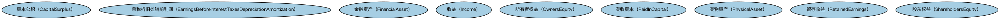

# 会计权益本体（Accounting Equity Ontology）结构与公理说明

本文档对应 `AccountingEquity.rdf` / `AccountingEquity.ttl`，说明该本体的类、继承关系、属性和公理约定。结构图见 `AccountingEquity-structure.png`（`AccountingEquity-structure.svg` 为可缩放版本）。

## 1. 本体概述

本本体定义权益相关概念，基于与企业的权益、债务、资产和负债相关的基本会计原则；权益是拥有某些形式公司实体的基础。

## 2. 类（Class）

| 类（Class） | 定义（Definition） |
|---|---|
| 资本公积（CapitalSurplus） | 超过股票面值或设定价值缴入的资本。 |
| 息税折旧摊销前利润（EarningsBeforeInterestTaxesDepreciationAmortization） | 扣除利息、所得税、折旧和摊销之前的收益，即 EBITDA。 |
| 金融资产（FinancialAsset） | 以现金、收取现金或其他金融资产的合同权利、或权益工具等形式存在的资产。 |
| 收益（Income） | 企业在一定期间内因经营活动获得的经济利益流入。 |
| 所有者权益（OwnersEquity） | 企业资产扣除负债后由所有者享有的剩余权益。 |
| 实收资本（PaidInCapital） | 投资者实际缴入企业的资本。 |
| 实物资产（PhysicalAsset） | 具有实物形态的资产。 |
| 留存收益（RetainedEarnings） | 企业历年累积未分配的利润。 |
| 股东权益（ShareholdersEquity） | 股东对企业净资产的所有权。 |

### 2.1 继承关系（Inheritance）

## 6. 依赖（owl:imports，3 个）

本本体通过 `owl:imports` 引入以下本体，各项的中文名称与简介如下：

| 导入本体 | 中文名称 | 简介 |
|---|---|---|
| `FND/OwnershipAndControl/Ownership.rdf` | 所有权本体（Ownership Ontology） | 定义「拥有」关系：所有者、被拥有资产及所有权份额。 |
| `FND/Utilities/AnnotationVocabulary.rdf` | FIBO 标注词汇表（FIBO Annotation Vocabulary） | 定义 FIBO 专用的标注属性（如释义来源、成熟度等级），用于本体自身的元数据标注。 |
| `https://www.omg.org/spec/Commons/AnnotationVocabulary/` | OMG 通用标注词汇表（OMG Commons Annotation Vocabulary） | OMG 通用本体库（Commons）中的标注词汇表，提供概念映射等标注属性，FIBO 用它标注术语与外部标准的对应关系。 |

## 7. 文件

- 官方 RDF/XML：`AccountingEquity.rdf`
- 中文 Turtle：`AccountingEquity.ttl`
- 结构图：`AccountingEquity-structure.png` / `AccountingEquity-structure.svg`