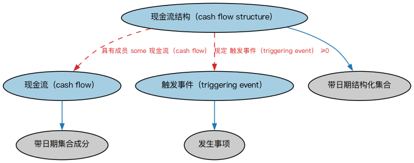

# 现金流本体（Cash Flows Ontology）结构与公理说明

本文档对应 `CashFlows.rdf` / `CashFlows.ttl`，说明该本体的类、继承关系、属性和公理约定。结构图见 `CashFlows-structure.png`（`CashFlows-structure.svg` 为可缩放版本）。

## 1. 本体概述

本本体定义现金流概念，供定义其他 FIBO 本体元素时使用。

## 2. 类（Class）

| 类（Class） | 定义（Definition） |
|---|---|
| 现金流（cash flow） | 资金从某来源到某去向的流动。 |
| 现金流结构（cash flow structure） | 与一个或多个现金流相关的结构。 |
| 触发事件（triggering event） | 与信用违约互换的某些方面相关或触发这些方面的事件。 |

### 2.1 继承关系（Inheritance）

- 现金流（cash flow） ⊑ 带日期集合成分
- 现金流结构（cash flow structure） ⊑ 带日期结构化集合
- 触发事件（triggering event） ⊑ 发生事项

## 3. 对象属性（Object Property）

| 属性（Property） | 中文（English） | 定义（Definition） | 说明 |
|---|---|---|---|
| fibo-fnd-acc-csf:hasSourceOfMoney | 具有资金来源（has source of funds） | 指某笔资金的来源。 | 子属性（subPropertyOf）：引用 |
| fibo-fnd-acc-csf:hasTargetOfMoney | 具有资金去向（has target of funds） | 指某笔资金的去向。 | 子属性（subPropertyOf）：引用 |

## 5. 公理约定（Axioms）

- 现金流（cash flow）：restriction
- 现金流（cash flow）：restriction
- 现金流（cash flow）：具有货币数量 货币数量 =1
- 现金流结构（cash flow structure）：具有进度表 进度表 ≤1
- 现金流结构（cash flow structure）：规定 触发事件（triggering event） ≥0
- 现金流结构（cash flow structure）：具有成员 some 现金流（cash flow）

## 6. 依赖（owl:imports，7 个）

本本体通过 `owl:imports` 引入以下本体，各项的中文名称与简介如下：

| 导入本体 | 中文名称 | 简介 |
|---|---|---|
| `FND/Accounting/CurrencyAmount.rdf` | 货币金额本体（Currency Amount Ontology） | 定义「金额＋币种」的货币金额（currency amount）表示，是 FIBO 中表达价格、债务金额、付款额等一切带币种数值的基础构件。 |
| `FND/DatesAndTimes/FinancialDates.rdf` | 金融日期本体（Financial Dates Ontology） | 定义金融语境下的日期与期间概念：结算日、付息日、到期日、日计数基准等。 |
| `FND/DatesAndTimes/Occurrences.rdf` | 事件与发生本体（Occurrences Ontology） | 定义「发生」（occurrence）、事件与触发条件，用于表达企业行动、信用事件等「发生了什么」。 |
| `FND/Utilities/AnnotationVocabulary.rdf` | FIBO 标注词汇表（FIBO Annotation Vocabulary） | 定义 FIBO 专用的标注属性（如释义来源、成熟度等级），用于本体自身的元数据标注。 |
| `https://www.omg.org/spec/Commons/AnnotationVocabulary/` | OMG 通用标注词汇表（OMG Commons Annotation Vocabulary） | OMG 通用本体库（Commons）中的标注词汇表，提供概念映射等标注属性，FIBO 用它标注术语与外部标准的对应关系。 |
| `https://www.omg.org/spec/Commons/Collections/` | OMG 通用集合本体（OMG Commons Collections） | Commons 库中的集合本体，定义集合、成员等通用概念。 |
| `https://www.omg.org/spec/Commons/Documents/` | OMG 通用文档本体（OMG Commons Documents） | Commons 库中的文档本体，定义文档及其组成部分的通用概念。 |

## 7. 文件

- 官方 RDF/XML：`CashFlows.rdf`
- 中文 Turtle：`CashFlows.ttl`
- 结构图：`CashFlows-structure.png` / `CashFlows-structure.svg`