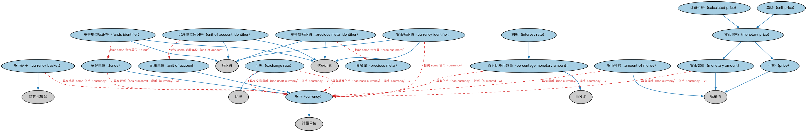

# 货币金额本体（Currency Amount Ontology）结构与公理说明

本文档对应 `CurrencyAmount.rdf` / `CurrencyAmount.ttl`，说明该本体的类、继承关系、属性和公理约定。结构图见 `CurrencyAmount-structure.png`（`CurrencyAmount-structure.svg` 为可缩放版本）。

## 1. 本体概述

定义货币金额（currency amount）的统一表示：「数值＋币种」的组合结构，是 FIBO 表达一切金额（价格、本金、付款、估值）的基础构件。

**在体系中的位置**：FND（基础）域会计模块的核心本体，处于全库最底层——凡涉及钱的概念都引用它。

**上下游关系**：上游依赖 FND 关系与度量相关概念；下游配套 ISO 4217 货币代码本体提供币种取值，被 FBC 定价、LOAN 贷款、SEC 债务等几乎所有模块引用。

**与相近概念的差别**：货币金额≠数字——同一数值配上不同币种是不同金额；与现金流的差别——金额是静态数值，现金流是金额随时间的流动。

本本体中类与类的核心关系如下（完整细节见各类小节）：

- **货币金额（amount of money）** 继承 **标量值（ScalarQuantityValue）**
- **计算价格（calculated price）** 继承 **货币价格（monetary price）**
- **货币（currency）** 继承 **计量单位（MeasurementUnit）**
- **货币篮子（currency basket）** 继承 **结构化集合（StructuredCollection）**
- **货币标识符（currency identifier）** 继承 **代码元素（CodeElement）**
- **货币标识符（currency identifier）** 继承 **标识符（Identifier）**
- **汇率（exchange rate）** 继承 **比率（Ratio）**
- **资金单位（funds）** 继承 **货币（currency）**
- **资金单位标识符（funds identifier）** 继承 **代码元素（CodeElement）**
- **资金单位标识符（funds identifier）** 继承 **标识符（Identifier）**
- **利率（interest rate）** 继承 **百分比货币数量（percentage monetary amount）**
- **货币数量（monetary amount）** 继承 **标量值（ScalarQuantityValue）**
- 其余 10 条关系从略。

## 2. 类（Class）

| 类（Class） | 定义（Definition） |
|---|---|
| 货币金额（amount of money） | 以纸币和硬币形式可随时动用的现金数量。 |
| 计算价格（calculated price） | 通过公式确定的货币价格。 |
| 货币（currency） | 交换价值的媒介，参照负责管理它的货币当局的地理位置来定义。 |
| 货币篮子（currency basket） | 选定的一组货币，以其加权平均值作为价值或债务数量的度量。 |
| 货币标识符（currency identifier） | 表示某种货币的字符序列。 |
| 汇率（exchange rate） | 一种货币可兑换为另一种货币的比率。 |
| 资金单位（funds） | 用作其他货币计算基准及会计用途的人造货币。 |
| 资金单位标识符（funds identifier） | 可用于唯一标识资金单位的字符序列。 |
| 利率（interest rate） | 为使用资产而支付的费用，以本金的百分比表示。 |
| 货币数量（monetary amount） | 以货币单位表示的一定金额的量。 |
| 货币价格（monetary price） | 以货币数量表示的价格。 |
| 百分比货币数量（percentage monetary amount） | 以占另一数量（某个名义数量或某个具体货币数量）的百分比表示的货币数量。 |
| 贵金属（precious metal） | 被认为稀有和/或具有高经济价值的金属。 |
| 贵金属标识符（precious metal identifier） | 在某情境中唯一标识贵金属的字符序列。 |
| 价格（price） | 为换取他物而要求、期望、需要或支付的货币、货物或服务的数量。 |
| 记账单位（unit of account） | 用于表示任何经济项目（货物、服务、资产、负债、收入等）实际价值（或成本）的名义货币计量单位。 |
| 记账单位标识符（unit of account identifier） | 可用于唯一标识名义货币单位的字符序列。 |
| 单价（unit price） | 以分配货物或服务所用的知名可测单位表示的货币价格。 |

以下按类逐个展开：每个类给出继承关系、相关属性与公理约定；子类在父类之下降一级编号。

### 2.1 货币金额（amount of money）

定义：以纸币和硬币形式可随时动用的现金数量。

- 父类：**标量值（ScalarQuantityValue）**

属性：

| 属性 | 定义 | 说明 |
|---|---|---|
| **具有货币（has currency）** | 指明某事物（如货币数量）据以计值的交换价值媒介。 | 值域：货币（currency）；子属性：具有计量单位 |

公理：

- **具有货币（has currency）**恰好有 1 个**货币（currency）**。

### 2.2 货币（currency）

定义：交换价值的媒介，参照负责管理它的货币当局的地理位置来定义。

- 父类：**计量单位（MeasurementUnit）**
- 直接子类：**资金单位（funds）**、**记账单位（unit of account）**

属性：

| 属性 | 定义 | 说明 |
|---|---|---|
| **具有辅币单位（has minor unit）** | 将货币辅币单位代码关联到货币或资金单位。 | 值域：xsd:string；子属性：具有文本值 |
| **具有数字代码（has numeric code）** | 将数字代码关联到某事物，如货币或资金单位。 | 值域：xsd:string；子属性：具有文本值 |
| **被……使用（isUsedBy）** | — | — |
| **具有文本名称（hasTextualName）** | — | — |

公理：

- **具有数字代码（has numeric code）**至少有一个取值，类型是**xsd:string（string）**。
- **具有文本名称（hasTextualName）**至少有一个取值，类型是**xsd:string（string）**。
- **具有辅币单位（has minor unit）**存在取值约束。
- **被……使用（isUsedBy）**至少有一个取值，类型是**地缘政治实体（GeopoliticalEntity）**。

#### 2.2.1 资金单位（funds）

定义：用作其他货币计算基准及会计用途的人造货币。

- 父类：**货币（currency）**

属性：

| 属性 | 定义 | 说明 |
|---|---|---|
| **具有货币（has currency）** | 指明某事物（如货币数量）据以计值的交换价值媒介。 | 值域：货币（currency）；子属性：具有计量单位 |
| **具有资金类型（has funds type）** | 标识资金类型，如美元资金的「次日」。 | 值域：xsd:string；子属性：具有文本值 |

公理：

- **具有货币（has currency）**恰好有 1 个**货币（currency）**。

#### 2.2.2 记账单位（unit of account）

定义：用于表示任何经济项目（货物、服务、资产、负债、收入等）实际价值（或成本）的名义货币计量单位。

- 父类：**货币（currency）**

### 2.3 货币篮子（currency basket）

定义：选定的一组货币，以其加权平均值作为价值或债务数量的度量。

- 父类：**结构化集合（StructuredCollection）**

属性：

| 属性 | 定义 | 说明 |
|---|---|---|
| **具有成员（hasMember）** | — | — |

公理：

- **具有成员（hasMember）**至少有一个取值，类型是**货币（currency）**。

### 2.4 货币标识符（currency identifier）

定义：表示某种货币的字符序列。

- 父类：**代码元素（CodeElement）**、**标识符（Identifier）**

属性：

| 属性 | 定义 | 说明 |
|---|---|---|
| **具有标签（hasTag）** | — | — |
| **标识（identifies）** | — | — |

公理：

- **具有标签（hasTag）**存在取值约束。
- **标识（identifies）**至少有一个取值，类型是**货币（currency）**。

### 2.5 汇率（exchange rate）

定义：一种货币可兑换为另一种货币的比率。

- 父类：**比率（Ratio）**

属性：

| 属性 | 定义 | 说明 |
|---|---|---|
| **具有基准货币（has base currency）** | 指明汇率中代表 R 单位交易货币的货币单位，R 为汇率值。 | 值域：货币（currency）；子属性：具有货币（has currency） |
| **具有交易货币（has dealt currency）** | 指明汇率中被兑换（目标）货币的货币单位；该货币 R 单位代表一单位基准货币。 | 值域：货币（currency）；子属性：具有货币（has currency） |
| **具有比率值（has rate value）** | 具有以数字（可为百分比或原始数字）表示的比率值。 | 值域：xsd:decimal；子属性：具有数值 |

公理：

- **具有交易货币（has dealt currency）**恰好有 1 个**货币（currency）**。
- **具有基准货币（has base currency）**恰好有 1 个**货币（currency）**。
- **具有比率值（has rate value）**存在取值约束。

### 2.6 资金单位标识符（funds identifier）

定义：可用于唯一标识资金单位的字符序列。

- 父类：**代码元素（CodeElement）**、**标识符（Identifier）**

属性：

| 属性 | 定义 | 说明 |
|---|---|---|
| **具有标签（hasTag）** | — | — |
| **标识（identifies）** | — | — |

公理：

- **具有标签（hasTag）**存在取值约束。
- **标识（identifies）**至少有一个取值，类型是**资金单位（funds）**。

### 2.7 货币数量（monetary amount）

定义：以货币单位表示的一定金额的量。

- 父类：**标量值（ScalarQuantityValue）**
- 直接子类：**货币价格（monetary price）**

属性：

| 属性 | 定义 | 说明 |
|---|---|---|
| **具有金额（has amount）** | 总数或总量。 | 值域：xsd:decimal；子属性：具有数值 |
| **具有货币（has currency）** | 指明某事物（如货币数量）据以计值的交换价值媒介。 | 值域：货币（currency）；子属性：具有计量单位 |

公理：

- **具有货币（has currency）**恰好有 1 个**货币（currency）**。
- **具有金额（has amount）**存在取值约束。

#### 2.7.1 货币价格（monetary price）

定义：以货币数量表示的价格。

- 父类：**货币数量（monetary amount）**、**价格（price）**
- 直接子类：**计算价格（calculated price）**、**单价（unit price）**

##### 2.7.1.1 计算价格（calculated price）

定义：通过公式确定的货币价格。

- 父类：**货币价格（monetary price）**

属性：

| 属性 | 定义 | 说明 |
|---|---|---|
| **具有表达式（hasExpression）** | — | — |

公理：

- **具有表达式（hasExpression）**恰好有 1 个**表达式（Expression）**。

##### 2.7.1.2 单价（unit price）

定义：以分配货物或服务所用的知名可测单位表示的货币价格。

- 父类：**货币价格（monetary price）**

属性：

| 属性 | 定义 | 说明 |
|---|---|---|
| **是……的价格（is price for）** | 将价格关联到其为之提供价值的事物。 | 逆属性：具有价格（has price）；子属性：引用 |

公理：

- **是……的价格（is price for）**至少有一个取值，类型是**owl:Thing（Thing）**。

### 2.8 百分比货币数量（percentage monetary amount）

定义：以占另一数量（某个名义数量或某个具体货币数量）的百分比表示的货币数量。

- 父类：**百分比（Percentage）**
- 直接子类：**利率（interest rate）**

属性：

| 属性 | 定义 | 说明 |
|---|---|---|
| **具有货币（has currency）** | 指明某事物（如货币数量）据以计值的交换价值媒介。 | 值域：货币（currency）；子属性：具有计量单位 |

公理：

- **具有货币（has currency）**恰好有 1 个**货币（currency）**。

#### 2.8.1 利率（interest rate）

定义：为使用资产而支付的费用，以本金的百分比表示。

- 父类：**百分比货币数量（percentage monetary amount）**

属性：

| 属性 | 定义 | 说明 |
|---|---|---|
| **具有比率值（has rate value）** | 具有以数字（可为百分比或原始数字）表示的比率值。 | 值域：xsd:decimal；子属性：具有数值 |

公理：

- **具有比率值（has rate value）**存在取值约束。

### 2.9 贵金属（precious metal）

定义：被认为稀有和/或具有高经济价值的金属。

属性：

| 属性 | 定义 | 说明 |
|---|---|---|
| **具有数字代码（has numeric code）** | 将数字代码关联到某事物，如货币或资金单位。 | 值域：xsd:string；子属性：具有文本值 |
| **具有文本名称（hasTextualName）** | — | — |

公理：

- **具有数字代码（has numeric code）**存在取值约束。
- **具有文本名称（hasTextualName）**至少有一个取值，类型是**xsd:string（string）**。

### 2.10 贵金属标识符（precious metal identifier）

定义：在某情境中唯一标识贵金属的字符序列。

- 父类：**代码元素（CodeElement）**、**标识符（Identifier）**

属性：

| 属性 | 定义 | 说明 |
|---|---|---|
| **具有标签（hasTag）** | — | — |
| **标识（identifies）** | — | — |

公理：

- **具有标签（hasTag）**存在取值约束。
- **标识（identifies）**至少有一个取值，类型是**贵金属（precious metal）**。

### 2.11 价格（price）

定义：为换取他物而要求、期望、需要或支付的货币、货物或服务的数量。

- 父类：**标量值（ScalarQuantityValue）**
- 直接子类：**货币价格（monetary price）**

属性：

| 属性 | 定义 | 说明 |
|---|---|---|
| **是……的价格（is price for）** | 将价格关联到其为之提供价值的事物。 | 逆属性：具有价格（has price）；子属性：引用 |

### 2.12 记账单位标识符（unit of account identifier）

定义：可用于唯一标识名义货币单位的字符序列。

- 父类：**代码元素（CodeElement）**、**标识符（Identifier）**

属性：

| 属性 | 定义 | 说明 |
|---|---|---|
| **具有标签（hasTag）** | — | — |
| **标识（identifies）** | — | — |

公理：

- **具有标签（hasTag）**存在取值约束。
- **标识（identifies）**至少有一个取值，类型是**记账单位（unit of account）**。

## 3. 其他属性

以下属性未绑定到本体的具体类（定义域在外部本体或未声明）：

对象属性（Object Property）：

| 属性 | 定义 | 说明 |
|---|---|---|
| **具有货币数量（has monetary amount）** | 以金额及其计值货币指明某事物的价值。 | 值域：货币数量（monetary amount）；子属性：具有量值 |
| **具有名义金额（has notional amount）** | 具有一个通常不变、用于特定计算、以某货币数量表示的值。 | 值域：货币数量（monetary amount）；子属性：具有货币数量（has monetary amount） |
| **具有价格（has price）** | 标识以货币或货物数量表示的某事物的价值。 | 值域：价格（price）；子属性：具有量值 |

## 4. 依赖（owl:imports，11 个）

本本体通过 `owl:imports` 引入以下本体，各项的中文名称与简介如下：

| 导入本体 | 中文名称 | 简介 |
|---|---|---|
| `FND/Utilities/AnnotationVocabulary.rdf` | FIBO 标注词汇表（FIBO Annotation Vocabulary） | 定义 FIBO 专用的标注属性（如释义来源、成熟度等级），用于本体自身的元数据标注。 |
| `https://www.omg.org/spec/Commons/AnnotationVocabulary/` | OMG 通用标注词汇表（OMG Commons Annotation Vocabulary） | OMG 通用本体库（Commons）中的标注词汇表，提供概念映射等标注属性，FIBO 用它标注术语与外部标准的对应关系。 |
| `https://www.omg.org/spec/Commons/CodesAndCodeSets/` | OMG 通用代码与代码集本体（OMG Commons Codes and Code Sets） | Commons 库中的代码本体，定义代码、代码集及其维护方的通用概念，是 ISO 4217、ISO 3166 等编码体系建模的基础。 |
| `https://www.omg.org/spec/Commons/Collections/` | OMG 通用集合本体（OMG Commons Collections） | Commons 库中的集合本体，定义集合、成员等通用概念。 |
| `https://www.omg.org/spec/Commons/ContextualDesignators/` | OMG 通用语境指称本体（OMG Commons Contextual Designators） | Commons 库中的语境指称本体，定义「在某个语境下指代某物的名称/符号」，是地址、账户号码等语境相关标识的基础。 |
| `https://www.omg.org/spec/Commons/Designators/` | OMG 通用指称符本体（OMG Commons Designators） | Commons 库中的指称符本体，定义名称、标识符等「指代某物的符号」的通用概念。 |
| `https://www.omg.org/spec/Commons/Documents/` | OMG 通用文档本体（OMG Commons Documents） | Commons 库中的文档本体，定义文档及其组成部分的通用概念。 |
| `https://www.omg.org/spec/Commons/Identifiers/` | OMG 通用标识符本体（OMG Commons Identifiers） | Commons 库中的标识符本体，定义标识符及其编码方案的通用概念。 |
| `https://www.omg.org/spec/Commons/Locations/` | OMG 通用位置本体（OMG Commons Locations） | Commons 库中的位置本体，定义地理位置、地点的通用概念。 |
| `https://www.omg.org/spec/Commons/QuantitiesAndUnits/` | OMG 通用量与单位本体（OMG Commons Quantities and Units） | Commons 库中的量与单位本体，定义数量、度量单位、量纲的通用概念，支撑金额、比率等数值表达。 |
| `https://www.omg.org/spec/Commons/TextDatatype/` | OMG 通用文本数据类型（OMG Commons Text Datatype） | Commons 库中的文本数据类型定义，提供带语言标记的文本等基础数据类型。 |

## 5. 文件

- 官方 RDF/XML：`CurrencyAmount.rdf`
- 中文 Turtle：`CurrencyAmount.ttl`
- 结构图：`CurrencyAmount-structure.png` / `CurrencyAmount-structure.svg`