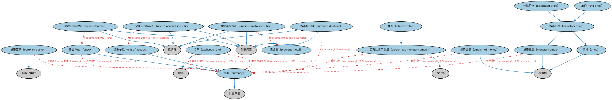

# 货币金额本体（Currency Amount Ontology）结构与公理说明

本文档对应 `CurrencyAmount.rdf` / `CurrencyAmount.ttl`，说明该本体的类、继承关系、属性和公理约定。结构图见 `CurrencyAmount-structure.png`（`CurrencyAmount-structure.svg` 为可缩放版本）。

## 1. 本体概述

定义货币金额（currency amount）的统一表示：「数值＋币种」的组合结构，是 FIBO 表达一切金额（价格、本金、付款、估值）的基础构件。

**在体系中的位置**：FND（基础）域会计模块的核心本体，处于全库最底层——凡涉及钱的概念都引用它。

**上下游关系**：上游依赖 FND 关系与度量相关概念；下游配套 ISO 4217 货币代码本体提供币种取值，被 FBC 定价、LOAN 贷款、SEC 债务等几乎所有模块引用。

**与相近概念的差别**：货币金额≠数字——同一数值配上不同币种是不同金额；与现金流的差别——金额是静态数值，现金流是金额随时间的流动。

## 2. 类（Class）

| 类（Class） | 定义（Definition） |
|---|---|
| 货币金额（amount of money） | 以纸币和硬币形式可随时动用的现金数量。 |
| 计算价格（calculated price） | 通过公式确定的货币价格。 |
| 货币（currency） | 交换价值的媒介，参照负责管理它的货币当局的地理位置来定义。 |
| 货币篮子（currency basket） | 选定的一组货币，以其加权平均值作为价值或债务数量的度量。 |
| 货币标识符（currency identifier） | 表示某种货币的字符序列。 |
| 汇率（exchange rate） | 一种货币可兑换为另一种货币的比率。 |
| 资金单位（funds） | 用作其他货币计算基准及会计用途的人造货币。 |
| 资金单位标识符（funds identifier） | 可用于唯一标识资金单位的字符序列。 |
| 利率（interest rate） | 为使用资产而支付的费用，以本金的百分比表示。 |
| 货币数量（monetary amount） | 以货币单位表示的一定金额的量。 |
| 货币价格（monetary price） | 以货币数量表示的价格。 |
| 百分比货币数量（percentage monetary amount） | 以占另一数量（某个名义数量或某个具体货币数量）的百分比表示的货币数量。 |
| 贵金属（precious metal） | 被认为稀有和/或具有高经济价值的金属。 |
| 贵金属标识符（precious metal identifier） | 在某情境中唯一标识贵金属的字符序列。 |
| 价格（price） | 为换取他物而要求、期望、需要或支付的货币、货物或服务的数量。 |
| 记账单位（unit of account） | 用于表示任何经济项目（货物、服务、资产、负债、收入等）实际价值（或成本）的名义货币计量单位。 |
| 记账单位标识符（unit of account identifier） | 可用于唯一标识名义货币单位的字符序列。 |
| 单价（unit price） | 以分配货物或服务所用的知名可测单位表示的货币价格。 |

### 2.1 继承关系（Inheritance）

- 货币金额（amount of money） ⊑ 标量值
- 计算价格（calculated price） ⊑ 货币价格（monetary price）
- 货币（currency） ⊑ 计量单位
- 货币篮子（currency basket） ⊑ 结构化集合
- 货币标识符（currency identifier） ⊑ 代码元素
- 货币标识符（currency identifier） ⊑ 标识符
- 汇率（exchange rate） ⊑ 比率
- 资金单位（funds） ⊑ 货币（currency）
- 资金单位标识符（funds identifier） ⊑ 代码元素
- 资金单位标识符（funds identifier） ⊑ 标识符
- 利率（interest rate） ⊑ 百分比货币数量（percentage monetary amount）
- 货币数量（monetary amount） ⊑ 标量值
- 货币价格（monetary price） ⊑ 货币数量（monetary amount）
- 货币价格（monetary price） ⊑ 价格（price）
- 百分比货币数量（percentage monetary amount） ⊑ 百分比
- 贵金属标识符（precious metal identifier） ⊑ 代码元素
- 贵金属标识符（precious metal identifier） ⊑ 标识符
- 价格（price） ⊑ 标量值
- 记账单位（unit of account） ⊑ 货币（currency）
- 记账单位标识符（unit of account identifier） ⊑ 代码元素
- 记账单位标识符（unit of account identifier） ⊑ 标识符
- 单价（unit price） ⊑ 货币价格（monetary price）

## 3. 对象属性（Object Property）

| 属性（Property） | 中文（English） | 定义（Definition） | 说明 |
|---|---|---|---|
| fibo-fnd-acc-cur:hasBaseCurrency | 具有基准货币（has base currency） | 指明汇率中代表 R 单位交易货币的货币单位，R 为汇率值。 | 值域（range）：货币（currency）；子属性（subPropertyOf）：具有货币（has currency） |
| fibo-fnd-acc-cur:hasCurrency | 具有货币（has currency） | 指明某事物（如货币数量）据以计值的交换价值媒介。 | 值域（range）：货币（currency）；子属性（subPropertyOf）：具有计量单位 |
| fibo-fnd-acc-cur:hasDealtCurrency | 具有交易货币（has dealt currency） | 指明汇率中被兑换（目标）货币的货币单位；该货币 R 单位代表一单位基准货币。 | 值域（range）：货币（currency）；子属性（subPropertyOf）：具有货币（has currency） |
| fibo-fnd-acc-cur:hasMonetaryAmount | 具有货币数量（has monetary amount） | 以金额及其计值货币指明某事物的价值。 | 值域（range）：货币数量（monetary amount）；子属性（subPropertyOf）：具有量值 |
| fibo-fnd-acc-cur:hasNotionalAmount | 具有名义金额（has notional amount） | 具有一个通常不变、用于特定计算、以某货币数量表示的值。 | 值域（range）：货币数量（monetary amount）；子属性（subPropertyOf）：具有货币数量（has monetary amount） |
| fibo-fnd-acc-cur:hasPrice | 具有价格（has price） | 标识以货币或货物数量表示的某事物的价值。 | 值域（range）：价格（price）；子属性（subPropertyOf）：具有量值 |
| fibo-fnd-acc-cur:isPriceFor | 是……的价格（is price for） | 将价格关联到其为之提供价值的事物。 | 定义域（domain）：价格（price）；逆属性（inverseOf）：具有价格（has price）；子属性（subPropertyOf）：引用 |

## 4. 数据属性（Datatype Property）

| 属性（Property） | 中文（English） | 定义（Definition） |
|---|---|---|
| fibo-fnd-acc-cur:hasAmount | 具有金额（has amount） | 总数或总量。 |
| fibo-fnd-acc-cur:hasFundsType | 具有资金类型（has funds type） | 标识资金类型，如美元资金的「次日」。 |
| fibo-fnd-acc-cur:hasMinorUnit | 具有辅币单位（has minor unit） | 将货币辅币单位代码关联到货币或资金单位。 |
| fibo-fnd-acc-cur:hasNumericCode | 具有数字代码（has numeric code） | 将数字代码关联到某事物，如货币或资金单位。 |
| fibo-fnd-acc-cur:hasRateValue | 具有比率值（has rate value） | 具有以数字（可为百分比或原始数字）表示的比率值。 |

## 5. 公理约定（Axioms）

- 货币金额（amount of money）：具有货币（has currency） 货币（currency） =1
- 计算价格（calculated price）：具有表达式 表达式 =1
- 货币（currency）：restriction
- 货币（currency）：具有数字代码（has numeric code） some xsd:string
- 货币（currency）：被……使用 some 地缘政治实体
- 货币（currency）：具有文本名称 some xsd:string
- 货币篮子（currency basket）：具有成员 some 货币（currency）
- 货币标识符（currency identifier）：restriction
- 货币标识符（currency identifier）：标识 some 货币（currency）
- 汇率（exchange rate）：具有基准货币（has base currency） 货币（currency） =1
- 汇率（exchange rate）：具有交易货币（has dealt currency） 货币（currency） =1
- 汇率（exchange rate）：restriction
- 资金单位（funds）：具有货币（has currency） 货币（currency） =1
- 资金单位标识符（funds identifier）：restriction
- 资金单位标识符（funds identifier）：标识 some 资金单位（funds）
- 利率（interest rate）：restriction
- 货币数量（monetary amount）：具有货币（has currency） 货币（currency） =1
- 货币数量（monetary amount）：restriction
- 百分比货币数量（percentage monetary amount）：具有货币（has currency） 货币（currency） =1
- 贵金属（precious metal）：restriction
- 贵金属（precious metal）：具有文本名称 some xsd:string
- 贵金属标识符（precious metal identifier）：restriction
- 贵金属标识符（precious metal identifier）：标识 some 贵金属（precious metal）
- 记账单位标识符（unit of account identifier）：restriction
- 记账单位标识符（unit of account identifier）：标识 some 记账单位（unit of account）
- 单价（unit price）：是……的价格（is price for） some owl:Thing

## 6. 依赖（owl:imports，11 个）

本本体通过 `owl:imports` 引入以下本体，各项的中文名称与简介如下：

| 导入本体 | 中文名称 | 简介 |
|---|---|---|
| `FND/Utilities/AnnotationVocabulary.rdf` | FIBO 标注词汇表（FIBO Annotation Vocabulary） | 定义 FIBO 专用的标注属性（如释义来源、成熟度等级），用于本体自身的元数据标注。 |
| `https://www.omg.org/spec/Commons/AnnotationVocabulary/` | OMG 通用标注词汇表（OMG Commons Annotation Vocabulary） | OMG 通用本体库（Commons）中的标注词汇表，提供概念映射等标注属性，FIBO 用它标注术语与外部标准的对应关系。 |
| `https://www.omg.org/spec/Commons/CodesAndCodeSets/` | OMG 通用代码与代码集本体（OMG Commons Codes and Code Sets） | Commons 库中的代码本体，定义代码、代码集及其维护方的通用概念，是 ISO 4217、ISO 3166 等编码体系建模的基础。 |
| `https://www.omg.org/spec/Commons/Collections/` | OMG 通用集合本体（OMG Commons Collections） | Commons 库中的集合本体，定义集合、成员等通用概念。 |
| `https://www.omg.org/spec/Commons/ContextualDesignators/` | OMG 通用语境指称本体（OMG Commons Contextual Designators） | Commons 库中的语境指称本体，定义「在某个语境下指代某物的名称/符号」，是地址、账户号码等语境相关标识的基础。 |
| `https://www.omg.org/spec/Commons/Designators/` | OMG 通用指称符本体（OMG Commons Designators） | Commons 库中的指称符本体，定义名称、标识符等「指代某物的符号」的通用概念。 |
| `https://www.omg.org/spec/Commons/Documents/` | OMG 通用文档本体（OMG Commons Documents） | Commons 库中的文档本体，定义文档及其组成部分的通用概念。 |
| `https://www.omg.org/spec/Commons/Identifiers/` | OMG 通用标识符本体（OMG Commons Identifiers） | Commons 库中的标识符本体，定义标识符及其编码方案的通用概念。 |
| `https://www.omg.org/spec/Commons/Locations/` | OMG 通用位置本体（OMG Commons Locations） | Commons 库中的位置本体，定义地理位置、地点的通用概念。 |
| `https://www.omg.org/spec/Commons/QuantitiesAndUnits/` | OMG 通用量与单位本体（OMG Commons Quantities and Units） | Commons 库中的量与单位本体，定义数量、度量单位、量纲的通用概念，支撑金额、比率等数值表达。 |
| `https://www.omg.org/spec/Commons/TextDatatype/` | OMG 通用文本数据类型（OMG Commons Text Datatype） | Commons 库中的文本数据类型定义，提供带语言标记的文本等基础数据类型。 |

## 7. 文件

- 官方 RDF/XML：`CurrencyAmount.rdf`
- 中文 Turtle：`CurrencyAmount.ttl`
- 结构图：`CurrencyAmount-structure.png` / `CurrencyAmount-structure.svg`