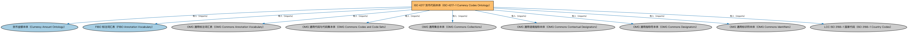

# ISO 4217 货币代码本体（ISO 4217-1 Currency Codes Ontology）说明

本文档对应 `ISO4217-CurrencyCodes.rdf` / `ISO4217-CurrencyCodes.ttl`。

## 1. 本文件是什么

收录 ISO 4217-1 标准的全部货币代码个体（如 USD、CNY、EUR），为货币金额提供标准化的币种取值。

从机制上说，这是一个个体（individuals）文件：它本身不定义任何新的类或属性，装的全是命名个体（owl:NamedIndividual）——也就是一条条真实存在的实例数据（如具体的货币、市场、监管机构、法域）。它的 `owl:imports` 引入的是这些个体所属的类定义所在的本体。应用需要实例级参考数据时加载这类文件。

## 2. 个体构成（共 359 个）

按个体所属类型统计（类型名为中文（English）对照）：

| 类型（Class） | 个体数量 |
|---|---|
| 货币标识符（CurrencyIdentifier） | 163 |
| 货币（Currency） | 158 |
| 资金单位（Funds） | 9 |
| 资金单位标识符（FundsIdentifier） | 8 |
| 记账单位（UnitOfAccount） | 6 |
| 记账单位标识符（UnitOfAccountIdentifier） | 6 |
| 贵金属（PreciousMetal） | 4 |
| 贵金属标识符（PreciousMetalIdentifier） | 4 |
| 代码集（CodeSet） | 1 |
| 标识方案（IdentificationScheme） | 1 |

个体数量较多，仅举前 10 个示例，完整清单见同名 `.ttl` 文件：

| 个体（示例） | 类型 |
|---|---|
| ADB Unit of Account | 记账单位（UnitOfAccount） |
| AED | 货币标识符（CurrencyIdentifier） |
| AFN | 货币标识符（CurrencyIdentifier） |
| ALL | 货币标识符（CurrencyIdentifier） |
| AMD | 货币标识符（CurrencyIdentifier） |
| ANG | 货币标识符（CurrencyIdentifier） |
| AOA | 货币标识符（CurrencyIdentifier） |
| ARS | 货币标识符（CurrencyIdentifier） |
| AUD | 货币标识符（CurrencyIdentifier） |
| AWG | 货币标识符（CurrencyIdentifier） |

## 3. 依赖的本体（owl:imports，9 个）

以下导入提供个体所属的类定义与相关参考数据：

| 导入本体 | 中文名称 | 简介 |
|---|---|---|
| `FND/Accounting/CurrencyAmount.rdf` | 货币金额本体（Currency Amount Ontology） | 定义「金额＋币种」的货币金额（currency amount）表示，是 FIBO 中表达价格、债务金额、付款额等一切带币种数值的基础构件。 |
| `FND/Utilities/AnnotationVocabulary.rdf` | FIBO 标注词汇表（FIBO Annotation Vocabulary） | 定义 FIBO 专用的标注属性（如释义来源、成熟度等级），用于本体自身的元数据标注。 |
| `https://www.omg.org/spec/Commons/AnnotationVocabulary/` | OMG 通用标注词汇表（OMG Commons Annotation Vocabulary） | OMG 通用本体库（Commons）中的标注词汇表，提供概念映射等标注属性，FIBO 用它标注术语与外部标准的对应关系。 |
| `https://www.omg.org/spec/Commons/CodesAndCodeSets/` | OMG 通用代码与代码集本体（OMG Commons Codes and Code Sets） | Commons 库中的代码本体，定义代码、代码集及其维护方的通用概念，是 ISO 4217、ISO 3166 等编码体系建模的基础。 |
| `https://www.omg.org/spec/Commons/Collections/` | OMG 通用集合本体（OMG Commons Collections） | Commons 库中的集合本体，定义集合、成员等通用概念。 |
| `https://www.omg.org/spec/Commons/ContextualDesignators/` | OMG 通用语境指称本体（OMG Commons Contextual Designators） | Commons 库中的语境指称本体，定义「在某个语境下指代某物的名称/符号」，是地址、账户号码等语境相关标识的基础。 |
| `https://www.omg.org/spec/Commons/Designators/` | OMG 通用指称符本体（OMG Commons Designators） | Commons 库中的指称符本体，定义名称、标识符等「指代某物的符号」的通用概念。 |
| `https://www.omg.org/spec/Commons/Identifiers/` | OMG 通用标识符本体（OMG Commons Identifiers） | Commons 库中的标识符本体，定义标识符及其编码方案的通用概念。 |
| `https://www.omg.org/spec/LCC/Countries/ISO3166-1-CountryCodes/` | LCC ISO 3166-1 国家代码（ISO 3166-1 Country Codes） | LCC 中 ISO 3166-1 标准的国家/地区代码个体集（如 CN、US、MX），供法域与地址建模引用。 |

## 4. 文件

- 官方 RDF/XML：`ISO4217-CurrencyCodes.rdf`
- 中文 Turtle：`ISO4217-CurrencyCodes.ttl`
- 结构图：`ISO4217-CurrencyCodes-structure.png` / `ISO4217-CurrencyCodes-structure.svg`