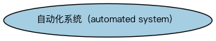

# 智能体本体（Agents Ontology）结构与公理说明

本文档对应 `Agents.rdf` / `Agents.ttl`，说明该本体的类、继承关系、属性和公理约定。结构图见 `Agents-structure.png`（`Agents-structure.svg` 为可缩放版本）。

## 1. 本体概述

本本体扩展 Commons 1.1 参与方与情境本体，定义软件系统的概念，该系统可能是也可能不是自主的。原本在此定义的其他概念已被 Commons 中的对应概念取代。

## 2. 类（Class）

| 类（Class） | 定义（Definition） |
|---|---|
| 自动化系统（automated system） | 自动执行任务的系统。 |

### 2.1 继承关系（Inheritance）

## 6. 依赖（owl:imports，2 个）

本本体通过 `owl:imports` 引入以下本体，各项的中文名称与简介如下：

| 导入本体 | 中文名称 | 简介 |
|---|---|---|
| `FND/Utilities/AnnotationVocabulary.rdf` | FIBO 标注词汇表（FIBO Annotation Vocabulary） | 定义 FIBO 专用的标注属性（如释义来源、成熟度等级），用于本体自身的元数据标注。 |
| `https://www.omg.org/spec/Commons/AnnotationVocabulary/` | OMG 通用标注词汇表（OMG Commons Annotation Vocabulary） | OMG 通用本体库（Commons）中的标注词汇表，提供概念映射等标注属性，FIBO 用它标注术语与外部标准的对应关系。 |

## 7. 文件

- 官方 RDF/XML：`Agents.rdf`
- 中文 Turtle：`Agents.ttl`
- 结构图：`Agents-structure.png` / `Agents-structure.svg`