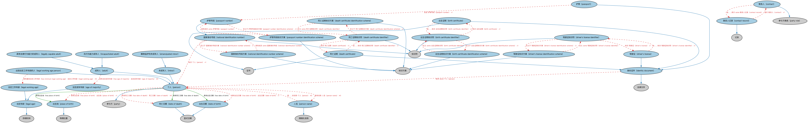

# 人员本体（People Ontology）结构与公理说明

本文档对应 `People.rdf` / `People.ttl`，说明该本体的类、继承关系、属性和公理约定。结构图见 `People-structure.png`（`People-structure.svg` 为可缩放版本）。

## 1. 本体概述

定义自然人（person）的核心属性：姓名、出生日期、国籍、身份标识、联系方式与家庭/社会关系。

**在体系中的位置**：FND 代理人与人员模块的核心，是雇员、客户、签署人、高管等一切「人」角色的基础。

**上下游关系**：上游依赖 FND 参与方与关系本体；下游被 BE 高管、FBC 客户、LOAN 借款人等引用。

**与相近概念的差别**：自然人≠法律主体——自然人是生物学意义上的人，法律主体是能持有权利义务的主体（含法人）；人≠参与方——人只有进入某个业务关系（签约、任职）才成为参与方。

## 2. 类（Class）

| 类（Class） | 定义（Definition） |
|---|---|
| 成年人（adult） | 在某管辖区达到法定成年年龄的人。 |
| 法定成年年龄（age of majority） | 在某管辖区获得成年人权利与责任的年龄。 |
| 出生证明（birth certificate） | 证明出生情况的原始文件，或该出生登记的认证副本或表示。 |
| 出生证明标识方案（birth certificate identification scheme） | 为出生证明分配标识符的体系。 |
| 出生证明标识符（birth certificate identifier） | 与记录儿童出生的生命统计记录关联的标识符。 |
| 联系人（contact） | 作为指定联络点的参与方所扮演的角色，通常在某个系统或过程中。 |
| 联系人记录（contact record） | 关于处于特定通信或联络角色的参与方的记录。 |
| 出生日期（date of birth） | 个人出生的显式日期（年、月、日）。 |
| 死亡日期（date of death） | 个人死亡的显式日期（年、月、日）。 |
| 死亡证明（death certificate） | 证明死亡情况（如死亡方式与时间）的原始文件，或该死亡登记的认证副本或表示。 |
| 死亡证明标识方案（death certificate identification scheme） | 为死亡证明分配标识符的体系。 |
| 死亡证明标识符（death certificate identifier） | 与记录个人死亡的生命统计记录关联的标识符。 |
| 驾驶证（driver's license） | 声明某人可在公共道路上驾驶机动车辆（如摩托车、汽车、卡车或公共汽车）的官方文件。 |
| 驾驶证标识方案（driver's license identification scheme） | 为驾驶证、操作证或非驾驶身份证件分配标识符的体系。 |
| 驾驶证标识符（driver's license identifier） | 与机动车驾驶执照或非驾驶身份卡关联的标识符。 |
| 解除监护的未成年人（emancipated minor） | 获准在不受父母控制的情况下以自己名义或为自己账户经营业务或从事其他职业的未成年人。 |
| 身份证件（identity document） | 可用于核验个人身份各个方面的任何法律文件。 |
| 无行为能力成年人（incapacitated adult） | 在法律上被认定为不具有法律行为能力的成年人，通常因某种固有的身心障碍所致。 |
| 法定年龄（legal age） | 在某管辖区获得做法律此前禁止之事的能力的年龄。 |
| 法定工作年龄（legal working age） | 在某管辖区获得合法工作能力的年龄。 |
| 达到法定工作年龄的人（legal working age person） | 年龄大于其工作所在管辖区规定的最低法定工作年龄的人。 |
| 具有法律行为能力的成年人（legally capable adult） | 在某管辖区达到法定成年年龄、并获准以自己名义经营业务或从事其他职业的人。 |
| 未成年人（minor） | 低于某一年龄（通常是给定管辖区的法定成年年龄）的人，该年龄在法律上划分童年与成年。 |
| 国家身份号码（national identification number） | 出现在由国家或管辖区签发的身份证件上的号码或文字。 |
| 国家身份号码方案（national identification number scheme） | 为国家身份号码分配标识符的体系。 |
| 护照（passport） | 由国家政府签发的正式身份证件，为国际旅行目的证明持有人的身份与国籍。 |
| 护照号码（passport number） | 与护照关联的国家身份号码。 |
| 护照号码标识方案（passport number identification scheme） | 为护照分配标识符的体系。 |
| 个人（person） | 具有自我意识的个体人类。 |
| 人名（person name） | 某人在某情境中为人所知的指称。 |
| 出生地（place of birth） | 个人出生的物理位置，包括国家、地区和市政区。 |

### 2.1 继承关系（Inheritance）

- 成年人（adult） ⊑ 个人（person）
- 法定成年年龄（age of majority） ⊑ 法定年龄（legal age）
- 出生证明（birth certificate） ⊑ 身份证件（identity document）
- 出生证明（birth certificate） ⊑ 证书
- 出生证明标识方案（birth certificate identification scheme） ⊑ 标识方案
- 出生证明标识符（birth certificate identifier） ⊑ 标识符
- 联系人（contact） ⊑ 参与方角色（party role）
- 联系人记录（contact record） ⊑ 记录
- 出生日期（date of birth） ⊑ 显式日期
- 死亡日期（date of death） ⊑ 显式日期
- 死亡证明（death certificate） ⊑ 身份证件（identity document）
- 死亡证明（death certificate） ⊑ 证书
- 死亡证明标识方案（death certificate identification scheme） ⊑ 标识方案
- 死亡证明标识符（death certificate identifier） ⊑ 标识符
- 驾驶证（driver's license） ⊑ 身份证件（identity document）
- 驾驶证标识方案（driver's license identification scheme） ⊑ 标识方案
- 驾驶证标识符（driver's license identifier） ⊑ 标识符
- 解除监护的未成年人（emancipated minor） ⊑ 未成年人（minor）
- 身份证件（identity document） ⊑ 法律文件
- 无行为能力成年人（incapacitated adult） ⊑ 成年人（adult）
- 法定年龄（legal age） ⊑ 存续时间
- 法定工作年龄（legal working age） ⊑ 法定年龄（legal age）
- 达到法定工作年龄的人（legal working age person） ⊑ 个人（person）
- 具有法律行为能力的成年人（legally capable adult） ⊑ 成年人（adult）
- 未成年人（minor） ⊑ 个人（person）
- 国家身份号码（national identification number） ⊑ 标识符
- 国家身份号码方案（national identification number scheme） ⊑ 标识方案
- 护照（passport） ⊑ 身份证件（identity document）
- 护照号码（passport number） ⊑ 国家身份号码（national identification number）
- 护照号码标识方案（passport number identification scheme） ⊑ 标识方案
- 个人（person） ⊑ 参与方（party）
- 人名（person name） ⊑ 情境化名称
- 出生地（place of birth） ⊑ 物理位置

## 3. 对象属性（Object Property）

| 属性（Property） | 中文（English） | 定义（Definition） | 说明 |
|---|---|---|---|
| fibo-fnd-aap-ppl:hasAgeOfMajority | 具有法定成年年龄（has age of majority） | 将某人关联到在某管辖区获得从事特定交易能力或被法律视为成年人所需的年龄。 | 值域（range）：法定成年年龄（age of majority）；子属性（subPropertyOf）：具有存续时间 |
| fibo-fnd-aap-ppl:hasCitizenship | 具有国籍（has citizenship） | 将个人关联到其国籍国。 | 定义域（domain）：个人（person）；值域（range）：国家；子属性（subPropertyOf）：由……分类 |
| fibo-fnd-aap-ppl:hasDateOfBirth | 具有出生日期（has date of birth） | 标识个人出生的日期。 | 定义域（domain）：个人（person）；值域（range）：出生日期（date of birth）；子属性（subPropertyOf）：具有显式日期 |
| fibo-fnd-aap-ppl:hasDateOfDeath | 具有死亡日期（has date of death） | 标识个人死亡的日期。 | 定义域（domain）：个人（person）；值域（range）：死亡日期（date of death）；子属性（subPropertyOf）：具有显式日期 |
| fibo-fnd-aap-ppl:hasMinimumLegalWorkingAge | 具有最低法定工作年龄（has minimum legal working age） | 将某人关联到其居住管辖区的最低法定工作年龄。 | 值域（range）：法定工作年龄（legal working age）；子属性（subPropertyOf）：具有存续时间 |
| fibo-fnd-aap-ppl:hasPlaceOfBirth | 具有出生地（has place of birth） | 标识个人出生的位置。 | 定义域（domain）：个人（person）；值域（range）：出生地（place of birth）；子属性（subPropertyOf）：以……为特征 |
| fibo-fnd-aap-ppl:hasPointOfContact | 具有联络点（has point of contact） | 标识被指定为联络点的参与方。 | 值域（range）：联系人（contact）；子属性（subPropertyOf）：具有角色（has role） |
| fibo-fnd-aap-ppl:hasPrimaryResidence | 具有主要居所（has primary residence） | 标识个人一年中大部分时间居住的住所。 | 定义域（domain）：个人（person）；值域（range）：常规街道地址；子属性（subPropertyOf）：具有居所（has residence） |
| fibo-fnd-aap-ppl:hasResidence | 具有居所（has residence） | 标识个人居住的住所。 | 定义域（domain）：个人（person）；值域（range）：常规街道地址；子属性（subPropertyOf）：具有地址 |
| fibo-fnd-aap-ppl:isPointOfContactFor | 是……的联络点（is point of contact for） | 是该参与方作为联络点所服务的实体或目的。 | 定义域（domain）：联系人（contact）；逆属性（inverseOf）：具有联络点（has point of contact）；子属性（subPropertyOf）：具有角色（has role） |

## 4. 数据属性（Datatype Property）

| 属性（Property） | 中文（English） | 定义（Definition） |
|---|---|---|
| fibo-fnd-aap-ppl:hasFamilyName | 具有姓氏（has family name） | 标识家庭成员共有的、区别于各成员名字的姓。 |
| fibo-fnd-aap-ppl:hasFirstName | 具有名字（has first name） | 标识个人的名，即出生时为其选取或其后更改的名字。 |
| fibo-fnd-aap-ppl:hasFullLegalName | 具有完整法定姓名（has full legal name） | 标识个人的完整姓名，通常用于正式场合（包括法律或合同性质的场合）。 |
| fibo-fnd-aap-ppl:hasGender | 具有性别（has gender） | 将特定性别值与个人关联。 |
| fibo-fnd-aap-ppl:hasGivenName | 具有名（has given name） | 标识个人的名，即出生时为其选取或其后更改的名字。 |
| fibo-fnd-aap-ppl:hasLastName | 具有姓（has last name） | 标识家庭成员共有的、区别于各成员名字的姓。 |
| fibo-fnd-aap-ppl:hasMaidenName | 具有婚前姓（has maiden name） | 标识因婚姻而改姓之前的家族姓氏。 |
| fibo-fnd-aap-ppl:hasMiddleNameOrInitial | 具有中间名或首字母（has middle name or initial） | 位于个人名与姓之间的一个或多个附加名字或首字母。 |
| fibo-fnd-aap-ppl:hasNamePrefix | 具有姓名前缀（has name prefix） | 标识位于个人姓名之前、提供其附加信息（如头衔、敬称或军衔）的字符或字符序列。 |
| fibo-fnd-aap-ppl:hasNameSuffix | 具有姓名后缀（has name suffix） | 标识位于个人姓名之后、提供其附加信息（如职位、学位、资格、官职或荣誉）的字符或字符序列。 |
| fibo-fnd-aap-ppl:hasPersonName | 具有人名（has person name） | 将名称关联到个人。 |
| fibo-fnd-aap-ppl:hasSurname | 具有姓（has surname） | 标识家庭成员共有的、区别于各成员名字的姓。 |

## 5. 公理约定（Axioms）

- 成年人（adult）：具有法定成年年龄（has age of majority） 法定成年年龄（age of majority） ≥0
- 出生证明（birth certificate）：由……标识 出生证明标识符（birth certificate identifier） =1
- 出生证明标识方案（birth certificate identification scheme）：定义 some 出生证明标识符（birth certificate identifier）
- 出生证明标识符（birth certificate identifier）：标识 出生证明（birth certificate） =1
- 出生证明标识符（birth certificate identifier）：定义于 出生证明标识方案（birth certificate identification scheme） =1
- 联系人（contact）：由……表示 some 联系人记录（contact record）
- 联系人（contact）：由……标识 some 参与方角色标识符
- 联系人（contact）：由…扮演（is played by） some 参与方（party）
- 联系人记录（contact record）：指代 联系人（contact） =1
- 联系人记录（contact record）：包含 参与方角色标识符 =1
- 死亡证明（death certificate）：由……标识 死亡证明标识符（death certificate identifier） =1
- 死亡证明标识方案（death certificate identification scheme）：定义 some 死亡证明标识符（death certificate identifier）
- 死亡证明标识符（death certificate identifier）：标识 死亡证明（death certificate） =1
- 死亡证明标识符（death certificate identifier）：定义于 死亡证明标识方案（death certificate identification scheme） =1
- 驾驶证（driver's license）：由……标识 驾驶证标识符（driver's license identifier） =1
- 驾驶证标识方案（driver's license identification scheme）：定义 some 驾驶证标识符（driver's license identifier）
- 驾驶证标识符（driver's license identifier）：标识 驾驶证（driver's license） =1
- 驾驶证标识符（driver's license identifier）：定义于 驾驶证标识方案（driver's license identification scheme） =1
- 身份证件（identity document）：具有到期日 日期 =1
- 身份证件（identity document）：具有签发日期 日期 =1
- 身份证件（identity document）：由……标识 标识符 =1
- 身份证件（identity document）：标识 some 个人（person）
- 无行为能力成年人（incapacitated adult） 与 具有法律行为能力的成年人（legally capable adult） 互斥（disjointWith）
- 法定年龄（legal age）：适用于情境 some 管辖权
- 达到法定工作年龄的人（legal working age person）：具有最低法定工作年龄（has minimum legal working age） 法定工作年龄（legal working age） ≥0
- 国家身份号码（national identification number）：定义于 国家身份号码方案（national identification number scheme） =1
- 国家身份号码（national identification number）：标识 个人（person） =1
- 国家身份号码方案（national identification number scheme）：具有成员 some 国家身份号码（national identification number）
- 护照（passport）：包含 护照号码（passport number） =1
- 护照号码（passport number）：定义于 护照号码标识方案（passport number identification scheme） =1
- 护照号码标识方案（passport number identification scheme）：具有成员 some 护照号码（passport number）
- 个人（person）：具有死亡日期（has date of death） 死亡日期（date of death） ≥0
- 个人（person）：具有名称 人名（person name） ≥0
- 个人（person）：具有存续时间 存续时间 ≥0
- 个人（person）：具有居所（has residence） 常规街道地址 ≥0
- 个人（person）：具有国籍（has citizenship） 国家 ≥0
- 个人（person）：具有出生日期（has date of birth） 出生日期（date of birth） =1
- 个人（person）：具有出生地（has place of birth） 出生地（place of birth） =1
- 个人（person）：restriction
- 人名（person name）：是……的名称 个人（person） ≥0
- 人名（person name）：restriction
- 人名（person name）：restriction
- 人名（person name）：restriction
- 人名（person name）：restriction

## 6. 依赖（owl:imports，20 个）

本本体通过 `owl:imports` 引入以下本体，各项的中文名称与简介如下：

| 导入本体 | 中文名称 | 简介 |
|---|---|---|
| `FND/Arrangements/Documents.rdf` | 文档本体（Documents Ontology） | 定义文档、文档类型及文档与其所记载内容的关系，为合同文本、募集说明书等法律文书建模。 |
| `FND/Arrangements/IdentifiersAndIndices.rdf` | 标识符与索引本体（Identifiers and Indices Ontology） | 定义标识符（identifier）、标识方案与索引（index）的基本结构，是 ISIN、LEI、CUSIP 等编码体系建模的基础。 |
| `FND/DatesAndTimes/FinancialDates.rdf` | 金融日期本体（Financial Dates Ontology） | 定义金融语境下的日期与期间概念：结算日、付息日、到期日、日计数基准等。 |
| `FND/Parties/Parties.rdf` | 参与方本体（Parties Ontology） | 定义参与方（party）、独立主体（autonomous agent）与「角色扮演」（party in role），是 FIBO 全库使用最广的基础本体之一。 |
| `FND/Places/Addresses.rdf` | 地址本体（Addresses Ontology） | 定义邮政地址及其组成部分，为机构注册地、通讯地址建模。 |
| `FND/Relations/Relations.rdf` | 关系本体（Relations Ontology） | FIBO 最底层的基础本体，定义参考（reference）、分类（classify）等通用关系与抽象概念，全库普遍依赖。 |
| `FND/Utilities/AnnotationVocabulary.rdf` | FIBO 标注词汇表（FIBO Annotation Vocabulary） | 定义 FIBO 专用的标注属性（如释义来源、成熟度等级），用于本体自身的元数据标注。 |
| `https://www.omg.org/spec/Commons/AnnotationVocabulary/` | OMG 通用标注词汇表（OMG Commons Annotation Vocabulary） | OMG 通用本体库（Commons）中的标注词汇表，提供概念映射等标注属性，FIBO 用它标注术语与外部标准的对应关系。 |
| `https://www.omg.org/spec/Commons/Classifiers/` | OMG 通用分类器本体（OMG Commons Classifiers） | OMG 通用本体库（Commons）中的分类器本体，定义分类方案、类别与归类关系的通用概念，FIBO 的分类建模建立在其上。 |
| `https://www.omg.org/spec/Commons/Collections/` | OMG 通用集合本体（OMG Commons Collections） | Commons 库中的集合本体，定义集合、成员等通用概念。 |
| `https://www.omg.org/spec/Commons/ContextualDesignators/` | OMG 通用语境指称本体（OMG Commons Contextual Designators） | Commons 库中的语境指称本体，定义「在某个语境下指代某物的名称/符号」，是地址、账户号码等语境相关标识的基础。 |
| `https://www.omg.org/spec/Commons/DatesAndTimes/` | OMG 通用日期与时间本体（OMG Commons Dates and Times） | Commons 库中的日期时间本体，定义日期、期间、时间点等通用时间概念。 |
| `https://www.omg.org/spec/Commons/Designators/` | OMG 通用指称符本体（OMG Commons Designators） | Commons 库中的指称符本体，定义名称、标识符等「指代某物的符号」的通用概念。 |
| `https://www.omg.org/spec/Commons/Documents/` | OMG 通用文档本体（OMG Commons Documents） | Commons 库中的文档本体，定义文档及其组成部分的通用概念。 |
| `https://www.omg.org/spec/Commons/Identifiers/` | OMG 通用标识符本体（OMG Commons Identifiers） | Commons 库中的标识符本体，定义标识符及其编码方案的通用概念。 |
| `https://www.omg.org/spec/Commons/Locations/` | OMG 通用位置本体（OMG Commons Locations） | Commons 库中的位置本体，定义地理位置、地点的通用概念。 |
| `https://www.omg.org/spec/Commons/PartiesAndSituations/` | OMG 通用参与方与情境本体（OMG Commons Parties and Situations） | Commons 库中的参与方本体，定义独立主体、参与方及其角色扮演的通用概念，是 FIBO 参与方模型的上游。 |
| `https://www.omg.org/spec/Commons/RegulatoryAgencies/` | OMG 通用监管机构本体（OMG Commons Regulatory Agencies） | Commons 库中的监管机构本体，定义监管机构及其监管职权的通用概念。 |
| `https://www.omg.org/spec/Commons/RolesAndCompositions/` | OMG 通用角色与构成本体（OMG Commons Roles and Compositions） | Commons 库中的角色本体，定义角色及整体—部分构成关系的通用概念。 |
| `https://www.omg.org/spec/Commons/TextDatatype/` | OMG 通用文本数据类型（OMG Commons Text Datatype） | Commons 库中的文本数据类型定义，提供带语言标记的文本等基础数据类型。 |

## 7. 文件

- 官方 RDF/XML：`People.rdf`
- 中文 Turtle：`People.ttl`
- 结构图：`People-structure.png` / `People-structure.svg`