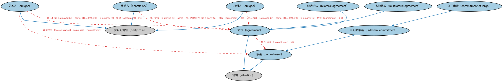

# 协议本体（Agreements Ontology）结构与公理说明

本文档对应 `Agreements.rdf` / `Agreements.ttl`，说明该本体的类、继承关系、属性和公理约定。结构图见 `Agreements-structure.png`（`Agreements-structure.svg` 为可缩放版本）。

## 1. 本体概述

定义协议概念以及参与方在协议中所扮演角色的本体。

## 2. 类（Class）

| 类（Class） | 定义（Definition） |
|---|---|
| 协议（agreement） | 两个或多个参与方之间经协商达成的理解，体现各方作出的承诺及其接受。 |
| 受益方（beneficiary） | 从某事物中获得某种利益、好处或收益的参与方。 |
| 双边协议（bilateral agreement） | 两方承诺相互履行特定义务或责任的协议。 |
| 承诺（commitment） | 某参与方作出的以某种方式行事或不行事的承诺。 |
| 公开承诺（commitment at large） | 某参与方作出、且潜在受益方未直接参与的承诺；可转让证券等的基础。 |
| 多边协议（multilateral agreement） | 涉及多个参与方的协议。 |
| 权利人（obligee） | 根据法律或协议条款享有某项承诺或义务的参与方。 |
| 义务人（obligor） | 根据法律或协议有义务偿还债务、付款、做某事或不做某事的参与方。 |
| 单方面承诺（unilateral commitment） | 由一方作出、无需另一方作出对等承诺的承诺或义务。 |

### 2.1 继承关系（Inheritance）

- 协议（agreement） ⊑ 情境（situation）
- 受益方（beneficiary） ⊑ 参与方角色（party role）
- 双边协议（bilateral agreement） ⊑ 协议（agreement）
- 承诺（commitment） ⊑ 情境（situation）
- 公开承诺（commitment at large） ⊑ 单方面承诺（unilateral commitment）
- 多边协议（multilateral agreement） ⊑ 协议（agreement）
- 权利人（obligee） ⊑ 参与方角色（party role）
- 义务人（obligor） ⊑ 参与方角色（party role）
- 单方面承诺（unilateral commitment） ⊑ 承诺（commitment）

## 3. 对象属性（Object Property）

| 属性（Property） | 中文（English） | 定义（Definition） | 说明 |
|---|---|---|---|
| fibo-fnd-agr-agr:hasObligation | 具有义务（has obligation） | 标识某参与方已承担的某项义务。 | 定义域（domain）：义务人（obligor）；逆属性（inverseOf）：属于义务人（is obligation of） |
| fibo-fnd-agr-agr:isObligationOf | 属于义务人（is obligation of） | 标识承担某项义务的参与方。 | 值域（range）：义务人（obligor）；子属性（subPropertyOf）：具有参与方角色（has party role） |

## 5. 公理约定（Axioms）

- 协议（agreement）：授予 承诺（commitment） ≥0
- 协议（agreement）：具有参与方角色（has party role） 参与方角色（party role） ≥2
- 受益方（beneficiary）：由…扮演（is played by） some（是…的参与方（is a party to） 协议（agreement） ≥0）
- 双边协议（bilateral agreement）：具有参与方角色（has party role） 参与方角色（party role） =2
- 承诺（commitment）：具有参与方角色（has party role） some 参与方角色（party role）
- 多边协议（multilateral agreement）：具有参与方角色（has party role） 参与方角色（party role） ≥3
- 多边协议（multilateral agreement） 与 双边协议（bilateral agreement） 互斥（disjointWith）
- 权利人（obligee）：由…扮演（is played by） some（是…的参与方（is a party to） 协议（agreement） ≥0）
- 义务人（obligor）：具有义务（has obligation） some 承诺（commitment）
- 义务人（obligor）：由…扮演（is played by） some（是…的参与方（is a party to） 协议（agreement） ≥0）

## 6. 依赖（owl:imports，5 个）

本本体通过 `owl:imports` 引入以下本体，各项的中文名称与简介如下：

| 导入本体 | 中文名称 | 简介 |
|---|---|---|
| `FND/Relations/Relations.rdf` | 关系本体（Relations Ontology） | FIBO 最底层的基础本体，定义参考（reference）、分类（classify）等通用关系与抽象概念，全库普遍依赖。 |
| `FND/Utilities/AnnotationVocabulary.rdf` | FIBO 标注词汇表（FIBO Annotation Vocabulary） | 定义 FIBO 专用的标注属性（如释义来源、成熟度等级），用于本体自身的元数据标注。 |
| `https://www.omg.org/spec/Commons/AnnotationVocabulary/` | OMG 通用标注词汇表（OMG Commons Annotation Vocabulary） | OMG 通用本体库（Commons）中的标注词汇表，提供概念映射等标注属性，FIBO 用它标注术语与外部标准的对应关系。 |
| `https://www.omg.org/spec/Commons/PartiesAndSituations/` | OMG 通用参与方与情境本体（OMG Commons Parties and Situations） | Commons 库中的参与方本体，定义独立主体、参与方及其角色扮演的通用概念，是 FIBO 参与方模型的上游。 |
| `https://www.omg.org/spec/Commons/RolesAndCompositions/` | OMG 通用角色与构成本体（OMG Commons Roles and Compositions） | Commons 库中的角色本体，定义角色及整体—部分构成关系的通用概念。 |

## 7. 文件

- 官方 RDF/XML：`Agreements.rdf`
- 中文 Turtle：`Agreements.ttl`
- 结构图：`Agreements-structure.png` / `Agreements-structure.svg`