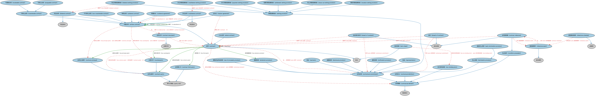

# 合同本体（Contracts Ontology）结构与公理说明

本文档对应 `Contracts.rdf` / `Contracts.ttl`，说明该本体的类、继承关系、属性和公理约定。结构图见 `Contracts-structure.png`（`Contracts-structure.svg` 为可缩放版本）。

## 1. 本体概述

定义具有法律约束力的合同（contract）：合同当事方、合同条款、权利与义务、合同的订立与终止。

**在体系中的位置**：FND 协议模块的核心之一，上承协议本体，是金融工具、贷款、衍生品合约等一切契约性概念的直接上游。

**上下游关系**：上游继承协议本体并依赖法律能力、参与方本体；下游被 FBC 金融工具、LOAN 贷款、DER 衍生品、SEC 证券等全库引用——几乎所有金融业务最终都是一份合同。

**与相近概念的差别**：合同≠协议——协议是双方意思一致的安排（未必有法律强制力），合同是有法律约束力的协议；合同≠文档——合同是法律关系本身，合同文本只是它的书面载体（见文档本体）。

本本体中类与类的核心关系如下（完整细节见各类小节）：

- **可转让合同（assignable contract）** 继承 **可转让合同（transferable contract）**
- **双边合同（bilateral contract）** 继承 **双边协议（BilateralAgreement）**
- **双边合同（bilateral contract）** 继承 **书面合同（written contract）**
- **双边净额结算条款（bilateral netting provision）** 继承 **净额结算条款（netting provision）**
- **违约（breach of contract）** 继承 **发生类别（OccurrenceKind）**
- **违反契约承诺（breach of covenant）** 继承 **发生类别（OccurrenceKind）**
- **终止净额结算条款（close-out netting provision）** 继承 **净额结算条款（netting provision）**
- **附属协议（collateral agreement）** 继承 **书面合同（written contract）**
- **先决条件（condition precedent）** 继承 **合同要素（contractual element）**
- **合同（contract）** 继承 **协议（Agreement）**
- **合同文件（contract document）** 继承 **法律文件（LegalDocument）**
- **合同里程碑（contract milestone）** 继承 **先决条件（condition precedent）**
- 其余 42 条关系从略。

## 2. 类（Class）

| 类（Class） | 定义（Definition） |
|---|---|
| 可转让合同（assignable contract） | 合同持有人（让与人）可将部分或全部权利与义务转让给另一方（受让人）的合同。 contract in which contract holder (assignor) may transfer some or all of their rights and obligations to another party (assignee) |
| 双边合同（bilateral contract） | 双方承诺对彼此履行特定行为或义务的合同。 contract where two parties commit to perform specific actions or obligations towards each other |
| 双边净额结算条款（bilateral netting provision） | 两方之间的净额结算条款，相互义务相互抵销以确定单笔净支付额。 netting provision that occurs between two parties, in which mutual obligations are offset to determine a single net payment |
| 违约（breach of contract） | 表示在无合法理由的情况下违反合同明示或默示条件（做或不做某事）的事件分类符。 classifier of events representing a violation of an express, or implied, condition of a contract to do or not to do something, without a legitimate excuse |
| 违反契约承诺（breach of covenant） | 表示在无合法理由的情况下违背合同中所载做或不做某事之承诺的事件分类符。 classifier of events representing breaking a promise specified in a contract to do or not to do something, without a legitimate excuse |
| 终止净额结算条款（close-out netting provision） | 可在交易对手违约时触发的净额结算条款，导致双方之间所有未了结交易终止。 netting provision that may be triggered when a counterparty defaults, leading to the termination of all outstanding transactions between the parties |
| 附属协议（collateral agreement） | 与另一合同相关、旨在为各参与方提供澄清和额外保护、且独立于主合同的书面合同。 written contract related to another contract designed to provide clarity and additional protection for all parties involved, that is separate from the primary contract and that can be independently enforced |
| 先决条件（condition precedent） | 规定合同某方面生效前必须满足之条件的约定。 stipulation that specifies conditions that must be met before some aspect of a contract takes effect |
| 合同（contract） | 有行为能力的参与方之间自愿、审慎达成的协议，各方同意受法律约束，并为此提供有价值的对价。 voluntary, deliberate agreement between competent parties to which the parties agree to be legally bound, and for which the parties provide valuable consideration |
| 合同文件（contract document） | 记录某合同正式条款与条件的法律文件。 legal document that records the formal terms and conditions of some contract |
| 合同里程碑（contract milestone） | 对与合同履行所要求的指定活动、任务或工作段的状态或完成程度相关的事件（里程碑）或事件集的分类符。 classifier for an event (milestone), or set of events related to the status or level of completion of a designated activity, task, or segment of work required for contract fulfillment |
| 合同当事方（contract party） | 订立了有约束力协议、接受并承担协议所规定义务、责任与利益的具有法律行为能力的参与方。 legally competent party that has entered into a binding agreement, accepting and conceding obligations, responsibilities, and benefits as specified |
| 合同主当事方（contract principal） | 发起合同并在合同作此区分时被标识为第一当事方的参与方。 party that originates a contract and is identified as the first party to that contract, in the event that the contract distinguishes any party as such |
| 合同第三方（contract third party） | 间接参与协议但不是协议对手方的参与方。 party that is indirectly involved in, but not a counterparty to, an agreement |
| 合同承诺（contractual commitment） | 规定缔约各方所同意事项（即一方所作履行某行为的许诺或保证）的条款。 provision specifying something that the contracting parties agree to, i.e., a promise or pledge made by one of the parties to perform some action or fulfill some duty |
| 合同定义（contractual definition） | 规定法律文件中某术语含义的合同要素，该定义在术语每次出现时可替代该术语。 contractual element that specifies the meaning of a term in a legal document, whose definition is substitutable for the term whenever it occurs in the body of that document |
| 合同要素（contractual element） | 构成协议不可分割部分的要素，如安排、条款、要求、规则、规范和标准。 element, such as an arrangement, provision, requirement, rule, specification, and standard that forms an integral part of an agreement |
| 交易对手（counterparty） | 就某项协议与之谈判的合同当事方。 party to a contract with whom one negotiates on a given agreement |
| 披露条款（disclosure provision） | 列明一方或双方相互披露特定信息之要求与责任的合同条款。 contractual provision that outlines the requirements and responsibilities of one or both parties to reveal certain information to each other |
| 提前终止条款（early termination provision） | 在到期日前因任何原因终止协议的条款。 termination of an agreement for any reason prior to its expiration date |
| 展期条款（extension provision） | 规定合同可展期之条件的合同条款。 contract terms that specify the conditions under which a contract can be extended |
| 主协议（master agreement） | 具名参与方之间的合同，列明适用于双方之间若干账户、交易或其他活动的条款与条件。 contract between named parties that outlines the terms and conditions designed to apply to a number of accounts, transactions, or other activities between the parties, and that consolidates and provides overarching terms for separate but related agreements |
| 里程碑事件（milestone event） | 与合同履行所要求的指定活动、任务或工作段的状态或完成程度相关的事件。 event related to the status or level of completion of a designated activity, task, or segment of work required for contract fulfillment |
| 里程碑进度表（milestone schedule） | 里程碑事件、观测或其他发生事项及其完成日期和/或时间的进度表。 schedule of milestone events, observations, or other occurrences and the associated dates and/or times when they will be done |
| 多边合同（multilateral contract） | 多方（即两方以上）承诺对彼此履行特定行为或义务的合同。 contract where multiple parties (i.e., more than two) commit to perform specific actions or obligations towards each other |
| 多边净额结算条款（multilateral netting provision） | 触发时由中央清算所或金融机构促成的净额结算条款。 netting provision that, when triggered, is facilitated by a central clearinghouse or financial institution |
| 净额结算条款（netting provision） | 规定通过汇总（合并）两项或多项义务以降低信用、结算及其他风险之方法的合同要素。 contractual element that specifies the method of reducing credit, settlement and other risks by aggregating (combining) two or more obligations to achieve a reduced net obligation |
| 非约束性条款（non-binding term） | 对协议任何一方均不具法律约束力的合同要素。 contractual element that is not legally binding on any party to the agreement |
| 不可转让合同（non-transferable contract） | 未经事先书面许可，其各项权利与义务不得转让给另一方的合同。 contract between whose individual rights and obligations are not transferable to another party without prior written permission |
| 通知条款（notification provision） | 表明相关事件发生前须作出通知的条款。 provision indicating that notification is required prior to the occurrence of a relevant event |
| 可更新合同（novateable contract） | 可被另一合同替代的合同；替代时原合同项下生效的权利与义务随之消灭。 contract that may be replaced by another contract, and in that event, extinguishes the rights and obligations in effect under the original contract with those in the new agreement |
| 更新净额结算条款（novation netting provision） | 规定给定合同被另一合同替代时净额结算应如何处理的合同要素。 contractual element that specifies what should be done with respect to netting when a given contract is replaced with another |
| 支付净额结算条款（payment netting provision） | 规定双方之间以单一货币应付的所有款项将如何在每个交易日汇总的净额结算条款。 netting provision that specifies the way in which all payments in a single currency owed between parties will be aggregated for each traded currency per value date and within the larger aggregate obligation |
| 陈述（representation） | 合同一方在订约前或订约时就某事实、情况所作的声明，属于合同要素。 contractual element that is a statement made by a party to the contract, before or at the time of making the contract, in regard to some fact, circumstance, or state of affairs pertinent to the contract, which the counterparty(ies) rely on, or is influential in bringing about the contract |
| 结算净额结算条款（settlement netting provision） | 规定在给定支付日各方将如何汇总其应交付的某货币金额的净额结算条款。 netting provision that specifies the way in which on a given payment date, each party will aggregate the amounts of a currency to be delivered by it, and only the difference in the aggregate amounts will be delivered by the party with the larger aggregate obligation |
| 条款清单（term sheet） | 列明拟议商业交易可能达成之基本条款与条件的非约束性协议。 nonbinding agreement setting forth the basic terms and conditions under which a proposed business deal may be made |
| 终止条款（termination provision） | 规定各方在何种情形下可解除其法律关系并停止履行合同义务的合同要素。 contractual element that specifies the circumstances under which the parties can dissolve their legal relationship and discontinue the fulfillment of their obligations under the contract |
| 可转让合同（transferable contract） | 一方的权利与义务可转让给另一方的合同。 contract in which the rights and obligations of one party may be transferred to another party |
| 单务合同（unilateral contract） | 一方作出只能通过履行行为（而非回以承诺）来接受之要约的合同。 contract in which one party makes an offer that can only be accepted through performance rather than a return promise |
| 募集资金用途条款（use of proceeds provision） | 规定通过融资（如信贷协议、发行、认股权证或其他工具）所获得资金之拟定用途的合同条款。 contract provision specifying how funds obtained through financing, such as through a credit agreement, offering, warrant, or other instrument are intended to be used |
| 口头合同（verbal contract） | 因某种口头交换而成立的合同。 contract that exists as a result of some verbal exchange |
| 保证（warranty） | 作为事实声明的合同要素。 contractual element that is a statement of fact |
| 书面合同（written contract） | 由各方签署的书面正式合同。 formal contract that is written and signed by the parties thereto |

以下按类逐个展开：每个类给出继承关系、相关属性与公理约定；子类在父类之下降一级编号。

### 2.1 违约（breach of contract）

定义：表示在无合法理由的情况下违反合同明示或默示条件（做或不做某事）的事件分类符。

- 父类：**发生类别（OccurrenceKind）**

属性：

| 属性 | 定义 | 说明 |
|---|---|---|
| **适用于（appliesTo）** | — | — |
| **引用（refersTo）** | — | — |

公理：

- **引用（refersTo）**至少有一个取值，类型是**合同承诺（contractual commitment）**。
- **适用于（appliesTo）**至少有一个取值，类型是**合同（contract）**。

### 2.2 违反契约承诺（breach of covenant）

定义：表示在无合法理由的情况下违背合同中所载做或不做某事之承诺的事件分类符。

- 父类：**发生类别（OccurrenceKind）**

属性：

| 属性 | 定义 | 说明 |
|---|---|---|
| **适用于（appliesTo）** | — | — |
| **引用（refersTo）** | — | — |

公理：

- **引用（refersTo）**至少有一个取值，类型是**合同承诺（contractual commitment）**。
- **适用于（appliesTo）**至少有一个取值，类型是**合同（contract）**。

### 2.3 合同（contract）

定义：有行为能力的参与方之间自愿、审慎达成的协议，各方同意受法律约束，并为此提供有价值的对价。

- 父类：**协议（Agreement）**
- 直接子类：**口头合同（verbal contract）**、**书面合同（written contract）**

属性：

| 属性 | 定义 | 说明 |
|---|---|---|
| **为……定义条款（defines terms for）** | 将合同关联到该合同为其定义具有法律约束力之条款与条件的事物。 relates a contract to something for which the contract defines legally binding terms and conditions | 子属性：定义 |
| **具有合同期限（has contract duration）** | 标识合同签署后拟生效的时间期间。 indicates the period of time during which a contract is intended to be in force once it has been executed | 值域：时长；子属性：具有期限（has term） |
| **具有合同当事方（has contract party）** | 标识订立了有约束力协议、接受并承担协议所规定义务、责任与利益的参与方。 indicates a party that has entered into a binding agreement, accepting and conceding obligations, responsibilities, and benefits as specified | 值域：合同当事方（contract party）；子属性：具有参与方角色（has party role） |
| **具有合同要素（has contractual element）** | 标识作为协议组成部分的某事物。 indicates something that is a component of an agreement | 值域：合同要素（contractual element）；子属性：包含 |
| **具有交易对手（has counterparty）** | 标识合同的当事方，通常不是合同主当事方。 identifies a party to a contract, typically not the contract principal | 值域：交易对手（counterparty）；子属性：具有合同当事方（has contract party） |
| **具有生效日期（has effective date）** | 标识合同、关系或政策生效的日期。 indicates the date a contract, relationship, or policy comes into force | 值域：日期；子属性：具有日期 |
| **具有展期条款（has extension provision）** | 指明允许合同某方面展期的合同条款细节。 specifies the details of a contract provision allowing extension of some aspect of the contract | 值域：展期条款（extension provision）；子属性：具有合同要素（has contractual element） |
| **具有管辖辖区（has governing jurisdiction）** | 标识各方约定的合同管辖辖区。 indicates the jurisdiction governing the contract, as agreed by all parties | 值域：管辖权；子属性：受……管辖 |
| **具有主当事方（has principal party）** | 标识合同的主要或主当事方。 identifies the main or principal party to a contract | 值域：合同主当事方（contract principal）；子属性：具有合同当事方（has contract party） |
| **具有第三方（has third party）** | 标识不是合同签署方但在合同界定的整体情境中扮演某种角色的参与方。 identifies a party which is not signatory to the party but has some role in the overall context defined by the contract. | 值域：合同第三方（contract third party）；子属性：具有参与方角色（has party role） |
| **可让与（is assignable）** | 表明合同及其项下权利是否可由签署方之一让与给其他参与方。 indicates whether the contract and the rights thereunder may be assigned by one of the signatories to some other party | 值域：xsd:boolean |
| **取代（supersedes）** | 标识先前签署并被本合同替代的合同。 indicates a contract that was executed prior to and is replaced by this contract | 值域：合同（contract） |

公理：

- **具有合同当事方（has contract party）**至少有 2 个**合同当事方（contract party）**。
- **具有合同要素（has contractual element）**至少有一个取值，类型是**合同要素（contractual element）**。
- **具有生效日期（has effective date）**可以有 0 个或多个**日期（Date）**。

#### 2.3.1 口头合同（verbal contract）

定义：因某种口头交换而成立的合同。

- 父类：**合同（contract）**

公理：

- 与**书面合同（written contract）**互斥：同一个体不能同时属于两者。

#### 2.3.2 书面合同（written contract）

定义：由各方签署的书面正式合同。

- 父类：**合同（contract）**
- 直接子类：**双边合同（bilateral contract）**、**附属协议（collateral agreement）**、**主协议（master agreement）**、**多边合同（multilateral contract）**、**不可转让合同（non-transferable contract）**、**可转让合同（transferable contract）**、**单务合同（unilateral contract）**

属性：

| 属性 | 定义 | 说明 |
|---|---|---|
| **具有交易对手（has counterparty）** | 标识合同的当事方，通常不是合同主当事方。 identifies a party to a contract, typically not the contract principal | 值域：交易对手（counterparty）；子属性：具有合同当事方（has contract party） |
| **具有生效日期时间戳（has effective date time stamp）** | 标识某事物生效的日期与时间（含时区）。 indicates the date and time, including time zone, something comes into force | 值域：日期时间戳；子属性：具有日期时间戳 |
| **具有签署日期（has execution date）** | 标识合同已由所有必要当事方签署的日期。 indicates the date a contract has been signed by all the necessary parties | 值域：日期；子属性：具有日期 |
| **具有签署日期时间戳（has execution date time stamp）** | 标识合同已由所有必要当事方签署的日期与时间（含时区）。 indicates the date and time, including time zone, a contract has been signed by all the necessary parties | 值域：日期时间戳；子属性：具有日期时间戳 |
| **具有主当事方（has principal party）** | 标识合同的主要或主当事方。 identifies the main or principal party to a contract | 值域：合同主当事方（contract principal）；子属性：具有合同当事方（has contract party） |
| **可让与（is assignable）** | 表明合同及其项下权利是否可由签署方之一让与给其他参与方。 indicates whether the contract and the rights thereunder may be assigned by one of the signatories to some other party | 值域：xsd:boolean |
| **由……证明（is evidenced by）** | 由……证实。 is attested by | 逆属性：是……的证据（is evidence for） |
| **是……的主合同（is primary contract for）** | 标识任何从属协议，如附属协议。 indicates any subordinate agreement, such as a collateral agreement | 值域：书面合同（written contract）；逆属性：从属于（is subordinate to）；子属性：被……引用 |
| **从属于（is subordinate to）** | 标识从属协议（如附属协议）所引用的主合同。 indicates the primary contract referenced by a subordinate agreement, such as a collateral agreement | 值域：书面合同（written contract）；子属性：引用 |
| **具有签发日期（hasDateOfIssuance）** | — | — |

公理：

- **具有主当事方（has principal party）**至少有一个取值，类型是**合同主当事方（contract principal）**。
- **具有交易对手（has counterparty）**至少有一个取值，类型是**交易对手（counterparty）**。
- **具有生效日期时间戳（has effective date time stamp）**可以有 0 个或多个**日期时间戳（DateTimeStamp）**。
- **具有签发日期（hasDateOfIssuance）**可以有 0 个或多个**日期（Date）**。
- **具有签署日期时间戳（has execution date time stamp）**可以有 0 个或多个**日期时间戳（DateTimeStamp）**。
- **具有签署日期（has execution date）**可以有 0 个或多个**日期（Date）**。
- **可让与（is assignable）**存在取值约束。
- **由……证明（is evidenced by）**至少有一个取值，类型是**合同文件（contract document）**。

##### 2.3.2.1 双边合同（bilateral contract）

定义：双方承诺对彼此履行特定行为或义务的合同。

- 父类：**双边协议（BilateralAgreement）**、**书面合同（written contract）**

##### 2.3.2.2 附属协议（collateral agreement）

定义：与另一合同相关、旨在为各参与方提供澄清和额外保护、且独立于主合同的书面合同。

- 父类：**书面合同（written contract）**

属性：

| 属性 | 定义 | 说明 |
|---|---|---|
| **从属于（is subordinate to）** | 标识从属协议（如附属协议）所引用的主合同。 indicates the primary contract referenced by a subordinate agreement, such as a collateral agreement | 值域：书面合同（written contract）；子属性：引用 |

公理：

- **从属于（is subordinate to）**至少有一个取值，类型是**书面合同（written contract）**。

##### 2.3.2.3 主协议（master agreement）

定义：具名参与方之间的合同，列明适用于双方之间若干账户、交易或其他活动的条款与条件。

- 父类：**书面合同（written contract）**

属性：

| 属性 | 定义 | 说明 |
|---|---|---|
| **管辖（governs）** | — | — |

公理：

- **管辖（governs）**可以有 0 个或多个**合同（contract）**。

##### 2.3.2.4 多边合同（multilateral contract）

定义：多方（即两方以上）承诺对彼此履行特定行为或义务的合同。

- 父类：**多边协议（MultilateralAgreement）**、**书面合同（written contract）**

##### 2.3.2.5 不可转让合同（non-transferable contract）

定义：未经事先书面许可，其各项权利与义务不得转让给另一方的合同。

- 父类：**书面合同（written contract）**

公理：

- 与**可转让合同（transferable contract）**互斥：同一个体不能同时属于两者。

##### 2.3.2.6 可转让合同（transferable contract）

定义：一方的权利与义务可转让给另一方的合同。

- 父类：**书面合同（written contract）**
- 直接子类：**可转让合同（assignable contract）**、**可更新合同（novateable contract）**

###### 2.3.2.6.1 可转让合同（assignable contract）

定义：合同持有人（让与人）可将部分或全部权利与义务转让给另一方（受让人）的合同。

- 父类：**可转让合同（transferable contract）**

属性：

| 属性 | 定义 | 说明 |
|---|---|---|
| **可让与（is assignable）** | 表明合同及其项下权利是否可由签署方之一让与给其他参与方。 indicates whether the contract and the rights thereunder may be assigned by one of the signatories to some other party | 值域：xsd:boolean |

公理：

- **可让与（is assignable）**的取值固定为 true。

###### 2.3.2.6.2 可更新合同（novateable contract）

定义：可被另一合同替代的合同；替代时原合同项下生效的权利与义务随之消灭。

- 父类：**可转让合同（transferable contract）**

##### 2.3.2.7 单务合同（unilateral contract）

定义：一方作出只能通过履行行为（而非回以承诺）来接受之要约的合同。

- 父类：**书面合同（written contract）**

属性：

| 属性 | 定义 | 说明 |
|---|---|---|
| **授予（confers）** | — | — |

公理：

- **授予（confers）**的所有取值只能是**单方面承诺（UnilateralCommitment）**。

### 2.4 合同文件（contract document）

定义：记录某合同正式条款与条件的法律文件。

- 父类：**法律文件（LegalDocument）**

属性：

| 属性 | 定义 | 说明 |
|---|---|---|
| **记录（records）** | — | — |

公理：

- **记录（records）**至少有一个取值，类型是**合同（contract）**。

### 2.5 合同当事方（contract party）

定义：订立了有约束力协议、接受并承担协议所规定义务、责任与利益的具有法律行为能力的参与方。

- 父类：**参与方角色（party role）**
- 直接子类：**合同主当事方（contract principal）**、**交易对手（counterparty）**

属性：

| 属性 | 定义 | 说明 |
|---|---|---|
| **由…扮演（is played by）** | — | — |

公理：

- **由…扮演（is played by）**恰好有 1 个**法律主体（LegalPerson）**。
- **由…扮演（is played by）**至少有一个取值，该取值满足：**是…的参与方（is a party to）**至少有一个取值，类型是**合同（contract）**。

#### 2.5.1 合同主当事方（contract principal）

定义：发起合同并在合同作此区分时被标识为第一当事方的参与方。

- 父类：**合同当事方（contract party）**

#### 2.5.2 交易对手（counterparty）

定义：就某项协议与之谈判的合同当事方。

- 父类：**合同当事方（contract party）**

### 2.6 合同第三方（contract third party）

定义：间接参与协议但不是协议对手方的参与方。

- 父类：**参与方角色（party role）**

### 2.7 合同要素（contractual element）

定义：构成协议不可分割部分的要素，如安排、条款、要求、规则、规范和标准。

- 父类：**组成成分（Constituent）**
- 直接子类：**先决条件（condition precedent）**、**合同承诺（contractual commitment）**、**合同定义（contractual definition）**、**非约束性条款（non-binding term）**

属性：

| 属性 | 定义 | 说明 |
|---|---|---|
| **具有法律描述（has legal description）** | 提供以法律术语表述的合同条款、条文或其他要素的文本或其摘要。 provides the text, or a summary thereof, expressed in legal terms, of the contract provision, clause, or other element | 值域：xsd:string；子属性：具有描述 |

公理：

- **具有法律描述（has legal description）**存在取值约束。

#### 2.7.1 先决条件（condition precedent）

定义：规定合同某方面生效前必须满足之条件的约定。

- 父类：**合同要素（contractual element）**
- 直接子类：**合同里程碑（contract milestone）**

##### 2.7.1.1 合同里程碑（contract milestone）

定义：对与合同履行所要求的指定活动、任务或工作段的状态或完成程度相关的事件（里程碑）或事件集的分类符。

- 父类：**先决条件（condition precedent）**、**发生类别（OccurrenceKind）**

属性：

| 属性 | 定义 | 说明 |
|---|---|---|
| **分类（classifies）** | — | — |
| **适用于（appliesTo）** | — | — |

公理：

- **分类（classifies）**可以有 0 个或多个**里程碑事件（milestone event）**。
- **适用于（appliesTo）**至少有一个取值，类型是**合同（contract）**。

#### 2.7.2 合同承诺（contractual commitment）

定义：规定缔约各方所同意事项（即一方所作履行某行为的许诺或保证）的条款。

- 父类：**合同要素（contractual element）**
- 直接子类：**披露条款（disclosure provision）**、**展期条款（extension provision）**、**净额结算条款（netting provision）**、**通知条款（notification provision）**、**陈述（representation）**、**终止条款（termination provision）**、**募集资金用途条款（use of proceeds provision）**、**保证（warranty）**

属性：

| 属性 | 定义 | 说明 |
|---|---|---|
| **由……授权要求（isMandatedBy）** | — | — |
| **具有部分（hasPart）** | — | — |

公理：

- **具有部分（hasPart）**的所有取值只能是**合同承诺（contractual commitment）**。
- **由……授权要求（isMandatedBy）**至少有一个取值，类型是**合同（contract）**。

##### 2.7.2.1 披露条款（disclosure provision）

定义：列明一方或双方相互披露特定信息之要求与责任的合同条款。

- 父类：**合同承诺（contractual commitment）**

##### 2.7.2.2 展期条款（extension provision）

定义：规定合同可展期之条件的合同条款。

- 父类：**合同承诺（contractual commitment）**

属性：

| 属性 | 定义 | 说明 |
|---|---|---|
| **具有可展期期间（has extendable period）** | 标识按合同条款允许展期的时间窗口。 indicates the window of time during which an extension is allowed under the terms of the contract | 值域：显式日期区间；子属性：具有日期区间 |

公理：

- **具有可展期期间（has extendable period）**可以有 0 个或多个**显式日期区间（ExplicitDatePeriod）**。

##### 2.7.2.3 净额结算条款（netting provision）

定义：规定通过汇总（合并）两项或多项义务以降低信用、结算及其他风险之方法的合同要素。

- 父类：**合同承诺（contractual commitment）**
- 直接子类：**双边净额结算条款（bilateral netting provision）**、**终止净额结算条款（close-out netting provision）**、**多边净额结算条款（multilateral netting provision）**、**更新净额结算条款（novation netting provision）**、**支付净额结算条款（payment netting provision）**、**结算净额结算条款（settlement netting provision）**

属性：

| 属性 | 定义 | 说明 |
|---|---|---|
| **净额结算是否自动（is netting automatic）** | 表明净额结算是否在协议范围内自动进行。 indicates whether netting takes place automatically under the scope of the agreement | 值域：xsd:boolean |

###### 2.7.2.3.1 双边净额结算条款（bilateral netting provision）

定义：两方之间的净额结算条款，相互义务相互抵销以确定单笔净支付额。

- 父类：**净额结算条款（netting provision）**

属性：

| 属性 | 定义 | 说明 |
|---|---|---|
| **适用于（appliesTo）** | — | — |

公理：

- **适用于（appliesTo）**至少有一个取值，类型是**双边合同（bilateral contract）**。

###### 2.7.2.3.2 终止净额结算条款（close-out netting provision）

定义：可在交易对手违约时触发的净额结算条款，导致双方之间所有未了结交易终止。

- 父类：**净额结算条款（netting provision）**

公理：

- 与**结算净额结算条款（settlement netting provision）**互斥：同一个体不能同时属于两者。

###### 2.7.2.3.3 多边净额结算条款（multilateral netting provision）

定义：触发时由中央清算所或金融机构促成的净额结算条款。

- 父类：**净额结算条款（netting provision）**

属性：

| 属性 | 定义 | 说明 |
|---|---|---|
| **适用于（appliesTo）** | — | — |

公理：

- **适用于（appliesTo）**至少有一个取值，类型是**多边合同（multilateral contract）**。
- 与**双边净额结算条款（bilateral netting provision）**互斥：同一个体不能同时属于两者。

###### 2.7.2.3.4 更新净额结算条款（novation netting provision）

定义：规定给定合同被另一合同替代时净额结算应如何处理的合同要素。

- 父类：**净额结算条款（netting provision）**

###### 2.7.2.3.5 支付净额结算条款（payment netting provision）

定义：规定双方之间以单一货币应付的所有款项将如何在每个交易日汇总的净额结算条款。

- 父类：**净额结算条款（netting provision）**

###### 2.7.2.3.6 结算净额结算条款（settlement netting provision）

定义：规定在给定支付日各方将如何汇总其应交付的某货币金额的净额结算条款。

- 父类：**净额结算条款（netting provision）**

公理：

- 该属性存在取值约束。

##### 2.7.2.4 通知条款（notification provision）

定义：表明相关事件发生前须作出通知的条款。

- 父类：**合同承诺（contractual commitment）**

##### 2.7.2.5 陈述（representation）

定义：合同一方在订约前或订约时就某事实、情况所作的声明，属于合同要素。

- 父类：**合同承诺（contractual commitment）**

##### 2.7.2.6 终止条款（termination provision）

定义：规定各方在何种情形下可解除其法律关系并停止履行合同义务的合同要素。

- 父类：**合同承诺（contractual commitment）**
- 直接子类：**提前终止条款（early termination provision）**

###### 2.7.2.6.1 提前终止条款（early termination provision）

定义：在到期日前因任何原因终止协议的条款。

- 父类：**终止条款（termination provision）**

属性：

| 属性 | 定义 | 说明 |
|---|---|---|
| **具有到期日（hasExpirationDate）** | — | — |

公理：

- **具有到期日（hasExpirationDate）**至少有一个取值，类型是**显式日期（ExplicitDate）**。

##### 2.7.2.7 募集资金用途条款（use of proceeds provision）

定义：规定通过融资（如信贷协议、发行、认股权证或其他工具）所获得资金之拟定用途的合同条款。

- 父类：**合同承诺（contractual commitment）**

##### 2.7.2.8 保证（warranty）

定义：作为事实声明的合同要素。

- 父类：**合同承诺（contractual commitment）**

#### 2.7.3 合同定义（contractual definition）

定义：规定法律文件中某术语含义的合同要素，该定义在术语每次出现时可替代该术语。

- 父类：**合同要素（contractual element）**

#### 2.7.4 非约束性条款（non-binding term）

定义：对协议任何一方均不具法律约束力的合同要素。

- 父类：**合同要素（contractual element）**

### 2.8 里程碑事件（milestone event）

定义：与合同履行所要求的指定活动、任务或工作段的状态或完成程度相关的事件。

- 父类：**发生事项（Occurrence）**

属性：

| 属性 | 定义 | 说明 |
|---|---|---|
| **由……分类（isClassifiedBy）** | — | — |

公理：

- **由……分类（isClassifiedBy）**至少有一个取值，类型是**合同里程碑（contract milestone）**。

### 2.9 里程碑进度表（milestone schedule）

定义：里程碑事件、观测或其他发生事项及其完成日期和/或时间的进度表。

- 父类：**进度表（Schedule）**

属性：

| 属性 | 定义 | 说明 |
|---|---|---|
| **具有成员（hasMember）** | — | — |

公理：

- **具有成员（hasMember）**至少有一个取值，类型是**里程碑事件（milestone event）**。

### 2.10 条款清单（term sheet）

定义：列明拟议商业交易可能达成之基本条款与条件的非约束性协议。

- 父类：**协议（Agreement）**

属性：

| 属性 | 定义 | 说明 |
|---|---|---|
| **具有非约束性条款（has non-binding term）** | 指协议中包含的、不被视为具有法律约束力的条款。 refers to a term that is included in an agreement that is not considered legally binding | 值域：非约束性条款（non-binding term）；子属性：具有合同要素（has contractual element） |

公理：

- **具有非约束性条款（has non-binding term）**至少有一个取值，类型是**非约束性条款（non-binding term）**。

## 3. 其他属性

以下属性未绑定到本体的具体类（定义域在外部本体或未声明）：

对象属性（Object Property）：

| 属性 | 定义 | 说明 |
|---|---|---|
| **具有受益人（has beneficiary）** | 按协议规定从某事物获得利益、好处或收益的参与方。 party that receives some benefit or advantage or profits from something as specified in the agreement | 值域：受益方；子属性：具有交易对手（has counterparty） |
| **具有提前终止日（has early termination date）** | 标识早于明示到期日的终止日期。 indicates a termination date that occurs prior to an explicit expiration date | 值域：显式日期；子属性：具有终止日 |
| **具有里程碑条款（has milestone provision）** | 指协议中包含的与合同存续期内某时点履行情况相关的要求。 refers to a requirement included in an agreement related to fulfillment as of some point in time in the lifetime of the contract | 值域：合同里程碑（contract milestone）；子属性：具有合同要素（has contractual element） |
| **具有期限（has term）** | 标识某事物（如合同、投资或要约）持续或拟持续的固定或有限期间。 indicates a fixed or limited period for which something, e.g., a contract, an investment, or an offer, lasts or is intended to last | 值域：时长；子属性：具有时长 |
| **是……的受益人（is beneficiary of）** | 指明受益人被列名的协议。 specifies the agreement that a beneficiary is named in | 值域：协议；子属性：受…影响（is affected by） |
| **是……的证据（is evidence for）** | 佐证。 corroborates | 逆属性：由……证明（is evidenced by） |
| **受……限定（is qualified by）** | 标识对某事物的约束、限制或细化。 indicates a constraint, limitation or refinement on something | 子属性：以……为特征 |
| **限定（qualifies）** | 限制、约束或细化。 limits, constrains or refines | 逆属性：受……限定（is qualified by）；子属性：刻画 |

## 4. 依赖（owl:imports，19 个）

本本体通过 `owl:imports` 引入以下本体，各项的中文名称与简介如下：

| 导入本体 | 中文名称 | 简介 |
|---|---|---|
| `FND/AgentsAndPeople/People.rdf` | 人员本体（People Ontology） | 定义自然人（person）的核心属性：姓名、出生日期、国籍、身份标识与联系方式，为雇员、客户、签署人等角色提供「人」的基础模型。 |
| `FND/Agreements/Agreements.rdf` | 协议本体（Agreements Ontology） | 定义两个或以上参与方之间协议（agreement）的通用概念：协议的当事方、条款、生效与终止，是合同等一切契约性安排的上位模型。 |
| `FND/Arrangements/Documents.rdf` | 文档本体（Documents Ontology） | 定义文档、文档类型及文档与其所记载内容的关系，为合同文本、募集说明书等法律文书建模。 |
| `FND/DatesAndTimes/FinancialDates.rdf` | 金融日期本体（Financial Dates Ontology） | 定义金融语境下的日期与期间概念：结算日、付息日、到期日、日计数基准等。 |
| `FND/DatesAndTimes/Occurrences.rdf` | 事件与发生本体（Occurrences Ontology） | 定义「发生」（occurrence）、事件与触发条件，用于表达企业行动、信用事件等「发生了什么」。 |
| `FND/Places/Addresses.rdf` | 地址本体（Addresses Ontology） | 定义邮政地址及其组成部分，为机构注册地、通讯地址建模。 |
| `FND/Relations/Relations.rdf` | 关系本体（Relations Ontology） | FIBO 最底层的基础本体，定义参考（reference）、分类（classify）等通用关系与抽象概念，全库普遍依赖。 |
| `FND/Utilities/AnnotationVocabulary.rdf` | FIBO 标注词汇表（FIBO Annotation Vocabulary） | 定义 FIBO 专用的标注属性（如释义来源、成熟度等级），用于本体自身的元数据标注。 |
| `https://www.omg.org/spec/Commons/AnnotationVocabulary/` | OMG 通用标注词汇表（OMG Commons Annotation Vocabulary） | OMG 通用本体库（Commons）中的标注词汇表，提供概念映射等标注属性，FIBO 用它标注术语与外部标准的对应关系。 |
| `https://www.omg.org/spec/Commons/Classifiers/` | OMG 通用分类器本体（OMG Commons Classifiers） | OMG 通用本体库（Commons）中的分类器本体，定义分类方案、类别与归类关系的通用概念，FIBO 的分类建模建立在其上。 |
| `https://www.omg.org/spec/Commons/Collections/` | OMG 通用集合本体（OMG Commons Collections） | Commons 库中的集合本体，定义集合、成员等通用概念。 |
| `https://www.omg.org/spec/Commons/ContextualDesignators/` | OMG 通用语境指称本体（OMG Commons Contextual Designators） | Commons 库中的语境指称本体，定义「在某个语境下指代某物的名称/符号」，是地址、账户号码等语境相关标识的基础。 |
| `https://www.omg.org/spec/Commons/DatesAndTimes/` | OMG 通用日期与时间本体（OMG Commons Dates and Times） | Commons 库中的日期时间本体，定义日期、期间、时间点等通用时间概念。 |
| `https://www.omg.org/spec/Commons/Designators/` | OMG 通用指称符本体（OMG Commons Designators） | Commons 库中的指称符本体，定义名称、标识符等「指代某物的符号」的通用概念。 |
| `https://www.omg.org/spec/Commons/Documents/` | OMG 通用文档本体（OMG Commons Documents） | Commons 库中的文档本体，定义文档及其组成部分的通用概念。 |
| `https://www.omg.org/spec/Commons/Organizations/` | OMG 通用组织本体（OMG Commons Organizations） | Commons 库中的组织本体，定义组织、组织成员与组织结构的通用概念。 |
| `https://www.omg.org/spec/Commons/PartiesAndSituations/` | OMG 通用参与方与情境本体（OMG Commons Parties and Situations） | Commons 库中的参与方本体，定义独立主体、参与方及其角色扮演的通用概念，是 FIBO 参与方模型的上游。 |
| `https://www.omg.org/spec/Commons/RegulatoryAgencies/` | OMG 通用监管机构本体（OMG Commons Regulatory Agencies） | Commons 库中的监管机构本体，定义监管机构及其监管职权的通用概念。 |
| `https://www.omg.org/spec/Commons/RolesAndCompositions/` | OMG 通用角色与构成本体（OMG Commons Roles and Compositions） | Commons 库中的角色本体，定义角色及整体—部分构成关系的通用概念。 |

## 5. 文件

- 官方 RDF/XML：`Contracts.rdf`
- 中文 Turtle：`Contracts.ttl`
- 结构图：`Contracts-structure.png` / `Contracts-structure.svg`