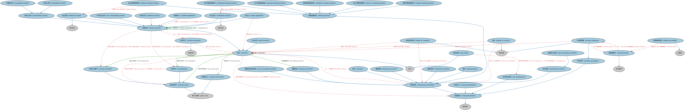

# 合同本体（Contracts Ontology）结构与公理说明

本文档对应 `Contracts.rdf` / `Contracts.ttl`，说明该本体的类、继承关系、属性和公理约定。结构图见 `Contracts-structure.png`（`Contracts-structure.svg` 为可缩放版本）。

## 1. 本体概述

定义具有法律约束力的合同（contract）：合同当事方、合同条款、权利与义务、合同的订立与终止。

**在体系中的位置**：FND 协议模块的核心之一，上承协议本体，是金融工具、贷款、衍生品合约等一切契约性概念的直接上游。

**上下游关系**：上游继承协议本体并依赖法律能力、参与方本体；下游被 FBC 金融工具、LOAN 贷款、DER 衍生品、SEC 证券等全库引用——几乎所有金融业务最终都是一份合同。

**与相近概念的差别**：合同≠协议——协议是双方意思一致的安排（未必有法律强制力），合同是有法律约束力的协议；合同≠文档——合同是法律关系本身，合同文本只是它的书面载体（见文档本体）。

## 2. 类（Class）

| 类（Class） | 定义（Definition） |
|---|---|
| 可转让合同（assignable contract） | 合同持有人（让与人）可将部分或全部权利与义务转让给另一方（受让人）的合同。 |
| 双边合同（bilateral contract） | 双方承诺对彼此履行特定行为或义务的合同。 |
| 双边净额结算条款（bilateral netting provision） | 两方之间的净额结算条款，相互义务相互抵销以确定单笔净支付额。 |
| 违约（breach of contract） | 表示在无合法理由的情况下违反合同明示或默示条件（做或不做某事）的事件分类符。 |
| 违反契约承诺（breach of covenant） | 表示在无合法理由的情况下违背合同中所载做或不做某事之承诺的事件分类符。 |
| 终止净额结算条款（close-out netting provision） | 可在交易对手违约时触发的净额结算条款，导致双方之间所有未了结交易终止。 |
| 附属协议（collateral agreement） | 与另一合同相关、旨在为各参与方提供澄清和额外保护、且独立于主合同的书面合同。 |
| 先决条件（condition precedent） | 规定合同某方面生效前必须满足之条件的约定。 |
| 合同（contract） | 有行为能力的参与方之间自愿、审慎达成的协议，各方同意受法律约束，并为此提供有价值的对价。 |
| 合同文件（contract document） | 记录某合同正式条款与条件的法律文件。 |
| 合同里程碑（contract milestone） | 对与合同履行所要求的指定活动、任务或工作段的状态或完成程度相关的事件（里程碑）或事件集的分类符。 |
| 合同当事方（contract party） | 订立了有约束力协议、接受并承担协议所规定义务、责任与利益的具有法律行为能力的参与方。 |
| 合同主当事方（contract principal） | 发起合同并在合同作此区分时被标识为第一当事方的参与方。 |
| 合同第三方（contract third party） | 间接参与协议但不是协议对手方的参与方。 |
| 合同承诺（contractual commitment） | 规定缔约各方所同意事项（即一方所作履行某行为的许诺或保证）的条款。 |
| 合同定义（contractual definition） | 规定法律文件中某术语含义的合同要素，该定义在术语每次出现时可替代该术语。 |
| 合同要素（contractual element） | 构成协议不可分割部分的要素，如安排、条款、要求、规则、规范和标准。 |
| 交易对手（counterparty） | 就某项协议与之谈判的合同当事方。 |
| 披露条款（disclosure provision） | 列明一方或双方相互披露特定信息之要求与责任的合同条款。 |
| 提前终止条款（early termination provision） | 在到期日前因任何原因终止协议的条款。 |
| 展期条款（extension provision） | 规定合同可展期之条件的合同条款。 |
| 主协议（master agreement） | 具名参与方之间的合同，列明适用于双方之间若干账户、交易或其他活动的条款与条件。 |
| 里程碑事件（milestone event） | 与合同履行所要求的指定活动、任务或工作段的状态或完成程度相关的事件。 |
| 里程碑进度表（milestone schedule） | 里程碑事件、观测或其他发生事项及其完成日期和/或时间的进度表。 |
| 多边合同（multilateral contract） | 多方（即两方以上）承诺对彼此履行特定行为或义务的合同。 |
| 多边净额结算条款（multilateral netting provision） | 触发时由中央清算所或金融机构促成的净额结算条款。 |
| 净额结算条款（netting provision） | 规定通过汇总（合并）两项或多项义务以降低信用、结算及其他风险之方法的合同要素。 |
| 非约束性条款（non-binding term） | 对协议任何一方均不具法律约束力的合同要素。 |
| 不可转让合同（non-transferable contract） | 未经事先书面许可，其各项权利与义务不得转让给另一方的合同。 |
| 通知条款（notification provision） | 表明相关事件发生前须作出通知的条款。 |
| 可更新合同（novateable contract） | 可被另一合同替代的合同；替代时原合同项下生效的权利与义务随之消灭。 |
| 更新净额结算条款（novation netting provision） | 规定给定合同被另一合同替代时净额结算应如何处理的合同要素。 |
| 支付净额结算条款（payment netting provision） | 规定双方之间以单一货币应付的所有款项将如何在每个交易日汇总的净额结算条款。 |
| 陈述（representation） | 合同一方在订约前或订约时就某事实、情况所作的声明，属于合同要素。 |
| 结算净额结算条款（settlement netting provision） | 规定在给定支付日各方将如何汇总其应交付的某货币金额的净额结算条款。 |
| 条款清单（term sheet） | 列明拟议商业交易可能达成之基本条款与条件的非约束性协议。 |
| 终止条款（termination provision） | 规定各方在何种情形下可解除其法律关系并停止履行合同义务的合同要素。 |
| 可转让合同（transferable contract） | 一方的权利与义务可转让给另一方的合同。 |
| 单务合同（unilateral contract） | 一方作出只能通过履行行为（而非回以承诺）来接受之要约的合同。 |
| 募集资金用途条款（use of proceeds provision） | 规定通过融资（如信贷协议、发行、认股权证或其他工具）所获得资金之拟定用途的合同条款。 |
| 口头合同（verbal contract） | 因某种口头交换而成立的合同。 |
| 保证（warranty） | 作为事实声明的合同要素。 |
| 书面合同（written contract） | 由各方签署的书面正式合同。 |

### 2.1 继承关系（Inheritance）

- 可转让合同（assignable contract） ⊑ 可转让合同（transferable contract）
- 双边合同（bilateral contract） ⊑ 双边协议
- 双边合同（bilateral contract） ⊑ 书面合同（written contract）
- 双边净额结算条款（bilateral netting provision） ⊑ 净额结算条款（netting provision）
- 违约（breach of contract） ⊑ 发生类别
- 违反契约承诺（breach of covenant） ⊑ 发生类别
- 终止净额结算条款（close-out netting provision） ⊑ 净额结算条款（netting provision）
- 附属协议（collateral agreement） ⊑ 书面合同（written contract）
- 先决条件（condition precedent） ⊑ 合同要素（contractual element）
- 合同（contract） ⊑ 协议
- 合同文件（contract document） ⊑ 法律文件
- 合同里程碑（contract milestone） ⊑ 先决条件（condition precedent）
- 合同里程碑（contract milestone） ⊑ 发生类别
- 合同当事方（contract party） ⊑ 参与方角色（party role）
- 合同主当事方（contract principal） ⊑ 合同当事方（contract party）
- 合同第三方（contract third party） ⊑ 参与方角色（party role）
- 合同承诺（contractual commitment） ⊑ 合同要素（contractual element）
- 合同定义（contractual definition） ⊑ 合同要素（contractual element）
- 合同要素（contractual element） ⊑ 组成成分
- 交易对手（counterparty） ⊑ 合同当事方（contract party）
- 披露条款（disclosure provision） ⊑ 合同承诺（contractual commitment）
- 提前终止条款（early termination provision） ⊑ 终止条款（termination provision）
- 展期条款（extension provision） ⊑ 合同承诺（contractual commitment）
- 主协议（master agreement） ⊑ 书面合同（written contract）
- 里程碑事件（milestone event） ⊑ 发生事项
- 里程碑进度表（milestone schedule） ⊑ 进度表
- 多边合同（multilateral contract） ⊑ 多边协议
- 多边合同（multilateral contract） ⊑ 书面合同（written contract）
- 多边净额结算条款（multilateral netting provision） ⊑ 净额结算条款（netting provision）
- 净额结算条款（netting provision） ⊑ 合同承诺（contractual commitment）
- 非约束性条款（non-binding term） ⊑ 合同要素（contractual element）
- 不可转让合同（non-transferable contract） ⊑ 书面合同（written contract）
- 通知条款（notification provision） ⊑ 合同承诺（contractual commitment）
- 可更新合同（novateable contract） ⊑ 可转让合同（transferable contract）
- 更新净额结算条款（novation netting provision） ⊑ 净额结算条款（netting provision）
- 支付净额结算条款（payment netting provision） ⊑ 净额结算条款（netting provision）
- 陈述（representation） ⊑ 合同承诺（contractual commitment）
- 结算净额结算条款（settlement netting provision） ⊑ 净额结算条款（netting provision）
- 条款清单（term sheet） ⊑ 协议
- 终止条款（termination provision） ⊑ 合同承诺（contractual commitment）
- 可转让合同（transferable contract） ⊑ 书面合同（written contract）
- 单务合同（unilateral contract） ⊑ 书面合同（written contract）
- 募集资金用途条款（use of proceeds provision） ⊑ 合同承诺（contractual commitment）
- 口头合同（verbal contract） ⊑ 合同（contract）
- 保证（warranty） ⊑ 合同承诺（contractual commitment）
- 书面合同（written contract） ⊑ 合同（contract）

## 3. 对象属性（Object Property）

| 属性（Property） | 中文（English） | 定义（Definition） | 说明 |
|---|---|---|---|
| fibo-fnd-agr-ctr:definesTermsFor | 为……定义条款（defines terms for） | 将合同关联到该合同为其定义具有法律约束力之条款与条件的事物。 | 定义域（domain）：合同（contract）；子属性（subPropertyOf）：定义 |
| fibo-fnd-agr-ctr:hasBeneficiary | 具有受益人（has beneficiary） | 按协议规定从某事物获得利益、好处或收益的参与方。 | 值域（range）：受益方；子属性（subPropertyOf）：具有交易对手（has counterparty） |
| fibo-fnd-agr-ctr:hasContractDuration | 具有合同期限（has contract duration） | 标识合同签署后拟生效的时间期间。 | 定义域（domain）：合同（contract）；值域（range）：时长；子属性（subPropertyOf）：具有期限（has term） |
| fibo-fnd-agr-ctr:hasContractParty | 具有合同当事方（has contract party） | 标识订立了有约束力协议、接受并承担协议所规定义务、责任与利益的参与方。 | 定义域（domain）：合同（contract）；值域（range）：合同当事方（contract party）；子属性（subPropertyOf）：具有参与方角色（has party role） |
| fibo-fnd-agr-ctr:hasContractualElement | 具有合同要素（has contractual element） | 标识作为协议组成部分的某事物。 | 定义域（domain）：协议；值域（range）：合同要素（contractual element）；子属性（subPropertyOf）：包含 |
| fibo-fnd-agr-ctr:hasCounterparty | 具有交易对手（has counterparty） | 标识合同的当事方，通常不是合同主当事方。 | 定义域（domain）：合同（contract）；值域（range）：交易对手（counterparty）；子属性（subPropertyOf）：具有合同当事方（has contract party） |
| fibo-fnd-agr-ctr:hasEarlyTerminationDate | 具有提前终止日（has early termination date） | 标识早于明示到期日的终止日期。 | 值域（range）：显式日期；子属性（subPropertyOf）：具有终止日 |
| fibo-fnd-agr-ctr:hasEffectiveDate | 具有生效日期（has effective date） | 标识合同、关系或政策生效的日期。 | 值域（range）：日期；子属性（subPropertyOf）：具有日期 |
| fibo-fnd-agr-ctr:hasEffectiveDateTimeStamp | 具有生效日期时间戳（has effective date time stamp） | 标识某事物生效的日期与时间（含时区）。 | 值域（range）：日期时间戳；子属性（subPropertyOf）：具有日期时间戳 |
| fibo-fnd-agr-ctr:hasExecutionDate | 具有签署日期（has execution date） | 标识合同已由所有必要当事方签署的日期。 | 值域（range）：日期；子属性（subPropertyOf）：具有日期 |
| fibo-fnd-agr-ctr:hasExecutionDateTimeStamp | 具有签署日期时间戳（has execution date time stamp） | 标识合同已由所有必要当事方签署的日期与时间（含时区）。 | 值域（range）：日期时间戳；子属性（subPropertyOf）：具有日期时间戳 |
| fibo-fnd-agr-ctr:hasExtendablePeriod | 具有可展期期间（has extendable period） | 标识按合同条款允许展期的时间窗口。 | 定义域（domain）：展期条款（extension provision）；值域（range）：显式日期区间；子属性（subPropertyOf）：具有日期区间 |
| fibo-fnd-agr-ctr:hasExtensionProvision | 具有展期条款（has extension provision） | 指明允许合同某方面展期的合同条款细节。 | 定义域（domain）：合同（contract）；值域（range）：展期条款（extension provision）；子属性（subPropertyOf）：具有合同要素（has contractual element） |
| fibo-fnd-agr-ctr:hasGoverningJurisdiction | 具有管辖辖区（has governing jurisdiction） | 标识各方约定的合同管辖辖区。 | 定义域（domain）：合同（contract）；值域（range）：管辖权；子属性（subPropertyOf）：受……管辖 |
| fibo-fnd-agr-ctr:hasMilestoneProvision | 具有里程碑条款（has milestone provision） | 指协议中包含的与合同存续期内某时点履行情况相关的要求。 | 定义域（domain）：协议；值域（range）：合同里程碑（contract milestone）；子属性（subPropertyOf）：具有合同要素（has contractual element） |
| fibo-fnd-agr-ctr:hasNonBindingTerm | 具有非约束性条款（has non-binding term） | 指协议中包含的、不被视为具有法律约束力的条款。 | 定义域（domain）：协议；值域（range）：非约束性条款（non-binding term）；子属性（subPropertyOf）：具有合同要素（has contractual element） |
| fibo-fnd-agr-ctr:hasPrincipalParty | 具有主当事方（has principal party） | 标识合同的主要或主当事方。 | 定义域（domain）：合同（contract）；值域（range）：合同主当事方（contract principal）；子属性（subPropertyOf）：具有合同当事方（has contract party） |
| fibo-fnd-agr-ctr:hasTerm | 具有期限（has term） | 标识某事物（如合同、投资或要约）持续或拟持续的固定或有限期间。 | 值域（range）：时长；子属性（subPropertyOf）：具有时长 |
| fibo-fnd-agr-ctr:hasThirdParty | 具有第三方（has third party） | 标识不是合同签署方但在合同界定的整体情境中扮演某种角色的参与方。 | 定义域（domain）：合同（contract）；值域（range）：合同第三方（contract third party）；子属性（subPropertyOf）：具有参与方角色（has party role） |
| fibo-fnd-agr-ctr:isBeneficiaryOf | 是……的受益人（is beneficiary of） | 指明受益人被列名的协议。 | 定义域（domain）：受益方；值域（range）：协议；子属性（subPropertyOf）：受…影响（is affected by） |
| fibo-fnd-agr-ctr:isEvidenceFor | 是……的证据（is evidence for） | 佐证。 | 逆属性（inverseOf）：由……证明（is evidenced by） |
| fibo-fnd-agr-ctr:isEvidencedBy | 由……证明（is evidenced by） | 由……证实。 | 逆属性（inverseOf）：是……的证据（is evidence for） |
| fibo-fnd-agr-ctr:isPrimaryContractFor | 是……的主合同（is primary contract for） | 标识任何从属协议，如附属协议。 | 定义域（domain）：书面合同（written contract）；值域（range）：书面合同（written contract）；逆属性（inverseOf）：从属于（is subordinate to）；子属性（subPropertyOf）：被……引用 |
| fibo-fnd-agr-ctr:isQualifiedBy | 受……限定（is qualified by） | 标识对某事物的约束、限制或细化。 | 子属性（subPropertyOf）：以……为特征 |
| fibo-fnd-agr-ctr:isSubordinateTo | 从属于（is subordinate to） | 标识从属协议（如附属协议）所引用的主合同。 | 定义域（domain）：书面合同（written contract）；值域（range）：书面合同（written contract）；子属性（subPropertyOf）：引用 |
| fibo-fnd-agr-ctr:qualifies | 限定（qualifies） | 限制、约束或细化。 | 逆属性（inverseOf）：受……限定（is qualified by）；子属性（subPropertyOf）：刻画 |
| fibo-fnd-agr-ctr:supersedes | 取代（supersedes） | 标识先前签署并被本合同替代的合同。 | 定义域（domain）：合同（contract）；值域（range）：合同（contract） |

## 4. 数据属性（Datatype Property）

| 属性（Property） | 中文（English） | 定义（Definition） |
|---|---|---|
| fibo-fnd-agr-ctr:hasLegalDescription | 具有法律描述（has legal description） | 提供以法律术语表述的合同条款、条文或其他要素的文本或其摘要。 |
| fibo-fnd-agr-ctr:isAssignable | 可让与（is assignable） | 表明合同及其项下权利是否可由签署方之一让与给其他参与方。 |
| fibo-fnd-agr-ctr:isNettingAutomatic | 净额结算是否自动（is netting automatic） | 表明净额结算是否在协议范围内自动进行。 |

## 5. 公理约定（Axioms）

- 可转让合同（assignable contract）：restriction
- 双边净额结算条款（bilateral netting provision）：适用于 some 双边合同（bilateral contract）
- 违约（breach of contract）：适用于 some 合同（contract）
- 违约（breach of contract）：引用 some 合同承诺（contractual commitment）
- 违反契约承诺（breach of covenant）：适用于 some 合同（contract）
- 违反契约承诺（breach of covenant）：引用 some 合同承诺（contractual commitment）
- 终止净额结算条款（close-out netting provision） 与 结算净额结算条款（settlement netting provision） 互斥（disjointWith）
- 附属协议（collateral agreement）：从属于（is subordinate to） some 书面合同（written contract）
- 合同（contract）：具有生效日期（has effective date） 日期 ≥0
- 合同（contract）：具有合同当事方（has contract party） 合同当事方（contract party） ≥2
- 合同（contract）：具有合同要素（has contractual element） some 合同要素（contractual element）
- 合同文件（contract document）：记录 some 合同（contract）
- 合同里程碑（contract milestone）：分类 里程碑事件（milestone event） ≥0
- 合同里程碑（contract milestone）：适用于 some 合同（contract）
- 合同当事方（contract party）：由…扮演（is played by） 法律主体 =1
- 合同当事方（contract party）：由…扮演（is played by） some（是…的参与方（is a party to） some 合同（contract））
- 合同承诺（contractual commitment）：具有部分 only 合同承诺（contractual commitment）
- 合同承诺（contractual commitment）：由……授权要求 some 合同（contract）
- 合同要素（contractual element）：restriction
- 提前终止条款（early termination provision）：具有到期日 some 显式日期
- 展期条款（extension provision）：具有可展期期间（has extendable period） 显式日期区间 ≥0
- 主协议（master agreement）：管辖 合同（contract） ≥0
- 里程碑事件（milestone event）：由……分类 some 合同里程碑（contract milestone）
- 里程碑进度表（milestone schedule）：具有成员 some 里程碑事件（milestone event）
- 多边净额结算条款（multilateral netting provision）：适用于 some 多边合同（multilateral contract）
- 多边净额结算条款（multilateral netting provision） 与 双边净额结算条款（bilateral netting provision） 互斥（disjointWith）
- 不可转让合同（non-transferable contract） 与 可转让合同（transferable contract） 互斥（disjointWith）
- 结算净额结算条款（settlement netting provision）：restriction
- 条款清单（term sheet）：具有非约束性条款（has non-binding term） some 非约束性条款（non-binding term）
- 单务合同（unilateral contract）：授予 only 单方面承诺
- 口头合同（verbal contract） 与 书面合同（written contract） 互斥（disjointWith）
- 书面合同（written contract）：具有签署日期（has execution date） 日期 ≥0
- 书面合同（written contract）：具有签发日期 日期 ≥0
- 书面合同（written contract）：具有生效日期时间戳（has effective date time stamp） 日期时间戳 ≥0
- 书面合同（written contract）：具有签署日期时间戳（has execution date time stamp） 日期时间戳 ≥0
- 书面合同（written contract）：restriction
- 书面合同（written contract）：具有交易对手（has counterparty） some 交易对手（counterparty）
- 书面合同（written contract）：具有主当事方（has principal party） some 合同主当事方（contract principal）
- 书面合同（written contract）：由……证明（is evidenced by） some 合同文件（contract document）

## 6. 依赖（owl:imports，19 个）

本本体通过 `owl:imports` 引入以下本体，各项的中文名称与简介如下：

| 导入本体 | 中文名称 | 简介 |
|---|---|---|
| `FND/AgentsAndPeople/People.rdf` | 人员本体（People Ontology） | 定义自然人（person）的核心属性：姓名、出生日期、国籍、身份标识与联系方式，为雇员、客户、签署人等角色提供「人」的基础模型。 |
| `FND/Agreements/Agreements.rdf` | 协议本体（Agreements Ontology） | 定义两个或以上参与方之间协议（agreement）的通用概念：协议的当事方、条款、生效与终止，是合同等一切契约性安排的上位模型。 |
| `FND/Arrangements/Documents.rdf` | 文档本体（Documents Ontology） | 定义文档、文档类型及文档与其所记载内容的关系，为合同文本、募集说明书等法律文书建模。 |
| `FND/DatesAndTimes/FinancialDates.rdf` | 金融日期本体（Financial Dates Ontology） | 定义金融语境下的日期与期间概念：结算日、付息日、到期日、日计数基准等。 |
| `FND/DatesAndTimes/Occurrences.rdf` | 事件与发生本体（Occurrences Ontology） | 定义「发生」（occurrence）、事件与触发条件，用于表达企业行动、信用事件等「发生了什么」。 |
| `FND/Places/Addresses.rdf` | 地址本体（Addresses Ontology） | 定义邮政地址及其组成部分，为机构注册地、通讯地址建模。 |
| `FND/Relations/Relations.rdf` | 关系本体（Relations Ontology） | FIBO 最底层的基础本体，定义参考（reference）、分类（classify）等通用关系与抽象概念，全库普遍依赖。 |
| `FND/Utilities/AnnotationVocabulary.rdf` | FIBO 标注词汇表（FIBO Annotation Vocabulary） | 定义 FIBO 专用的标注属性（如释义来源、成熟度等级），用于本体自身的元数据标注。 |
| `https://www.omg.org/spec/Commons/AnnotationVocabulary/` | OMG 通用标注词汇表（OMG Commons Annotation Vocabulary） | OMG 通用本体库（Commons）中的标注词汇表，提供概念映射等标注属性，FIBO 用它标注术语与外部标准的对应关系。 |
| `https://www.omg.org/spec/Commons/Classifiers/` | OMG 通用分类器本体（OMG Commons Classifiers） | OMG 通用本体库（Commons）中的分类器本体，定义分类方案、类别与归类关系的通用概念，FIBO 的分类建模建立在其上。 |
| `https://www.omg.org/spec/Commons/Collections/` | OMG 通用集合本体（OMG Commons Collections） | Commons 库中的集合本体，定义集合、成员等通用概念。 |
| `https://www.omg.org/spec/Commons/ContextualDesignators/` | OMG 通用语境指称本体（OMG Commons Contextual Designators） | Commons 库中的语境指称本体，定义「在某个语境下指代某物的名称/符号」，是地址、账户号码等语境相关标识的基础。 |
| `https://www.omg.org/spec/Commons/DatesAndTimes/` | OMG 通用日期与时间本体（OMG Commons Dates and Times） | Commons 库中的日期时间本体，定义日期、期间、时间点等通用时间概念。 |
| `https://www.omg.org/spec/Commons/Designators/` | OMG 通用指称符本体（OMG Commons Designators） | Commons 库中的指称符本体，定义名称、标识符等「指代某物的符号」的通用概念。 |
| `https://www.omg.org/spec/Commons/Documents/` | OMG 通用文档本体（OMG Commons Documents） | Commons 库中的文档本体，定义文档及其组成部分的通用概念。 |
| `https://www.omg.org/spec/Commons/Organizations/` | OMG 通用组织本体（OMG Commons Organizations） | Commons 库中的组织本体，定义组织、组织成员与组织结构的通用概念。 |
| `https://www.omg.org/spec/Commons/PartiesAndSituations/` | OMG 通用参与方与情境本体（OMG Commons Parties and Situations） | Commons 库中的参与方本体，定义独立主体、参与方及其角色扮演的通用概念，是 FIBO 参与方模型的上游。 |
| `https://www.omg.org/spec/Commons/RegulatoryAgencies/` | OMG 通用监管机构本体（OMG Commons Regulatory Agencies） | Commons 库中的监管机构本体，定义监管机构及其监管职权的通用概念。 |
| `https://www.omg.org/spec/Commons/RolesAndCompositions/` | OMG 通用角色与构成本体（OMG Commons Roles and Compositions） | Commons 库中的角色本体，定义角色及整体—部分构成关系的通用概念。 |

## 7. 文件

- 官方 RDF/XML：`Contracts.rdf`
- 中文 Turtle：`Contracts.ttl`
- 结构图：`Contracts-structure.png` / `Contracts-structure.svg`