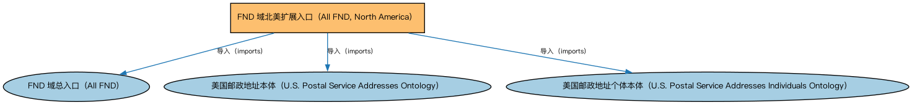

# FND 域北美扩展入口（All FND, North America）聚合说明

本文档对应 `AllFND-NorthAmerica.rdf` / `AllFND-NorthAmerica.ttl`。

## 1. 本文件是什么

聚合 FND 域中北美地区的扩展内容（美国邮政服务地址及其参考个体），与 AllFND 配合使用以覆盖北美地址场景。

从机制上说，这是一个聚合入口（load-all）文件：它本身不定义任何新的类或属性，只通过 `owl:imports` 把一组本体打包在一起。应用只要导入这一个文件，推理机就会把它列出的所有本体一次性加载进来，免去逐个声明的麻烦。因此它的价值不在「内容」，而在「组合」——组合方式本身就表达了发布方的意图（例如按域打包、按区域扩展打包、按是否含参考数据打包）。

## 2. 聚合的本地本体（3 个）

以下本体均可在本目录结构中找到同名 `.rdf` 文件及配套中文文档：

| 导入本体 | 中文名称 | 简介 |
|---|---|---|
| `FND/AllFND.rdf` | FND 域总入口（All FND） | 聚合基础（Foundations，FND）域的全部生产本体，一次导入即可获得 FIBO 全部基础概念（协议、合同、参与方、日期、所有权等），是依赖 FND 全域时的标准入口。 |
| `FND/Places/NorthAmerica/USPostalServiceAddresses.rdf` | 美国邮政地址本体（U.S. Postal Service Addresses Ontology） | 定义符合美国邮政服务（USPS）规范的地址结构：街道、城市、州与邮编。 |
| `FND/Places/NorthAmerica/USPostalServiceAddressesIndividuals.rdf` | 美国邮政地址个体本体（U.S. Postal Service Addresses Individuals Ontology） | 收录美国州、地区等地址参考数据个体，供美国地址建模时引用。 |

## 3. 文件

- 官方 RDF/XML：`AllFND-NorthAmerica.rdf`
- 中文 Turtle：`AllFND-NorthAmerica.ttl`
- 结构图：`AllFND-NorthAmerica-structure.png` / `AllFND-NorthAmerica-structure.svg`