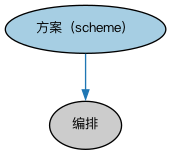

# 安排本体（Arrangements Ontology）结构与公理说明

本文档对应 `Arrangements.rdf` / `Arrangements.ttl`，说明该本体的类、继承关系、属性和公理约定。结构图见 `Arrangements-structure.png`（`Arrangements-structure.svg` 为可缩放版本）。

## 1. 本体概述

本本体定义抽象结构概念，扩展 Commons 的安排（arrangement）概念以表示各种方案（scheme）。

## 2. 类（Class）

| 类（Class） | 定义（Definition） |
|---|---|
| 方案（scheme） | 用于组织信息的结构或方式，如蓝图、模式、编号系统、组织结构、度量系统、计划、分类法或组织信息的语言。 |

### 2.1 继承关系（Inheritance）

- 方案（scheme） ⊑ 编排

## 4. 数据属性（Datatype Property）

| 属性（Property） | 中文（English） | 定义（Definition） |
|---|---|---|
| fibo-fnd-arr-arr:hasCollectionSize | 具有集合大小（has collection size） | 指示给定集合中元素的数量。 |

## 5. 公理约定（Axioms）

- 方案（scheme）：restriction

## 6. 依赖（owl:imports，5 个）

本本体通过 `owl:imports` 引入以下本体，各项的中文名称与简介如下：

| 导入本体 | 中文名称 | 简介 |
|---|---|---|
| `FND/Utilities/AnnotationVocabulary.rdf` | FIBO 标注词汇表（FIBO Annotation Vocabulary） | 定义 FIBO 专用的标注属性（如释义来源、成熟度等级），用于本体自身的元数据标注。 |
| `https://www.omg.org/spec/Commons/AnnotationVocabulary/` | OMG 通用标注词汇表（OMG Commons Annotation Vocabulary） | OMG 通用本体库（Commons）中的标注词汇表，提供概念映射等标注属性，FIBO 用它标注术语与外部标准的对应关系。 |
| `https://www.omg.org/spec/Commons/CodesAndCodeSets/` | OMG 通用代码与代码集本体（OMG Commons Codes and Code Sets） | Commons 库中的代码本体，定义代码、代码集及其维护方的通用概念，是 ISO 4217、ISO 3166 等编码体系建模的基础。 |
| `https://www.omg.org/spec/Commons/Collections/` | OMG 通用集合本体（OMG Commons Collections） | Commons 库中的集合本体，定义集合、成员等通用概念。 |
| `https://www.omg.org/spec/Commons/Designators/` | OMG 通用指称符本体（OMG Commons Designators） | Commons 库中的指称符本体，定义名称、标识符等「指代某物的符号」的通用概念。 |

## 7. 文件

- 官方 RDF/XML：`Arrangements.rdf`
- 中文 Turtle：`Arrangements.ttl`
- 结构图：`Arrangements-structure.png` / `Arrangements-structure.svg`