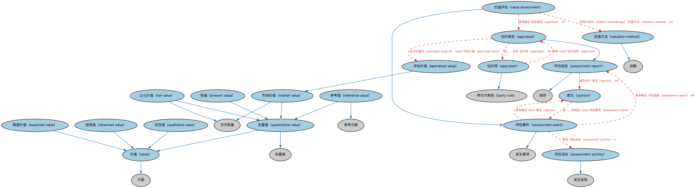

# 评估本体（Assessments Ontology）结构与公理说明

本文档对应 `Assessments.rdf` / `Assessments.ttl`，说明该本体的类、继承关系、属性和公理约定。结构图见 `Assessments-structure.png`（`Assessments-structure.svg` 为可缩放版本）。

## 1. 本体概述

定义评估（assessment）活动、评估结果与评估方的通用结构：谁、依据什么、对什么给出了判断。

**在体系中的位置**：FND 安排模块的配套本体，是评级、估值等判断性活动的上位模型。

**上下游关系**：上游依赖安排与参与方本体；下游被评级本体（FND）和信用评级（FBC）引用。

**与相近概念的差别**：评估≠评级——评估是泛指一切判断活动（含一次性的），评级是按标准量表给出的等级化评估；评估结果是意见，不是客观事实。

## 2. 类（Class）

| 类（Class） | 定义（Definition） |
|---|---|
| 估价报告（appraisal） | 对某事物在某时点市场价值的书面估计，通常由合格估价师提供。 |
| 评估价值（appraised value） | 某资产在给定时点的估计价值。 |
| 估价师（appraiser） | 评估或估计某人或某事物的性质、质量、能力或价值的参与方。 |
| 评估活动（assessment activity） | 涉及评估或估计某人或某事物的性质、质量、能力或价值的活动。 |
| 评估事件（assessment event） | 涉及评估或估计某人或某事物的性质、质量或能力的事件。 |
| 评估报告（assessment report） | 包含对某事物的意见、判断、估价或看法，以及通常得出该意见所用方法和原始输入的报告。 |
| 期望价值（expected value） | 基于模型或假设预期的理论价值。 |
| 公允价值（fair value） | 在计量日市场参与者之间的有序交易中出售资产所能收到或转移负债所须支付的价格。 |
| 市场价值（market value） | 资产在市场上可售得的价格。 |
| 观测值（observed value） | 从实验、调查或观测中收集的实际数据点。 |
| 意见（opinion） | 对某事物的判断、估价或看法。 |
| 现值（present value） | 资产当前的价值，可由参考数据计算并可能基于其预期未来价值。 |
| 定性值（qualitative value） | 精度或准确度低于定量方法所确定值的值，通常以代码而非实际数值表示。 |
| 定量值（quantitative value） | 通过定量方法确定、以适当单位的数值表示的值。 |
| 参考值（reference value） | 对某可辨识事物、可获得证据支持的值。 |
| 估值方法（valuation method） | 用于确定资产当前或预期价值的方法。 |
| 价值（value） | 某事物（如产品、服务或资产）对公司、客户或利益相关方的感知价值。 |
| 价值评估（value assessment） | 估计某事物价值的评估事件。 |

### 2.1 继承关系（Inheritance）

- 估价报告（appraisal） ⊑ 评估报告（assessment report）
- 评估价值（appraised value） ⊑ 市场价值（market value）
- 估价师（appraiser） ⊑ 参与方角色（party role）
- 评估活动（assessment activity） ⊑ 发生类别
- 评估事件（assessment event） ⊑ 发生事项
- 评估报告（assessment report） ⊑ 报告
- 期望价值（expected value） ⊑ 价值（value）
- 公允价值（fair value） ⊑ 货币数量
- 公允价值（fair value） ⊑ 定量值（quantitative value）
- 市场价值（market value） ⊑ 货币数量
- 市场价值（market value） ⊑ 定量值（quantitative value）
- 观测值（observed value） ⊑ 价值（value）
- 现值（present value） ⊑ 定量值（quantitative value）
- 定性值（qualitative value） ⊑ 价值（value）
- 定量值（quantitative value） ⊑ 价值（value）
- 定量值（quantitative value） ⊑ 标量值
- 参考值（reference value） ⊑ 定量值（quantitative value）
- 参考值（reference value） ⊑ 参考文献
- 估值方法（valuation method） ⊑ 战略
- 价值（value） ⊑ 方面
- 价值评估（value assessment） ⊑ 评估事件（assessment event）

## 3. 对象属性（Object Property）

| 属性（Property） | 中文（English） | 定义（Definition） | 说明 |
|---|---|---|---|
| fibo-fnd-arr-asmt:appliesMethodology | 应用方法论（applies methodology） | 标识为确定某事物公允市场价值或现值所用的策略。 | 值域（range）：估值方法（valuation method）；子属性（subPropertyOf）：具有战略 |
| fibo-fnd-arr-asmt:estimatesValueAt | 估计价值为（estimates value at） | 给出某资产在某时点的近似价值。 | 值域（range）：评估价值（appraised value）；子属性（subPropertyOf）：具有货币数量 |
| fibo-fnd-arr-asmt:hasAppraiser | 具有估价师（has appraiser） | 将评估或报告关联到实施评估的代理。 | 子属性（subPropertyOf）：由……提供 |
| fibo-fnd-arr-asmt:hasDateOfAssessment | 具有评估日期（has date of assessment） | 评估过程完成的日期。 | 值域（range）：显式日期；子属性（subPropertyOf）：具有显式日期 |
| fibo-fnd-arr-asmt:hasEstimatedValue | 具有估计价值（has estimated value） | 将某事物关联到其估计价值。 | 值域（range）：评估价值（appraised value）；子属性（subPropertyOf）：具有货币数量 |
| fibo-fnd-arr-asmt:isEstimatedValueOf | 是……的估计价值（is estimated value of） | 将评估价值关联到评估日所关注的资产。 | 定义域（domain）：评估价值（appraised value）；逆属性（inverseOf）：具有估计价值（has estimated value）；子属性（subPropertyOf）：是……的值 |

## 5. 公理约定（Axioms）

- 估价报告（appraisal）：由……生成 估价师（appraiser） ≥0
- 估价报告（appraisal）：评估 资产 ≥0
- 估价报告（appraisal）：估计价值为（estimates value at） some 评估价值（appraised value）
- 估价师（appraiser）：restriction
- 估价师（appraiser）：提供 some 估价报告（appraisal）
- 评估活动（assessment activity）：restriction
- 评估活动（assessment activity）：由……提供 some 智能体角色（agent role）
- 评估事件（assessment event）：restriction
- 评估事件（assessment event）：具有输出 评估报告（assessment report） ≥0
- 评估事件（assessment event）：例证 评估活动（assessment activity） =1
- 评估事件（assessment event）：具有输出 some 意见（opinion）
- 评估事件（assessment event）：由……提供 some 智能体角色（agent role）
- 评估报告（assessment report）：报告关于 意见（opinion） ≥0
- 期望价值（expected value） 与 观测值（observed value） 互斥（disjointWith）
- 意见（opinion）：是……的输出 some 评估事件（assessment event）
- 意见（opinion）：由……生成 some 智能体角色（agent role）
- 定性值（qualitative value） 与 定量值（quantitative value） 互斥（disjointWith）
- 价值评估（value assessment）：具有输出 估价报告（appraisal） ≥0
- 价值评估（value assessment）：应用方法论（applies methodology） 估值方法（valuation method） ≥0
- 价值评估（value assessment）：具有估价师（has appraiser） some 智能体角色（agent role）

## 6. 依赖（owl:imports，15 个）

本本体通过 `owl:imports` 引入以下本体，各项的中文名称与简介如下：

| 导入本体 | 中文名称 | 简介 |
|---|---|---|
| `FND/Accounting/CurrencyAmount.rdf` | 货币金额本体（Currency Amount Ontology） | 定义「金额＋币种」的货币金额（currency amount）表示，是 FIBO 中表达价格、债务金额、付款额等一切带币种数值的基础构件。 |
| `FND/Arrangements/Reporting.rdf` | 报告本体（Reporting Ontology） | 定义报告、报告方与报告内容的关系，支撑监管报告、财务报告等报送场景。 |
| `FND/DatesAndTimes/Occurrences.rdf` | 事件与发生本体（Occurrences Ontology） | 定义「发生」（occurrence）、事件与触发条件，用于表达企业行动、信用事件等「发生了什么」。 |
| `FND/GoalsAndObjectives/Objectives.rdf` | 目标本体（Objectives Ontology） | 定义目标（objective）及其与组织、计划的关系，用于表达机构的经营目标与投资目标。 |
| `FND/OwnershipAndControl/Ownership.rdf` | 所有权本体（Ownership Ontology） | 定义「拥有」关系：所有者、被拥有资产及所有权份额。 |
| `FND/Relations/Relations.rdf` | 关系本体（Relations Ontology） | FIBO 最底层的基础本体，定义参考（reference）、分类（classify）等通用关系与抽象概念，全库普遍依赖。 |
| `FND/Utilities/AnnotationVocabulary.rdf` | FIBO 标注词汇表（FIBO Annotation Vocabulary） | 定义 FIBO 专用的标注属性（如释义来源、成熟度等级），用于本体自身的元数据标注。 |
| `https://www.omg.org/spec/Commons/AnnotationVocabulary/` | OMG 通用标注词汇表（OMG Commons Annotation Vocabulary） | OMG 通用本体库（Commons）中的标注词汇表，提供概念映射等标注属性，FIBO 用它标注术语与外部标准的对应关系。 |
| `https://www.omg.org/spec/Commons/Classifiers/` | OMG 通用分类器本体（OMG Commons Classifiers） | OMG 通用本体库（Commons）中的分类器本体，定义分类方案、类别与归类关系的通用概念，FIBO 的分类建模建立在其上。 |
| `https://www.omg.org/spec/Commons/ContextualDesignators/` | OMG 通用语境指称本体（OMG Commons Contextual Designators） | Commons 库中的语境指称本体，定义「在某个语境下指代某物的名称/符号」，是地址、账户号码等语境相关标识的基础。 |
| `https://www.omg.org/spec/Commons/DatesAndTimes/` | OMG 通用日期与时间本体（OMG Commons Dates and Times） | Commons 库中的日期时间本体，定义日期、期间、时间点等通用时间概念。 |
| `https://www.omg.org/spec/Commons/Documents/` | OMG 通用文档本体（OMG Commons Documents） | Commons 库中的文档本体，定义文档及其组成部分的通用概念。 |
| `https://www.omg.org/spec/Commons/Organizations/` | OMG 通用组织本体（OMG Commons Organizations） | Commons 库中的组织本体，定义组织、组织成员与组织结构的通用概念。 |
| `https://www.omg.org/spec/Commons/PartiesAndSituations/` | OMG 通用参与方与情境本体（OMG Commons Parties and Situations） | Commons 库中的参与方本体，定义独立主体、参与方及其角色扮演的通用概念，是 FIBO 参与方模型的上游。 |
| `https://www.omg.org/spec/Commons/QuantitiesAndUnits/` | OMG 通用量与单位本体（OMG Commons Quantities and Units） | Commons 库中的量与单位本体，定义数量、度量单位、量纲的通用概念，支撑金额、比率等数值表达。 |

## 7. 文件

- 官方 RDF/XML：`Assessments.rdf`
- 中文 Turtle：`Assessments.ttl`
- 结构图：`Assessments-structure.png` / `Assessments-structure.svg`