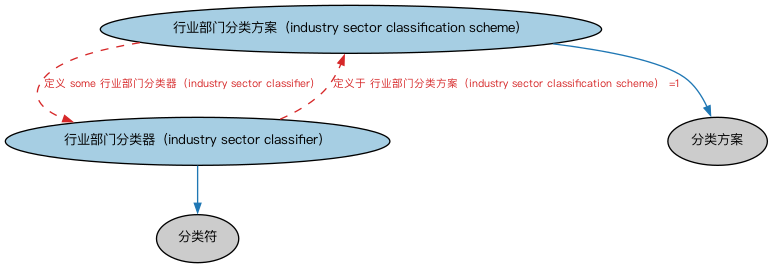

# 分类方案本体（Classification Schemes Ontology）结构与公理说明

本文档对应 `ClassificationSchemes.rdf` / `ClassificationSchemes.ttl`，说明该本体的类、继承关系、属性和公理约定。结构图见 `ClassificationSchemes-structure.png`（`ClassificationSchemes-structure.svg` 为可缩放版本）。

## 1. 本体概述

本本体定义表示行业分类方案的抽象概念。

本本体中类与类的核心关系如下（完整细节见各类小节）：

- **行业部门分类方案（industry sector classification scheme）** 继承 **分类方案（ClassificationScheme）**
- **行业部门分类器（industry sector classifier）** 继承 **分类符（Classifier）**

## 2. 类（Class）

| 类（Class） | 定义（Definition） |
|---|---|
| 行业部门分类方案（industry sector classification scheme） | 按行业部门为组织分配分类器的系统。 |
| 行业部门分类器（industry sector classifier） | 按照某种行业划分方案，对组织或代表该组织权益的证券所作的标准化分类或划分。 |

以下按类逐个展开：每个类给出继承关系、相关属性与公理约定；子类在父类之下降一级编号。

### 2.1 行业部门分类方案（industry sector classification scheme）

定义：按行业部门为组织分配分类器的系统。

- 父类：**分类方案（ClassificationScheme）**

属性：

| 属性 | 定义 | 说明 |
|---|---|---|
| **定义（defines）** | — | — |

公理：

- **定义（defines）**至少有一个取值，类型是**行业部门分类器（industry sector classifier）**。

### 2.2 行业部门分类器（industry sector classifier）

定义：按照某种行业划分方案，对组织或代表该组织权益的证券所作的标准化分类或划分。

- 父类：**分类符（Classifier）**

属性：

| 属性 | 定义 | 说明 |
|---|---|---|
| **定义于（isDefinedIn）** | — | — |

公理：

- **定义于（isDefinedIn）**恰好有 1 个**行业部门分类方案（industry sector classification scheme）**。

## 3. 依赖（owl:imports，5 个）

本本体通过 `owl:imports` 引入以下本体，各项的中文名称与简介如下：

| 导入本体 | 中文名称 | 简介 |
|---|---|---|
| `FND/Arrangements/Arrangements.rdf` | 安排本体（Arrangements Ontology） | 定义「安排」（arrangement）这一抽象概念：把若干事物按某种结构组织起来的方式，是分类方案、标识方案、生命周期等概念的上位基础。 |
| `FND/Utilities/AnnotationVocabulary.rdf` | FIBO 标注词汇表（FIBO Annotation Vocabulary） | 定义 FIBO 专用的标注属性（如释义来源、成熟度等级），用于本体自身的元数据标注。 |
| `https://www.omg.org/spec/Commons/AnnotationVocabulary/` | OMG 通用标注词汇表（OMG Commons Annotation Vocabulary） | OMG 通用本体库（Commons）中的标注词汇表，提供概念映射等标注属性，FIBO 用它标注术语与外部标准的对应关系。 |
| `https://www.omg.org/spec/Commons/Classifiers/` | OMG 通用分类器本体（OMG Commons Classifiers） | OMG 通用本体库（Commons）中的分类器本体，定义分类方案、类别与归类关系的通用概念，FIBO 的分类建模建立在其上。 |
| `https://www.omg.org/spec/Commons/Designators/` | OMG 通用指称符本体（OMG Commons Designators） | Commons 库中的指称符本体，定义名称、标识符等「指代某物的符号」的通用概念。 |

## 4. 文件

- 官方 RDF/XML：`ClassificationSchemes.rdf`
- 中文 Turtle：`ClassificationSchemes.ttl`
- 结构图：`ClassificationSchemes-structure.png` / `ClassificationSchemes-structure.svg`