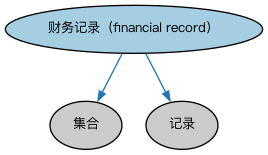

# 文档本体（Documents Ontology）结构与公理说明

本文档对应 `Documents.rdf` / `Documents.ttl`，说明该本体的类、继承关系、属性和公理约定。结构图见 `Documents-structure.png`（`Documents-structure.svg` 为可缩放版本）。

## 1. 本体概述

本本体定义用于在其他 FIBO 本体元素中表示文档的抽象概念。

## 2. 类（Class）

| 类（Class） | 定义（Definition） |
|---|---|
| 财务记录（financial record） | 财务信息的记录。 |

### 2.1 继承关系（Inheritance）

- 财务记录（financial record） ⊑ 集合
- 财务记录（financial record） ⊑ 记录

## 3. 对象属性（Object Property）

| 属性（Property） | 中文（English） | 定义（Definition） | 说明 |
|---|---|---|---|
| fibo-fnd-arr-doc:hasExpirationDate | 具有到期日（has expiration date） | 将某事物（通常是协议、合同、文档或易腐物品）与其到期日关联起来。 | 值域（range）：日期；子属性（subPropertyOf）：具有结束日期 |
| fibo-fnd-arr-doc:hasRecord | 具有记录（has record） | 将某事物关联到与其相关的记录。 | 值域（range）：记录；子属性（subPropertyOf）：包含 |
| fibo-fnd-arr-doc:hasReportingPeriod | 具有报告期（has reporting period） | 指定报告或其他内容（如市场利率、经济指标）适用的报告期。 | 值域（range）：显式日期区间；子属性（subPropertyOf）：具有日期区间 |
| fibo-fnd-arr-doc:hasTerminationDate | 具有终止日（has termination date） | 将某事物（通常是协议、合同、文档或流程）与其计划或实际终止日期关联起来。 | 值域（range）：日期；子属性（subPropertyOf）：具有结束日期 |

## 6. 依赖（owl:imports，5 个）

本本体通过 `owl:imports` 引入以下本体，各项的中文名称与简介如下：

| 导入本体 | 中文名称 | 简介 |
|---|---|---|
| `FND/Utilities/AnnotationVocabulary.rdf` | FIBO 标注词汇表（FIBO Annotation Vocabulary） | 定义 FIBO 专用的标注属性（如释义来源、成熟度等级），用于本体自身的元数据标注。 |
| `https://www.omg.org/spec/Commons/AnnotationVocabulary/` | OMG 通用标注词汇表（OMG Commons Annotation Vocabulary） | OMG 通用本体库（Commons）中的标注词汇表，提供概念映射等标注属性，FIBO 用它标注术语与外部标准的对应关系。 |
| `https://www.omg.org/spec/Commons/Collections/` | OMG 通用集合本体（OMG Commons Collections） | Commons 库中的集合本体，定义集合、成员等通用概念。 |
| `https://www.omg.org/spec/Commons/DatesAndTimes/` | OMG 通用日期与时间本体（OMG Commons Dates and Times） | Commons 库中的日期时间本体，定义日期、期间、时间点等通用时间概念。 |
| `https://www.omg.org/spec/Commons/Documents/` | OMG 通用文档本体（OMG Commons Documents） | Commons 库中的文档本体，定义文档及其组成部分的通用概念。 |

## 7. 文件

- 官方 RDF/XML：`Documents.rdf`
- 中文 Turtle：`Documents.ttl`
- 结构图：`Documents-structure.png` / `Documents-structure.svg`