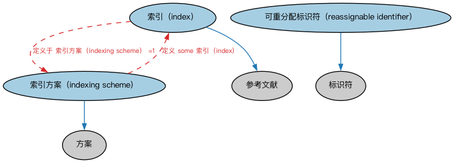

# 标识符与索引本体（Identifiers and Indices Ontology）结构与公理说明

本文档对应 `IdentifiersAndIndices.rdf` / `IdentifiersAndIndices.ttl`，说明该本体的类、继承关系、属性和公理约定。结构图见 `IdentifiersAndIndices-structure.png`（`IdentifiersAndIndices-structure.svg` 为可缩放版本）。

## 1. 本体概述

本本体定义表示索引与索引方案以及可复用标识符的抽象概念，供其他本体复用。

## 2. 类（Class）

| 类（Class） | 定义（Definition） |
|---|---|
| 索引（index） | 从大量值、数据、信息或知识中派生并指向其中的间接快捷方式。 |
| 索引方案（indexing scheme） | 对值、数据、信息或知识进行索引的体系。 |
| 可重分配标识符（reassignable identifier） | 在给定时间段内唯一标识某物、并可在不同时间点重新用于标识其他事物的标识符。 |

### 2.1 继承关系（Inheritance）

- 索引（index） ⊑ 参考文献
- 索引方案（indexing scheme） ⊑ 方案
- 可重分配标识符（reassignable identifier） ⊑ 标识符

## 3. 对象属性（Object Property）

| 属性（Property） | 中文（English） | 定义（Definition） | 说明 |
|---|---|---|---|
| fibo-fnd-arr-id:isIndexTo | 是…的索引（is index to） | 索引所指的对象。 | 定义域（domain）：索引（index）；子属性（subPropertyOf）：引用 |

## 4. 数据属性（Datatype Property）

| 属性（Property） | 中文（English） | 定义（Definition） |
|---|---|---|
| fibo-fnd-arr-id:hasAssignmentTerminationDate | 具有分配终止日期（has assignment termination date） | 标识符解除与某资源分配关系的日期。 |
| fibo-fnd-arr-id:hasInitialAssignmentDate | 具有初始分配日期（has initial assignment date） | 标识符首次分配给某资源的日期。 |

## 5. 公理约定（Axioms）

- 索引（index）：restriction
- 索引（index）：定义于 索引方案（indexing scheme） =1
- 索引方案（indexing scheme）：定义 some 索引（index）
- 可重分配标识符（reassignable identifier）：restriction
- 可重分配标识符（reassignable identifier）：restriction

## 6. 依赖（owl:imports，10 个）

本本体通过 `owl:imports` 引入以下本体，各项的中文名称与简介如下：

| 导入本体 | 中文名称 | 简介 |
|---|---|---|
| `FND/Arrangements/Arrangements.rdf` | 安排本体（Arrangements Ontology） | 定义「安排」（arrangement）这一抽象概念：把若干事物按某种结构组织起来的方式，是分类方案、标识方案、生命周期等概念的上位基础。 |
| `FND/Utilities/AnnotationVocabulary.rdf` | FIBO 标注词汇表（FIBO Annotation Vocabulary） | 定义 FIBO 专用的标注属性（如释义来源、成熟度等级），用于本体自身的元数据标注。 |
| `https://www.omg.org/spec/Commons/AnnotationVocabulary/` | OMG 通用标注词汇表（OMG Commons Annotation Vocabulary） | OMG 通用本体库（Commons）中的标注词汇表，提供概念映射等标注属性，FIBO 用它标注术语与外部标准的对应关系。 |
| `https://www.omg.org/spec/Commons/CodesAndCodeSets/` | OMG 通用代码与代码集本体（OMG Commons Codes and Code Sets） | Commons 库中的代码本体，定义代码、代码集及其维护方的通用概念，是 ISO 4217、ISO 3166 等编码体系建模的基础。 |
| `https://www.omg.org/spec/Commons/Collections/` | OMG 通用集合本体（OMG Commons Collections） | Commons 库中的集合本体，定义集合、成员等通用概念。 |
| `https://www.omg.org/spec/Commons/ContextualIdentifiers/` | OMG 通用语境标识符本体（OMG Commons Contextual Identifiers） | Commons 库中的语境标识符本体，定义在特定语境下唯一标识事物的标识符结构，是地址、账户类标识的基础。 |
| `https://www.omg.org/spec/Commons/DatesAndTimes/` | OMG 通用日期与时间本体（OMG Commons Dates and Times） | Commons 库中的日期时间本体，定义日期、期间、时间点等通用时间概念。 |
| `https://www.omg.org/spec/Commons/Designators/` | OMG 通用指称符本体（OMG Commons Designators） | Commons 库中的指称符本体，定义名称、标识符等「指代某物的符号」的通用概念。 |
| `https://www.omg.org/spec/Commons/Documents/` | OMG 通用文档本体（OMG Commons Documents） | Commons 库中的文档本体，定义文档及其组成部分的通用概念。 |
| `https://www.omg.org/spec/Commons/Identifiers/` | OMG 通用标识符本体（OMG Commons Identifiers） | Commons 库中的标识符本体，定义标识符及其编码方案的通用概念。 |

## 7. 文件

- 官方 RDF/XML：`IdentifiersAndIndices.rdf`
- 中文 Turtle：`IdentifiersAndIndices.ttl`
- 结构图：`IdentifiersAndIndices-structure.png` / `IdentifiersAndIndices-structure.svg`