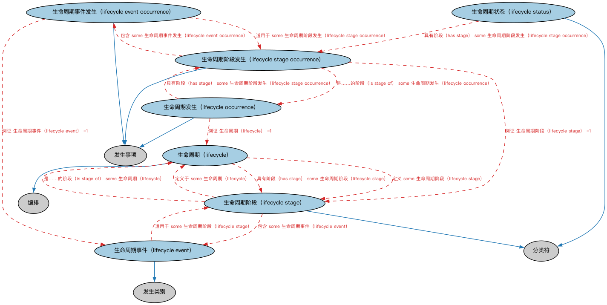

# 生命周期本体（Lifecycles Ontology）结构与公理说明

本文档对应 `Lifecycles.rdf` / `Lifecycles.ttl`，说明该本体的类、继承关系、属性和公理约定。结构图见 `Lifecycles-structure.png`（`Lifecycles-structure.svg` 为可缩放版本）。

## 1. 本体概述

定义生命周期（lifecycle）、生命周期阶段（stage）与状态转移：描述对象从创设到终止的演化路径。

**在体系中的位置**：FND 安排模块的配套本体，为合同、金融工具、机构的「状态机」建模。

**上下游关系**：上游依赖安排与日期本体；下游被贷款事件、证券发行流程、企业行动等需要描述阶段演化的本体引用。

**与相近概念的差别**：生命周期≠业务流程——生命周期描述一个对象自身的状态变化（草稿→生效→到期），流程（BP 域）描述多方协作的业务步骤。

本本体中类与类的核心关系如下（完整细节见各类小节）：

- **生命周期（lifecycle）** 继承 **编排（Arrangement）**
- **生命周期事件（lifecycle event）** 继承 **发生类别（OccurrenceKind）**
- **生命周期事件发生（lifecycle event occurrence）** 继承 **发生事项（Occurrence）**
- **生命周期发生（lifecycle occurrence）** 继承 **发生事项（Occurrence）**
- **生命周期阶段（lifecycle stage）** 继承 **分类符（Classifier）**
- **生命周期阶段发生（lifecycle stage occurrence）** 继承 **发生事项（Occurrence）**
- **生命周期状态（lifecycle status）** 继承 **分类符（Classifier）**

## 2. 类（Class）

| 类（Class） | 定义（Definition） |
|---|---|
| 生命周期（lifecycle） | 将家族、组织、过程、产品、营销、订单管理、组合管理等系统的循环性质与生物体从摇篮到坟墓的生命阶段（出生、成长、成熟、衰退、死亡）相类比的编排。 |
| 生命周期事件（lifecycle event） | 在生命周期的一个或多个阶段中发生的一类事件。 |
| 生命周期事件发生（lifecycle event occurrence） | 生命周期某阶段中事件的实现。 |
| 生命周期发生（lifecycle occurrence） | 生命周期的实现。 |
| 生命周期阶段（lifecycle stage） | 生命周期中的一个时期。 |
| 生命周期阶段发生（lifecycle stage occurrence） | 给定生命周期中某个时期的实现。 |
| 生命周期状态（lifecycle status） | 标识某事物在其生命周期特定时点所处位置或状态的分类符。 |

以下按类逐个展开：每个类给出继承关系、相关属性与公理约定；子类在父类之下降一级编号。

### 2.1 生命周期（lifecycle）

定义：将家族、组织、过程、产品、营销、订单管理、组合管理等系统的循环性质与生物体从摇篮到坟墓的生命阶段（出生、成长、成熟、衰退、死亡）相类比的编排。

- 父类：**编排（Arrangement）**

属性：

| 属性 | 定义 | 说明 |
|---|---|---|
| **具有阶段（has stage）** | 将某事物（如产品或交易生命周期或相关过程）关联到该生命周期中的一个时期或阶段。 | 值域：Nd94e64aff1fa4d0eb5c580fd7058589e；子属性：具有部分 |
| **是……的生命周期（is lifecycle of）** | 将生命周期关联到它所刻画的事物。 | 逆属性：具有生命周期（has lifecycle）；子属性：刻画 |
| **定义（defines）** | — | — |

公理：

- **具有阶段（has stage）**至少有一个取值，类型是**生命周期阶段（lifecycle stage）**。
- **定义（defines）**至少有一个取值，类型是**生命周期阶段（lifecycle stage）**。
- **是……的生命周期（is lifecycle of）**至少有一个取值，类型是**owl:Thing（Thing）**。

### 2.2 生命周期事件（lifecycle event）

定义：在生命周期的一个或多个阶段中发生的一类事件。

- 父类：**发生类别（OccurrenceKind）**

属性：

| 属性 | 定义 | 说明 |
|---|---|---|
| **适用于（appliesTo）** | — | — |

公理：

- **适用于（appliesTo）**至少有一个取值，类型是**生命周期阶段（lifecycle stage）**。

### 2.3 生命周期事件发生（lifecycle event occurrence）

定义：生命周期某阶段中事件的实现。

- 父类：**发生事项（Occurrence）**

属性：

| 属性 | 定义 | 说明 |
|---|---|---|
| **例证（exemplifies）** | — | — |
| **适用于（appliesTo）** | — | — |

公理：

- **例证（exemplifies）**恰好有 1 个**生命周期事件（lifecycle event）**。
- **适用于（appliesTo）**至少有一个取值，类型是**生命周期阶段发生（lifecycle stage occurrence）**。

### 2.4 生命周期发生（lifecycle occurrence）

定义：生命周期的实现。

- 父类：**发生事项（Occurrence）**

属性：

| 属性 | 定义 | 说明 |
|---|---|---|
| **具有阶段（has stage）** | 将某事物（如产品或交易生命周期或相关过程）关联到该生命周期中的一个时期或阶段。 | 值域：Nd94e64aff1fa4d0eb5c580fd7058589e；子属性：具有部分 |
| **例证（exemplifies）** | — | — |

公理：

- **例证（exemplifies）**恰好有 1 个**生命周期（lifecycle）**。
- **具有阶段（has stage）**至少有一个取值，类型是**生命周期阶段发生（lifecycle stage occurrence）**。

### 2.5 生命周期阶段（lifecycle stage）

定义：生命周期中的一个时期。

- 父类：**分类符（Classifier）**

属性：

| 属性 | 定义 | 说明 |
|---|---|---|
| **是……的阶段（is stage of）** | 将产品或交易生命周期或过程中的一个阶段关联到它所属的生命周期或过程。 | 逆属性：具有阶段（has stage）；子属性：是……的部分 |
| **包含（comprises）** | — | — |
| **定义于（isDefinedIn）** | — | — |

公理：

- **包含（comprises）**至少有一个取值，类型是**生命周期事件（lifecycle event）**。
- **定义于（isDefinedIn）**至少有一个取值，类型是**生命周期（lifecycle）**。
- **是……的阶段（is stage of）**至少有一个取值，类型是**生命周期（lifecycle）**。

### 2.6 生命周期阶段发生（lifecycle stage occurrence）

定义：给定生命周期中某个时期的实现。

- 父类：**发生事项（Occurrence）**

属性：

| 属性 | 定义 | 说明 |
|---|---|---|
| **是……的阶段（is stage of）** | 将产品或交易生命周期或过程中的一个阶段关联到它所属的生命周期或过程。 | 逆属性：具有阶段（has stage）；子属性：是……的部分 |
| **例证（exemplifies）** | — | — |
| **包含（comprises）** | — | — |

公理：

- **例证（exemplifies）**恰好有 1 个**生命周期阶段（lifecycle stage）**。
- **包含（comprises）**至少有一个取值，类型是**生命周期事件发生（lifecycle event occurrence）**。
- **是……的阶段（is stage of）**至少有一个取值，类型是**生命周期发生（lifecycle occurrence）**。

### 2.7 生命周期状态（lifecycle status）

定义：标识某事物在其生命周期特定时点所处位置或状态的分类符。

- 父类：**分类符（Classifier）**

属性：

| 属性 | 定义 | 说明 |
|---|---|---|
| **具有阶段（has stage）** | 将某事物（如产品或交易生命周期或相关过程）关联到该生命周期中的一个时期或阶段。 | 值域：Nd94e64aff1fa4d0eb5c580fd7058589e；子属性：具有部分 |

公理：

- **具有阶段（has stage）**至少有一个取值，类型是**生命周期阶段发生（lifecycle stage occurrence）**。

## 3. 其他属性

以下属性未绑定到本体的具体类（定义域在外部本体或未声明）：

对象属性（Object Property）：

| 属性 | 定义 | 说明 |
|---|---|---|
| **具有生命周期（has lifecycle）** | 将某事物（如产品、交易或相关过程）关联到刻画它的生命周期。 | 值域：生命周期（lifecycle）；子属性：以……为特征 |

## 4. 依赖（owl:imports，8 个）

本本体通过 `owl:imports` 引入以下本体，各项的中文名称与简介如下：

| 导入本体 | 中文名称 | 简介 |
|---|---|---|
| `FND/DatesAndTimes/Occurrences.rdf` | 事件与发生本体（Occurrences Ontology） | 定义「发生」（occurrence）、事件与触发条件，用于表达企业行动、信用事件等「发生了什么」。 |
| `FND/Relations/Relations.rdf` | 关系本体（Relations Ontology） | FIBO 最底层的基础本体，定义参考（reference）、分类（classify）等通用关系与抽象概念，全库普遍依赖。 |
| `FND/Utilities/AnnotationVocabulary.rdf` | FIBO 标注词汇表（FIBO Annotation Vocabulary） | 定义 FIBO 专用的标注属性（如释义来源、成熟度等级），用于本体自身的元数据标注。 |
| `https://www.omg.org/spec/Commons/AnnotationVocabulary/` | OMG 通用标注词汇表（OMG Commons Annotation Vocabulary） | OMG 通用本体库（Commons）中的标注词汇表，提供概念映射等标注属性，FIBO 用它标注术语与外部标准的对应关系。 |
| `https://www.omg.org/spec/Commons/Classifiers/` | OMG 通用分类器本体（OMG Commons Classifiers） | OMG 通用本体库（Commons）中的分类器本体，定义分类方案、类别与归类关系的通用概念，FIBO 的分类建模建立在其上。 |
| `https://www.omg.org/spec/Commons/Collections/` | OMG 通用集合本体（OMG Commons Collections） | Commons 库中的集合本体，定义集合、成员等通用概念。 |
| `https://www.omg.org/spec/Commons/ContextualDesignators/` | OMG 通用语境指称本体（OMG Commons Contextual Designators） | Commons 库中的语境指称本体，定义「在某个语境下指代某物的名称/符号」，是地址、账户号码等语境相关标识的基础。 |
| `https://www.omg.org/spec/Commons/Designators/` | OMG 通用指称符本体（OMG Commons Designators） | Commons 库中的指称符本体，定义名称、标识符等「指代某物的符号」的通用概念。 |

## 5. 文件

- 官方 RDF/XML：`Lifecycles.rdf`
- 中文 Turtle：`Lifecycles.ttl`
- 结构图：`Lifecycles-structure.png` / `Lifecycles-structure.svg`