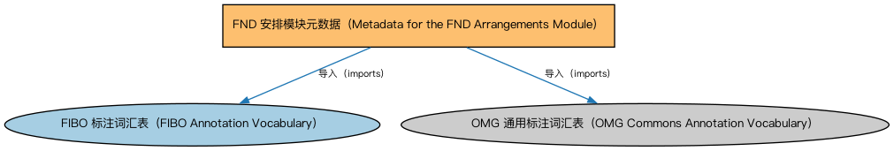

# FND 安排模块元数据（Metadata for the FND Arrangements Module）说明

本文档对应 `MetadataFNDArrangements.rdf` / `MetadataFNDArrangements.ttl`。

## 1. 本文件是什么

声明安排（Arrangements）模块的构成：安排、分类方案、标识符与索引、文档、生命周期、评估、评级、报告八个本体。

从机制上说，这是一个元数据清单（metadata manifest）文件：它本身不定义任何类或属性，而是通过 `dct:hasPart` 声明一个域或模块由哪些本体构成，并携带版本 IRI、版权、许可与成熟度等发布管理信息。它回答的问题是「这个域/模块包含什么、当前是什么版本」，供发布工具和文档系统按模块组织内容；它的 `owl:imports` 只引入标注词汇表，不是用来加载业务本体的入口（加载入口是 `All*` 与 `About*` 聚合文件）。

## 2. 声明的构成（dct:hasPart，8 个）

| 构成项 | 中文名称 | 简介 |
|---|---|---|
| `FND/Arrangements/Arrangements.rdf` | 安排本体（Arrangements Ontology） | 定义「安排」（arrangement）这一抽象概念：把若干事物按某种结构组织起来的方式，是分类方案、标识方案、生命周期等概念的上位基础。 |
| `FND/Arrangements/Assessments.rdf` | 评估本体（Assessments Ontology） | 定义评估活动、评估结果与评估方的通用结构，为信用评级、风险打分等判断性活动提供基础模型。 |
| `FND/Arrangements/ClassificationSchemes.rdf` | 分类方案本体（Classification Schemes Ontology） | 定义分类方案（classification scheme）、类别及「将事物归入类别」的关系，支撑证券分类、行业分类等具体分类体系。 |
| `FND/Arrangements/Documents.rdf` | 文档本体（Documents Ontology） | 定义文档、文档类型及文档与其所记载内容的关系，为合同文本、募集说明书等法律文书建模。 |
| `FND/Arrangements/IdentifiersAndIndices.rdf` | 标识符与索引本体（Identifiers and Indices Ontology） | 定义标识符（identifier）、标识方案与索引（index）的基本结构，是 ISIN、LEI、CUSIP 等编码体系建模的基础。 |
| `FND/Arrangements/Lifecycles.rdf` | 生命周期本体（Lifecycles Ontology） | 定义生命周期、生命周期阶段与状态转移，用于描述合同、金融工具、机构从创设到终止的演化过程。 |
| `FND/Arrangements/Ratings.rdf` | 评级本体（Ratings Ontology） | 定义评级（rating）、评级量表与评级方的通用结构，是信用评级等具体评级体系的基础。 |
| `FND/Arrangements/Reporting.rdf` | 报告本体（Reporting Ontology） | 定义报告、报告方与报告内容的关系，支撑监管报告、财务报告等报送场景。 |

## 3. 标注依赖（owl:imports，2 个）

以下导入仅用于支撑元数据标注本身（如成熟度等级、概念映射），不属于业务内容：

| 导入本体 | 中文名称 | 简介 |
|---|---|---|
| `FND/Utilities/AnnotationVocabulary.rdf` | FIBO 标注词汇表（FIBO Annotation Vocabulary） | 定义 FIBO 专用的标注属性（如释义来源、成熟度等级），用于本体自身的元数据标注。 |
| `https://www.omg.org/spec/Commons/AnnotationVocabulary/` | OMG 通用标注词汇表（OMG Commons Annotation Vocabulary） | OMG 通用本体库（Commons）中的标注词汇表，提供概念映射等标注属性，FIBO 用它标注术语与外部标准的对应关系。 |

## 4. 文件

- 官方 RDF/XML：`MetadataFNDArrangements.rdf`
- 中文 Turtle：`MetadataFNDArrangements.ttl`
- 结构图：`MetadataFNDArrangements-structure.png` / `MetadataFNDArrangements-structure.svg`