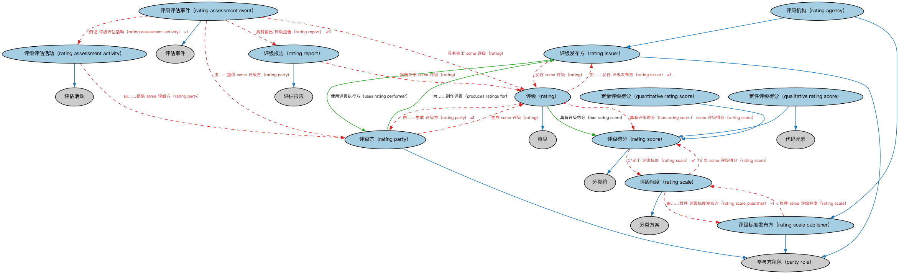

# 评级本体（Ratings Ontology）结构与公理说明

本文档对应 `Ratings.rdf` / `Ratings.ttl`，说明该本体的类、继承关系、属性和公理约定。结构图见 `Ratings-structure.png`（`Ratings-structure.svg` 为可缩放版本）。

## 1. 本体概述

定义评级（rating）、评级量表（rating scale）与评级方的通用结构。

**在体系中的位置**：FND 安排模块的配套本体，是 FBC 信用评级的直接上游。

**上下游关系**：上游继承评估本体；下游被 FBC 信用评级、IND 指标等引用。

**与相近概念的差别**：评级是「按量表打等级」的评估——AAA、BBB 是量表取值；与分类的差别——分类把事物归入类别体系，评级给出的是有序等级。

本本体中类与类的核心关系如下（完整细节见各类小节）：

- **定性评级得分（qualitative rating score）** 继承 **评级得分（rating score）**
- **定性评级得分（qualitative rating score）** 继承 **代码元素（CodeElement）**
- **定量评级得分（quantitative rating score）** 继承 **评级得分（rating score）**
- **评级（rating）** 继承 **意见（Opinion）**
- **评级机构（rating agency）** 继承 **评级发布方（rating issuer）**
- **评级机构（rating agency）** 继承 **评级标度发布方（rating scale publisher）**
- **评级评估活动（rating assessment activity）** 继承 **评估活动（AssessmentActivity）**
- **评级评估事件（rating assessment event）** 继承 **评估事件（AssessmentEvent）**
- **评级发布方（rating issuer）** 继承 **参与方角色（party role）**
- **评级方（rating party）** 继承 **参与方角色（party role）**
- **评级报告（rating report）** 继承 **评估报告（AssessmentReport）**
- **评级标度（rating scale）** 继承 **分类方案（ClassificationScheme）**
- 其余 5 条关系从略。

## 2. 类（Class）

| 类（Class） | 定义（Definition） |
|---|---|
| 定性评级得分（qualitative rating score） | 以相对于某评级标度的定性代码表示的评级得分。 |
| 定量评级得分（quantitative rating score） | 某标度上的简单数值型评级得分，如个人的信用评分。 |
| 评级（rating） | 某事物在特定时间的等级地位，由某参与方基于评估、参照某标度以至少一个得分表示。 |
| 评级机构（rating agency） | 同时也是评级标度发布方的评级发布方，通常（但非总是）为独立评级服务机构。 |
| 评级评估活动（rating assessment activity） | 产生等级或得分、并可能产生描述该得分及其确定过程之报告的评估活动。 |
| 评级评估事件（rating assessment event） | 产生等级或得分、并可能产生描述该得分之报告的单个评估。 |
| 评级发布方（rating issuer） | 负责发布评级的参与方。 |
| 评级方（rating party） | 分析某事物某方面并制定评级的个人、组织或团体。 |
| 评级报告（rating report） | 描述一组评级的报告。 |
| 评级标度（rating scale） | 依据某种标度、就质量、标准或排名为某事物赋值的体系。 |
| 评级标度发布方（rating scale publisher） | 负责管理一个或多个评级方案并可能据以发布评级的参与方。 |
| 评级得分（rating score） | 依照某评级标度对某事物的等级、分类或排名。 |

以下按类逐个展开：每个类给出继承关系、相关属性与公理约定；子类在父类之下降一级编号。

### 2.1 评级（rating）

定义：某事物在特定时间的等级地位，由某参与方基于评估、参照某标度以至少一个得分表示。

- 父类：**意见（Opinion）**

属性：

| 属性 | 定义 | 说明 |
|---|---|---|
| **具有生效日期（hasEffectiveDate）** | — | — |
| **具有评级得分（has rating score）** | 标识某评级相对于特定评级标度的等级或得分。 | 值域：评级得分（rating score）；子属性：由……分类 |
| **评定（rates）** | 标识评级所适用的工具、参与方或其他事物。 | 子属性：分类 |
| **由……生成（isGeneratedBy）** | — | — |
| **由……发行（isIssuedBy）** | — | — |
| **具有签发日期（hasDateOfIssuance）** | — | — |

公理：

- **具有生效日期（hasEffectiveDate）**至多有 1 个**日期（Date）**。
- **具有签发日期（hasDateOfIssuance）**恰好有 1 个**日期（Date）**。
- **具有评级得分（has rating score）**至少有一个取值，类型是**评级得分（rating score）**。
- **由……发行（isIssuedBy）**恰好有 1 个**评级发布方（rating issuer）**。
- **由……生成（isGeneratedBy）**恰好有 1 个**评级方（rating party）**。
- **评定（rates）**存在取值约束。

### 2.2 评级评估活动（rating assessment activity）

定义：产生等级或得分、并可能产生描述该得分及其确定过程之报告的评估活动。

- 父类：**评估活动（AssessmentActivity）**

属性：

| 属性 | 定义 | 说明 |
|---|---|---|
| **由……提供（isProvidedBy）** | — | — |

公理：

- **由……提供（isProvidedBy）**至少有一个取值，类型是**评级方（rating party）**。

### 2.3 评级评估事件（rating assessment event）

定义：产生等级或得分、并可能产生描述该得分之报告的单个评估。

- 父类：**评估事件（AssessmentEvent）**

属性：

| 属性 | 定义 | 说明 |
|---|---|---|
| **具有输出（hasOutput）** | — | — |
| **例证（exemplifies）** | — | — |
| **由……提供（isProvidedBy）** | — | — |

公理：

- **例证（exemplifies）**恰好有 1 个**评级评估活动（rating assessment activity）**。
- **具有输出（hasOutput）**可以有 0 个或多个**评级报告（rating report）**。
- **具有输出（hasOutput）**至少有一个取值，类型是**评级（rating）**。
- **由……提供（isProvidedBy）**至少有一个取值，类型是**评级方（rating party）**。

### 2.4 评级发布方（rating issuer）

定义：负责发布评级的参与方。

- 父类：**参与方角色（party role）**
- 直接子类：**评级机构（rating agency）**

属性：

| 属性 | 定义 | 说明 |
|---|---|---|
| **使用评级执行方（uses rating performer）** | 发行方用于评估评级的评级执行方。 | 值域：评级方（rating party）；子属性：由……生产 |
| **发行（issues）** | — | — |

公理：

- **发行（issues）**至少有一个取值，类型是**评级（rating）**。

#### 2.4.1 评级机构（rating agency）

定义：同时也是评级标度发布方的评级发布方，通常（但非总是）为独立评级服务机构。

- 父类：**评级发布方（rating issuer）**、**评级标度发布方（rating scale publisher）**

属性：

| 属性 | 定义 | 说明 |
|---|---|---|
| **由…扮演（is played by）** | — | — |

公理：

- **由…扮演（is played by）**至少有一个取值，类型是**正式组织（FormalOrganization）**。

### 2.5 评级方（rating party）

定义：分析某事物某方面并制定评级的个人、组织或团体。

- 父类：**参与方角色（party role）**

属性：

| 属性 | 定义 | 说明 |
|---|---|---|
| **为……制作评级（produces ratings for）** | 通过其为……制作或发布评级的发行方。 | 值域：评级发布方（rating issuer）；逆属性：使用评级执行方（uses rating performer）；子属性：生产 |
| **生成（generates）** | — | — |

公理：

- **生成（generates）**至少有一个取值，类型是**评级（rating）**。

### 2.6 评级报告（rating report）

定义：描述一组评级的报告。

- 父类：**评估报告（AssessmentReport）**

属性：

| 属性 | 定义 | 说明 |
|---|---|---|
| **报告关于（reportsOn）** | — | — |

公理：

- **报告关于（reportsOn）**至少有一个取值，类型是**评级（rating）**。

### 2.7 评级标度（rating scale）

定义：依据某种标度、就质量、标准或排名为某事物赋值的体系。

- 父类：**分类方案（ClassificationScheme）**

属性：

| 属性 | 定义 | 说明 |
|---|---|---|
| **具有最优度量（has best measure）** | 标识评级得分的标度内度量属性可能的「最优」（最期望）值。 | 值域：xsd:decimal |
| **具有最差度量（has worst measure）** | 标识评级得分的标度内度量属性可能的「最差」（最不期望）值。 | 值域：xsd:decimal |
| **定义（defines）** | — | — |
| **由……管理（isManagedBy）** | — | — |

公理：

- **具有最优度量（has best measure）**存在取值约束。
- **具有最差度量（has worst measure）**存在取值约束。
- **定义（defines）**至少有一个取值，类型是**评级得分（rating score）**。
- **由……管理（isManagedBy）**恰好有 1 个**评级标度发布方（rating scale publisher）**。

### 2.8 评级标度发布方（rating scale publisher）

定义：负责管理一个或多个评级方案并可能据以发布评级的参与方。

- 父类：**参与方角色（party role）**
- 直接子类：**评级机构（rating agency）**

属性：

| 属性 | 定义 | 说明 |
|---|---|---|
| **管理（manages）** | — | — |

公理：

- **管理（manages）**至少有一个取值，类型是**评级标度（rating scale）**。

### 2.9 评级得分（rating score）

定义：依照某评级标度对某事物的等级、分类或排名。

- 父类：**分类符（Classifier）**
- 直接子类：**定性评级得分（qualitative rating score）**、**定量评级得分（quantitative rating score）**

属性：

| 属性 | 定义 | 说明 |
|---|---|---|
| **具有标度内度量（has measure within scale）** | 标识评级标度上的相对数值度量或次序。 | 值域：xsd:decimal |
| **定义于（isDefinedIn）** | — | — |

公理：

- **具有标度内度量（has measure within scale）**存在取值约束。
- **定义于（isDefinedIn）**恰好有 1 个**评级标度（rating scale）**。

#### 2.9.1 定性评级得分（qualitative rating score）

定义：以相对于某评级标度的定性代码表示的评级得分。

- 父类：**评级得分（rating score）**、**代码元素（CodeElement）**

属性：

| 属性 | 定义 | 说明 |
|---|---|---|
| **具有标签（hasTag）** | — | — |

公理：

- **具有标签（hasTag）**存在取值约束。

#### 2.9.2 定量评级得分（quantitative rating score）

定义：某标度上的简单数值型评级得分，如个人的信用评分。

- 父类：**评级得分（rating score）**

属性：

| 属性 | 定义 | 说明 |
|---|---|---|
| **具有标度内度量（has measure within scale）** | 标识评级标度上的相对数值度量或次序。 | 值域：xsd:decimal |

公理：

- **具有标度内度量（has measure within scale）**存在取值约束。

## 3. 其他属性

以下属性未绑定到本体的具体类（定义域在外部本体或未声明）：

对象属性（Object Property）：

| 属性 | 定义 | 说明 |
|---|---|---|
| **具有评级（has rating）** | 标识基于特定评级标度按等级或得分赋予某事物的评级。 | 值域：评级（rating）；逆属性：评定（rates）；子属性：由……分类 |

## 4. 依赖（owl:imports，14 个）

本本体通过 `owl:imports` 引入以下本体，各项的中文名称与简介如下：

| 导入本体 | 中文名称 | 简介 |
|---|---|---|
| `FND/Agreements/Contracts.rdf` | 合同本体（Contracts Ontology） | 在协议之上定义具有法律约束力的合同（contract）：合同当事方、合同条款、义务与权利，是金融工具与交易合同建模的基石。 |
| `FND/Arrangements/Assessments.rdf` | 评估本体（Assessments Ontology） | 定义评估活动、评估结果与评估方的通用结构，为信用评级、风险打分等判断性活动提供基础模型。 |
| `FND/Arrangements/Reporting.rdf` | 报告本体（Reporting Ontology） | 定义报告、报告方与报告内容的关系，支撑监管报告、财务报告等报送场景。 |
| `FND/DatesAndTimes/Occurrences.rdf` | 事件与发生本体（Occurrences Ontology） | 定义「发生」（occurrence）、事件与触发条件，用于表达企业行动、信用事件等「发生了什么」。 |
| `FND/Relations/Relations.rdf` | 关系本体（Relations Ontology） | FIBO 最底层的基础本体，定义参考（reference）、分类（classify）等通用关系与抽象概念，全库普遍依赖。 |
| `FND/Utilities/AnnotationVocabulary.rdf` | FIBO 标注词汇表（FIBO Annotation Vocabulary） | 定义 FIBO 专用的标注属性（如释义来源、成熟度等级），用于本体自身的元数据标注。 |
| `https://www.omg.org/spec/Commons/AnnotationVocabulary/` | OMG 通用标注词汇表（OMG Commons Annotation Vocabulary） | OMG 通用本体库（Commons）中的标注词汇表，提供概念映射等标注属性，FIBO 用它标注术语与外部标准的对应关系。 |
| `https://www.omg.org/spec/Commons/Classifiers/` | OMG 通用分类器本体（OMG Commons Classifiers） | OMG 通用本体库（Commons）中的分类器本体，定义分类方案、类别与归类关系的通用概念，FIBO 的分类建模建立在其上。 |
| `https://www.omg.org/spec/Commons/CodesAndCodeSets/` | OMG 通用代码与代码集本体（OMG Commons Codes and Code Sets） | Commons 库中的代码本体，定义代码、代码集及其维护方的通用概念，是 ISO 4217、ISO 3166 等编码体系建模的基础。 |
| `https://www.omg.org/spec/Commons/DatesAndTimes/` | OMG 通用日期与时间本体（OMG Commons Dates and Times） | Commons 库中的日期时间本体，定义日期、期间、时间点等通用时间概念。 |
| `https://www.omg.org/spec/Commons/Designators/` | OMG 通用指称符本体（OMG Commons Designators） | Commons 库中的指称符本体，定义名称、标识符等「指代某物的符号」的通用概念。 |
| `https://www.omg.org/spec/Commons/Organizations/` | OMG 通用组织本体（OMG Commons Organizations） | Commons 库中的组织本体，定义组织、组织成员与组织结构的通用概念。 |
| `https://www.omg.org/spec/Commons/PartiesAndSituations/` | OMG 通用参与方与情境本体（OMG Commons Parties and Situations） | Commons 库中的参与方本体，定义独立主体、参与方及其角色扮演的通用概念，是 FIBO 参与方模型的上游。 |
| `https://www.omg.org/spec/Commons/RolesAndCompositions/` | OMG 通用角色与构成本体（OMG Commons Roles and Compositions） | Commons 库中的角色本体，定义角色及整体—部分构成关系的通用概念。 |

## 5. 文件

- 官方 RDF/XML：`Ratings.rdf`
- 中文 Turtle：`Ratings.ttl`
- 结构图：`Ratings-structure.png` / `Ratings-structure.svg`