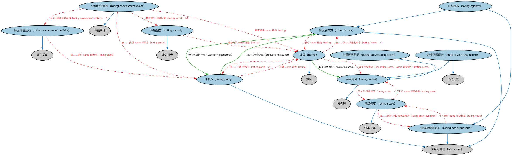

# 评级本体（Ratings Ontology）结构与公理说明

本文档对应 `Ratings.rdf` / `Ratings.ttl`，说明该本体的类、继承关系、属性和公理约定。结构图见 `Ratings-structure.png`（`Ratings-structure.svg` 为可缩放版本）。

## 1. 本体概述

定义评级（rating）、评级量表（rating scale）与评级方的通用结构。

**在体系中的位置**：FND 安排模块的配套本体，是 FBC 信用评级的直接上游。

**上下游关系**：上游继承评估本体；下游被 FBC 信用评级、IND 指标等引用。

**与相近概念的差别**：评级是「按量表打等级」的评估——AAA、BBB 是量表取值；与分类的差别——分类把事物归入类别体系，评级给出的是有序等级。

## 2. 类（Class）

| 类（Class） | 定义（Definition） |
|---|---|
| 定性评级得分（qualitative rating score） | 以相对于某评级标度的定性代码表示的评级得分。 |
| 定量评级得分（quantitative rating score） | 某标度上的简单数值型评级得分，如个人的信用评分。 |
| 评级（rating） | 某事物在特定时间的等级地位，由某参与方基于评估、参照某标度以至少一个得分表示。 |
| 评级机构（rating agency） | 同时也是评级标度发布方的评级发布方，通常（但非总是）为独立评级服务机构。 |
| 评级评估活动（rating assessment activity） | 产生等级或得分、并可能产生描述该得分及其确定过程之报告的评估活动。 |
| 评级评估事件（rating assessment event） | 产生等级或得分、并可能产生描述该得分之报告的单个评估。 |
| 评级发布方（rating issuer） | 负责发布评级的参与方。 |
| 评级方（rating party） | 分析某事物某方面并制定评级的个人、组织或团体。 |
| 评级报告（rating report） | 描述一组评级的报告。 |
| 评级标度（rating scale） | 依据某种标度、就质量、标准或排名为某事物赋值的体系。 |
| 评级标度发布方（rating scale publisher） | 负责管理一个或多个评级方案并可能据以发布评级的参与方。 |
| 评级得分（rating score） | 依照某评级标度对某事物的等级、分类或排名。 |

### 2.1 继承关系（Inheritance）

- 定性评级得分（qualitative rating score） ⊑ 评级得分（rating score）
- 定性评级得分（qualitative rating score） ⊑ 代码元素
- 定量评级得分（quantitative rating score） ⊑ 评级得分（rating score）
- 评级（rating） ⊑ 意见
- 评级机构（rating agency） ⊑ 评级发布方（rating issuer）
- 评级机构（rating agency） ⊑ 评级标度发布方（rating scale publisher）
- 评级评估活动（rating assessment activity） ⊑ 评估活动
- 评级评估事件（rating assessment event） ⊑ 评估事件
- 评级发布方（rating issuer） ⊑ 参与方角色（party role）
- 评级方（rating party） ⊑ 参与方角色（party role）
- 评级报告（rating report） ⊑ 评估报告
- 评级标度（rating scale） ⊑ 分类方案
- 评级标度发布方（rating scale publisher） ⊑ 参与方角色（party role）
- 评级得分（rating score） ⊑ 分类符

## 3. 对象属性（Object Property）

| 属性（Property） | 中文（English） | 定义（Definition） | 说明 |
|---|---|---|---|
| fibo-fnd-arr-rt:hasRating | 具有评级（has rating） | 标识基于特定评级标度按等级或得分赋予某事物的评级。 | 值域（range）：评级（rating）；逆属性（inverseOf）：评定（rates）；子属性（subPropertyOf）：由……分类 |
| fibo-fnd-arr-rt:hasRatingScore | 具有评级得分（has rating score） | 标识某评级相对于特定评级标度的等级或得分。 | 定义域（domain）：评级（rating）；值域（range）：评级得分（rating score）；子属性（subPropertyOf）：由……分类 |
| fibo-fnd-arr-rt:producesRatingsFor | 为……制作评级（produces ratings for） | 通过其为……制作或发布评级的发行方。 | 定义域（domain）：评级方（rating party）；值域（range）：评级发布方（rating issuer）；逆属性（inverseOf）：使用评级执行方（uses rating performer）；子属性（subPropertyOf）：生产 |
| fibo-fnd-arr-rt:rates | 评定（rates） | 标识评级所适用的工具、参与方或其他事物。 | 定义域（domain）：评级（rating）；子属性（subPropertyOf）：分类 |
| fibo-fnd-arr-rt:usesRatingParty | 使用评级执行方（uses rating performer） | 发行方用于评估评级的评级执行方。 | 定义域（domain）：评级发布方（rating issuer）；值域（range）：评级方（rating party）；子属性（subPropertyOf）：由……生产 |

## 4. 数据属性（Datatype Property）

| 属性（Property） | 中文（English） | 定义（Definition） |
|---|---|---|
| fibo-fnd-arr-rt:hasBestMeasure | 具有最优度量（has best measure） | 标识评级得分的标度内度量属性可能的「最优」（最期望）值。 |
| fibo-fnd-arr-rt:hasMeasureWithinScale | 具有标度内度量（has measure within scale） | 标识评级标度上的相对数值度量或次序。 |
| fibo-fnd-arr-rt:hasWorstMeasure | 具有最差度量（has worst measure） | 标识评级得分的标度内度量属性可能的「最差」（最不期望）值。 |

## 5. 公理约定（Axioms）

- 定性评级得分（qualitative rating score）：restriction
- 定量评级得分（quantitative rating score）：restriction
- 评级（rating）：restriction
- 评级（rating）：具有生效日期 日期 ≤1
- 评级（rating）：由……发行 评级发布方（rating issuer） =1
- 评级（rating）：由……生成 评级方（rating party） =1
- 评级（rating）：具有签发日期 日期 =1
- 评级（rating）：具有评级得分（has rating score） some 评级得分（rating score）
- 评级机构（rating agency）：由…扮演（is played by） some 正式组织
- 评级评估活动（rating assessment activity）：由……提供 some 评级方（rating party）
- 评级评估事件（rating assessment event）：具有输出 评级报告（rating report） ≥0
- 评级评估事件（rating assessment event）：例证 评级评估活动（rating assessment activity） =1
- 评级评估事件（rating assessment event）：具有输出 some 评级（rating）
- 评级评估事件（rating assessment event）：由……提供 some 评级方（rating party）
- 评级发布方（rating issuer）：发行 some 评级（rating）
- 评级方（rating party）：生成 some 评级（rating）
- 评级报告（rating report）：报告关于 some 评级（rating）
- 评级标度（rating scale）：restriction
- 评级标度（rating scale）：restriction
- 评级标度（rating scale）：由……管理 评级标度发布方（rating scale publisher） =1
- 评级标度（rating scale）：定义 some 评级得分（rating score）
- 评级标度发布方（rating scale publisher）：管理 some 评级标度（rating scale）
- 评级得分（rating score）：restriction
- 评级得分（rating score）：定义于 评级标度（rating scale） =1

## 6. 依赖（owl:imports，14 个）

本本体通过 `owl:imports` 引入以下本体，各项的中文名称与简介如下：

| 导入本体 | 中文名称 | 简介 |
|---|---|---|
| `FND/Agreements/Contracts.rdf` | 合同本体（Contracts Ontology） | 在协议之上定义具有法律约束力的合同（contract）：合同当事方、合同条款、义务与权利，是金融工具与交易合同建模的基石。 |
| `FND/Arrangements/Assessments.rdf` | 评估本体（Assessments Ontology） | 定义评估活动、评估结果与评估方的通用结构，为信用评级、风险打分等判断性活动提供基础模型。 |
| `FND/Arrangements/Reporting.rdf` | 报告本体（Reporting Ontology） | 定义报告、报告方与报告内容的关系，支撑监管报告、财务报告等报送场景。 |
| `FND/DatesAndTimes/Occurrences.rdf` | 事件与发生本体（Occurrences Ontology） | 定义「发生」（occurrence）、事件与触发条件，用于表达企业行动、信用事件等「发生了什么」。 |
| `FND/Relations/Relations.rdf` | 关系本体（Relations Ontology） | FIBO 最底层的基础本体，定义参考（reference）、分类（classify）等通用关系与抽象概念，全库普遍依赖。 |
| `FND/Utilities/AnnotationVocabulary.rdf` | FIBO 标注词汇表（FIBO Annotation Vocabulary） | 定义 FIBO 专用的标注属性（如释义来源、成熟度等级），用于本体自身的元数据标注。 |
| `https://www.omg.org/spec/Commons/AnnotationVocabulary/` | OMG 通用标注词汇表（OMG Commons Annotation Vocabulary） | OMG 通用本体库（Commons）中的标注词汇表，提供概念映射等标注属性，FIBO 用它标注术语与外部标准的对应关系。 |
| `https://www.omg.org/spec/Commons/Classifiers/` | OMG 通用分类器本体（OMG Commons Classifiers） | OMG 通用本体库（Commons）中的分类器本体，定义分类方案、类别与归类关系的通用概念，FIBO 的分类建模建立在其上。 |
| `https://www.omg.org/spec/Commons/CodesAndCodeSets/` | OMG 通用代码与代码集本体（OMG Commons Codes and Code Sets） | Commons 库中的代码本体，定义代码、代码集及其维护方的通用概念，是 ISO 4217、ISO 3166 等编码体系建模的基础。 |
| `https://www.omg.org/spec/Commons/DatesAndTimes/` | OMG 通用日期与时间本体（OMG Commons Dates and Times） | Commons 库中的日期时间本体，定义日期、期间、时间点等通用时间概念。 |
| `https://www.omg.org/spec/Commons/Designators/` | OMG 通用指称符本体（OMG Commons Designators） | Commons 库中的指称符本体，定义名称、标识符等「指代某物的符号」的通用概念。 |
| `https://www.omg.org/spec/Commons/Organizations/` | OMG 通用组织本体（OMG Commons Organizations） | Commons 库中的组织本体，定义组织、组织成员与组织结构的通用概念。 |
| `https://www.omg.org/spec/Commons/PartiesAndSituations/` | OMG 通用参与方与情境本体（OMG Commons Parties and Situations） | Commons 库中的参与方本体，定义独立主体、参与方及其角色扮演的通用概念，是 FIBO 参与方模型的上游。 |
| `https://www.omg.org/spec/Commons/RolesAndCompositions/` | OMG 通用角色与构成本体（OMG Commons Roles and Compositions） | Commons 库中的角色本体，定义角色及整体—部分构成关系的通用概念。 |

## 7. 文件

- 官方 RDF/XML：`Ratings.rdf`
- 中文 Turtle：`Ratings.ttl`
- 结构图：`Ratings-structure.png` / `Ratings-structure.svg`