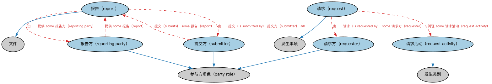

# 报告本体（Reporting Ontology）结构与公理说明

本文档对应 `Reporting.rdf` / `Reporting.ttl`，说明该本体的类、继承关系、属性和公理约定。结构图见 `Reporting-structure.png`（`Reporting-structure.svg` 为可缩放版本）。

## 1. 本体概述

定义报告（report）、报告方与报告内容的关系：谁向谁、就什么、按什么要求提交报告。

**在体系中的位置**：FND 安排模块的配套本体，支撑监管报告、财务报告等报送场景。

**上下游关系**：上游依赖安排、文档与参与方本体；下游被贷款监管（HMDA 报告）、监管报送建模引用。

**与相近概念的差别**：报告≠文档——报告是「报送行为及其产物」的整体，文档只是载体；报告通常有法定格式与期限要求。

本本体中类与类的核心关系如下（完整细节见各类小节）：

- **报告（report）** 继承 **文件（Document）**
- **报告方（reporting party）** 继承 **参与方角色（party role）**
- **请求（request）** 继承 **发生事项（Occurrence）**
- **请求活动（request activity）** 继承 **发生类别（OccurrenceKind）**
- **请求方（requester）** 继承 **参与方角色（party role）**
- **提交方（submitter）** 继承 **参与方角色（party role）**

## 2. 类（Class）

| 类（Class） | 定义（Definition） |
|---|---|
| 报告（report） | 对某事物提供结构化描述的文件，按临时、定期、循环、常规或要求的方式编制。 |
| 报告方（reporting party） | 提供报告的参与方，通常是应某项合同、法律、监管或其他业务要求。 |
| 请求（request） | 某参与方在某时点向另一参与方索要某事物的事件。 |
| 请求活动（request activity） | 某参与方向另一参与方索要某事物或请求其做某事的活动。 |
| 请求方（requester） | 索要某事物的参与方。 |
| 提交方（submitter） | 呈交某事物（如监管报告）的参与方。 |

以下按类逐个展开：每个类给出继承关系、相关属性与公理约定；子类在父类之下降一级编号。

### 2.1 报告（report）

定义：对某事物提供结构化描述的文件，按临时、定期、循环、常规或要求的方式编制。

- 父类：**文件（Document）**

属性：

| 属性 | 定义 | 说明 |
|---|---|---|
| **具有报告期（hasReportingPeriod）** | — | — |
| **具有报告日期（has report date）** | 报告发布的日期。 | 值域：显式日期；子属性：具有签发日期 |
| **具有报告日期时间（has report date time）** | 报告发布的日期与时间。 | 值域：日期时间；子属性：具有日期时间 |
| **被报告给（is reported to）** | 标识某事物被报告给的参与方。 | 值域：参与方角色（party role）；子属性：具有参与方角色（has party role） |
| **由……提交（is submitted by）** | 标识提交某事物的参与方。 | 值域：提交方（submitter）；逆属性：提交（submits）；子属性：由……提供 |
| **被提交给（is submitted to）** | 标识某事物被提交给的参与方。 | 值域：参与方角色（party role）；子属性：具有参与方角色（has party role） |
| **报告关于（reports on）** | 标识报告的主题、观测、评估、焦点或其他话题。 | 子属性：关于 |
| **由……提供（isProvidedBy）** | — | — |

公理：

- **具有报告日期时间（has report date time）**可以有 0 个或多个**日期时间（DateTime）**。
- **具有报告日期（has report date）**可以有 0 个或多个**显式日期（ExplicitDate）**。
- **具有报告期（hasReportingPeriod）**可以有 0 个或多个**日期区间（DatePeriod）**。
- **由……提交（is submitted by）**可以有 0 个或多个**提交方（submitter）**。
- **由……提供（isProvidedBy）**至少有一个取值，类型是**报告方（reporting party）**。
- **被报告给（is reported to）**至少有一个取值，类型是**参与方角色（party role）**。
- **被提交给（is submitted to）**可以有 0 个或多个**参与方角色（party role）**。

### 2.2 报告方（reporting party）

定义：提供报告的参与方，通常是应某项合同、法律、监管或其他业务要求。

- 父类：**参与方角色（party role）**

属性：

| 属性 | 定义 | 说明 |
|---|---|---|
| **提供（provides）** | — | — |

公理：

- **提供（provides）**至少有一个取值，类型是**报告（report）**。

### 2.3 请求（request）

定义：某参与方在某时点向另一参与方索要某事物的事件。

- 父类：**发生事项（Occurrence）**

属性：

| 属性 | 定义 | 说明 |
|---|---|---|
| **具有请求日期（has request date）** | 提出请求的日期。 | 值域：显式日期；子属性：具有显式日期 |
| **具有请求日期时间（has request date time）** | 提出请求的日期与时间。 | 值域：日期时间；子属性：具有日期时间 |
| **由……请求（is requested by）** | 标识索要某事物的参与方。 | 值域：请求方（requester）；子属性：具有参与方角色（has party role） |
| **被请求于（is requested of）** | 标识被索要某事物的参与方。 | 值域：参与方角色（party role）；子属性：具有参与方角色（has party role） |
| **例证（exemplifies）** | — | — |

公理：

- **例证（exemplifies）**至少有一个取值，类型是**请求活动（request activity）**。
- **具有请求日期时间（has request date time）**可以有 0 个或多个**日期时间（DateTime）**。
- **具有请求日期（has request date）**可以有 0 个或多个**显式日期（ExplicitDate）**。
- **由……请求（is requested by）**至少有一个取值，类型是**请求方（requester）**。
- **被请求于（is requested of）**至少有一个取值，类型是**参与方角色（party role）**。

### 2.4 请求活动（request activity）

定义：某参与方向另一参与方索要某事物或请求其做某事的活动。

- 父类：**发生类别（OccurrenceKind）**

属性：

| 属性 | 定义 | 说明 |
|---|---|---|
| **请求（requests）** | 索要某事物。 | 子属性：关于 |

公理：

- **请求（requests）**至少有一个取值，类型是**owl:Thing（Thing）**。

### 2.5 请求方（requester）

定义：索要某事物的参与方。

- 父类：**参与方角色（party role）**

### 2.6 提交方（submitter）

定义：呈交某事物（如监管报告）的参与方。

- 父类：**参与方角色（party role）**

属性：

| 属性 | 定义 | 说明 |
|---|---|---|
| **提交（submits）** | 呈交某事物（提案、申请、报告或其他文件）以供考虑或审查。 | 子属性：提供 |

公理：

- **提交（submits）**至少有一个取值，类型是**报告（report）**。

## 3. 依赖（owl:imports，9 个）

本本体通过 `owl:imports` 引入以下本体，各项的中文名称与简介如下：

| 导入本体 | 中文名称 | 简介 |
|---|---|---|
| `FND/Arrangements/Documents.rdf` | 文档本体（Documents Ontology） | 定义文档、文档类型及文档与其所记载内容的关系，为合同文本、募集说明书等法律文书建模。 |
| `FND/DatesAndTimes/Occurrences.rdf` | 事件与发生本体（Occurrences Ontology） | 定义「发生」（occurrence）、事件与触发条件，用于表达企业行动、信用事件等「发生了什么」。 |
| `FND/Relations/Relations.rdf` | 关系本体（Relations Ontology） | FIBO 最底层的基础本体，定义参考（reference）、分类（classify）等通用关系与抽象概念，全库普遍依赖。 |
| `FND/Utilities/AnnotationVocabulary.rdf` | FIBO 标注词汇表（FIBO Annotation Vocabulary） | 定义 FIBO 专用的标注属性（如释义来源、成熟度等级），用于本体自身的元数据标注。 |
| `https://www.omg.org/spec/Commons/AnnotationVocabulary/` | OMG 通用标注词汇表（OMG Commons Annotation Vocabulary） | OMG 通用本体库（Commons）中的标注词汇表，提供概念映射等标注属性，FIBO 用它标注术语与外部标准的对应关系。 |
| `https://www.omg.org/spec/Commons/DatesAndTimes/` | OMG 通用日期与时间本体（OMG Commons Dates and Times） | Commons 库中的日期时间本体，定义日期、期间、时间点等通用时间概念。 |
| `https://www.omg.org/spec/Commons/Documents/` | OMG 通用文档本体（OMG Commons Documents） | Commons 库中的文档本体，定义文档及其组成部分的通用概念。 |
| `https://www.omg.org/spec/Commons/Organizations/` | OMG 通用组织本体（OMG Commons Organizations） | Commons 库中的组织本体，定义组织、组织成员与组织结构的通用概念。 |
| `https://www.omg.org/spec/Commons/PartiesAndSituations/` | OMG 通用参与方与情境本体（OMG Commons Parties and Situations） | Commons 库中的参与方本体，定义独立主体、参与方及其角色扮演的通用概念，是 FIBO 参与方模型的上游。 |

## 4. 文件

- 官方 RDF/XML：`Reporting.rdf`
- 中文 Turtle：`Reporting.ttl`
- 结构图：`Reporting-structure.png` / `Reporting-structure.svg`