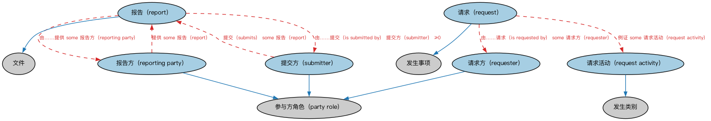

# 报告本体（Reporting Ontology）结构与公理说明

本文档对应 `Reporting.rdf` / `Reporting.ttl`，说明该本体的类、继承关系、属性和公理约定。结构图见 `Reporting-structure.png`（`Reporting-structure.svg` 为可缩放版本）。

## 1. 本体概述

定义报告（report）、报告方与报告内容的关系：谁向谁、就什么、按什么要求提交报告。

**在体系中的位置**：FND 安排模块的配套本体，支撑监管报告、财务报告等报送场景。

**上下游关系**：上游依赖安排、文档与参与方本体；下游被贷款监管（HMDA 报告）、监管报送建模引用。

**与相近概念的差别**：报告≠文档——报告是「报送行为及其产物」的整体，文档只是载体；报告通常有法定格式与期限要求。

## 2. 类（Class）

| 类（Class） | 定义（Definition） |
|---|---|
| 报告（report） | 对某事物提供结构化描述的文件，按临时、定期、循环、常规或要求的方式编制。 |
| 报告方（reporting party） | 提供报告的参与方，通常是应某项合同、法律、监管或其他业务要求。 |
| 请求（request） | 某参与方在某时点向另一参与方索要某事物的事件。 |
| 请求活动（request activity） | 某参与方向另一参与方索要某事物或请求其做某事的活动。 |
| 请求方（requester） | 索要某事物的参与方。 |
| 提交方（submitter） | 呈交某事物（如监管报告）的参与方。 |

### 2.1 继承关系（Inheritance）

- 报告（report） ⊑ 文件
- 报告方（reporting party） ⊑ 参与方角色（party role）
- 请求（request） ⊑ 发生事项
- 请求活动（request activity） ⊑ 发生类别
- 请求方（requester） ⊑ 参与方角色（party role）
- 提交方（submitter） ⊑ 参与方角色（party role）

## 3. 对象属性（Object Property）

| 属性（Property） | 中文（English） | 定义（Definition） | 说明 |
|---|---|---|---|
| fibo-fnd-arr-rep:hasReportDate | 具有报告日期（has report date） | 报告发布的日期。 | 值域（range）：显式日期；子属性（subPropertyOf）：具有签发日期 |
| fibo-fnd-arr-rep:hasReportDateTime | 具有报告日期时间（has report date time） | 报告发布的日期与时间。 | 值域（range）：日期时间；子属性（subPropertyOf）：具有日期时间 |
| fibo-fnd-arr-rep:hasRequestDate | 具有请求日期（has request date） | 提出请求的日期。 | 值域（range）：显式日期；子属性（subPropertyOf）：具有显式日期 |
| fibo-fnd-arr-rep:hasRequestDateTime | 具有请求日期时间（has request date time） | 提出请求的日期与时间。 | 值域（range）：日期时间；子属性（subPropertyOf）：具有日期时间 |
| fibo-fnd-arr-rep:isReportedTo | 被报告给（is reported to） | 标识某事物被报告给的参与方。 | 值域（range）：参与方角色（party role）；子属性（subPropertyOf）：具有参与方角色（has party role） |
| fibo-fnd-arr-rep:isRequestedBy | 由……请求（is requested by） | 标识索要某事物的参与方。 | 值域（range）：请求方（requester）；子属性（subPropertyOf）：具有参与方角色（has party role） |
| fibo-fnd-arr-rep:isRequestedOf | 被请求于（is requested of） | 标识被索要某事物的参与方。 | 值域（range）：参与方角色（party role）；子属性（subPropertyOf）：具有参与方角色（has party role） |
| fibo-fnd-arr-rep:isSubmittedBy | 由……提交（is submitted by） | 标识提交某事物的参与方。 | 值域（range）：提交方（submitter）；逆属性（inverseOf）：提交（submits）；子属性（subPropertyOf）：由……提供 |
| fibo-fnd-arr-rep:isSubmittedTo | 被提交给（is submitted to） | 标识某事物被提交给的参与方。 | 值域（range）：参与方角色（party role）；子属性（subPropertyOf）：具有参与方角色（has party role） |
| fibo-fnd-arr-rep:reportsOn | 报告关于（reports on） | 标识报告的主题、观测、评估、焦点或其他话题。 | 定义域（domain）：报告（report）；子属性（subPropertyOf）：关于 |
| fibo-fnd-arr-rep:requests | 请求（requests） | 索要某事物。 | 子属性（subPropertyOf）：关于 |
| fibo-fnd-arr-rep:submits | 提交（submits） | 呈交某事物（提案、申请、报告或其他文件）以供考虑或审查。 | 定义域（domain）：提交方（submitter）；子属性（subPropertyOf）：提供 |

## 5. 公理约定（Axioms）

- 报告（report）：由……提交（is submitted by） 提交方（submitter） ≥0
- 报告（report）：具有报告期 日期区间 ≥0
- 报告（report）：具有报告日期时间（has report date time） 日期时间 ≥0
- 报告（report）：具有报告日期（has report date） 显式日期 ≥0
- 报告（report）：被提交给（is submitted to） 参与方角色（party role） ≥0
- 报告（report）：被报告给（is reported to） some 参与方角色（party role）
- 报告（report）：由……提供 some 报告方（reporting party）
- 报告方（reporting party）：提供 some 报告（report）
- 请求（request）：具有请求日期时间（has request date time） 日期时间 ≥0
- 请求（request）：具有请求日期（has request date） 显式日期 ≥0
- 请求（request）：由……请求（is requested by） some 请求方（requester）
- 请求（request）：被请求于（is requested of） some 参与方角色（party role）
- 请求（request）：例证 some 请求活动（request activity）
- 请求活动（request activity）：请求（requests） some owl:Thing
- 提交方（submitter）：提交（submits） some 报告（report）

## 6. 依赖（owl:imports，9 个）

本本体通过 `owl:imports` 引入以下本体，各项的中文名称与简介如下：

| 导入本体 | 中文名称 | 简介 |
|---|---|---|
| `FND/Arrangements/Documents.rdf` | 文档本体（Documents Ontology） | 定义文档、文档类型及文档与其所记载内容的关系，为合同文本、募集说明书等法律文书建模。 |
| `FND/DatesAndTimes/Occurrences.rdf` | 事件与发生本体（Occurrences Ontology） | 定义「发生」（occurrence）、事件与触发条件，用于表达企业行动、信用事件等「发生了什么」。 |
| `FND/Relations/Relations.rdf` | 关系本体（Relations Ontology） | FIBO 最底层的基础本体，定义参考（reference）、分类（classify）等通用关系与抽象概念，全库普遍依赖。 |
| `FND/Utilities/AnnotationVocabulary.rdf` | FIBO 标注词汇表（FIBO Annotation Vocabulary） | 定义 FIBO 专用的标注属性（如释义来源、成熟度等级），用于本体自身的元数据标注。 |
| `https://www.omg.org/spec/Commons/AnnotationVocabulary/` | OMG 通用标注词汇表（OMG Commons Annotation Vocabulary） | OMG 通用本体库（Commons）中的标注词汇表，提供概念映射等标注属性，FIBO 用它标注术语与外部标准的对应关系。 |
| `https://www.omg.org/spec/Commons/DatesAndTimes/` | OMG 通用日期与时间本体（OMG Commons Dates and Times） | Commons 库中的日期时间本体，定义日期、期间、时间点等通用时间概念。 |
| `https://www.omg.org/spec/Commons/Documents/` | OMG 通用文档本体（OMG Commons Documents） | Commons 库中的文档本体，定义文档及其组成部分的通用概念。 |
| `https://www.omg.org/spec/Commons/Organizations/` | OMG 通用组织本体（OMG Commons Organizations） | Commons 库中的组织本体，定义组织、组织成员与组织结构的通用概念。 |
| `https://www.omg.org/spec/Commons/PartiesAndSituations/` | OMG 通用参与方与情境本体（OMG Commons Parties and Situations） | Commons 库中的参与方本体，定义独立主体、参与方及其角色扮演的通用概念，是 FIBO 参与方模型的上游。 |

## 7. 文件

- 官方 RDF/XML：`Reporting.rdf`
- 中文 Turtle：`Reporting.ttl`
- 结构图：`Reporting-structure.png` / `Reporting-structure.svg`