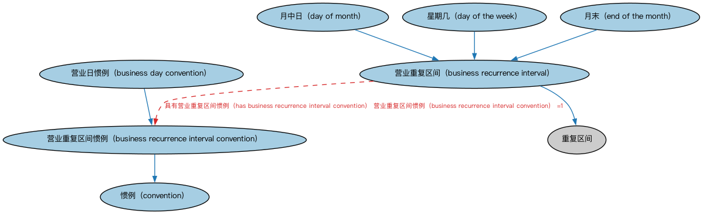

# 营业日期本体（Business Dates Ontology）结构与公理说明

本文档对应 `BusinessDates.rdf` / `BusinessDates.ttl`，说明该本体的类、继承关系、属性和公理约定。结构图见 `BusinessDates-structure.png`（`BusinessDates-structure.svg` 为可缩放版本）。

## 1. 本体概述

本本体在 FinancialDates 本体的日期与日程概念基础上，定义落在周末或节假日时可能需要按指定营业中心调整的日期概念。

## 2. 类（Class）

| 类（Class） | 定义（Definition） |
|---|---|
| 营业日惯例（business day convention） | 列举日期落在周末或节假日时各种处理方式的惯例。 |
| 营业重复区间（business recurrence interval） | 按特定惯例定义的重复区间，该惯例决定如何处理重复出现的日期。 |
| 营业重复区间惯例（business recurrence interval convention） | 规定如何处理重复日期的惯例，如月末、某月特定日或星期几。 |
| 惯例（convention） | 某实践共同体内被广泛接受或确立的做事方式。 |
| 月中日（day of month） | 每月中特定的重复日期。 |
| 星期几（day of the week） | 每周中特定的重复日。 |
| 月末（end of the month） | 日历月的最后一天，不论该月长短。 |

### 2.1 继承关系（Inheritance）

- 营业日惯例（business day convention） ⊑ 营业重复区间惯例（business recurrence interval convention）
- 营业重复区间（business recurrence interval） ⊑ 重复区间
- 营业重复区间惯例（business recurrence interval convention） ⊑ 惯例（convention）
- 月中日（day of month） ⊑ 营业重复区间（business recurrence interval）
- 星期几（day of the week） ⊑ 营业重复区间（business recurrence interval）
- 月末（end of the month） ⊑ 营业重复区间（business recurrence interval）

## 3. 对象属性（Object Property）

| 属性（Property） | 中文（English） | 定义（Definition） | 说明 |
|---|---|---|---|
| fibo-fnd-dt-bd:hasBusinessDayConvention | 具有营业日惯例（has business day convention） | 标识当日期落在非营业日（如周末或节假日）时应如何处理的惯例。 | 值域（range）：营业日惯例（business day convention） |
| fibo-fnd-dt-bd:hasBusinessRecurrenceIntervalConvention | 具有营业重复区间惯例（has business recurrence interval convention） | 标识关于特定重复日期相对给定日程应如何处理的惯例。 | 值域（range）：营业重复区间惯例（business recurrence interval convention） |

## 5. 公理约定（Axioms）

- 营业日惯例（business day convention）：具有商业中心 商业中心 ≥0
- 营业重复区间（business recurrence interval）：具有营业重复区间惯例（has business recurrence interval convention） 营业重复区间惯例（business recurrence interval convention） =1
- 月中日（day of month）：restriction

## 6. 依赖（owl:imports，7 个）

本本体通过 `owl:imports` 引入以下本体，各项的中文名称与简介如下：

| 导入本体 | 中文名称 | 简介 |
|---|---|---|
| `FND/DatesAndTimes/FinancialDates.rdf` | 金融日期本体（Financial Dates Ontology） | 定义金融语境下的日期与期间概念：结算日、付息日、到期日、日计数基准等。 |
| `FND/Relations/Relations.rdf` | 关系本体（Relations Ontology） | FIBO 最底层的基础本体，定义参考（reference）、分类（classify）等通用关系与抽象概念，全库普遍依赖。 |
| `FND/Utilities/AnnotationVocabulary.rdf` | FIBO 标注词汇表（FIBO Annotation Vocabulary） | 定义 FIBO 专用的标注属性（如释义来源、成熟度等级），用于本体自身的元数据标注。 |
| `https://www.omg.org/spec/Commons/AnnotationVocabulary/` | OMG 通用标注词汇表（OMG Commons Annotation Vocabulary） | OMG 通用本体库（Commons）中的标注词汇表，提供概念映射等标注属性，FIBO 用它标注术语与外部标准的对应关系。 |
| `https://www.omg.org/spec/Commons/DatesAndTimes/` | OMG 通用日期与时间本体（OMG Commons Dates and Times） | Commons 库中的日期时间本体，定义日期、期间、时间点等通用时间概念。 |
| `https://www.omg.org/spec/Commons/Locations/` | OMG 通用位置本体（OMG Commons Locations） | Commons 库中的位置本体，定义地理位置、地点的通用概念。 |
| `https://www.omg.org/spec/Commons/PartiesAndSituations/` | OMG 通用参与方与情境本体（OMG Commons Parties and Situations） | Commons 库中的参与方本体，定义独立主体、参与方及其角色扮演的通用概念，是 FIBO 参与方模型的上游。 |

## 7. 文件

- 官方 RDF/XML：`BusinessDates.rdf`
- 中文 Turtle：`BusinessDates.ttl`
- 结构图：`BusinessDates-structure.png` / `BusinessDates-structure.svg`