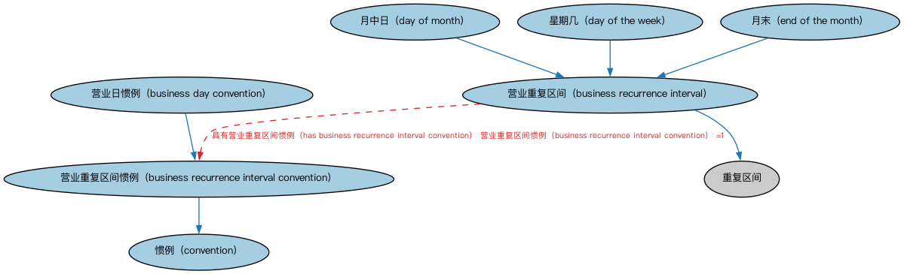

# 营业日期本体（Business Dates Ontology）结构与公理说明

本文档对应 `BusinessDates.rdf` / `BusinessDates.ttl`，说明该本体的类、继承关系、属性和公理约定。结构图见 `BusinessDates-structure.png`（`BusinessDates-structure.svg` 为可缩放版本）。

## 1. 本体概述

本本体在 FinancialDates 本体的日期与日程概念基础上，定义落在周末或节假日时可能需要按指定营业中心调整的日期概念。

本本体中类与类的核心关系如下（完整细节见各类小节）：

- **营业日惯例（business day convention）** 继承 **营业重复区间惯例（business recurrence interval convention）**
- **营业重复区间（business recurrence interval）** 继承 **重复区间（RecurrenceInterval）**
- **营业重复区间惯例（business recurrence interval convention）** 继承 **惯例（convention）**
- **月中日（day of month）** 继承 **营业重复区间（business recurrence interval）**
- **星期几（day of the week）** 继承 **营业重复区间（business recurrence interval）**
- **月末（end of the month）** 继承 **营业重复区间（business recurrence interval）**

## 2. 类（Class）

| 类（Class） | 定义（Definition） |
|---|---|
| 营业日惯例（business day convention） | 列举日期落在周末或节假日时各种处理方式的惯例。 convention that enumerates the possible ways to handle a date that falls on a weekend or holiday |
| 营业重复区间（business recurrence interval） | 按特定惯例定义的重复区间，该惯例决定如何处理重复出现的日期。 recurrence interval that is defined per a specific convention that determines how recurring days should be handled |
| 营业重复区间惯例（business recurrence interval convention） | 规定如何处理重复日期的惯例，如月末、某月特定日或星期几。 convention that specifies how recurring days should be handled, such as the end of the month, a particular day of the month, a day of the week, or more specifically, a t-bill auction date |
| 惯例（convention） | 某实践共同体内被广泛接受或确立的做事方式。 widely accepted or established way of doing 'something' within some community of practice |
| 月中日（day of month） | 每月中特定的重复日期。 specific, recurring day of the month |
| 星期几（day of the week） | 每周中特定的重复日。 specific, recurring day of the week |
| 月末（end of the month） | 日历月的最后一天，不论该月长短。 the last day of a calendar month, irrespective of the length of the calendar month |

以下按类逐个展开：每个类给出继承关系、相关属性与公理约定；子类在父类之下降一级编号。

### 2.1 营业重复区间（business recurrence interval）

定义：按特定惯例定义的重复区间，该惯例决定如何处理重复出现的日期。

- 父类：**重复区间（RecurrenceInterval）**
- 直接子类：**月中日（day of month）**、**星期几（day of the week）**、**月末（end of the month）**

属性：

| 属性 | 定义 | 说明 |
|---|---|---|
| **具有营业重复区间惯例（has business recurrence interval convention）** | 标识关于特定重复日期相对给定日程应如何处理的惯例。 identifies a convention regarding how certain recurring dates should be handled with respect to a given schedule, such as the end of the month | 值域：营业重复区间惯例（business recurrence interval convention） |

公理：

- **具有营业重复区间惯例（has business recurrence interval convention）**恰好有 1 个**营业重复区间惯例（business recurrence interval convention）**。

#### 2.1.1 月中日（day of month）

定义：每月中特定的重复日期。

- 父类：**营业重复区间（business recurrence interval）**

属性：

| 属性 | 定义 | 说明 |
|---|---|---|
| **具有序数（hasOrdinalNumber）** | — | — |

公理：

- **具有序数（hasOrdinalNumber）**存在取值约束。

#### 2.1.2 星期几（day of the week）

定义：每周中特定的重复日。

- 父类：**营业重复区间（business recurrence interval）**

#### 2.1.3 月末（end of the month）

定义：日历月的最后一天，不论该月长短。

- 父类：**营业重复区间（business recurrence interval）**

### 2.2 惯例（convention）

定义：某实践共同体内被广泛接受或确立的做事方式。

- 直接子类：**营业重复区间惯例（business recurrence interval convention）**

#### 2.2.1 营业重复区间惯例（business recurrence interval convention）

定义：规定如何处理重复日期的惯例，如月末、某月特定日或星期几。

- 父类：**惯例（convention）**
- 直接子类：**营业日惯例（business day convention）**

##### 2.2.1.1 营业日惯例（business day convention）

定义：列举日期落在周末或节假日时各种处理方式的惯例。

- 父类：**营业重复区间惯例（business recurrence interval convention）**

属性：

| 属性 | 定义 | 说明 |
|---|---|---|
| **具有商业中心（hasBusinessCenter）** | — | — |

公理：

- **具有商业中心（hasBusinessCenter）**可以有 0 个或多个**商业中心（BusinessCenter）**。

## 3. 其他属性

以下属性未绑定到本体的具体类（定义域在外部本体或未声明）：

对象属性（Object Property）：

| 属性 | 定义 | 说明 |
|---|---|---|
| **具有营业日惯例（has business day convention）** | 标识当日期落在非营业日（如周末或节假日）时应如何处理的惯例。 identifies a convention regarding how a date should be handled when it falls on a day that is not a business day, such as a weekend or holiday | 值域：营业日惯例（business day convention） |

## 4. 依赖（owl:imports，7 个）

本本体通过 `owl:imports` 引入以下本体，各项的中文名称与简介如下：

| 导入本体 | 中文名称 | 简介 |
|---|---|---|
| `FND/DatesAndTimes/FinancialDates.rdf` | 金融日期本体（Financial Dates Ontology） | 定义金融语境下的日期与期间概念：结算日、付息日、到期日、日计数基准等。 |
| `FND/Relations/Relations.rdf` | 关系本体（Relations Ontology） | FIBO 最底层的基础本体，定义参考（reference）、分类（classify）等通用关系与抽象概念，全库普遍依赖。 |
| `FND/Utilities/AnnotationVocabulary.rdf` | FIBO 标注词汇表（FIBO Annotation Vocabulary） | 定义 FIBO 专用的标注属性（如释义来源、成熟度等级），用于本体自身的元数据标注。 |
| `https://www.omg.org/spec/Commons/AnnotationVocabulary/` | OMG 通用标注词汇表（OMG Commons Annotation Vocabulary） | OMG 通用本体库（Commons）中的标注词汇表，提供概念映射等标注属性，FIBO 用它标注术语与外部标准的对应关系。 |
| `https://www.omg.org/spec/Commons/DatesAndTimes/` | OMG 通用日期与时间本体（OMG Commons Dates and Times） | Commons 库中的日期时间本体，定义日期、期间、时间点等通用时间概念。 |
| `https://www.omg.org/spec/Commons/Locations/` | OMG 通用位置本体（OMG Commons Locations） | Commons 库中的位置本体，定义地理位置、地点的通用概念。 |
| `https://www.omg.org/spec/Commons/PartiesAndSituations/` | OMG 通用参与方与情境本体（OMG Commons Parties and Situations） | Commons 库中的参与方本体，定义独立主体、参与方及其角色扮演的通用概念，是 FIBO 参与方模型的上游。 |

## 5. 文件

- 官方 RDF/XML：`BusinessDates.rdf`
- 中文 Turtle：`BusinessDates.ttl`
- 结构图：`BusinessDates-structure.png` / `BusinessDates-structure.svg`