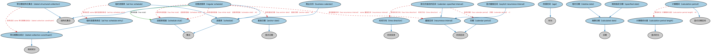

# 金融日期本体（Financial Dates Ontology）结构与公理说明

本文档对应 `FinancialDates.rdf` / `FinancialDates.ttl`，说明该本体的类、继承关系、属性和公理约定。结构图见 `FinancialDates-structure.png`（`FinancialDates-structure.svg` 为可缩放版本）。

## 1. 本体概述

定义金融语境下的日期与期间：结算日、付息日、到期日、日计数基准（day count basis，如 30/360、ACT/365）等。

**在体系中的位置**：FND 日期与时间模块的核心，金融合同一切日期条款的基础。

**上下游关系**：上游依赖 OMG 通用日期时间本体与 FND 关系本体；下游被付款计划表、债务、衍生品等所有含日期条款的本体引用。

**与相近概念的差别**：金融日期≠日历日期——金融日期带有业务含义与计算规则（如利息按什么基准算天数）；与营业日期的差别——营业日期解决「哪天开门」，金融日期解决「哪天发生什么事、怎么算」。

本本体中类与类的核心关系如下（完整细节见各类小节）：

- **临时进度表（ad hoc schedule）** 继承 **进度表（schedule）**
- **临时进度表条目（ad hoc schedule entry）** 继承 **带日期集合成分（dated collection constituent）**
- **存续时间（age）** 继承 **时长（Duration）**
- **基准日期（anchor date）** 继承 **显式日期（ExplicitDate）**
- **商业日历（business calendar）** 继承 **进度表（schedule）**
- **推算日期（calculated date）** 继承 **日期（Date）**
- **计算期间（calculation period）** 继承 **显式日期区间（ExplicitDatePeriod）**
- **计算期间长度（calculation period length）** 继承 **显式时长（ExplicitDuration）**
- **历期（calendar period）** 继承 **时间区间（TimeInterval）**
- **按日历指定的区间（calendar-specified interval）** 继承 **重复区间（recurrence interval）**
- **带日期集合成分（dated collection constituent）** 继承 **组成成分（Constituent）**
- **带日期结构化集合（dated structured collection）** 继承 **结构化集合（StructuredCollection）**
- 其余 10 条关系从略。

## 2. 类（Class）

| 类（Class） | 定义（Definition） |
|---|---|
| 临时进度表（ad hoc schedule） | 由若干个不一定重复发生的独立事件组成的进度表。 |
| 临时进度表条目（ad hoc schedule entry） | 进度表中多个非定期重复条目之一，含日期或日期时间。 |
| 存续时间（age） | 某事物或某人已存活或存在的时间长度。 |
| 基准日期（anchor date） | 序列或时间线中的固定参照点。 |
| 商业日历（business calendar） | 用于管理会议、规划事件、协调组织内和/或跨组织活动的日程与沟通工具。 |
| 推算日期（calculated date） | 基于某个公式确定或将要确定的日期。 |
| 计算期间（calculation period） | 计算过程或运算发生所在的特定区间或范围内、从起点到终点的显式期间。 |
| 计算期间长度（calculation period length） | 按适用规则计算的、从调整后的生效日或起始日到调整后的终止日或结束日的显式天数。 |
| 历期（calendar period） | 在某体系内确定一年的某段起点与长度的时间区间。 |
| 按日历指定的区间（calendar-specified interval） | 定义为某历期（如日历月）第 n 天并带有时间方向（自起点向前或自终点向后）的重复区间。 |
| 带日期集合成分（dated collection constituent） | 与日期时间关联的集合元素。 |
| 带日期结构化集合（dated structured collection） | 其元素必须具有日期时间的结构化集合。 |
| 显式重复区间（explicit recurrence interval） | 以显式时长定义的重复区间。 |
| 重复区间（recurrence interval） | 在定期进度表的各元素之间保持一致的时间区间。 |
| 定期进度表（regular schedule） | 时间区间规律重复的进度表。 |
| 相对日期（relative date） | 在另一日期之前或之后某时长的推算日期。 |
| 进度表（schedule） | 事件、观测或其他发生事项及其将完成的关联日期和/或时间的集合。 |
| 进度表短端（schedule stub） | 进度表重复部分开始之前或结束之后、可能与特定发生事项关联的日期区间。 |
| 规则指定日期（specified date） | 由规则定义的推算日期，该规则以字符串形式记录于「具有日期规则」属性。 |
| 时间方向（time direction） | 表明按日历指定的日期从历期起点还是终点起算的枚举。 |

以下按类逐个展开：每个类给出继承关系、相关属性与公理约定；子类在父类之下降一级编号。

### 2.1 存续时间（age）

定义：某事物或某人已存活或存在的时间长度。

- 父类：**时长（Duration）**

属性：

| 属性 | 定义 | 说明 |
|---|---|---|
| **具有截止日（has as-of date）** | 将某事物关联到其内容准确或有效的日期（如信用报告的截止日指信息提取之日）。 | 子属性：具有日期 |

公理：

- **具有截止日（has as-of date）**至少有一个取值，类型是**显式日期（ExplicitDate）**。

### 2.2 基准日期（anchor date）

定义：序列或时间线中的固定参照点。

- 父类：**显式日期（ExplicitDate）**

### 2.3 推算日期（calculated date）

定义：基于某个公式确定或将要确定的日期。

- 父类：**日期（Date）**
- 直接子类：**相对日期（relative date）**、**规则指定日期（specified date）**

公理：

- 与**显式日期（ExplicitDate）**互斥：同一个体不能同时属于两者。

#### 2.3.1 相对日期（relative date）

定义：在另一日期之前或之后某时长的推算日期。

- 父类：**推算日期（calculated date）**

属性：

| 属性 | 定义 | 说明 |
|---|---|---|
| **具有相对时长（has relative duration）** | 两个显式日期之间的时长。 | 值域：xsd:string |
| **相对于（is relative to）** | 标识相对日期或相对日期区间所参照的特定日期。 | 值域：日期 |

公理：

- **具有相对时长（has relative duration）**存在取值约束。
- **相对于（is relative to）**恰好有 1 个**日期（Date）**。
- 与**规则指定日期（specified date）**互斥：同一个体不能同时属于两者。

#### 2.3.2 规则指定日期（specified date）

定义：由规则定义的推算日期，该规则以字符串形式记录于「具有日期规则」属性。

- 父类：**推算日期（calculated date）**

属性：

| 属性 | 定义 | 说明 |
|---|---|---|
| **具有日期规则（has date specification）** | 指明规则指定日期如何计算的规则。 | 值域：xsd:string |

公理：

- **具有日期规则（has date specification）**存在取值约束。

### 2.4 计算期间（calculation period）

定义：计算过程或运算发生所在的特定区间或范围内、从起点到终点的显式期间。

- 父类：**显式日期区间（ExplicitDatePeriod）**

属性：

| 属性 | 定义 | 说明 |
|---|---|---|
| **具有时长（hasDuration）** | — | — |

公理：

- **具有时长（hasDuration）**至多有 1 个**计算期间长度（calculation period length）**。

### 2.5 计算期间长度（calculation period length）

定义：按适用规则计算的、从调整后的生效日或起始日到调整后的终止日或结束日的显式天数。

- 父类：**显式时长（ExplicitDuration）**

### 2.6 历期（calendar period）

定义：在某体系内确定一年的某段起点与长度的时间区间。

- 父类：**时间区间（TimeInterval）**

### 2.7 带日期集合成分（dated collection constituent）

定义：与日期时间关联的集合元素。

- 父类：**组成成分（Constituent）**
- 直接子类：**临时进度表条目（ad hoc schedule entry）**

属性：

| 属性 | 定义 | 说明 |
|---|---|---|
| **具有观测日期时间（hasObservedDateTime）** | — | — |

公理：

- **具有观测日期时间（hasObservedDateTime）**至少有一个取值，类型是**cmns-dt:CombinedDateTime（CombinedDateTime）**。

#### 2.7.1 临时进度表条目（ad hoc schedule entry）

定义：进度表中多个非定期重复条目之一，含日期或日期时间。

- 父类：**带日期集合成分（dated collection constituent）**

### 2.8 带日期结构化集合（dated structured collection）

定义：其元素必须具有日期时间的结构化集合。

- 父类：**结构化集合（StructuredCollection）**

属性：

| 属性 | 定义 | 说明 |
|---|---|---|
| **具有成员（hasMember）** | — | — |

公理：

- **具有成员（hasMember）**至少有一个取值，类型是**带日期集合成分（dated collection constituent）**。

### 2.9 重复区间（recurrence interval）

定义：在定期进度表的各元素之间保持一致的时间区间。

- 父类：**时间区间（TimeInterval）**
- 直接子类：**按日历指定的区间（calendar-specified interval）**、**显式重复区间（explicit recurrence interval）**

#### 2.9.1 按日历指定的区间（calendar-specified interval）

定义：定义为某历期（如日历月）第 n 天并带有时间方向（自起点向前或自终点向后）的重复区间。

- 父类：**重复区间（recurrence interval）**

属性：

| 属性 | 定义 | 说明 |
|---|---|---|
| **具有历期（has calendar period）** | 标识计算按日历指定日期所用的时段，如日历年周、日历月、日历季度或日历年。 | 值域：历期（calendar period） |
| **具有序数（has ordinal number）** | 指明在有序序列中位置的数字，即第 1、第 2、第 3 等。 | 值域：xsd:integer |
| **具有时间方向（has time direction）** | 表明按日历指定的日期从历期起点还是终点起算。 | 值域：时间方向（time direction） |

公理：

- **具有历期（has calendar period）**恰好有 1 个**历期（calendar period）**。
- **具有序数（has ordinal number）**存在取值约束。
- **具有时间方向（has time direction）**恰好有 1 个**时间方向（time direction）**。
- 与**显式重复区间（explicit recurrence interval）**互斥：同一个体不能同时属于两者。

#### 2.9.2 显式重复区间（explicit recurrence interval）

定义：以显式时长定义的重复区间。

- 父类：**重复区间（recurrence interval）**

属性：

| 属性 | 定义 | 说明 |
|---|---|---|
| **具有时长值（hasDurationValue）** | — | — |

公理：

- **具有时长值（hasDurationValue）**存在取值约束。

### 2.10 进度表（schedule）

定义：事件、观测或其他发生事项及其将完成的关联日期和/或时间的集合。

- 父类：**集合（Collection）**
- 直接子类：**临时进度表（ad hoc schedule）**、**商业日历（business calendar）**、**定期进度表（regular schedule）**

属性：

| 属性 | 定义 | 说明 |
|---|---|---|
| **具有整体期间（has overall period）** | 标识包含进度表全部日期（含任何短端）的日期区间。 | 子属性：具有日期区间 |

公理：

- **具有整体期间（has overall period）**至少有一个取值，类型是**日期区间（DatePeriod）**。

#### 2.10.1 临时进度表（ad hoc schedule）

定义：由若干个不一定重复发生的独立事件组成的进度表。

- 父类：**进度表（schedule）**

属性：

| 属性 | 定义 | 说明 |
|---|---|---|
| **具有成员（hasMember）** | — | — |

公理：

- **具有成员（hasMember）**至少有一个取值，类型是**临时进度表条目（ad hoc schedule entry）**。

#### 2.10.2 商业日历（business calendar）

定义：用于管理会议、规划事件、协调组织内和/或跨组织活动的日程与沟通工具。

- 父类：**进度表（schedule）**

#### 2.10.3 定期进度表（regular schedule）

定义：时间区间规律重复的进度表。

- 父类：**进度表（schedule）**、**结构化集合（StructuredCollection）**

属性：

| 属性 | 定义 | 说明 |
|---|---|---|
| **具有基准日期（has anchor date）** | 指明序列或时间线中的固定参照点。 | 值域：基准日期（anchor date）；子属性：具有显式日期 |
| **具有计数（has count）** | 指明集合中事物的总数，如定期进度表的条目数。 | 值域：xsd:positiveInteger |
| **具有末段短端（has final stub）** | 标识定期进度表末尾的任何特殊时段。 | 子属性：具有短端（has stub） |
| **具有首段短端（has initial stub）** | 标识定期进度表开头的任何特殊时段。 | 子属性：具有短端（has stub） |
| **具有重复区间（has recurrence interval）** | 标识某事件或发布发生的频率。 | 值域：重复区间（recurrence interval） |
| **具有短端（has stub）** | 将进度表开头或末尾的缩短时段关联到整体进度表。 | 值域：进度表短端（schedule stub） |
| **具有起始日期（hasStartDate）** | — | — |

公理：

- **具有基准日期（has anchor date）**可以有 0 个或多个**基准日期（anchor date）**。
- **具有末段短端（has final stub）**可以有 0 个或多个**进度表短端（schedule stub）**。
- **具有计数（has count）**存在取值约束。
- **具有起始日期（hasStartDate）**至少有一个取值，该取值满足：该属性存在取值约束。
- **具有重复区间（has recurrence interval）**至少有一个取值，类型是**重复区间（recurrence interval）**。
- **具有首段短端（has initial stub）**可以有 0 个或多个**进度表短端（schedule stub）**。

### 2.11 进度表短端（schedule stub）

定义：进度表重复部分开始之前或结束之后、可能与特定发生事项关联的日期区间。

- 父类：**集合（Collection）**

属性：

| 属性 | 定义 | 说明 |
|---|---|---|
| **具有日期区间（hasDatePeriod）** | — | — |

公理：

- **具有日期区间（hasDatePeriod）**恰好有 1 个**日期区间（DatePeriod）**。

### 2.12 时间方向（time direction）

定义：表明按日历指定的日期从历期起点还是终点起算的枚举。

- 父类：**时间实体（TemporalEntity）**

## 3. 其他属性

以下属性未绑定到本体的具体类（定义域在外部本体或未声明）：

对象属性（Object Property）：

| 属性 | 定义 | 说明 |
|---|---|---|
| **具有存续时间（has age）** | 将某事物关联到其已存在的时间长度。 | 值域：时长；子属性：具有时长 |
| **具有加入日期（has date added）** | 标识某事物被纳入他物的日期。 | 值域：显式日期；子属性：具有显式日期 |
| **具有接收日期（has date received）** | 将某事物关联到其到达或交付的日期，如贷款申请。 | 子属性：具有日期 |
| **具有进度表（has schedule）** | 标识某事物的进度表。 | 值域：进度表（schedule） |

数据属性（Datatype Property）：

| 属性 | 定义 |
|---|---|
| **具有取得日期（has acquisition date）** | 将资产或所有者/控制方/被控制方关联到购买日期或日期时间。 |
| **具有截止日时间（has closing date time）** | 某事物截止的日期与时间。 |
| **具有开启日时间（has opening date time）** | 某事物开启的日期与时间。 |

## 4. 依赖（owl:imports，4 个）

本本体通过 `owl:imports` 引入以下本体，各项的中文名称与简介如下：

| 导入本体 | 中文名称 | 简介 |
|---|---|---|
| `FND/Utilities/AnnotationVocabulary.rdf` | FIBO 标注词汇表（FIBO Annotation Vocabulary） | 定义 FIBO 专用的标注属性（如释义来源、成熟度等级），用于本体自身的元数据标注。 |
| `https://www.omg.org/spec/Commons/AnnotationVocabulary/` | OMG 通用标注词汇表（OMG Commons Annotation Vocabulary） | OMG 通用本体库（Commons）中的标注词汇表，提供概念映射等标注属性，FIBO 用它标注术语与外部标准的对应关系。 |
| `https://www.omg.org/spec/Commons/Collections/` | OMG 通用集合本体（OMG Commons Collections） | Commons 库中的集合本体，定义集合、成员等通用概念。 |
| `https://www.omg.org/spec/Commons/DatesAndTimes/` | OMG 通用日期与时间本体（OMG Commons Dates and Times） | Commons 库中的日期时间本体，定义日期、期间、时间点等通用时间概念。 |

## 5. 文件

- 官方 RDF/XML：`FinancialDates.rdf`
- 中文 Turtle：`FinancialDates.ttl`
- 结构图：`FinancialDates-structure.png` / `FinancialDates-structure.svg`