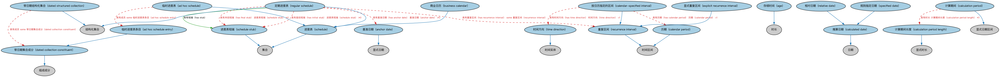

# 金融日期本体（Financial Dates Ontology）结构与公理说明

本文档对应 `FinancialDates.rdf` / `FinancialDates.ttl`，说明该本体的类、继承关系、属性和公理约定。结构图见 `FinancialDates-structure.png`（`FinancialDates-structure.svg` 为可缩放版本）。

## 1. 本体概述

定义金融语境下的日期与期间：结算日、付息日、到期日、日计数基准（day count basis，如 30/360、ACT/365）等。

**在体系中的位置**：FND 日期与时间模块的核心，金融合同一切日期条款的基础。

**上下游关系**：上游依赖 OMG 通用日期时间本体与 FND 关系本体；下游被付款计划表、债务、衍生品等所有含日期条款的本体引用。

**与相近概念的差别**：金融日期≠日历日期——金融日期带有业务含义与计算规则（如利息按什么基准算天数）；与营业日期的差别——营业日期解决「哪天开门」，金融日期解决「哪天发生什么事、怎么算」。

## 2. 类（Class）

| 类（Class） | 定义（Definition） |
|---|---|
| 临时进度表（ad hoc schedule） | 由若干个不一定重复发生的独立事件组成的进度表。 |
| 临时进度表条目（ad hoc schedule entry） | 进度表中多个非定期重复条目之一，含日期或日期时间。 |
| 存续时间（age） | 某事物或某人已存活或存在的时间长度。 |
| 基准日期（anchor date） | 序列或时间线中的固定参照点。 |
| 商业日历（business calendar） | 用于管理会议、规划事件、协调组织内和/或跨组织活动的日程与沟通工具。 |
| 推算日期（calculated date） | 基于某个公式确定或将要确定的日期。 |
| 计算期间（calculation period） | 计算过程或运算发生所在的特定区间或范围内、从起点到终点的显式期间。 |
| 计算期间长度（calculation period length） | 按适用规则计算的、从调整后的生效日或起始日到调整后的终止日或结束日的显式天数。 |
| 历期（calendar period） | 在某体系内确定一年的某段起点与长度的时间区间。 |
| 按日历指定的区间（calendar-specified interval） | 定义为某历期（如日历月）第 n 天并带有时间方向（自起点向前或自终点向后）的重复区间。 |
| 带日期集合成分（dated collection constituent） | 与日期时间关联的集合元素。 |
| 带日期结构化集合（dated structured collection） | 其元素必须具有日期时间的结构化集合。 |
| 显式重复区间（explicit recurrence interval） | 以显式时长定义的重复区间。 |
| 重复区间（recurrence interval） | 在定期进度表的各元素之间保持一致的时间区间。 |
| 定期进度表（regular schedule） | 时间区间规律重复的进度表。 |
| 相对日期（relative date） | 在另一日期之前或之后某时长的推算日期。 |
| 进度表（schedule） | 事件、观测或其他发生事项及其将完成的关联日期和/或时间的集合。 |
| 进度表短端（schedule stub） | 进度表重复部分开始之前或结束之后、可能与特定发生事项关联的日期区间。 |
| 规则指定日期（specified date） | 由规则定义的推算日期，该规则以字符串形式记录于「具有日期规则」属性。 |
| 时间方向（time direction） | 表明按日历指定的日期从历期起点还是终点起算的枚举。 |

### 2.1 继承关系（Inheritance）

- 临时进度表（ad hoc schedule） ⊑ 进度表（schedule）
- 临时进度表条目（ad hoc schedule entry） ⊑ 带日期集合成分（dated collection constituent）
- 存续时间（age） ⊑ 时长
- 基准日期（anchor date） ⊑ 显式日期
- 商业日历（business calendar） ⊑ 进度表（schedule）
- 推算日期（calculated date） ⊑ 日期
- 计算期间（calculation period） ⊑ 显式日期区间
- 计算期间长度（calculation period length） ⊑ 显式时长
- 历期（calendar period） ⊑ 时间区间
- 按日历指定的区间（calendar-specified interval） ⊑ 重复区间（recurrence interval）
- 带日期集合成分（dated collection constituent） ⊑ 组成成分
- 带日期结构化集合（dated structured collection） ⊑ 结构化集合
- 显式重复区间（explicit recurrence interval） ⊑ 重复区间（recurrence interval）
- 重复区间（recurrence interval） ⊑ 时间区间
- 定期进度表（regular schedule） ⊑ 进度表（schedule）
- 定期进度表（regular schedule） ⊑ 结构化集合
- 相对日期（relative date） ⊑ 推算日期（calculated date）
- 进度表（schedule） ⊑ 集合
- 进度表短端（schedule stub） ⊑ 集合
- 规则指定日期（specified date） ⊑ 推算日期（calculated date）
- 时间方向（time direction） ⊑ 时间实体

## 3. 对象属性（Object Property）

| 属性（Property） | 中文（English） | 定义（Definition） | 说明 |
|---|---|---|---|
| fibo-fnd-dt-fd:hasAge | 具有存续时间（has age） | 将某事物关联到其已存在的时间长度。 | 值域（range）：时长；子属性（subPropertyOf）：具有时长 |
| fibo-fnd-dt-fd:hasAnchorDate | 具有基准日期（has anchor date） | 指明序列或时间线中的固定参照点。 | 值域（range）：基准日期（anchor date）；子属性（subPropertyOf）：具有显式日期 |
| fibo-fnd-dt-fd:hasAsOfDate | 具有截止日（has as-of date） | 将某事物关联到其内容准确或有效的日期（如信用报告的截止日指信息提取之日）。 | 子属性（subPropertyOf）：具有日期 |
| fibo-fnd-dt-fd:hasCalendarPeriod | 具有历期（has calendar period） | 标识计算按日历指定日期所用的时段，如日历年周、日历月、日历季度或日历年。 | 值域（range）：历期（calendar period） |
| fibo-fnd-dt-fd:hasDateAdded | 具有加入日期（has date added） | 标识某事物被纳入他物的日期。 | 值域（range）：显式日期；子属性（subPropertyOf）：具有显式日期 |
| fibo-fnd-dt-fd:hasDateReceived | 具有接收日期（has date received） | 将某事物关联到其到达或交付的日期，如贷款申请。 | 子属性（subPropertyOf）：具有日期 |
| fibo-fnd-dt-fd:hasFinalStub | 具有末段短端（has final stub） | 标识定期进度表末尾的任何特殊时段。 | 子属性（subPropertyOf）：具有短端（has stub） |
| fibo-fnd-dt-fd:hasInitialStub | 具有首段短端（has initial stub） | 标识定期进度表开头的任何特殊时段。 | 子属性（subPropertyOf）：具有短端（has stub） |
| fibo-fnd-dt-fd:hasOverallPeriod | 具有整体期间（has overall period） | 标识包含进度表全部日期（含任何短端）的日期区间。 | 定义域（domain）：进度表（schedule）；子属性（subPropertyOf）：具有日期区间 |
| fibo-fnd-dt-fd:hasRecurrenceInterval | 具有重复区间（has recurrence interval） | 标识某事件或发布发生的频率。 | 值域（range）：重复区间（recurrence interval） |
| fibo-fnd-dt-fd:hasSchedule | 具有进度表（has schedule） | 标识某事物的进度表。 | 值域（range）：进度表（schedule） |
| fibo-fnd-dt-fd:hasStub | 具有短端（has stub） | 将进度表开头或末尾的缩短时段关联到整体进度表。 | 定义域（domain）：定期进度表（regular schedule）；值域（range）：进度表短端（schedule stub） |
| fibo-fnd-dt-fd:hasTimeDirection | 具有时间方向（has time direction） | 表明按日历指定的日期从历期起点还是终点起算。 | 值域（range）：时间方向（time direction） |
| fibo-fnd-dt-fd:isRelativeTo | 相对于（is relative to） | 标识相对日期或相对日期区间所参照的特定日期。 | 值域（range）：日期 |

## 4. 数据属性（Datatype Property）

| 属性（Property） | 中文（English） | 定义（Definition） |
|---|---|---|
| fibo-fnd-dt-fd:hasAcquisitionDate | 具有取得日期（has acquisition date） | 将资产或所有者/控制方/被控制方关联到购买日期或日期时间。 |
| fibo-fnd-dt-fd:hasClosingDateTime | 具有截止日时间（has closing date time） | 某事物截止的日期与时间。 |
| fibo-fnd-dt-fd:hasCount | 具有计数（has count） | 指明集合中事物的总数，如定期进度表的条目数。 |
| fibo-fnd-dt-fd:hasDateSpecification | 具有日期规则（has date specification） | 指明规则指定日期如何计算的规则。 |
| fibo-fnd-dt-fd:hasOpeningDateTime | 具有开启日时间（has opening date time） | 某事物开启的日期与时间。 |
| fibo-fnd-dt-fd:hasOrdinalNumber | 具有序数（has ordinal number） | 指明在有序序列中位置的数字，即第 1、第 2、第 3 等。 |
| fibo-fnd-dt-fd:hasRelativeDuration | 具有相对时长（has relative duration） | 两个显式日期之间的时长。 |

## 5. 公理约定（Axioms）

- 临时进度表（ad hoc schedule）：具有成员 some 临时进度表条目（ad hoc schedule entry）
- 存续时间（age）：具有截止日（has as-of date） some 显式日期
- 推算日期（calculated date） 与 显式日期 互斥（disjointWith）
- 计算期间（calculation period）：具有时长 计算期间长度（calculation period length） ≤1
- 按日历指定的区间（calendar-specified interval）：具有历期（has calendar period） 历期（calendar period） =1
- 按日历指定的区间（calendar-specified interval）：具有时间方向（has time direction） 时间方向（time direction） =1
- 按日历指定的区间（calendar-specified interval）：restriction
- 按日历指定的区间（calendar-specified interval） 与 显式重复区间（explicit recurrence interval） 互斥（disjointWith）
- 带日期集合成分（dated collection constituent）：具有观测日期时间 some cmns-dt:CombinedDateTime
- 带日期结构化集合（dated structured collection）：具有成员 some 带日期集合成分（dated collection constituent）
- 显式重复区间（explicit recurrence interval）：restriction
- 定期进度表（regular schedule）：具有基准日期（has anchor date） 基准日期（anchor date） ≥0
- 定期进度表（regular schedule）：具有末段短端（has final stub） 进度表短端（schedule stub） ≥0
- 定期进度表（regular schedule）：具有首段短端（has initial stub） 进度表短端（schedule stub） ≥0
- 定期进度表（regular schedule）：restriction
- 定期进度表（regular schedule）：具有重复区间（has recurrence interval） some 重复区间（recurrence interval）
- 定期进度表（regular schedule）：具有起始日期 some（restriction）
- 相对日期（relative date）：相对于（is relative to） 日期 =1
- 相对日期（relative date）：restriction
- 相对日期（relative date） 与 规则指定日期（specified date） 互斥（disjointWith）
- 进度表（schedule）：具有整体期间（has overall period） some 日期区间
- 进度表短端（schedule stub）：具有日期区间 日期区间 =1
- 规则指定日期（specified date）：restriction

## 6. 依赖（owl:imports，4 个）

本本体通过 `owl:imports` 引入以下本体，各项的中文名称与简介如下：

| 导入本体 | 中文名称 | 简介 |
|---|---|---|
| `FND/Utilities/AnnotationVocabulary.rdf` | FIBO 标注词汇表（FIBO Annotation Vocabulary） | 定义 FIBO 专用的标注属性（如释义来源、成熟度等级），用于本体自身的元数据标注。 |
| `https://www.omg.org/spec/Commons/AnnotationVocabulary/` | OMG 通用标注词汇表（OMG Commons Annotation Vocabulary） | OMG 通用本体库（Commons）中的标注词汇表，提供概念映射等标注属性，FIBO 用它标注术语与外部标准的对应关系。 |
| `https://www.omg.org/spec/Commons/Collections/` | OMG 通用集合本体（OMG Commons Collections） | Commons 库中的集合本体，定义集合、成员等通用概念。 |
| `https://www.omg.org/spec/Commons/DatesAndTimes/` | OMG 通用日期与时间本体（OMG Commons Dates and Times） | Commons 库中的日期时间本体，定义日期、期间、时间点等通用时间概念。 |

## 7. 文件

- 官方 RDF/XML：`FinancialDates.rdf`
- 中文 Turtle：`FinancialDates.ttl`
- 结构图：`FinancialDates-structure.png` / `FinancialDates-structure.svg`