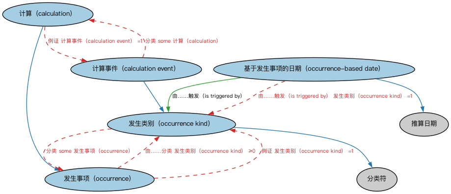

# 事件与发生本体（Occurrences Ontology）结构与公理说明

本文档对应 `Occurrences.rdf` / `Occurrences.ttl`，说明该本体的类、继承关系、属性和公理约定。结构图见 `Occurrences-structure.png`（`Occurrences-structure.svg` 为可缩放版本）。

## 1. 本体概述

定义「发生」（occurrence）、事件（event）与触发条件：表达「某时某地发生了什么」。

**在体系中的位置**：FND 日期与时间模块中处理「事件」的本体，是企业行动、信用事件、贷款事件的共同上游。

**上下游关系**：上游依赖日期与参与方本体；下游被 CAE 企业行动、FBC 信用事件、LOAN 贷款事件引用。

**与相近概念的差别**：事件≠状态——事件是时间点上的发生（违约了），状态是持续的处境（处于违约中）；与流程的差别——流程是一系列预定步骤，事件是单次发生。

## 2. 类（Class）

| 类（Class） | 定义（Definition） |
|---|---|
| 计算（calculation） | 被排定或由某事物触发的某项计算、计算过程或运算的实际执行。 |
| 计算事件（calculation event） | 被排定或由某事物（如相关金融事件）触发、从而导致执行计算的一类事件。 |
| 发生事项（occurrence） | 某种发生类别的发生，即事件。 |
| 发生类别（occurrence kind） | 指明发生事项（事件）一般性质的分类符。 |
| 基于发生事项的日期（occurrence-based date） | 相对于某发生类别的发生而定义的推算日期。 |

### 2.1 继承关系（Inheritance）

- 计算（calculation） ⊑ 发生事项（occurrence）
- 计算事件（calculation event） ⊑ 发生类别（occurrence kind）
- 发生类别（occurrence kind） ⊑ 分类符
- 基于发生事项的日期（occurrence-based date） ⊑ 推算日期

## 3. 对象属性（Object Property）

| 属性（Property） | 中文（English） | 定义（Definition） | 说明 |
|---|---|---|---|
| fibo-fnd-dt-oc:hasEventDate | 具有事件日期（has event date） | 标识与事件（发生事项）关联的日期。 | 值域（range）：日期；子属性（subPropertyOf）：具有日期 |
| fibo-fnd-dt-oc:hasInput | 具有输入（has input） | 将某事物（如发生事项）关联到用作某活动或过程输入的事物。 | 逆属性（inverseOf）：是……的输入（is input to） |
| fibo-fnd-dt-oc:hasOccurrence | 具有发生事项（has occurrence） | 标识给定发生类别的事件，通常指其在进度表中的发生。 | 值域（range）：发生事项（occurrence） |
| fibo-fnd-dt-oc:hasOutput | 具有输出（has output） | 将某事物（如发生事项）关联到作为某活动或过程结果的事物。 | 逆属性（inverseOf）：是……的输出（is output from） |
| fibo-fnd-dt-oc:isInputTo | 是……的输入（is input to） | 标识某活动、过程、系统、报告、分析等的前提条件、要求或其他投入（如数据）。 | — |
| fibo-fnd-dt-oc:isOutputFrom | 是……的输出（is output from） | 标识某活动、过程、系统、报告、分析等的后置条件或其他产物。 | — |
| fibo-fnd-dt-oc:isTriggeredBy | 由……触发（is triggered by） | 由……激活或发起。 | 定义域（domain）：基于发生事项的日期（occurrence-based date）；值域（range）：发生类别（occurrence kind） |

## 4. 数据属性（Datatype Property）

| 属性（Property） | 中文（English） | 定义（Definition） |
|---|---|---|
| fibo-fnd-dt-oc:hasEventDateValue | 具有事件日期值（has event date value） | 标识与事件（发生事项）关联的日期或日期时间值。 |

## 5. 公理约定（Axioms）

- 计算（calculation）：具有表达式 表达式 ≥0
- 计算（calculation）：具有量值 标量值 ≥0
- 计算（calculation）：具有量值区间 标量值区间 ≥0
- 计算（calculation）：例证 计算事件（calculation event） =1
- 计算事件（calculation event）：分类 some 计算（calculation）
- 发生事项（occurrence）：restriction
- 发生事项（occurrence）：由……分类 发生类别（occurrence kind） ≥0
- 发生事项（occurrence）：具有位置 位置 ≥0
- 发生事项（occurrence）：例证 发生类别（occurrence kind） =1
- 发生类别（occurrence kind）：分类 some 发生事项（occurrence）
- 基于发生事项的日期（occurrence-based date）：由……触发（is triggered by） 发生类别（occurrence kind） =1

## 6. 依赖（owl:imports，10 个）

本本体通过 `owl:imports` 引入以下本体，各项的中文名称与简介如下：

| 导入本体 | 中文名称 | 简介 |
|---|---|---|
| `FND/DatesAndTimes/FinancialDates.rdf` | 金融日期本体（Financial Dates Ontology） | 定义金融语境下的日期与期间概念：结算日、付息日、到期日、日计数基准等。 |
| `FND/Relations/Relations.rdf` | 关系本体（Relations Ontology） | FIBO 最底层的基础本体，定义参考（reference）、分类（classify）等通用关系与抽象概念，全库普遍依赖。 |
| `FND/Utilities/AnnotationVocabulary.rdf` | FIBO 标注词汇表（FIBO Annotation Vocabulary） | 定义 FIBO 专用的标注属性（如释义来源、成熟度等级），用于本体自身的元数据标注。 |
| `https://www.omg.org/spec/Commons/AnnotationVocabulary/` | OMG 通用标注词汇表（OMG Commons Annotation Vocabulary） | OMG 通用本体库（Commons）中的标注词汇表，提供概念映射等标注属性，FIBO 用它标注术语与外部标准的对应关系。 |
| `https://www.omg.org/spec/Commons/Classifiers/` | OMG 通用分类器本体（OMG Commons Classifiers） | OMG 通用本体库（Commons）中的分类器本体，定义分类方案、类别与归类关系的通用概念，FIBO 的分类建模建立在其上。 |
| `https://www.omg.org/spec/Commons/Collections/` | OMG 通用集合本体（OMG Commons Collections） | Commons 库中的集合本体，定义集合、成员等通用概念。 |
| `https://www.omg.org/spec/Commons/DatesAndTimes/` | OMG 通用日期与时间本体（OMG Commons Dates and Times） | Commons 库中的日期时间本体，定义日期、期间、时间点等通用时间概念。 |
| `https://www.omg.org/spec/Commons/Locations/` | OMG 通用位置本体（OMG Commons Locations） | Commons 库中的位置本体，定义地理位置、地点的通用概念。 |
| `https://www.omg.org/spec/Commons/PartiesAndSituations/` | OMG 通用参与方与情境本体（OMG Commons Parties and Situations） | Commons 库中的参与方本体，定义独立主体、参与方及其角色扮演的通用概念，是 FIBO 参与方模型的上游。 |
| `https://www.omg.org/spec/Commons/QuantitiesAndUnits/` | OMG 通用量与单位本体（OMG Commons Quantities and Units） | Commons 库中的量与单位本体，定义数量、度量单位、量纲的通用概念，支撑金额、比率等数值表达。 |

## 7. 文件

- 官方 RDF/XML：`Occurrences.rdf`
- 中文 Turtle：`Occurrences.ttl`
- 结构图：`Occurrences-structure.png` / `Occurrences-structure.svg`