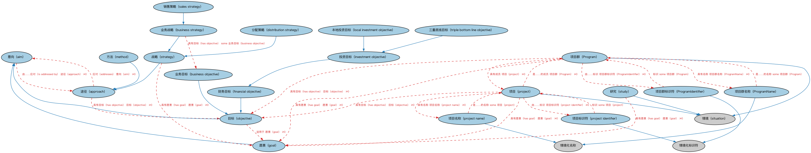

# 目标本体（Objectives Ontology）结构与公理说明

本文档对应 `Objectives.rdf` / `Objectives.ttl`，说明该本体的类、继承关系、属性和公理约定。结构图见 `Objectives-structure.png`（`Objectives-structure.svg` 为可缩放版本）。

## 1. 本体概述

定义目标（objective）及其与组织、计划的关系：机构设定的经营目标、投资目标、合规目标。

**在体系中的位置**：FND 目标模块的唯一本体，为战略与意图建模。

**上下游关系**：上游依赖组织与安排本体；下游被基金（投资目标）、企业治理等场景引用。

**与相近概念的差别**：目标≠约束——目标是追求的方向（收益最大化），约束是必须遵守的限制（投资比例上限）；目标可度量程度各异，本本体不强制量化。

## 2. 类（Class）

| 类（Class） | 定义（Definition） |
|---|---|
| 项目群（Program） | 为获得单独管理所无法获得的收益而设计的事务状态与协调活动集。 |
| 项目群标识符（ProgramIdentifier） | 在项目群被管理的情境内唯一标识特定项目群的字符序列。 |
| 项目群名称（ProgramName） | 项目群在其被管理情境内的情境化指称。 |
| 意向（aim） | 指明代理行动所指向的期望方向、状况或情形的意图，不要求精确的范围或可测性。 |
| 途径（approach） | 应对意向或问题的方式，以高层规划和系统化执行为特征，不预设范围或粒度。 |
| 业务目标（business objective） | 反映企业在一定时间框架和可用资源内的战略目标与方向的目标。 |
| 业务战略（business strategy） | 实现特定业务目标、目的、解决方案或结果的战略。 |
| 分配策略（distribution strategy） | 使产品或服务可获得、或分配资金（如以股息或票息形式）的策略。 |
| 财务目标（financial objective） | 反映参与方在一定时间框架和可用资源内的战略财务目标与方向的目标。 |
| 愿景（goal） | 以宽泛范围和抱负性质为特征的意向，常为定性的、长期的，用以达成某种期望状态。 |
| 投资目标（investment objective） | 投资者用于判断某项潜在投资是否适合自己或代表他人的财务目标。 |
| 本地投资目标（local investment objective） | 旨在支持地理上集中的社区发展需求的财务目标。 |
| 方法（method） | 以系统化、可重复的程序和操作上的明确性为特征的途径，由明确的步骤组成。 |
| 目标（objective） | 以具体范围和可测标准为特征的意向，常为定量的、短期的，参与方寻求达成它。 |
| 项目（project） | 为交付有形产出而设计的事务状态及独特而临时的组织。 |
| 项目标识符（project identifier） | 在项目或其所属项目群被管理的情境内唯一标识特定项目的字符序列。 |
| 项目名称（project name） | 项目的情境化指称。 |
| 销售策略（sales strategy） | 销售某事物的策略，包括为销售过程分配资源、降低成本和优化收入。 |
| 战略（strategy） | 指导决策并协调行动与计划以追求某意向的高层途径。 |
| 研究（study） | 调查特定关注领域以确定其特性、关系、约束或影响的分析活动。 |
| 三重底线目标（triple bottom line objective） | 将经济绩效、环境管理和社会责任作为同等成功标准加以整合的财务目标。 |

### 2.1 继承关系（Inheritance）

- 项目群（Program） ⊑ 情境（situation）
- 项目群标识符（ProgramIdentifier） ⊑ 情境化标识符
- 项目群名称（ProgramName） ⊑ 情境化名称
- 业务目标（business objective） ⊑ 目标（objective）
- 业务战略（business strategy） ⊑ 战略（strategy）
- 分配策略（distribution strategy） ⊑ 战略（strategy）
- 财务目标（financial objective） ⊑ 目标（objective）
- 愿景（goal） ⊑ 意向（aim）
- 投资目标（investment objective） ⊑ 财务目标（financial objective）
- 本地投资目标（local investment objective） ⊑ 投资目标（investment objective）
- 方法（method） ⊑ 途径（approach）
- 目标（objective） ⊑ 意向（aim）
- 项目（project） ⊑ 情境（situation）
- 项目标识符（project identifier） ⊑ 情境化标识符
- 项目名称（project name） ⊑ 情境化名称
- 销售策略（sales strategy） ⊑ 业务战略（business strategy）
- 战略（strategy） ⊑ 途径（approach）
- 研究（study） ⊑ 情境（situation）
- 三重底线目标（triple bottom line objective） ⊑ 投资目标（investment objective）

## 3. 对象属性（Object Property）

| 属性（Property） | 中文（English） | 定义（Definition） | 说明 |
|---|---|---|---|
| fibo-fnd-gao-obj:addresses | 应对（addresses） | 处理、处置或关注。 | 子属性（subPropertyOf）：涉及 |
| fibo-fnd-gao-obj:hasGoal | 具有愿景（has goal） | 具有长期的期望结果。 | 值域（range）：愿景（goal） |
| fibo-fnd-gao-obj:hasObjective | 具有目标（has objective） | 旨在一定时间框架内、以可用资源达成。 | 值域（range）：目标（objective） |
| fibo-fnd-gao-obj:hasStrategy | 具有战略（has strategy） | 应用战略。 | 值域（range）：战略（strategy）；子属性（subPropertyOf）：使用 |
| fibo-fnd-gao-obj:isAddressedBy | 由……应对（is addressed by） | 标识被……处理的事物，如愿景或目标。 | 逆属性（inverseOf）：应对（addresses） |
| fibo-fnd-gao-obj:usesMethod | 使用方法（uses method） | 运用方法。 | 值域（range）：方法（method）；子属性（subPropertyOf）：使用 |

## 5. 公理约定（Axioms）

- 项目群（Program）：具有愿景（has goal） 愿景（goal） ≥0
- 项目群（Program）：具有目标（has objective） 目标（objective） ≥0
- 项目群（Program）：由……标识 项目群标识符（ProgramIdentifier） ≥0
- 项目群（Program）：具有名称 项目群名称（ProgramName） ≥0
- 项目群（Program）：具有成员 项目（project） ≥0
- 项目群（Program）：具有描述 some xsd:string
- 项目群标识符（ProgramIdentifier）：标识 some 项目群（Program）
- 项目群名称（ProgramName）：是……的名称 some 项目群（Program）
- 意向（aim）：由……应对（is addressed by） 途径（approach） ≥0
- 途径（approach）：应对（addresses） 意向（aim） ≥0
- 途径（approach）：具有目标（has objective） 目标（objective） ≥0
- 业务战略（business strategy）：具有目标（has objective） some 业务目标（business objective）
- 目标（objective）：适用于 愿景（goal） ≥0
- 目标（objective）：具有日期区间 日期区间 ≥0
- 项目（project）：restriction
- 项目（project）：restriction
- 项目（project）：具有愿景（has goal） 愿景（goal） ≥0
- 项目（project）：具有目标（has objective） 目标（objective） ≥0
- 项目（project）：是……的成员 项目群（Program） ≥0
- 项目（project）：由……标识 项目标识符（project identifier） ≥0
- 项目（project）：具有名称 项目名称（project name） ≥0
- 项目（project）：具有描述 some xsd:string
- 项目标识符（project identifier）：标识 some 项目（project）
- 项目名称（project name）：是……的名称 some 项目（project）
- 战略（strategy）：具有愿景（has goal） 愿景（goal） ≥0
- 研究（study）：具有愿景（has goal） 愿景（goal） ≥0
- 研究（study）：适用于情境 情境 ≥0

## 6. 依赖（owl:imports，11 个）

本本体通过 `owl:imports` 引入以下本体，各项的中文名称与简介如下：

| 导入本体 | 中文名称 | 简介 |
|---|---|---|
| `FND/DatesAndTimes/Occurrences.rdf` | 事件与发生本体（Occurrences Ontology） | 定义「发生」（occurrence）、事件与触发条件，用于表达企业行动、信用事件等「发生了什么」。 |
| `FND/Relations/Relations.rdf` | 关系本体（Relations Ontology） | FIBO 最底层的基础本体，定义参考（reference）、分类（classify）等通用关系与抽象概念，全库普遍依赖。 |
| `FND/Utilities/AnnotationVocabulary.rdf` | FIBO 标注词汇表（FIBO Annotation Vocabulary） | 定义 FIBO 专用的标注属性（如释义来源、成熟度等级），用于本体自身的元数据标注。 |
| `https://www.omg.org/spec/Commons/AnnotationVocabulary/` | OMG 通用标注词汇表（OMG Commons Annotation Vocabulary） | OMG 通用本体库（Commons）中的标注词汇表，提供概念映射等标注属性，FIBO 用它标注术语与外部标准的对应关系。 |
| `https://www.omg.org/spec/Commons/Collections/` | OMG 通用集合本体（OMG Commons Collections） | Commons 库中的集合本体，定义集合、成员等通用概念。 |
| `https://www.omg.org/spec/Commons/ContextualDesignators/` | OMG 通用语境指称本体（OMG Commons Contextual Designators） | Commons 库中的语境指称本体，定义「在某个语境下指代某物的名称/符号」，是地址、账户号码等语境相关标识的基础。 |
| `https://www.omg.org/spec/Commons/ContextualIdentifiers/` | OMG 通用语境标识符本体（OMG Commons Contextual Identifiers） | Commons 库中的语境标识符本体，定义在特定语境下唯一标识事物的标识符结构，是地址、账户类标识的基础。 |
| `https://www.omg.org/spec/Commons/DatesAndTimes/` | OMG 通用日期与时间本体（OMG Commons Dates and Times） | Commons 库中的日期时间本体，定义日期、期间、时间点等通用时间概念。 |
| `https://www.omg.org/spec/Commons/Designators/` | OMG 通用指称符本体（OMG Commons Designators） | Commons 库中的指称符本体，定义名称、标识符等「指代某物的符号」的通用概念。 |
| `https://www.omg.org/spec/Commons/Identifiers/` | OMG 通用标识符本体（OMG Commons Identifiers） | Commons 库中的标识符本体，定义标识符及其编码方案的通用概念。 |
| `https://www.omg.org/spec/Commons/PartiesAndSituations/` | OMG 通用参与方与情境本体（OMG Commons Parties and Situations） | Commons 库中的参与方本体，定义独立主体、参与方及其角色扮演的通用概念，是 FIBO 参与方模型的上游。 |

## 7. 文件

- 官方 RDF/XML：`Objectives.rdf`
- 中文 Turtle：`Objectives.ttl`
- 结构图：`Objectives-structure.png` / `Objectives-structure.svg`