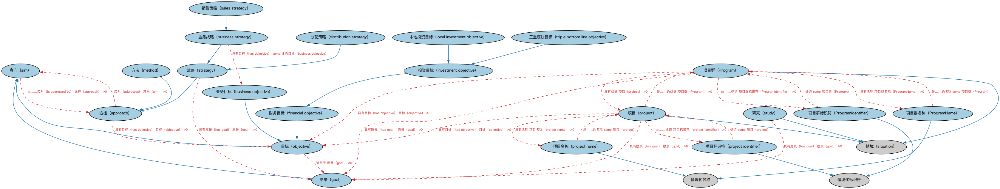

# 目标本体（Objectives Ontology）结构与公理说明

本文档对应 `Objectives.rdf` / `Objectives.ttl`，说明该本体的类、继承关系、属性和公理约定。结构图见 `Objectives-structure.png`（`Objectives-structure.svg` 为可缩放版本）。

## 1. 本体概述

定义目标（objective）及其与组织、计划的关系：机构设定的经营目标、投资目标、合规目标。

**在体系中的位置**：FND 目标模块的唯一本体，为战略与意图建模。

**上下游关系**：上游依赖组织与安排本体；下游被基金（投资目标）、企业治理等场景引用。

**与相近概念的差别**：目标≠约束——目标是追求的方向（收益最大化），约束是必须遵守的限制（投资比例上限）；目标可度量程度各异，本本体不强制量化。

本本体中类与类的核心关系如下（完整细节见各类小节）：

- **项目群（Program）** 继承 **情境（situation）**
- **项目群标识符（ProgramIdentifier）** 继承 **情境化标识符（ContextualIdentifier）**
- **项目群名称（ProgramName）** 继承 **情境化名称（ContextualName）**
- **业务目标（business objective）** 继承 **目标（objective）**
- **业务战略（business strategy）** 继承 **战略（strategy）**
- **分配策略（distribution strategy）** 继承 **战略（strategy）**
- **财务目标（financial objective）** 继承 **目标（objective）**
- **愿景（goal）** 继承 **意向（aim）**
- **投资目标（investment objective）** 继承 **财务目标（financial objective）**
- **本地投资目标（local investment objective）** 继承 **投资目标（investment objective）**
- **方法（method）** 继承 **途径（approach）**
- **目标（objective）** 继承 **意向（aim）**
- 其余 7 条关系从略。

## 2. 类（Class）

| 类（Class） | 定义（Definition） |
|---|---|
| 项目群（Program） | 为获得单独管理所无法获得的收益而设计的事务状态与协调活动集。 state of affairs and coordinated set of activities designed to obtain benefits not available from managing them individually |
| 项目群标识符（ProgramIdentifier） | 在项目群被管理的情境内唯一标识特定项目群的字符序列。 sequence of characters uniquely identifying a specific program within the context in which that program is administered |
| 项目群名称（ProgramName） | 项目群在其被管理情境内的情境化指称。 contextual designation for a program within the context in which that program is administered |
| 意向（aim） | 指明代理行动所指向的期望方向、状况或情形的意图，不要求精确的范围或可测性。 intention specifying a desired direction, condition, or situation toward which an agent's actions are directed, without requiring precise scope or measurable criteria |
| 途径（approach） | 应对意向或问题的方式，以高层规划和系统化执行为特征，不预设范围或粒度。 way of addressing an aim or problem characterized by high-level planning and systematic execution, without presupposing scope or granularity |
| 业务目标（business objective） | 反映企业在一定时间框架和可用资源内的战略目标与方向的目标。 objective that reflects the strategic goals and direction of a business within a time frame and available resources |
| 业务战略（business strategy） | 实现特定业务目标、目的、解决方案或结果的战略。 strategy for achieving a specific business goal, objective, solution or outcome |
| 分配策略（distribution strategy） | 使产品或服务可获得、或分配资金（如以股息或票息形式）的策略。 strategy for making a product or service available, or for distributing funds, such as in the form of a dividend or coupon |
| 财务目标（financial objective） | 反映参与方在一定时间框架和可用资源内的战略财务目标与方向的目标。 objective that reflects the strategic financial goals and direction of a party within a time frame and available resources |
| 愿景（goal） | 以宽泛范围和抱负性质为特征的意向，常为定性的、长期的，用以达成某种期望状态。 aim distinguished by broad scope and aspirational character, often qualitative and long-term, in order to achieve a desired state |
| 投资目标（investment objective） | 投资者用于判断某项潜在投资是否适合自己或代表他人的财务目标。 financial objective used by an investor to determine whether or not a given potential investment is appropriate for themselves or on behalf of another party |
| 本地投资目标（local investment objective） | 旨在支持地理上集中的社区发展需求的财务目标。 financial objective that aims to support geographically centralized, community development needs |
| 方法（method） | 以系统化、可重复的程序和操作上的明确性为特征的途径，由明确的步骤组成。 approach distinguished by systematic, repeatable procedures and operational specificity for doing or calculating something, consisting of defined steps or rules to achieve a result |
| 目标（objective） | 以具体范围和可测标准为特征的意向，常为定量的、短期的，参与方寻求达成它。 aim distinguished by specific scope and measurable criteria, often quantitative and short-term that a party seeks to attain, typically in order to achieve its long-term goals |
| 项目（project） | 为交付有形产出而设计的事务状态及独特而临时的组织。 state of affairs and unique and temporary organization, designed to deliver a tangible output |
| 项目标识符（project identifier） | 在项目或其所属项目群被管理的情境内唯一标识特定项目的字符序列。 sequence of characters uniquely identifying a specific project within the context in which that project or an overarching program is administered |
| 项目名称（project name） | 项目的情境化指称。 contextual designation for a project |
| 销售策略（sales strategy） | 销售某事物的策略，包括为销售过程分配资源、降低成本和优化收入。 strategy for selling something, including allocating resources to the sales process, reducing costs, and optimizing revenues |
| 战略（strategy） | 指导决策并协调行动与计划以追求某意向的高层途径。 high-level approach that guides decision-making and the coordination of actions and plans in pursuit of some aim |
| 研究（study） | 调查特定关注领域以确定其特性、关系、约束或影响的分析活动。 analytical activity that investigates a specified area of interest, to determine its characteristics, relationships, constraints, or implications |
| 三重底线目标（triple bottom line objective） | 将经济绩效、环境管理和社会责任作为同等成功标准加以整合的财务目标。 financial objective that integrates economic performance, environmental stewardship, and social responsibility as co-equal criteria for success |

以下按类逐个展开：每个类给出继承关系、相关属性与公理约定；子类在父类之下降一级编号。

### 2.1 项目群（Program）

定义：为获得单独管理所无法获得的收益而设计的事务状态与协调活动集。

- 父类：**情境（situation）**

属性：

| 属性 | 定义 | 说明 |
|---|---|---|
| **具有愿景（has goal）** | 具有长期的期望结果。 has long-term, desired outcome | 值域：愿景（goal） |
| **具有目标（has objective）** | 旨在一定时间框架内、以可用资源达成。 aims to achieve within a time frame and with available resources | 值域：目标（objective） |
| **具有成员（hasMember）** | — | — |
| **具有描述（hasDescription）** | — | — |
| **具有名称（hasName）** | — | — |
| **由……标识（isIdentifiedBy）** | — | — |

公理：

- **具有名称（hasName）**可以有 0 个或多个**项目群名称（ProgramName）**。
- **具有愿景（has goal）**可以有 0 个或多个**愿景（goal）**。
- **具有成员（hasMember）**可以有 0 个或多个**项目（project）**。
- **具有描述（hasDescription）**至少有一个取值，类型是**xsd:string（string）**。
- **具有目标（has objective）**可以有 0 个或多个**目标（objective）**。
- **由……标识（isIdentifiedBy）**可以有 0 个或多个**项目群标识符（ProgramIdentifier）**。

### 2.2 项目群标识符（ProgramIdentifier）

定义：在项目群被管理的情境内唯一标识特定项目群的字符序列。

- 父类：**情境化标识符（ContextualIdentifier）**

属性：

| 属性 | 定义 | 说明 |
|---|---|---|
| **标识（identifies）** | — | — |

公理：

- **标识（identifies）**至少有一个取值，类型是**项目群（Program）**。

### 2.3 项目群名称（ProgramName）

定义：项目群在其被管理情境内的情境化指称。

- 父类：**情境化名称（ContextualName）**

属性：

| 属性 | 定义 | 说明 |
|---|---|---|
| **是……的名称（isNameOf）** | — | — |

公理：

- **是……的名称（isNameOf）**至少有一个取值，类型是**项目群（Program）**。

### 2.4 意向（aim）

定义：指明代理行动所指向的期望方向、状况或情形的意图，不要求精确的范围或可测性。

- 直接子类：**愿景（goal）**、**目标（objective）**

属性：

| 属性 | 定义 | 说明 |
|---|---|---|
| **由……应对（is addressed by）** | 标识被……处理的事物，如愿景或目标。 indicates something, such a goal or objective, that is dealt with by | 逆属性：应对（addresses） |

公理：

- **由……应对（is addressed by）**可以有 0 个或多个**途径（approach）**。

#### 2.4.1 愿景（goal）

定义：以宽泛范围和抱负性质为特征的意向，常为定性的、长期的，用以达成某种期望状态。

- 父类：**意向（aim）**

#### 2.4.2 目标（objective）

定义：以具体范围和可测标准为特征的意向，常为定量的、短期的，参与方寻求达成它。

- 父类：**意向（aim）**
- 直接子类：**业务目标（business objective）**、**财务目标（financial objective）**

属性：

| 属性 | 定义 | 说明 |
|---|---|---|
| **适用于（appliesTo）** | — | — |
| **具有日期区间（hasDatePeriod）** | — | — |

公理：

- **具有日期区间（hasDatePeriod）**可以有 0 个或多个**日期区间（DatePeriod）**。
- **适用于（appliesTo）**可以有 0 个或多个**愿景（goal）**。

##### 2.4.2.1 业务目标（business objective）

定义：反映企业在一定时间框架和可用资源内的战略目标与方向的目标。

- 父类：**目标（objective）**

##### 2.4.2.2 财务目标（financial objective）

定义：反映参与方在一定时间框架和可用资源内的战略财务目标与方向的目标。

- 父类：**目标（objective）**
- 直接子类：**投资目标（investment objective）**

###### 2.4.2.2.1 投资目标（investment objective）

定义：投资者用于判断某项潜在投资是否适合自己或代表他人的财务目标。

- 父类：**财务目标（financial objective）**
- 直接子类：**本地投资目标（local investment objective）**、**三重底线目标（triple bottom line objective）**

###### 2.4.2.2.1.1 本地投资目标（local investment objective）

定义：旨在支持地理上集中的社区发展需求的财务目标。

- 父类：**投资目标（investment objective）**

###### 2.4.2.2.1.2 三重底线目标（triple bottom line objective）

定义：将经济绩效、环境管理和社会责任作为同等成功标准加以整合的财务目标。

- 父类：**投资目标（investment objective）**

### 2.5 途径（approach）

定义：应对意向或问题的方式，以高层规划和系统化执行为特征，不预设范围或粒度。

- 直接子类：**方法（method）**、**战略（strategy）**

属性：

| 属性 | 定义 | 说明 |
|---|---|---|
| **应对（addresses）** | 处理、处置或关注。 deals with, handles, or gives attention to | 子属性：涉及 |
| **具有目标（has objective）** | 旨在一定时间框架内、以可用资源达成。 aims to achieve within a time frame and with available resources | 值域：目标（objective） |

公理：

- **具有目标（has objective）**可以有 0 个或多个**目标（objective）**。
- **应对（addresses）**可以有 0 个或多个**意向（aim）**。

#### 2.5.1 方法（method）

定义：以系统化、可重复的程序和操作上的明确性为特征的途径，由明确的步骤组成。

- 父类：**途径（approach）**

#### 2.5.2 战略（strategy）

定义：指导决策并协调行动与计划以追求某意向的高层途径。

- 父类：**途径（approach）**
- 直接子类：**业务战略（business strategy）**、**分配策略（distribution strategy）**

属性：

| 属性 | 定义 | 说明 |
|---|---|---|
| **具有愿景（has goal）** | 具有长期的期望结果。 has long-term, desired outcome | 值域：愿景（goal） |

公理：

- **具有愿景（has goal）**可以有 0 个或多个**愿景（goal）**。

##### 2.5.2.1 业务战略（business strategy）

定义：实现特定业务目标、目的、解决方案或结果的战略。

- 父类：**战略（strategy）**
- 直接子类：**销售策略（sales strategy）**

属性：

| 属性 | 定义 | 说明 |
|---|---|---|
| **具有目标（has objective）** | 旨在一定时间框架内、以可用资源达成。 aims to achieve within a time frame and with available resources | 值域：目标（objective） |

公理：

- **具有目标（has objective）**至少有一个取值，类型是**业务目标（business objective）**。

###### 2.5.2.1.1 销售策略（sales strategy）

定义：销售某事物的策略，包括为销售过程分配资源、降低成本和优化收入。

- 父类：**业务战略（business strategy）**

##### 2.5.2.2 分配策略（distribution strategy）

定义：使产品或服务可获得、或分配资金（如以股息或票息形式）的策略。

- 父类：**战略（strategy）**

### 2.6 项目（project）

定义：为交付有形产出而设计的事务状态及独特而临时的组织。

- 父类：**情境（situation）**

属性：

| 属性 | 定义 | 说明 |
|---|---|---|
| **具有输入（hasInput）** | — | — |
| **具有输出（hasOutput）** | — | — |
| **具有愿景（has goal）** | 具有长期的期望结果。 has long-term, desired outcome | 值域：愿景（goal） |
| **具有目标（has objective）** | 旨在一定时间框架内、以可用资源达成。 aims to achieve within a time frame and with available resources | 值域：目标（objective） |
| **是……的成员（isMemberOf）** | — | — |
| **具有描述（hasDescription）** | — | — |
| **具有名称（hasName）** | — | — |
| **由……标识（isIdentifiedBy）** | — | — |

公理：

- **具有名称（hasName）**可以有 0 个或多个**项目名称（project name）**。
- **具有愿景（has goal）**可以有 0 个或多个**愿景（goal）**。
- **具有描述（hasDescription）**至少有一个取值，类型是**xsd:string（string）**。
- **具有目标（has objective）**可以有 0 个或多个**目标（objective）**。
- **具有输入（hasInput）**至少有 0 个取值。
- **具有输出（hasOutput）**至少有 0 个取值。
- **是……的成员（isMemberOf）**可以有 0 个或多个**项目群（Program）**。
- **由……标识（isIdentifiedBy）**可以有 0 个或多个**项目标识符（project identifier）**。

### 2.7 项目标识符（project identifier）

定义：在项目或其所属项目群被管理的情境内唯一标识特定项目的字符序列。

- 父类：**情境化标识符（ContextualIdentifier）**

属性：

| 属性 | 定义 | 说明 |
|---|---|---|
| **标识（identifies）** | — | — |

公理：

- **标识（identifies）**至少有一个取值，类型是**项目（project）**。

### 2.8 项目名称（project name）

定义：项目的情境化指称。

- 父类：**情境化名称（ContextualName）**

属性：

| 属性 | 定义 | 说明 |
|---|---|---|
| **是……的名称（isNameOf）** | — | — |

公理：

- **是……的名称（isNameOf）**至少有一个取值，类型是**项目（project）**。

### 2.9 研究（study）

定义：调查特定关注领域以确定其特性、关系、约束或影响的分析活动。

- 父类：**情境（situation）**

属性：

| 属性 | 定义 | 说明 |
|---|---|---|
| **具有愿景（has goal）** | 具有长期的期望结果。 has long-term, desired outcome | 值域：愿景（goal） |
| **适用于情境（isApplicableIn）** | — | — |

公理：

- **具有愿景（has goal）**可以有 0 个或多个**愿景（goal）**。
- **适用于情境（isApplicableIn）**可以有 0 个或多个**情境（Context）**。

## 3. 其他属性

以下属性未绑定到本体的具体类（定义域在外部本体或未声明）：

对象属性（Object Property）：

| 属性 | 定义 | 说明 |
|---|---|---|
| **具有战略（has strategy）** | 应用战略。 applies strategy | 值域：战略（strategy）；子属性：使用 |
| **使用方法（uses method）** | 运用方法。 employs method | 值域：方法（method）；子属性：使用 |

## 4. 依赖（owl:imports，11 个）

本本体通过 `owl:imports` 引入以下本体，各项的中文名称与简介如下：

| 导入本体 | 中文名称 | 简介 |
|---|---|---|
| `FND/DatesAndTimes/Occurrences.rdf` | 事件与发生本体（Occurrences Ontology） | 定义「发生」（occurrence）、事件与触发条件，用于表达企业行动、信用事件等「发生了什么」。 |
| `FND/Relations/Relations.rdf` | 关系本体（Relations Ontology） | FIBO 最底层的基础本体，定义参考（reference）、分类（classify）等通用关系与抽象概念，全库普遍依赖。 |
| `FND/Utilities/AnnotationVocabulary.rdf` | FIBO 标注词汇表（FIBO Annotation Vocabulary） | 定义 FIBO 专用的标注属性（如释义来源、成熟度等级），用于本体自身的元数据标注。 |
| `https://www.omg.org/spec/Commons/AnnotationVocabulary/` | OMG 通用标注词汇表（OMG Commons Annotation Vocabulary） | OMG 通用本体库（Commons）中的标注词汇表，提供概念映射等标注属性，FIBO 用它标注术语与外部标准的对应关系。 |
| `https://www.omg.org/spec/Commons/Collections/` | OMG 通用集合本体（OMG Commons Collections） | Commons 库中的集合本体，定义集合、成员等通用概念。 |
| `https://www.omg.org/spec/Commons/ContextualDesignators/` | OMG 通用语境指称本体（OMG Commons Contextual Designators） | Commons 库中的语境指称本体，定义「在某个语境下指代某物的名称/符号」，是地址、账户号码等语境相关标识的基础。 |
| `https://www.omg.org/spec/Commons/ContextualIdentifiers/` | OMG 通用语境标识符本体（OMG Commons Contextual Identifiers） | Commons 库中的语境标识符本体，定义在特定语境下唯一标识事物的标识符结构，是地址、账户类标识的基础。 |
| `https://www.omg.org/spec/Commons/DatesAndTimes/` | OMG 通用日期与时间本体（OMG Commons Dates and Times） | Commons 库中的日期时间本体，定义日期、期间、时间点等通用时间概念。 |
| `https://www.omg.org/spec/Commons/Designators/` | OMG 通用指称符本体（OMG Commons Designators） | Commons 库中的指称符本体，定义名称、标识符等「指代某物的符号」的通用概念。 |
| `https://www.omg.org/spec/Commons/Identifiers/` | OMG 通用标识符本体（OMG Commons Identifiers） | Commons 库中的标识符本体，定义标识符及其编码方案的通用概念。 |
| `https://www.omg.org/spec/Commons/PartiesAndSituations/` | OMG 通用参与方与情境本体（OMG Commons Parties and Situations） | Commons 库中的参与方本体，定义独立主体、参与方及其角色扮演的通用概念，是 FIBO 参与方模型的上游。 |

## 5. 文件

- 官方 RDF/XML：`Objectives.rdf`
- 中文 Turtle：`Objectives.ttl`
- 结构图：`Objectives-structure.png` / `Objectives-structure.svg`