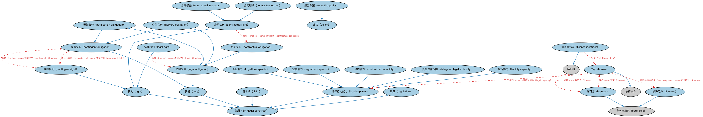

# 法律能力本体（Legal Capacity Ontology）结构与公理说明

本文档对应 `LegalCapacity.rdf` / `LegalCapacity.ttl`，说明该本体的类、继承关系、属性和公理约定。结构图见 `LegalCapacity-structure.png`（`LegalCapacity-structure.svg` 为可缩放版本）。

## 1. 本体概述

定义法律能力（legal capacity）：缔约能力、签章权、代表权等主体从事法律行为的资格。

**在体系中的位置**：FND 法律模块的两个本体之一，与法律核心本体互补。

**上下游关系**：上游依赖法律核心与参与方本体；下游被合同（签约主体须有缔约能力）、BE 法律实体引用。

**与相近概念的差别**：法律能力≠权利——能力是「有没有资格做」（如未成年人缔约能力受限），权利是「可以做什么」；签章权是组织授予个人的代表资格。

本本体中类与类的核心关系如下（完整细节见各类小节）：

- **请求权（claim）** 继承 **法律构造（legal construct）**
- **或有义务（contingent obligation）** 继承 **责任（duty）**
- **或有权利（contingent right）** 继承 **权利（right）**
- **缔约能力（contractual capability）** 继承 **法律行为能力（legal capacity）**
- **合同权益（contractual interest）** 继承 **合同权利（contractual right）**
- **合同义务（contractual obligation）** 继承 **法律义务（legal obligation）**
- **合同期权（contractual option）** 继承 **合同权利（contractual right）**
- **合同权利（contractual right）** 继承 **权利（right）**
- **受托法律权限（delegated legal authority）** 继承 **法律行为能力（legal capacity）**
- **交付义务（delivery obligation）** 继承 **或有义务（contingent obligation）**
- **交付义务（delivery obligation）** 继承 **法律义务（legal obligation）**
- **责任（duty）** 继承 **法律构造（legal construct）**
- 其余 15 条关系从略。

## 2. 类（Class）

| 类（Class） | 定义（Definition） |
|---|---|
| 请求权（claim） | 一方基于共同产生可法律强制执行的权利或司法行动的事实，向另一方提出的要求或主张。 |
| 或有义务（contingent obligation） | 取决于未来事件或某行为之履行的义务。 |
| 或有权利（contingent right） | 取决于未来事件或某行为之履行的权利。 |
| 缔约能力（contractual capability） | 订立具有法律约束力合同的能力。 |
| 合同权益（contractual interest） | 由合同、协议或工具产生的可法律强制执行的利益或权利，实体在其中持有特定的权利或义务。 |
| 合同义务（contractual obligation） | 由合同条款产生的具有法律约束力的义务。 |
| 合同期权（contractual option） | 可在未来某时点行使的合同权利，如展期合同的选择权或其他可用但非强制的权利。 |
| 合同权利（contractual right） | 在有约束力协议中授予参与方的可法律强制执行的利益或权利。 |
| 受托法律权限（delegated legal authority） | 特定职务、职能或职位所固有的制度化法定权力，旨在使其持有者能够成功履行职责。 |
| 交付义务（delivery obligation） | 为清偿请求权或债务而交付某物的义务。 |
| 责任（duty） | 存在并加于某个人的某项义务。 |
| 法律行为能力（legal capacity） | 实施特定行为或享有特定权利的能力，以及为此所需的资源。 |
| 法律构造（legal construct） | 通过法律或合同赋予的事物，如权利。 |
| 法律义务（legal obligation） | 可由法院强制执行的义务或责任。 |
| 法律权利（legal right） | 政府、合同或法律提供或保护的个人权利、特权或利益，使个人或实体有资格获得某物。 |
| 应诉能力（liability capacity） | 在法律上被起诉的能力。 |
| 许可（license） | 做某事所需之准许的授予。 |
| 许可标识符（license identifier） | 与许可关联的标识符。 |
| 被许可方（licensee） | 被授予许可的参与方。 |
| 许可方（licensor） | 授予许可的参与方。 |
| 诉讼能力（litigation capacity） | 在法律上提起并推进诉讼的法律行为能力。 |
| 通知义务（notification obligation） | 按协议约定，一方就特定事件、行为或变更正式告知另一方（或多方）的要求。 |
| 政策（policy） | 组织为指导特定情形下的决策而采纳并实施的原则、规则和指南体系。 |
| 规章（regulation） | 用于实施法律的规则。 |
| 报告政策（reporting policy） | 就报告某方面规定原则、规则和/或指南的政策。 |
| 权利（right） | 实施（或不实施）特定行为、或处于（或不处于）特定状态的资格；或要求他人实施特定行为的资格。 |
| 签署能力（signatory capacity） | 自然人代表某组织或法律主体签署协议的能力。 |

以下按类逐个展开：每个类给出继承关系、相关属性与公理约定；子类在父类之下降一级编号。

### 2.1 法律构造（legal construct）

定义：通过法律或合同赋予的事物，如权利。

- 直接子类：**请求权（claim）**、**责任（duty）**、**法律行为能力（legal capacity）**、**规章（regulation）**、**权利（right）**

属性：

| 属性 | 定义 | 说明 |
|---|---|---|
| **被授予给（is conferred on）** | 标识被授予某项利益或权利的参与方。 | 值域：参与方（party） |
| **由……授予（isConferredBy）** | — | — |

公理：

- **由……授予（isConferredBy）**可以有 0 个或多个**N4b49daef4e40423784f83fb113f9b684**。
- **被授予给（is conferred on）**可以有 0 个或多个**参与方（party）**。

#### 2.1.1 请求权（claim）

定义：一方基于共同产生可法律强制执行的权利或司法行动的事实，向另一方提出的要求或主张。

- 父类：**法律构造（legal construct）**

#### 2.1.2 责任（duty）

定义：存在并加于某个人的某项义务。

- 父类：**法律构造（legal construct）**
- 直接子类：**或有义务（contingent obligation）**、**法律义务（legal obligation）**

##### 2.1.2.1 或有义务（contingent obligation）

定义：取决于未来事件或某行为之履行的义务。

- 父类：**责任（duty）**
- 直接子类：**交付义务（delivery obligation）**、**通知义务（notification obligation）**

属性：

| 属性 | 定义 | 说明 |
|---|---|---|
| **属于义务人（isObligationOf）** | — | — |
| **由……蕴含（is implied by）** | 标识由另一事物强烈暗示的事物，如基于某组观测、事实或事件的逻辑推论。 | 逆属性：蕴含（implies） |

公理：

- **属于义务人（isObligationOf）**至少有一个取值，类型是**义务人（Obligor）**。
- **由……蕴含（is implied by）**至少有一个取值，类型是**或有权利（contingent right）**。

###### 2.1.2.1.1 交付义务（delivery obligation）

定义：为清偿请求权或债务而交付某物的义务。

- 父类：**或有义务（contingent obligation）**、**法律义务（legal obligation）**

###### 2.1.2.1.2 通知义务（notification obligation）

定义：按协议约定，一方就特定事件、行为或变更正式告知另一方（或多方）的要求。

- 父类：**或有义务（contingent obligation）**、**法律义务（legal obligation）**

##### 2.1.2.2 法律义务（legal obligation）

定义：可由法院强制执行的义务或责任。

- 父类：**责任（duty）**
- 直接子类：**合同义务（contractual obligation）**、**交付义务（delivery obligation）**、**通知义务（notification obligation）**

属性：

| 属性 | 定义 | 说明 |
|---|---|---|
| **由……授予（isConferredBy）** | — | — |
| **由……授权要求（isMandatedBy）** | — | — |
| **适用于情境（isApplicableIn）** | — | — |

公理：

- **由……授予（isConferredBy）**至少有一个取值，该取值满足：该属性存在取值约束。
- **由……授权要求（isMandatedBy）**至少有一个取值，该取值满足：该属性存在取值约束。
- **适用于情境（isApplicableIn）**至少有一个取值，类型是**管辖权（Jurisdiction）**。

###### 2.1.2.2.1 合同义务（contractual obligation）

定义：由合同条款产生的具有法律约束力的义务。

- 父类：**法律义务（legal obligation）**

属性：

| 属性 | 定义 | 说明 |
|---|---|---|
| **由……蕴含（is implied by）** | 标识由另一事物强烈暗示的事物，如基于某组观测、事实或事件的逻辑推论。 | 逆属性：蕴含（implies） |
| **由……授予（isConferredBy）** | — | — |

公理：

- **由……授予（isConferredBy）**至少有一个取值，类型是**合同（Contract）**。
- **由……蕴含（is implied by）**的所有取值只能是**合同权利（contractual right）**。

#### 2.1.3 法律行为能力（legal capacity）

定义：实施特定行为或享有特定权利的能力，以及为此所需的资源。

- 父类：**法律构造（legal construct）**
- 直接子类：**缔约能力（contractual capability）**、**受托法律权限（delegated legal authority）**、**应诉能力（liability capacity）**、**诉讼能力（litigation capacity）**、**签署能力（signatory capacity）**

属性：

| 属性 | 定义 | 说明 |
|---|---|---|
| **是……的能力（is capacity of）** | 标识被赋予某项法律行为能力的个人或组织。 | 值域：参与方（party）；子属性：被授予给（is conferred on） |

##### 2.1.3.1 缔约能力（contractual capability）

定义：订立具有法律约束力合同的能力。

- 父类：**法律行为能力（legal capacity）**

##### 2.1.3.2 受托法律权限（delegated legal authority）

定义：特定职务、职能或职位所固有的制度化法定权力，旨在使其持有者能够成功履行职责。

- 父类：**法律行为能力（legal capacity）**

##### 2.1.3.3 应诉能力（liability capacity）

定义：在法律上被起诉的能力。

- 父类：**法律行为能力（legal capacity）**

##### 2.1.3.4 诉讼能力（litigation capacity）

定义：在法律上提起并推进诉讼的法律行为能力。

- 父类：**法律行为能力（legal capacity）**

##### 2.1.3.5 签署能力（signatory capacity）

定义：自然人代表某组织或法律主体签署协议的能力。

- 父类：**法律行为能力（legal capacity）**

#### 2.1.4 规章（regulation）

定义：用于实施法律的规则。

- 父类：**法律构造（legal construct）**

属性：

| 属性 | 定义 | 说明 |
|---|---|---|
| **由……授予（isConferredBy）** | — | — |
| **适用于情境（isApplicableIn）** | — | — |

公理：

- **由……授予（isConferredBy）**至少有一个取值，类型是**法律（Law）**。
- **适用于情境（isApplicableIn）**至少有一个取值，类型是**管辖权（Jurisdiction）**。

#### 2.1.5 权利（right）

定义：实施（或不实施）特定行为、或处于（或不处于）特定状态的资格；或要求他人实施特定行为的资格。

- 父类：**法律构造（legal construct）**
- 直接子类：**或有权利（contingent right）**、**合同权利（contractual right）**、**法律权利（legal right）**

##### 2.1.5.1 或有权利（contingent right）

定义：取决于未来事件或某行为之履行的权利。

- 父类：**权利（right）**

属性：

| 属性 | 定义 | 说明 |
|---|---|---|
| **蕴含（implies）** | 基于某组观测、事实或事件，强烈暗示或作为逻辑推论包含。 | 子属性：涉及 |
| **被授予给（is conferred on）** | 标识被授予某项利益或权利的参与方。 | 值域：参与方（party） |

公理：

- **蕴含（implies）**至少有一个取值，类型是**或有义务（contingent obligation）**。
- **被授予给（is conferred on）**至少有一个取值，类型是**参与方（party）**。

##### 2.1.5.2 合同权利（contractual right）

定义：在有约束力协议中授予参与方的可法律强制执行的利益或权利。

- 父类：**权利（right）**
- 直接子类：**合同权益（contractual interest）**、**合同期权（contractual option）**

属性：

| 属性 | 定义 | 说明 |
|---|---|---|
| **蕴含（implies）** | 基于某组观测、事实或事件，强烈暗示或作为逻辑推论包含。 | 子属性：涉及 |
| **由……授予（isConferredBy）** | — | — |

公理：

- **由……授予（isConferredBy）**至少有一个取值，类型是**合同（Contract）**。
- **蕴含（implies）**至少有一个取值，类型是**合同义务（contractual obligation）**。

###### 2.1.5.2.1 合同权益（contractual interest）

定义：由合同、协议或工具产生的可法律强制执行的利益或权利，实体在其中持有特定的权利或义务。

- 父类：**合同权利（contractual right）**

属性：

| 属性 | 定义 | 说明 |
|---|---|---|
| **具有份额权益（has fractional interest）** | 对……具有按比例的、非排他的权利。 | 值域：xsd:decimal；子属性：具有数值 |

公理：

- **具有份额权益（has fractional interest）**存在取值约束。

###### 2.1.5.2.2 合同期权（contractual option）

定义：可在未来某时点行使的合同权利，如展期合同的选择权或其他可用但非强制的权利。

- 父类：**合同权利（contractual right）**

##### 2.1.5.3 法律权利（legal right）

定义：政府、合同或法律提供或保护的个人权利、特权或利益，使个人或实体有资格获得某物。

- 父类：**权利（right）**

属性：

| 属性 | 定义 | 说明 |
|---|---|---|
| **蕴含（implies）** | 基于某组观测、事实或事件，强烈暗示或作为逻辑推论包含。 | 子属性：涉及 |
| **由……授予（isConferredBy）** | — | — |
| **适用于情境（isApplicableIn）** | — | — |

公理：

- **由……授予（isConferredBy）**至少有一个取值，类型是**成文法（StatuteLaw）**。
- **蕴含（implies）**至少有一个取值，类型是**法律义务（legal obligation）**。
- **适用于情境（isApplicableIn）**至少有一个取值，类型是**管辖权（Jurisdiction）**。

### 2.2 许可（license）

定义：做某事所需之准许的授予。

- 父类：**法律文件（LegalDocument）**

属性：

| 属性 | 定义 | 说明 |
|---|---|---|
| **授予（confers）** | — | — |
| **由……发行（isIssuedBy）** | — | — |
| **具有参与方角色（has party role）** | — | — |
| **在…期间保持（holds during）** | — | — |

公理：

- **具有参与方角色（has party role）**至少有一个取值，类型是**被许可方（licensee）**。
- **在…期间保持（holds during）**恰好有 1 个**日期区间（DatePeriod）**。
- **授予（confers）**至少有一个取值，类型是**法律行为能力（legal capacity）**。
- **由……发行（isIssuedBy）**至少有一个取值，类型是**许可方（licensor）**。

### 2.3 许可标识符（license identifier）

定义：与许可关联的标识符。

- 父类：**标识符（Identifier）**

属性：

| 属性 | 定义 | 说明 |
|---|---|---|
| **标识（identifies）** | — | — |

公理：

- **标识（identifies）**恰好有 1 个**许可（license）**。

### 2.4 被许可方（licensee）

定义：被授予许可的参与方。

- 父类：**参与方角色（party role）**

属性：

| 属性 | 定义 | 说明 |
|---|---|---|
| **由…扮演（is played by）** | — | — |

公理：

- **由…扮演（is played by）**至少有一个取值，该取值满足：**是…的参与方（is a party to）**至少有一个取值，类型是**许可（license）**。

### 2.5 许可方（licensor）

定义：授予许可的参与方。

- 父类：**参与方角色（party role）**

属性：

| 属性 | 定义 | 说明 |
|---|---|---|
| **签发许可（licenses）** | 签发展为执行某项任务、提供某项服务、行使某项特权或从事某行业所需的许可。 | 子属性：管辖 |
| **发行（issues）** | — | — |
| **由…扮演（is played by）** | — | — |

公理：

- **发行（issues）**至少有一个取值，类型是**许可（license）**。
- **由…扮演（is played by）**至少有一个取值，该取值满足：**是…的参与方（is a party to）**至少有一个取值，类型是**许可（license）**。
- **签发许可（licenses）**至少有一个取值，类型是**owl:Thing（Thing）**。

### 2.6 政策（policy）

定义：组织为指导特定情形下的决策而采纳并实施的原则、规则和指南体系。

- 直接子类：**报告政策（reporting policy）**

属性：

| 属性 | 定义 | 说明 |
|---|---|---|
| **实施（implements）** | 执行或付诸实施，履行。 | 子属性：涉及 |
| **管辖（governs）** | — | — |

公理：

- **实施（implements）**可以有 0 个或多个**N53faf6cb6dd3424ba878053e2358f74a**。
- **管辖（governs）**至少有一个取值，类型是**战略（Strategy）**。

#### 2.6.1 报告政策（reporting policy）

定义：就报告某方面规定原则、规则和/或指南的政策。

- 父类：**政策（policy）**

## 3. 其他属性

以下属性未绑定到本体的具体类（定义域在外部本体或未声明）：

对象属性（Object Property）：

| 属性 | 定义 | 说明 |
|---|---|---|
| **具有能力方（has capacity）** | 标识具有实施特定行为的能力和余力、或具有特定权利或义务的个人或组织。 | 值域：法律行为能力（legal capacity）；逆属性：是……的能力（is capacity of） |
| **由……实施（is implemented by）** | 标识由……执行、纳入或付诸实施的事物。 | 逆属性：实施（implements） |
| **由……许可（is licensed by）** | 标识向另一方签发特定许可的参与方。 | 值域：参与方角色（party role）；逆属性：签发许可（licenses）；子属性：受……管辖 |
| **以……为前提（is predicated on）** | 取决于……中所述的假定或要求。 | 值域：N7354b4e1d83640a2bb9818014f5ededd；子属性：规定于 |

## 4. 依赖（owl:imports，16 个）

本本体通过 `owl:imports` 引入以下本体，各项的中文名称与简介如下：

| 导入本体 | 中文名称 | 简介 |
|---|---|---|
| `FND/Agreements/Agreements.rdf` | 协议本体（Agreements Ontology） | 定义两个或以上参与方之间协议（agreement）的通用概念：协议的当事方、条款、生效与终止，是合同等一切契约性安排的上位模型。 |
| `FND/Agreements/Contracts.rdf` | 合同本体（Contracts Ontology） | 在协议之上定义具有法律约束力的合同（contract）：合同当事方、合同条款、义务与权利，是金融工具与交易合同建模的基石。 |
| `FND/GoalsAndObjectives/Objectives.rdf` | 目标本体（Objectives Ontology） | 定义目标（objective）及其与组织、计划的关系，用于表达机构的经营目标与投资目标。 |
| `FND/Law/LegalCore.rdf` | 法律核心本体（Legal Core Ontology） | 定义法域（jurisdiction）、法律、法规等核心法律概念，为监管主体与适用法律建模。 |
| `FND/Relations/Relations.rdf` | 关系本体（Relations Ontology） | FIBO 最底层的基础本体，定义参考（reference）、分类（classify）等通用关系与抽象概念，全库普遍依赖。 |
| `FND/Utilities/AnnotationVocabulary.rdf` | FIBO 标注词汇表（FIBO Annotation Vocabulary） | 定义 FIBO 专用的标注属性（如释义来源、成熟度等级），用于本体自身的元数据标注。 |
| `https://www.omg.org/spec/Commons/AnnotationVocabulary/` | OMG 通用标注词汇表（OMG Commons Annotation Vocabulary） | OMG 通用本体库（Commons）中的标注词汇表，提供概念映射等标注属性，FIBO 用它标注术语与外部标准的对应关系。 |
| `https://www.omg.org/spec/Commons/ContextualDesignators/` | OMG 通用语境指称本体（OMG Commons Contextual Designators） | Commons 库中的语境指称本体，定义「在某个语境下指代某物的名称/符号」，是地址、账户号码等语境相关标识的基础。 |
| `https://www.omg.org/spec/Commons/DatesAndTimes/` | OMG 通用日期与时间本体（OMG Commons Dates and Times） | Commons 库中的日期时间本体，定义日期、期间、时间点等通用时间概念。 |
| `https://www.omg.org/spec/Commons/Designators/` | OMG 通用指称符本体（OMG Commons Designators） | Commons 库中的指称符本体，定义名称、标识符等「指代某物的符号」的通用概念。 |
| `https://www.omg.org/spec/Commons/Documents/` | OMG 通用文档本体（OMG Commons Documents） | Commons 库中的文档本体，定义文档及其组成部分的通用概念。 |
| `https://www.omg.org/spec/Commons/Identifiers/` | OMG 通用标识符本体（OMG Commons Identifiers） | Commons 库中的标识符本体，定义标识符及其编码方案的通用概念。 |
| `https://www.omg.org/spec/Commons/PartiesAndSituations/` | OMG 通用参与方与情境本体（OMG Commons Parties and Situations） | Commons 库中的参与方本体，定义独立主体、参与方及其角色扮演的通用概念，是 FIBO 参与方模型的上游。 |
| `https://www.omg.org/spec/Commons/QuantitiesAndUnits/` | OMG 通用量与单位本体（OMG Commons Quantities and Units） | Commons 库中的量与单位本体，定义数量、度量单位、量纲的通用概念，支撑金额、比率等数值表达。 |
| `https://www.omg.org/spec/Commons/RegulatoryAgencies/` | OMG 通用监管机构本体（OMG Commons Regulatory Agencies） | Commons 库中的监管机构本体，定义监管机构及其监管职权的通用概念。 |
| `https://www.omg.org/spec/Commons/RolesAndCompositions/` | OMG 通用角色与构成本体（OMG Commons Roles and Compositions） | Commons 库中的角色本体，定义角色及整体—部分构成关系的通用概念。 |

## 5. 文件

- 官方 RDF/XML：`LegalCapacity.rdf`
- 中文 Turtle：`LegalCapacity.ttl`
- 结构图：`LegalCapacity-structure.png` / `LegalCapacity-structure.svg`