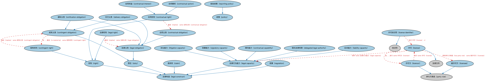

# 法律能力本体（Legal Capacity Ontology）结构与公理说明

本文档对应 `LegalCapacity.rdf` / `LegalCapacity.ttl`，说明该本体的类、继承关系、属性和公理约定。结构图见 `LegalCapacity-structure.png`（`LegalCapacity-structure.svg` 为可缩放版本）。

## 1. 本体概述

定义法律能力（legal capacity）：缔约能力、签章权、代表权等主体从事法律行为的资格。

**在体系中的位置**：FND 法律模块的两个本体之一，与法律核心本体互补。

**上下游关系**：上游依赖法律核心与参与方本体；下游被合同（签约主体须有缔约能力）、BE 法律实体引用。

**与相近概念的差别**：法律能力≠权利——能力是「有没有资格做」（如未成年人缔约能力受限），权利是「可以做什么」；签章权是组织授予个人的代表资格。

## 2. 类（Class）

| 类（Class） | 定义（Definition） |
|---|---|
| 请求权（claim） | 一方基于共同产生可法律强制执行的权利或司法行动的事实，向另一方提出的要求或主张。 |
| 或有义务（contingent obligation） | 取决于未来事件或某行为之履行的义务。 |
| 或有权利（contingent right） | 取决于未来事件或某行为之履行的权利。 |
| 缔约能力（contractual capability） | 订立具有法律约束力合同的能力。 |
| 合同权益（contractual interest） | 由合同、协议或工具产生的可法律强制执行的利益或权利，实体在其中持有特定的权利或义务。 |
| 合同义务（contractual obligation） | 由合同条款产生的具有法律约束力的义务。 |
| 合同期权（contractual option） | 可在未来某时点行使的合同权利，如展期合同的选择权或其他可用但非强制的权利。 |
| 合同权利（contractual right） | 在有约束力协议中授予参与方的可法律强制执行的利益或权利。 |
| 受托法律权限（delegated legal authority） | 特定职务、职能或职位所固有的制度化法定权力，旨在使其持有者能够成功履行职责。 |
| 交付义务（delivery obligation） | 为清偿请求权或债务而交付某物的义务。 |
| 责任（duty） | 存在并加于某个人的某项义务。 |
| 法律行为能力（legal capacity） | 实施特定行为或享有特定权利的能力，以及为此所需的资源。 |
| 法律构造（legal construct） | 通过法律或合同赋予的事物，如权利。 |
| 法律义务（legal obligation） | 可由法院强制执行的义务或责任。 |
| 法律权利（legal right） | 政府、合同或法律提供或保护的个人权利、特权或利益，使个人或实体有资格获得某物。 |
| 应诉能力（liability capacity） | 在法律上被起诉的能力。 |
| 许可（license） | 做某事所需之准许的授予。 |
| 许可标识符（license identifier） | 与许可关联的标识符。 |
| 被许可方（licensee） | 被授予许可的参与方。 |
| 许可方（licensor） | 授予许可的参与方。 |
| 诉讼能力（litigation capacity） | 在法律上提起并推进诉讼的法律行为能力。 |
| 通知义务（notification obligation） | 按协议约定，一方就特定事件、行为或变更正式告知另一方（或多方）的要求。 |
| 政策（policy） | 组织为指导特定情形下的决策而采纳并实施的原则、规则和指南体系。 |
| 规章（regulation） | 用于实施法律的规则。 |
| 报告政策（reporting policy） | 就报告某方面规定原则、规则和/或指南的政策。 |
| 权利（right） | 实施（或不实施）特定行为、或处于（或不处于）特定状态的资格；或要求他人实施特定行为的资格。 |
| 签署能力（signatory capacity） | 自然人代表某组织或法律主体签署协议的能力。 |

### 2.1 继承关系（Inheritance）

- 请求权（claim） ⊑ 法律构造（legal construct）
- 或有义务（contingent obligation） ⊑ 责任（duty）
- 或有权利（contingent right） ⊑ 权利（right）
- 缔约能力（contractual capability） ⊑ 法律行为能力（legal capacity）
- 合同权益（contractual interest） ⊑ 合同权利（contractual right）
- 合同义务（contractual obligation） ⊑ 法律义务（legal obligation）
- 合同期权（contractual option） ⊑ 合同权利（contractual right）
- 合同权利（contractual right） ⊑ 权利（right）
- 受托法律权限（delegated legal authority） ⊑ 法律行为能力（legal capacity）
- 交付义务（delivery obligation） ⊑ 或有义务（contingent obligation）
- 交付义务（delivery obligation） ⊑ 法律义务（legal obligation）
- 责任（duty） ⊑ 法律构造（legal construct）
- 法律行为能力（legal capacity） ⊑ 法律构造（legal construct）
- 法律义务（legal obligation） ⊑ 责任（duty）
- 法律权利（legal right） ⊑ 权利（right）
- 应诉能力（liability capacity） ⊑ 法律行为能力（legal capacity）
- 许可（license） ⊑ 法律文件
- 许可标识符（license identifier） ⊑ 标识符
- 被许可方（licensee） ⊑ 参与方角色（party role）
- 许可方（licensor） ⊑ 参与方角色（party role）
- 诉讼能力（litigation capacity） ⊑ 法律行为能力（legal capacity）
- 通知义务（notification obligation） ⊑ 或有义务（contingent obligation）
- 通知义务（notification obligation） ⊑ 法律义务（legal obligation）
- 规章（regulation） ⊑ 法律构造（legal construct）
- 报告政策（reporting policy） ⊑ 政策（policy）
- 权利（right） ⊑ 法律构造（legal construct）
- 签署能力（signatory capacity） ⊑ 法律行为能力（legal capacity）

## 3. 对象属性（Object Property）

| 属性（Property） | 中文（English） | 定义（Definition） | 说明 |
|---|---|---|---|
| fibo-fnd-law-lcap:hasCapacity | 具有能力方（has capacity） | 标识具有实施特定行为的能力和余力、或具有特定权利或义务的个人或组织。 | 定义域（domain）：参与方（party）；值域（range）：法律行为能力（legal capacity）；逆属性（inverseOf）：是……的能力（is capacity of） |
| fibo-fnd-law-lcap:implements | 实施（implements） | 执行或付诸实施，履行。 | 子属性（subPropertyOf）：涉及 |
| fibo-fnd-law-lcap:implies | 蕴含（implies） | 基于某组观测、事实或事件，强烈暗示或作为逻辑推论包含。 | 子属性（subPropertyOf）：涉及 |
| fibo-fnd-law-lcap:isCapacityOf | 是……的能力（is capacity of） | 标识被赋予某项法律行为能力的个人或组织。 | 定义域（domain）：法律行为能力（legal capacity）；值域（range）：参与方（party）；子属性（subPropertyOf）：被授予给（is conferred on） |
| fibo-fnd-law-lcap:isConferredOn | 被授予给（is conferred on） | 标识被授予某项利益或权利的参与方。 | 值域（range）：参与方（party） |
| fibo-fnd-law-lcap:isImplementedBy | 由……实施（is implemented by） | 标识由……执行、纳入或付诸实施的事物。 | 逆属性（inverseOf）：实施（implements） |
| fibo-fnd-law-lcap:isImpliedBy | 由……蕴含（is implied by） | 标识由另一事物强烈暗示的事物，如基于某组观测、事实或事件的逻辑推论。 | 逆属性（inverseOf）：蕴含（implies） |
| fibo-fnd-law-lcap:isLicensedBy | 由……许可（is licensed by） | 标识向另一方签发特定许可的参与方。 | 值域（range）：参与方角色（party role）；逆属性（inverseOf）：签发许可（licenses）；子属性（subPropertyOf）：受……管辖 |
| fibo-fnd-law-lcap:isPredicatedOn | 以……为前提（is predicated on） | 取决于……中所述的假定或要求。 | 定义域（domain）：先决条件；值域（range）：N0c7f4bab703b4b47b7caaf2e5fdaabfd；子属性（subPropertyOf）：规定于 |
| fibo-fnd-law-lcap:licenses | 签发许可（licenses） | 签发展为执行某项任务、提供某项服务、行使某项特权或从事某行业所需的许可。 | 定义域（domain）：参与方角色（party role）；子属性（subPropertyOf）：管辖 |

## 4. 数据属性（Datatype Property）

| 属性（Property） | 中文（English） | 定义（Definition） |
|---|---|---|
| fibo-fnd-law-lcap:hasFractionalInterest | 具有份额权益（has fractional interest） | 对……具有按比例的、非排他的权利。 |

## 5. 公理约定（Axioms）

- 或有义务（contingent obligation）：属于义务人 some 义务人
- 或有义务（contingent obligation）：由……蕴含（is implied by） some 或有权利（contingent right）
- 或有权利（contingent right）：蕴含（implies） some 或有义务（contingent obligation）
- 或有权利（contingent right）：被授予给（is conferred on） some 参与方（party）
- 合同权益（contractual interest）：restriction
- 合同义务（contractual obligation）：由……蕴含（is implied by） only 合同权利（contractual right）
- 合同义务（contractual obligation）：由……授予 some 合同
- 合同权利（contractual right）：蕴含（implies） some 合同义务（contractual obligation）
- 合同权利（contractual right）：由……授予 some 合同
- 法律构造（legal construct）：被授予给（is conferred on） 参与方（party） ≥0
- 法律构造（legal construct）：由……授予 N56bff8f80fb04a7c8b8e857c4dfb2991 ≥0
- 法律义务（legal obligation）：由……授予 some（restriction）
- 法律义务（legal obligation）：由……授权要求 some（restriction）
- 法律义务（legal obligation）：适用于情境 some 管辖权
- 法律权利（legal right）：蕴含（implies） some 法律义务（legal obligation）
- 法律权利（legal right）：由……授予 some 成文法
- 法律权利（legal right）：适用于情境 some 管辖权
- 许可（license）：在…期间保持（holds during） 日期区间 =1
- 许可（license）：授予 some 法律行为能力（legal capacity）
- 许可（license）：由……发行 some 许可方（licensor）
- 许可（license）：具有参与方角色（has party role） some 被许可方（licensee）
- 许可标识符（license identifier）：标识 许可（license） =1
- 被许可方（licensee）：由…扮演（is played by） some（是…的参与方（is a party to） some 许可（license））
- 许可方（licensor）：签发许可（licenses） some owl:Thing
- 许可方（licensor）：发行 some 许可（license）
- 许可方（licensor）：由…扮演（is played by） some（是…的参与方（is a party to） some 许可（license））
- 政策（policy）：实施（implements） N191659c5cca74c53b13a4f6a187f80d1 ≥0
- 政策（policy）：管辖 some 战略
- 规章（regulation）：由……授予 some 法律
- 规章（regulation）：适用于情境 some 管辖权

## 6. 依赖（owl:imports，16 个）

本本体通过 `owl:imports` 引入以下本体，各项的中文名称与简介如下：

| 导入本体 | 中文名称 | 简介 |
|---|---|---|
| `FND/Agreements/Agreements.rdf` | 协议本体（Agreements Ontology） | 定义两个或以上参与方之间协议（agreement）的通用概念：协议的当事方、条款、生效与终止，是合同等一切契约性安排的上位模型。 |
| `FND/Agreements/Contracts.rdf` | 合同本体（Contracts Ontology） | 在协议之上定义具有法律约束力的合同（contract）：合同当事方、合同条款、义务与权利，是金融工具与交易合同建模的基石。 |
| `FND/GoalsAndObjectives/Objectives.rdf` | 目标本体（Objectives Ontology） | 定义目标（objective）及其与组织、计划的关系，用于表达机构的经营目标与投资目标。 |
| `FND/Law/LegalCore.rdf` | 法律核心本体（Legal Core Ontology） | 定义法域（jurisdiction）、法律、法规等核心法律概念，为监管主体与适用法律建模。 |
| `FND/Relations/Relations.rdf` | 关系本体（Relations Ontology） | FIBO 最底层的基础本体，定义参考（reference）、分类（classify）等通用关系与抽象概念，全库普遍依赖。 |
| `FND/Utilities/AnnotationVocabulary.rdf` | FIBO 标注词汇表（FIBO Annotation Vocabulary） | 定义 FIBO 专用的标注属性（如释义来源、成熟度等级），用于本体自身的元数据标注。 |
| `https://www.omg.org/spec/Commons/AnnotationVocabulary/` | OMG 通用标注词汇表（OMG Commons Annotation Vocabulary） | OMG 通用本体库（Commons）中的标注词汇表，提供概念映射等标注属性，FIBO 用它标注术语与外部标准的对应关系。 |
| `https://www.omg.org/spec/Commons/ContextualDesignators/` | OMG 通用语境指称本体（OMG Commons Contextual Designators） | Commons 库中的语境指称本体，定义「在某个语境下指代某物的名称/符号」，是地址、账户号码等语境相关标识的基础。 |
| `https://www.omg.org/spec/Commons/DatesAndTimes/` | OMG 通用日期与时间本体（OMG Commons Dates and Times） | Commons 库中的日期时间本体，定义日期、期间、时间点等通用时间概念。 |
| `https://www.omg.org/spec/Commons/Designators/` | OMG 通用指称符本体（OMG Commons Designators） | Commons 库中的指称符本体，定义名称、标识符等「指代某物的符号」的通用概念。 |
| `https://www.omg.org/spec/Commons/Documents/` | OMG 通用文档本体（OMG Commons Documents） | Commons 库中的文档本体，定义文档及其组成部分的通用概念。 |
| `https://www.omg.org/spec/Commons/Identifiers/` | OMG 通用标识符本体（OMG Commons Identifiers） | Commons 库中的标识符本体，定义标识符及其编码方案的通用概念。 |
| `https://www.omg.org/spec/Commons/PartiesAndSituations/` | OMG 通用参与方与情境本体（OMG Commons Parties and Situations） | Commons 库中的参与方本体，定义独立主体、参与方及其角色扮演的通用概念，是 FIBO 参与方模型的上游。 |
| `https://www.omg.org/spec/Commons/QuantitiesAndUnits/` | OMG 通用量与单位本体（OMG Commons Quantities and Units） | Commons 库中的量与单位本体，定义数量、度量单位、量纲的通用概念，支撑金额、比率等数值表达。 |
| `https://www.omg.org/spec/Commons/RegulatoryAgencies/` | OMG 通用监管机构本体（OMG Commons Regulatory Agencies） | Commons 库中的监管机构本体，定义监管机构及其监管职权的通用概念。 |
| `https://www.omg.org/spec/Commons/RolesAndCompositions/` | OMG 通用角色与构成本体（OMG Commons Roles and Compositions） | Commons 库中的角色本体，定义角色及整体—部分构成关系的通用概念。 |

## 7. 文件

- 官方 RDF/XML：`LegalCapacity.rdf`
- 中文 Turtle：`LegalCapacity.ttl`
- 结构图：`LegalCapacity-structure.png` / `LegalCapacity-structure.svg`