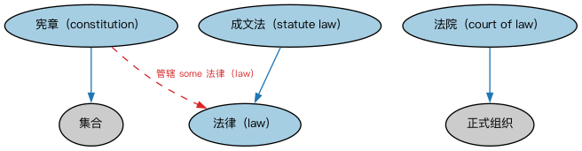

# 法律核心本体（Legal Core Ontology）结构与公理说明

本文档对应 `LegalCore.rdf` / `LegalCore.ttl`，说明该本体的类、继承关系、属性和公理约定。结构图见 `LegalCore-structure.png`（`LegalCore-structure.svg` 为可缩放版本）。

## 1. 本体概述

本本体定义供其他 FIBO 本体元素使用的高层法律概念，包括法律（law）与宪章（constitution），其抽象层次高于国家或州的法律与宪法；还定义了政府宪法、条例等变体以及法院。

## 2. 类（Class）

| 类（Class） | 定义（Definition） |
|---|---|
| 宪章（constitution） | 治理某组织的一套基本原则，尤其涉及被治理者的权利。 |
| 法院（court of law） | 具有司法权威、依据成文法或普通法审理并解决纠纷的个人或机构。 |
| 法律（law） | 某共同体认可为规范其成员行为、并可通过施加处罚来强制执行的规则。 |
| 成文法（statute law） | 由立法机关颁布的法律。 |

### 2.1 继承关系（Inheritance）

- 宪章（constitution） ⊑ 集合
- 法院（court of law） ⊑ 正式组织
- 成文法（statute law） ⊑ 法律（law）

## 3. 对象属性（Object Property）

| 属性（Property） | 中文（English） | 定义（Definition） | 说明 |
|---|---|---|---|
| fibo-fnd-law-cor:hasInForce | 现行有效（has in force） | 将某司法辖区或情境关联到当前在其中有效的规则、规章或法律（统称“法律”）。 | 值域（range）：法律（law）；逆属性（inverseOf）：在…中有效（is in force in） |
| fibo-fnd-law-cor:isInForceIn | 在…中有效（is in force in） | 标识某法律生效的司法辖区。 | 定义域（domain）：法律（law） |

## 5. 公理约定（Axioms）

- 宪章（constitution）：管辖 some 法律（law）
- 成文法（statute law）：在…中有效（is in force in） some 管辖权

## 6. 依赖（owl:imports，5 个）

本本体通过 `owl:imports` 引入以下本体，各项的中文名称与简介如下：

| 导入本体 | 中文名称 | 简介 |
|---|---|---|
| `FND/Utilities/AnnotationVocabulary.rdf` | FIBO 标注词汇表（FIBO Annotation Vocabulary） | 定义 FIBO 专用的标注属性（如释义来源、成熟度等级），用于本体自身的元数据标注。 |
| `https://www.omg.org/spec/Commons/AnnotationVocabulary/` | OMG 通用标注词汇表（OMG Commons Annotation Vocabulary） | OMG 通用本体库（Commons）中的标注词汇表，提供概念映射等标注属性，FIBO 用它标注术语与外部标准的对应关系。 |
| `https://www.omg.org/spec/Commons/Collections/` | OMG 通用集合本体（OMG Commons Collections） | Commons 库中的集合本体，定义集合、成员等通用概念。 |
| `https://www.omg.org/spec/Commons/Organizations/` | OMG 通用组织本体（OMG Commons Organizations） | Commons 库中的组织本体，定义组织、组织成员与组织结构的通用概念。 |
| `https://www.omg.org/spec/Commons/RegulatoryAgencies/` | OMG 通用监管机构本体（OMG Commons Regulatory Agencies） | Commons 库中的监管机构本体，定义监管机构及其监管职权的通用概念。 |

## 7. 文件

- 官方 RDF/XML：`LegalCore.rdf`
- 中文 Turtle：`LegalCore.ttl`
- 结构图：`LegalCore-structure.png` / `LegalCore-structure.svg`