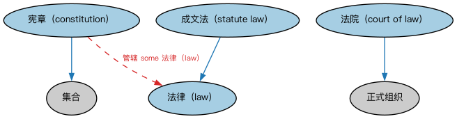

# 法律核心本体（Legal Core Ontology）结构与公理说明

本文档对应 `LegalCore.rdf` / `LegalCore.ttl`，说明该本体的类、继承关系、属性和公理约定。结构图见 `LegalCore-structure.png`（`LegalCore-structure.svg` 为可缩放版本）。

## 1. 本体概述

本本体定义供其他 FIBO 本体元素使用的高层法律概念，包括法律（law）与宪章（constitution），其抽象层次高于国家或州的法律与宪法；还定义了政府宪法、条例等变体以及法院。

本本体中类与类的核心关系如下（完整细节见各类小节）：

- **宪章（constitution）** 继承 **集合（Collection）**
- **法院（court of law）** 继承 **正式组织（FormalOrganization）**
- **成文法（statute law）** 继承 **法律（law）**

## 2. 类（Class）

| 类（Class） | 定义（Definition） |
|---|---|
| 宪章（constitution） | 治理某组织的一套基本原则，尤其涉及被治理者的权利。 |
| 法院（court of law） | 具有司法权威、依据成文法或普通法审理并解决纠纷的个人或机构。 |
| 法律（law） | 某共同体认可为规范其成员行为、并可通过施加处罚来强制执行的规则。 |
| 成文法（statute law） | 由立法机关颁布的法律。 |

以下按类逐个展开：每个类给出继承关系、相关属性与公理约定；子类在父类之下降一级编号。

### 2.1 宪章（constitution）

定义：治理某组织的一套基本原则，尤其涉及被治理者的权利。

- 父类：**集合（Collection）**

属性：

| 属性 | 定义 | 说明 |
|---|---|---|
| **管辖（governs）** | — | — |

公理：

- **管辖（governs）**至少有一个取值，类型是**法律（law）**。

### 2.2 法院（court of law）

定义：具有司法权威、依据成文法或普通法审理并解决纠纷的个人或机构。

- 父类：**正式组织（FormalOrganization）**

### 2.3 法律（law）

定义：某共同体认可为规范其成员行为、并可通过施加处罚来强制执行的规则。

- 直接子类：**成文法（statute law）**

属性：

| 属性 | 定义 | 说明 |
|---|---|---|
| **在…中有效（is in force in）** | 标识某法律生效的司法辖区。 | — |

#### 2.3.1 成文法（statute law）

定义：由立法机关颁布的法律。

- 父类：**法律（law）**

属性：

| 属性 | 定义 | 说明 |
|---|---|---|
| **在…中有效（is in force in）** | 标识某法律生效的司法辖区。 | — |

公理：

- **在…中有效（is in force in）**至少有一个取值，类型是**管辖权（Jurisdiction）**。

## 3. 其他属性

以下属性未绑定到本体的具体类（定义域在外部本体或未声明）：

对象属性（Object Property）：

| 属性 | 定义 | 说明 |
|---|---|---|
| **现行有效（has in force）** | 将某司法辖区或情境关联到当前在其中有效的规则、规章或法律（统称“法律”）。 | 值域：法律（law）；逆属性：在…中有效（is in force in） |

## 4. 依赖（owl:imports，5 个）

本本体通过 `owl:imports` 引入以下本体，各项的中文名称与简介如下：

| 导入本体 | 中文名称 | 简介 |
|---|---|---|
| `FND/Utilities/AnnotationVocabulary.rdf` | FIBO 标注词汇表（FIBO Annotation Vocabulary） | 定义 FIBO 专用的标注属性（如释义来源、成熟度等级），用于本体自身的元数据标注。 |
| `https://www.omg.org/spec/Commons/AnnotationVocabulary/` | OMG 通用标注词汇表（OMG Commons Annotation Vocabulary） | OMG 通用本体库（Commons）中的标注词汇表，提供概念映射等标注属性，FIBO 用它标注术语与外部标准的对应关系。 |
| `https://www.omg.org/spec/Commons/Collections/` | OMG 通用集合本体（OMG Commons Collections） | Commons 库中的集合本体，定义集合、成员等通用概念。 |
| `https://www.omg.org/spec/Commons/Organizations/` | OMG 通用组织本体（OMG Commons Organizations） | Commons 库中的组织本体，定义组织、组织成员与组织结构的通用概念。 |
| `https://www.omg.org/spec/Commons/RegulatoryAgencies/` | OMG 通用监管机构本体（OMG Commons Regulatory Agencies） | Commons 库中的监管机构本体，定义监管机构及其监管职权的通用概念。 |

## 5. 文件

- 官方 RDF/XML：`LegalCore.rdf`
- 中文 Turtle：`LegalCore.ttl`
- 结构图：`LegalCore-structure.png` / `LegalCore-structure.svg`