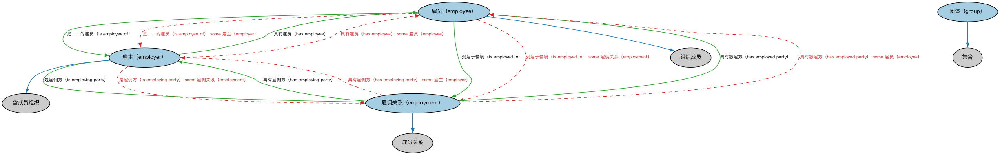

# 正式组织本体（Formal Organizations Ontology）结构与公理说明

本文档对应 `FormalOrganizations.rdf` / `FormalOrganizations.ttl`，说明该本体的类、继承关系、属性和公理约定。结构图见 `FormalOrganizations-structure.png`（`FormalOrganizations-structure.svg` 为可缩放版本）。

## 1. 本体概述

定义正式组织（formal organization）、组织成员与组织内部角色：有明确宗旨、结构和成员规则的团体。

**在体系中的位置**：FND 组织模块的核心，是 BE 公司、政府机构、FBC 金融服务机构等一切组织概念的上游。

**上下游关系**：上游依赖参与方与关系本体；下游被 BE、FBC 各组织类本体大量继承。

**与相近概念的差别**：正式组织≠法人——正式组织是社会学概念（有结构的团体），法人是法律概念（有独立人格）；一个非法人部门也可以是正式组织；组织≠参与方——组织只有进入业务关系才是参与方。

本本体中类与类的核心关系如下（完整细节见各类小节）：

- **雇员（employee）** 继承 **组织成员（OrganizationMember）**
- **雇主（employer）** 继承 **含成员组织（MemberBearingOrganization）**
- **雇佣关系（employment）** 继承 **成员关系（Membership）**
- **团体（group）** 继承 **集合（Collection）**
- **雇佣关系（employment）** 通过 **具有被雇方（has employed party）** 关联 **雇员（employee）**
- **雇主（employer）** 通过 **具有雇员（has employee）** 关联 **雇员（employee）**
- **雇佣关系（employment）** 通过 **具有雇佣方（has employing party）** 关联 **雇主（employer）**
- **雇员（employee）** 通过 **受雇于情境（is employed in）** 关联 **雇佣关系（employment）**
- **雇员（employee）** 通过 **是……的雇员（is employee of）** 关联 **雇主（employer）**
- **雇主（employer）** 通过 **是雇佣方（is employing party）** 关联 **雇佣关系（employment）**

## 2. 类（Class）

| 类（Class） | 定义（Definition） |
|---|---|
| 雇员（employee） | 依任何明示或默示、口头或书面的雇佣合同为他人服务的人，雇主有权控制和指导其工作。 |
| 雇主（employer） | 以报酬（包括工资或薪金及潜在的其他福利）换取一人或多人工作的参与方。 |
| 雇佣关系（employment） | 表示被雇用状态的情形，即雇主与雇员之间在某段时期内存在的关系。 |
| 团体（group） | 被视为一个整体的代理（人、组织、软件代理等）集合。 |

以下按类逐个展开：每个类给出继承关系、相关属性与公理约定；子类在父类之下降一级编号。

### 2.1 雇员（employee）

定义：依任何明示或默示、口头或书面的雇佣合同为他人服务的人，雇主有权控制和指导其工作。

- 父类：**组织成员（OrganizationMember）**

属性：

| 属性 | 定义 | 说明 |
|---|---|---|
| **受雇于情境（is employed in）** | 标识某人受雇所在的雇佣情境。 | 值域：雇佣关系（employment）；子属性：是组织成员 |
| **是……的雇员（is employee of）** | 标识雇员为之工作的正式组织。 | 值域：雇主（employer）；子属性：受…影响（is affected by） |
| **由…扮演（is played by）** | — | — |

公理：

- **受雇于情境（is employed in）**至少有一个取值，类型是**雇佣关系（employment）**。
- **是……的雇员（is employee of）**至少有一个取值，类型是**雇主（employer）**。
- **由…扮演（is played by）**至少有一个取值，类型是**个人（Person）**。

### 2.2 雇主（employer）

定义：以报酬（包括工资或薪金及潜在的其他福利）换取一人或多人工作的参与方。

- 父类：**含成员组织（MemberBearingOrganization）**

属性：

| 属性 | 定义 | 说明 |
|---|---|---|
| **具有雇员（has employee）** | 标识被雇主雇用的雇员。 | 值域：雇员（employee）；逆属性：是……的雇员（is employee of）；子属性：对…采取行动（acts on） |
| **是雇佣方（is employing party）** | 将处于雇主角色的参与方关联到雇佣情境。 | 值域：雇佣关系（employment）；子属性：在……中为成员方 |
| **由…扮演（is played by）** | — | — |

公理：

- **具有雇员（has employee）**至少有一个取值，类型是**雇员（employee）**。
- **是雇佣方（is employing party）**至少有一个取值，类型是**雇佣关系（employment）**。
- **由…扮演（is played by）**至少有一个取值，类型是**法律主体（LegalPerson）**。

### 2.3 雇佣关系（employment）

定义：表示被雇用状态的情形，即雇主与雇员之间在某段时期内存在的关系。

- 父类：**成员关系（Membership）**

属性：

| 属性 | 定义 | 说明 |
|---|---|---|
| **具有被雇方（has employed party）** | 标识雇佣情形中的雇员。 | 值域：雇员（employee）；逆属性：受雇于情境（is employed in）；子属性：具有组织成员 |
| **具有雇佣方（has employing party）** | 标识雇佣情形中的雇主。 | 值域：雇主（employer）；逆属性：是雇佣方（is employing party）；子属性：具有成员关系 |

公理：

- **具有被雇方（has employed party）**至少有一个取值，类型是**雇员（employee）**。
- **具有雇佣方（has employing party）**至少有一个取值，类型是**雇主（employer）**。

### 2.4 团体（group）

定义：被视为一个整体的代理（人、组织、软件代理等）集合。

- 父类：**集合（Collection）**

属性：

| 属性 | 定义 | 说明 |
|---|---|---|
| **具有成员（hasMember）** | — | — |

公理：

- **具有成员（hasMember）**的所有取值只能是**智能体（agent）**。

## 3. 其他属性

以下属性未绑定到本体的具体类（定义域在外部本体或未声明）：

对象属性（Object Property）：

| 属性 | 定义 | 说明 |
|---|---|---|
| **雇用（employs）** | 标识被该法律主体雇用的人。 | 值域：个人；子属性：扮演直接影响…的主动角色（plays active role that directly affects） |
| **受雇于（is employed by）** | 标识雇用某人的参与方（法律主体或正式组织）。 | 值域：法律主体；子属性：直接经历（experiences directly） |

## 4. 依赖（owl:imports，10 个）

本本体通过 `owl:imports` 引入以下本体，各项的中文名称与简介如下：

| 导入本体 | 中文名称 | 简介 |
|---|---|---|
| `FND/AgentsAndPeople/People.rdf` | 人员本体（People Ontology） | 定义自然人（person）的核心属性：姓名、出生日期、国籍、身份标识与联系方式，为雇员、客户、签署人等角色提供「人」的基础模型。 |
| `FND/GoalsAndObjectives/Objectives.rdf` | 目标本体（Objectives Ontology） | 定义目标（objective）及其与组织、计划的关系，用于表达机构的经营目标与投资目标。 |
| `FND/Utilities/AnnotationVocabulary.rdf` | FIBO 标注词汇表（FIBO Annotation Vocabulary） | 定义 FIBO 专用的标注属性（如释义来源、成熟度等级），用于本体自身的元数据标注。 |
| `https://www.omg.org/spec/Commons/AnnotationVocabulary/` | OMG 通用标注词汇表（OMG Commons Annotation Vocabulary） | OMG 通用本体库（Commons）中的标注词汇表，提供概念映射等标注属性，FIBO 用它标注术语与外部标准的对应关系。 |
| `https://www.omg.org/spec/Commons/Collections/` | OMG 通用集合本体（OMG Commons Collections） | Commons 库中的集合本体，定义集合、成员等通用概念。 |
| `https://www.omg.org/spec/Commons/Designators/` | OMG 通用指称符本体（OMG Commons Designators） | Commons 库中的指称符本体，定义名称、标识符等「指代某物的符号」的通用概念。 |
| `https://www.omg.org/spec/Commons/Organizations/` | OMG 通用组织本体（OMG Commons Organizations） | Commons 库中的组织本体，定义组织、组织成员与组织结构的通用概念。 |
| `https://www.omg.org/spec/Commons/PartiesAndSituations/` | OMG 通用参与方与情境本体（OMG Commons Parties and Situations） | Commons 库中的参与方本体，定义独立主体、参与方及其角色扮演的通用概念，是 FIBO 参与方模型的上游。 |
| `https://www.omg.org/spec/Commons/RolesAndCompositions/` | OMG 通用角色与构成本体（OMG Commons Roles and Compositions） | Commons 库中的角色本体，定义角色及整体—部分构成关系的通用概念。 |
| `https://www.omg.org/spec/Commons/TextDatatype/` | OMG 通用文本数据类型（OMG Commons Text Datatype） | Commons 库中的文本数据类型定义，提供带语言标记的文本等基础数据类型。 |

## 5. 文件

- 官方 RDF/XML：`FormalOrganizations.rdf`
- 中文 Turtle：`FormalOrganizations.ttl`
- 结构图：`FormalOrganizations-structure.png` / `FormalOrganizations-structure.svg`