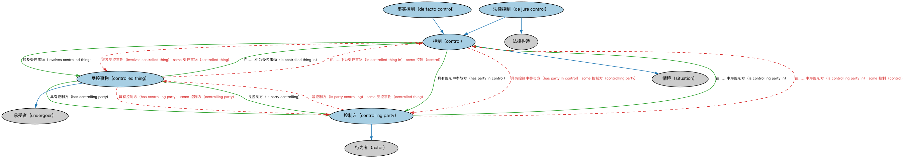

# 控制本体（Control Ontology）结构与公理说明

本文档对应 `Control.rdf` / `Control.ttl`，说明该本体的类、继承关系、属性和公理约定。结构图见 `Control-structure.png`（`Control-structure.svg` 为可缩放版本）。

## 1. 本体概述

定义「控制」（control）关系本身：控制方、被控制方、控制程度与控制权来源。

**在体系中的位置**：FND 所有权与控制模块的三件套之一（控制、所有权、所有权与控制综合）。

**上下游关系**：上游依赖关系与参与方本体；下游被 BE 公司控制、合并报表判断引用。

**与相近概念的差别**：控制≠所有权——51% 股权通常带来控制，但通过协议安排无多数股权也可控制；与管理权的差别——控制是股东层面的支配力，管理是经营层面的执行权。

## 2. 类（Class）

| 类（Class） | 定义（Definition） |
|---|---|
| 控制（control） | 某参与方有权指挥或强烈影响某事物相关管理与政策方向的情形。 |
| 受控事物（controlled thing） | 在某情形中被某参与方施以某种形式控制的事物。 |
| 控制方（controlling party） | 在某情形情境中实施某种形式控制的行为体。 |
| 事实控制（de facto control） | 非正式存在但被接受的控制，虽未经正式承认。 |
| 法律控制（de jure control） | 作为法律事项存在的控制，即对某事物的正当合法控制。 |

### 2.1 继承关系（Inheritance）

- 控制（control） ⊑ 情境（situation）
- 受控事物（controlled thing） ⊑ 承受者（undergoer）
- 控制方（controlling party） ⊑ 行为者（actor）
- 事实控制（de facto control） ⊑ 控制（control）
- 法律控制（de jure control） ⊑ 法律构造
- 法律控制（de jure control） ⊑ 控制（control）

## 3. 对象属性（Object Property）

| 属性（Property） | 中文（English） | 定义（Definition） | 说明 |
|---|---|---|---|
| fibo-fnd-oac-ctl:hasControllingParty | 具有控制方（has controlling party） | 标识对某事物行使权力或影响力的参与方。 | 定义域（domain）：受控事物（controlled thing）；值域（range）：控制方（controlling party）；子属性（subPropertyOf）：受…影响（is affected by） |
| fibo-fnd-oac-ctl:hasPartyInControl | 具有控制中参与方（has party in control） | 标识控制情形情境中的行为体。 | 定义域（domain）：控制（control）；值域（range）：控制方（controlling party）；子属性（subPropertyOf）：具有行为者（has actor） |
| fibo-fnd-oac-ctl:involvesControlledThing | 涉及受控事物（involves controlled thing） | 标识控制情形情境中被控制的某事物。 | 定义域（domain）：控制（control）；值域（range）：受控事物（controlled thing）；子属性（subPropertyOf）：具有承受者（has undergoer） |
| fibo-fnd-oac-ctl:isControlledPartyOf | 是……的受控方（is controlled party of） | 标识对……具有一定权力或影响力的控制方。 | 值域（range）：控制方（controlling party）；子属性（subPropertyOf）：直接受…影响（is directly affected by） |
| fibo-fnd-oac-ctl:isControlledThingIn | 在……中为受控事物（is controlled thing in） | 标识某事物被控制的控制情境。 | 定义域（domain）：受控事物（controlled thing）；值域（range）：控制（control）；逆属性（inverseOf）：涉及受控事物（involves controlled thing）；子属性（subPropertyOf）：承受（undergoes） |
| fibo-fnd-oac-ctl:isControllingPartyIn | 在……中为控制方（is controlling party in） | 标识参与方扮演控制角色的控制情境。 | 定义域（domain）：控制方（controlling party）；值域（range）：控制（control）；逆属性（inverseOf）：具有控制中参与方（has party in control）；子属性（subPropertyOf）：在…中行动（acts in） |
| fibo-fnd-oac-ctl:isControllingPartyOf | 是……的控制方（is controlling party of） | 标识控制方对其具有一定权力或影响力的事物。 | 定义域（domain）：控制方（controlling party）；子属性（subPropertyOf）：直接影响（directly affects） |
| fibo-fnd-oac-ctl:isPartyControlling | 是控制方（is party controlling） | 标识控制方对其具有一定权力或影响力的受控事物。 | 定义域（domain）：控制方（controlling party）；值域（range）：受控事物（controlled thing）；逆属性（inverseOf）：具有控制方（has controlling party）；子属性（subPropertyOf）：对…采取行动（acts on） |

## 4. 数据属性（Datatype Property）

| 属性（Property） | 中文（English） | 定义（Definition） |
|---|---|---|
| fibo-fnd-oac-ctl:isInitiallyControlledOn | 首次受控于（is initially controlled on） | 标识某种程度的权力或影响力首次确立的日期或日期时间。 |

## 5. 公理约定（Axioms）

- 控制（control）：具有控制中参与方（has party in control） some 控制方（controlling party）
- 控制（control）：涉及受控事物（involves controlled thing） some 受控事物（controlled thing）
- 受控事物（controlled thing）：restriction
- 受控事物（controlled thing）：具有控制方（has controlling party） some 控制方（controlling party）
- 受控事物（controlled thing）：在……中为受控事物（is controlled thing in） some 控制（control）
- 控制方（controlling party）：在……中为控制方（is controlling party in） some 控制（control）
- 控制方（controlling party）：是控制方（is party controlling） some 受控事物（controlled thing）
- 事实控制（de facto control） 与 法律控制（de jure control） 互斥（disjointWith）

## 6. 依赖（owl:imports，6 个）

本本体通过 `owl:imports` 引入以下本体，各项的中文名称与简介如下：

| 导入本体 | 中文名称 | 简介 |
|---|---|---|
| `FND/Law/LegalCapacity.rdf` | 法律能力本体（Legal Capacity Ontology） | 定义法律能力、缔约能力、签章权等概念，刻画主体从事法律行为的资格。 |
| `FND/Relations/Relations.rdf` | 关系本体（Relations Ontology） | FIBO 最底层的基础本体，定义参考（reference）、分类（classify）等通用关系与抽象概念，全库普遍依赖。 |
| `FND/Utilities/AnnotationVocabulary.rdf` | FIBO 标注词汇表（FIBO Annotation Vocabulary） | 定义 FIBO 专用的标注属性（如释义来源、成熟度等级），用于本体自身的元数据标注。 |
| `https://www.omg.org/spec/Commons/AnnotationVocabulary/` | OMG 通用标注词汇表（OMG Commons Annotation Vocabulary） | OMG 通用本体库（Commons）中的标注词汇表，提供概念映射等标注属性，FIBO 用它标注术语与外部标准的对应关系。 |
| `https://www.omg.org/spec/Commons/DatesAndTimes/` | OMG 通用日期与时间本体（OMG Commons Dates and Times） | Commons 库中的日期时间本体，定义日期、期间、时间点等通用时间概念。 |
| `https://www.omg.org/spec/Commons/PartiesAndSituations/` | OMG 通用参与方与情境本体（OMG Commons Parties and Situations） | Commons 库中的参与方本体，定义独立主体、参与方及其角色扮演的通用概念，是 FIBO 参与方模型的上游。 |

## 7. 文件

- 官方 RDF/XML：`Control.rdf`
- 中文 Turtle：`Control.ttl`
- 结构图：`Control-structure.png` / `Control-structure.svg`