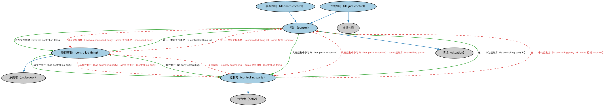

# 控制本体（Control Ontology）结构与公理说明

本文档对应 `Control.rdf` / `Control.ttl`，说明该本体的类、继承关系、属性和公理约定。结构图见 `Control-structure.png`（`Control-structure.svg` 为可缩放版本）。

## 1. 本体概述

定义「控制」（control）关系本身：控制方、被控制方、控制程度与控制权来源。

**在体系中的位置**：FND 所有权与控制模块的三件套之一（控制、所有权、所有权与控制综合）。

**上下游关系**：上游依赖关系与参与方本体；下游被 BE 公司控制、合并报表判断引用。

**与相近概念的差别**：控制≠所有权——51% 股权通常带来控制，但通过协议安排无多数股权也可控制；与管理权的差别——控制是股东层面的支配力，管理是经营层面的执行权。

本本体中类与类的核心关系如下（完整细节见各类小节）：

- **控制（control）** 继承 **情境（situation）**
- **受控事物（controlled thing）** 继承 **承受者（undergoer）**
- **控制方（controlling party）** 继承 **行为者（actor）**
- **事实控制（de facto control）** 继承 **控制（control）**
- **法律控制（de jure control）** 继承 **法律构造（LegalConstruct）**
- **法律控制（de jure control）** 继承 **控制（control）**
- **受控事物（controlled thing）** 通过 **具有控制方（has controlling party）** 关联 **控制方（controlling party）**
- **控制（control）** 通过 **具有控制中参与方（has party in control）** 关联 **控制方（controlling party）**
- **控制（control）** 通过 **涉及受控事物（involves controlled thing）** 关联 **受控事物（controlled thing）**
- **受控事物（controlled thing）** 通过 **在……中为受控事物（is controlled thing in）** 关联 **控制（control）**
- **控制方（controlling party）** 通过 **在……中为控制方（is controlling party in）** 关联 **控制（control）**
- **控制方（controlling party）** 通过 **是控制方（is party controlling）** 关联 **受控事物（controlled thing）**

## 2. 类（Class）

| 类（Class） | 定义（Definition） |
|---|---|
| 控制（control） | 某参与方有权指挥或强烈影响某事物相关管理与政策方向的情形。 situation in which some party has the power to direct or strongly influence the direction of the management and policies related to something |
| 受控事物（controlled thing） | 在某情形中被某参与方施以某种形式控制的事物。 something over which some party exercises some form of control with respect to some situation |
| 控制方（controlling party） | 在某情形情境中实施某种形式控制的行为体。 actor that exercises some form of control in the context of some situation |
| 事实控制（de facto control） | 非正式存在但被接受的控制，虽未经正式承认。 control that exists informally and is accepted, although not formally recognized |
| 法律控制（de jure control） | 作为法律事项存在的控制，即对某事物的正当合法控制。 control that exists as a matter of law, i.e., legitimate, legal control of something |

以下按类逐个展开：每个类给出继承关系、相关属性与公理约定；子类在父类之下降一级编号。

### 2.1 控制（control）

定义：某参与方有权指挥或强烈影响某事物相关管理与政策方向的情形。

- 父类：**情境（situation）**
- 直接子类：**事实控制（de facto control）**、**法律控制（de jure control）**

属性：

| 属性 | 定义 | 说明 |
|---|---|---|
| **具有控制中参与方（has party in control）** | 标识控制情形情境中的行为体。 indicates the actor in the context of a control situation | 值域：控制方（controlling party）；子属性：具有行为者（has actor） |
| **涉及受控事物（involves controlled thing）** | 标识控制情形情境中被控制的某事物。 indicates something controlled in the context of a control situation | 值域：受控事物（controlled thing）；子属性：具有承受者（has undergoer） |

公理：

- **具有控制中参与方（has party in control）**至少有一个取值，类型是**控制方（controlling party）**。
- **涉及受控事物（involves controlled thing）**至少有一个取值，类型是**受控事物（controlled thing）**。

#### 2.1.1 事实控制（de facto control）

定义：非正式存在但被接受的控制，虽未经正式承认。

- 父类：**控制（control）**

公理：

- 与**法律控制（de jure control）**互斥：同一个体不能同时属于两者。

#### 2.1.2 法律控制（de jure control）

定义：作为法律事项存在的控制，即对某事物的正当合法控制。

- 父类：**法律构造（LegalConstruct）**、**控制（control）**

### 2.2 受控事物（controlled thing）

定义：在某情形中被某参与方施以某种形式控制的事物。

- 父类：**承受者（undergoer）**

属性：

| 属性 | 定义 | 说明 |
|---|---|---|
| **具有控制方（has controlling party）** | 标识对某事物行使权力或影响力的参与方。 indicates the party that exercises authority or influence over something | 值域：控制方（controlling party）；子属性：受…影响（is affected by） |
| **在……中为受控事物（is controlled thing in）** | 标识某事物被控制的控制情境。 indicates the context of control in which something is being controlled | 值域：控制（control）；逆属性：涉及受控事物（involves controlled thing）；子属性：承受（undergoes） |
| **首次受控于（is initially controlled on）** | 标识某种程度的权力或影响力首次确立的日期或日期时间。 indicates the date or date and time that some level of authority or influence was first put in place | 值域：cmns-dt:CombinedDateTime；子属性：具有观测日期时间 |

公理：

- **具有控制方（has controlling party）**至少有一个取值，类型是**控制方（controlling party）**。
- **在……中为受控事物（is controlled thing in）**至少有一个取值，类型是**控制（control）**。
- **首次受控于（is initially controlled on）**存在取值约束。

### 2.3 控制方（controlling party）

定义：在某情形情境中实施某种形式控制的行为体。

- 父类：**行为者（actor）**

属性：

| 属性 | 定义 | 说明 |
|---|---|---|
| **在……中为控制方（is controlling party in）** | 标识参与方扮演控制角色的控制情境。 indicates the context of control in which the party plays the role of controlling something | 值域：控制（control）；逆属性：具有控制中参与方（has party in control）；子属性：在…中行动（acts in） |
| **是……的控制方（is controlling party of）** | 标识控制方对其具有一定权力或影响力的事物。 indicates something that a controlling party has some amount of authority or influence over | 子属性：直接影响（directly affects） |
| **是控制方（is party controlling）** | 标识控制方对其具有一定权力或影响力的受控事物。 indicates something controlled that a controlling party has some amount of authority or influence over | 值域：受控事物（controlled thing）；逆属性：具有控制方（has controlling party）；子属性：对…采取行动（acts on） |

公理：

- **在……中为控制方（is controlling party in）**至少有一个取值，类型是**控制（control）**。
- **是控制方（is party controlling）**至少有一个取值，类型是**受控事物（controlled thing）**。

## 3. 其他属性

以下属性未绑定到本体的具体类（定义域在外部本体或未声明）：

对象属性（Object Property）：

| 属性 | 定义 | 说明 |
|---|---|---|
| **是……的受控方（is controlled party of）** | 标识对……具有一定权力或影响力的控制方。 indicates a controlling party that has some amount of authority or influence over it | 值域：控制方（controlling party）；子属性：直接受…影响（is directly affected by） |

## 4. 依赖（owl:imports，6 个）

本本体通过 `owl:imports` 引入以下本体，各项的中文名称与简介如下：

| 导入本体 | 中文名称 | 简介 |
|---|---|---|
| `FND/Law/LegalCapacity.rdf` | 法律能力本体（Legal Capacity Ontology） | 定义法律能力、缔约能力、签章权等概念，刻画主体从事法律行为的资格。 |
| `FND/Relations/Relations.rdf` | 关系本体（Relations Ontology） | FIBO 最底层的基础本体，定义参考（reference）、分类（classify）等通用关系与抽象概念，全库普遍依赖。 |
| `FND/Utilities/AnnotationVocabulary.rdf` | FIBO 标注词汇表（FIBO Annotation Vocabulary） | 定义 FIBO 专用的标注属性（如释义来源、成熟度等级），用于本体自身的元数据标注。 |
| `https://www.omg.org/spec/Commons/AnnotationVocabulary/` | OMG 通用标注词汇表（OMG Commons Annotation Vocabulary） | OMG 通用本体库（Commons）中的标注词汇表，提供概念映射等标注属性，FIBO 用它标注术语与外部标准的对应关系。 |
| `https://www.omg.org/spec/Commons/DatesAndTimes/` | OMG 通用日期与时间本体（OMG Commons Dates and Times） | Commons 库中的日期时间本体，定义日期、期间、时间点等通用时间概念。 |
| `https://www.omg.org/spec/Commons/PartiesAndSituations/` | OMG 通用参与方与情境本体（OMG Commons Parties and Situations） | Commons 库中的参与方本体，定义独立主体、参与方及其角色扮演的通用概念，是 FIBO 参与方模型的上游。 |

## 5. 文件

- 官方 RDF/XML：`Control.rdf`
- 中文 Turtle：`Control.ttl`
- 结构图：`Control-structure.png` / `Control-structure.svg`