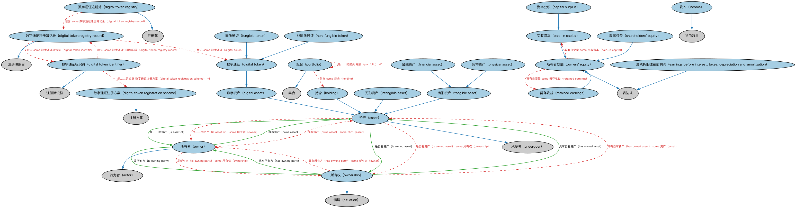

# 所有权本体（Ownership Ontology）结构与公理说明

本文档对应 `Ownership.rdf` / `Ownership.ttl`，说明该本体的类、继承关系、属性和公理约定。结构图见 `Ownership-structure.png`（`Ownership-structure.svg` 为可缩放版本）。

## 1. 本体概述

定义「拥有」（ownership）关系本身：所有者、被拥有资产、所有权份额与取得方式。

**在体系中的位置**：FND 所有权与控制模块的三件套之一。

**上下游关系**：上游依赖关系与参与方本体；下游被 BE 公司所有权、不动产、证券化资产归属引用。

**与相近概念的差别**：所有权≠占有——占有是实际控制着东西，所有权是法律上的归属（寄存物品时保管人占有但不拥有）；与受益权的差别——信托中受托人拥有名义所有权，受益人享有受益权。

## 2. 类（Class）

| 类（Class） | 定义（Definition） |
|---|---|
| 资产（asset） | 具有货币价值、为某参与方所拥有或为其带来利益的事物。 |
| 资本公积（capital surplus） | 超出所发行所有者权益面值（设定价值）的出资部分。 |
| 数字资产（digital asset） | 仅以数字形式存在、或作为另一资产之数字表示的资产。 |
| 数字通证（digital token） | 在发行、存储、交换、所有权记录或交易验证中使用分布式账本技术的数字资产。 |
| 数字通证标识符（digital token identifier） | 符合 ISO 24165 的数字通证注册用全球唯一标识符。 |
| 数字通证注册方案（digital token registration scheme） | 符合 ISO 24165 的数字通证标识符注册方案。 |
| 数字通证注册簿（digital token registry） | 数字通证的权威记录集合。 |
| 数字通证注册簿记录（digital token registry record） | 包含 ISO 24165-2:2025 为适用数字通证标识符（DTI）类型规定之数据元素的数字通证记录。 |
| 息税折旧摊销前利润（earnings before interest, taxes, depreciation and amortization） | 剔除资本结构、税项和非现金费用影响的潜在现金流度量。 |
| 金融资产（financial asset） | 非实物形态的有形资产，其价值源自合同性请求权，如银行存款、债券、股票、权利、证书和银行余额。 |
| 同质通证（fungible token） | 各数字资产单位之间可相互替代的数字通证。 |
| 持仓（holding） | 由对某资产或证券的法定或受益所有权构成、为其所有者赋予经济权利的自有金融权益。 |
| 收入（income） | 在某段时期内收到的收益。 |
| 无形资产（intangible asset） | 可识别的、无实物形态的非货币性资产。 |
| 非同质通证（non-fungible token） | 代表对一个或多个有形和/或无形资产所有权证明的唯一数字通证，具有唯一元数据和/或标识。 |
| 所有者（owner） | 在法律上被承认对某事物拥有占有权、使用特权以及转让任何相关权利或特权之能力的参与方。 |
| 所有者权益（owners' equity） | 所有者在企业中的份额加上经营利润。 |
| 所有权（ownership） | 某参与方（明示或默示）持有某事物法定所有权、并有权转让该所有权和/或占有权的情形。 |
| 实收资本（paid-in capital） | 从投资者处收到的、以所有者权益为交换的资产。 |
| 实物资产（physical asset） | 具有物质形态的有形资产，如不动产、设备和存货。 |
| 组合（portfolio） | 为实现战略目标而作为整体汇集和维护、用于管理目的的持仓集合。 |
| 留存收益（retained earnings） | 支付股息后留存在企业中累积的净利润。 |
| 股东权益（shareholders' equity） | 以实体、基金或结构化产品中的股份形式体现的权益。 |
| 有形资产（tangible asset） | 作为物理可测资源（即具有物理形态）的资产。 |

### 2.1 继承关系（Inheritance）

- 资产（asset） ⊑ 承受者（undergoer）
- 资本公积（capital surplus） ⊑ 实收资本（paid-in capital）
- 数字资产（digital asset） ⊑ 资产（asset）
- 数字通证（digital token） ⊑ 数字资产（digital asset）
- 数字通证标识符（digital token identifier） ⊑ 注册标识符
- 数字通证注册方案（digital token registration scheme） ⊑ 注册方案
- 数字通证注册簿（digital token registry） ⊑ 注册簿
- 数字通证注册簿记录（digital token registry record） ⊑ 注册簿条目
- 息税折旧摊销前利润（earnings before interest, taxes, depreciation and amortization） ⊑ 表达式
- 金融资产（financial asset） ⊑ 有形资产（tangible asset）
- 同质通证（fungible token） ⊑ 数字通证（digital token）
- 持仓（holding） ⊑ 资产（asset）
- 收入（income） ⊑ 货币数量
- 无形资产（intangible asset） ⊑ 资产（asset）
- 非同质通证（non-fungible token） ⊑ 数字通证（digital token）
- 所有者（owner） ⊑ 行为者（actor）
- 所有者权益（owners' equity） ⊑ 表达式
- 所有权（ownership） ⊑ 情境（situation）
- 实收资本（paid-in capital） ⊑ 所有者权益（owners' equity）
- 实物资产（physical asset） ⊑ 有形资产（tangible asset）
- 组合（portfolio） ⊑ 集合
- 留存收益（retained earnings） ⊑ 所有者权益（owners' equity）
- 股东权益（shareholders' equity） ⊑ 所有者权益（owners' equity）
- 有形资产（tangible asset） ⊑ 资产（asset）

## 3. 对象属性（Object Property）

| 属性（Property） | 中文（English） | 定义（Definition） | 说明 |
|---|---|---|---|
| fibo-fnd-oac-own:hasAcquisitionPrice | 具有取得价格（has acquisition price） | 具有取得日以货币、其他金融资产或货物表示的价值。 | 值域（range）：价格；子属性（subPropertyOf）：具有价格 |
| fibo-fnd-oac-own:hasOwnedAsset | 具有自有资产（has owned asset） | 标识所有权情形中的资产。 | 定义域（domain）：所有权（ownership）；值域（range）：资产（asset）；逆属性（inverseOf）：是自有资产（is owned asset）；子属性（subPropertyOf）：具有承受者（has undergoer） |
| fibo-fnd-oac-own:hasOwningParty | 具有所有方（has owning party） | 标识所有权情形中持有资产所有权的行为体。 | 定义域（domain）：所有权（ownership）；值域（range）：所有者（owner）；逆属性（inverseOf）：是所有方（is owning party）；子属性（subPropertyOf）：具有行为者（has actor） |
| fibo-fnd-oac-own:isAssetOf | 是……的资产（is asset of） | 标识资产的所有者。 | 定义域（domain）：资产（asset）；值域（range）：所有者（owner）；子属性（subPropertyOf）：受…影响（is affected by） |
| fibo-fnd-oac-own:isOwnedAsset | 是自有资产（is owned asset） | 标识某事物作为资产的所有权情境。 | 定义域（domain）：资产（asset）；值域（range）：所有权（ownership）；子属性（subPropertyOf）：承受（undergoes） |
| fibo-fnd-oac-own:isOwnedBy | 由……拥有（is owned by） | 标识某人所拥有的事物。 | 值域（range）：参与方（party）；子属性（subPropertyOf）：直接经历（experiences directly） |
| fibo-fnd-oac-own:isOwningParty | 是所有方（is owning party） | 标识参与方扮演所有者角色的所有权情境。 | 定义域（domain）：所有者（owner）；值域（range）：所有权（ownership）；子属性（subPropertyOf）：在…中行动（acts in） |
| fibo-fnd-oac-own:owns | 拥有（owns） | 标识参与方持有所有权并可占有的事物。 | 定义域（domain）：参与方（party）；子属性（subPropertyOf）：扮演直接影响…的主动角色（plays active role that directly affects） |
| fibo-fnd-oac-own:ownsAsset | 拥有资产（owns asset） | 标识所有者所拥有的资产。 | 定义域（domain）：所有者（owner）；值域（range）：资产（asset）；逆属性（inverseOf）：是……的资产（is asset of）；子属性（subPropertyOf）：对…采取行动（acts on） |

## 5. 公理约定（Axioms）

- 资产（asset）：具有取得价格（has acquisition price） 价格 ≤1
- 资产（asset）：restriction
- 资产（asset）：是……的资产（is asset of） some 所有者（owner）
- 资产（asset）：是自有资产（is owned asset） some 所有权（ownership）
- 数字通证标识符（digital token identifier）：是……的成员 数字通证注册方案（digital token registration scheme） =1
- 数字通证标识符（digital token identifier）：标识 some 数字通证注册簿记录（digital token registry record）
- 数字通证注册簿（digital token registry）：包含 some 数字通证注册簿记录（digital token registry record）
- 数字通证注册簿记录（digital token registry record）：包含 some 数字通证标识符（digital token identifier）
- 数字通证注册簿记录（digital token registry record）：登记 some 数字通证（digital token）
- 息税折旧摊销前利润（earnings before interest, taxes, depreciation and amortization）：适用于 正式组织 ≥0
- 金融资产（financial asset）：具有取得价格（has acquisition price） only 货币价格
- 同质通证（fungible token） 与 非同质通证（non-fungible token） 互斥（disjointWith）
- 持仓（holding）：restriction
- 收入（income）：具有日期区间 日期区间 =1
- 无形资产（intangible asset） 与 有形资产（tangible asset） 互斥（disjointWith）
- 所有者（owner）：是所有方（is owning party） some 所有权（ownership）
- 所有者（owner）：拥有资产（owns asset） some 资产（asset）
- 所有者权益（owners' equity）：适用于 正式组织 ≥0
- 所有者权益（owners' equity）：具有自变量 some 实收资本（paid-in capital）
- 所有者权益（owners' equity）：具有自变量 some 留存收益（retained earnings）
- 所有权（ownership）：具有自有资产（has owned asset） some 资产（asset）
- 所有权（ownership）：具有所有方（has owning party） some 所有者（owner）
- 实物资产（physical asset） 与 金融资产（financial asset） 互斥（disjointWith）
- 组合（portfolio）：是……的成员 组合（portfolio） ≤1
- 组合（portfolio）：包含 some 持仓（holding）

## 6. 依赖（owl:imports，13 个）

本本体通过 `owl:imports` 引入以下本体，各项的中文名称与简介如下：

| 导入本体 | 中文名称 | 简介 |
|---|---|---|
| `FND/Accounting/CurrencyAmount.rdf` | 货币金额本体（Currency Amount Ontology） | 定义「金额＋币种」的货币金额（currency amount）表示，是 FIBO 中表达价格、债务金额、付款额等一切带币种数值的基础构件。 |
| `FND/DatesAndTimes/FinancialDates.rdf` | 金融日期本体（Financial Dates Ontology） | 定义金融语境下的日期与期间概念：结算日、付息日、到期日、日计数基准等。 |
| `FND/Law/LegalCapacity.rdf` | 法律能力本体（Legal Capacity Ontology） | 定义法律能力、缔约能力、签章权等概念，刻画主体从事法律行为的资格。 |
| `FND/Utilities/AnnotationVocabulary.rdf` | FIBO 标注词汇表（FIBO Annotation Vocabulary） | 定义 FIBO 专用的标注属性（如释义来源、成熟度等级），用于本体自身的元数据标注。 |
| `https://www.omg.org/spec/Commons/AnnotationVocabulary/` | OMG 通用标注词汇表（OMG Commons Annotation Vocabulary） | OMG 通用本体库（Commons）中的标注词汇表，提供概念映射等标注属性，FIBO 用它标注术语与外部标准的对应关系。 |
| `https://www.omg.org/spec/Commons/Collections/` | OMG 通用集合本体（OMG Commons Collections） | Commons 库中的集合本体，定义集合、成员等通用概念。 |
| `https://www.omg.org/spec/Commons/ContextualDesignators/` | OMG 通用语境指称本体（OMG Commons Contextual Designators） | Commons 库中的语境指称本体，定义「在某个语境下指代某物的名称/符号」，是地址、账户号码等语境相关标识的基础。 |
| `https://www.omg.org/spec/Commons/DatesAndTimes/` | OMG 通用日期与时间本体（OMG Commons Dates and Times） | Commons 库中的日期时间本体，定义日期、期间、时间点等通用时间概念。 |
| `https://www.omg.org/spec/Commons/Identifiers/` | OMG 通用标识符本体（OMG Commons Identifiers） | Commons 库中的标识符本体，定义标识符及其编码方案的通用概念。 |
| `https://www.omg.org/spec/Commons/Organizations/` | OMG 通用组织本体（OMG Commons Organizations） | Commons 库中的组织本体，定义组织、组织成员与组织结构的通用概念。 |
| `https://www.omg.org/spec/Commons/PartiesAndSituations/` | OMG 通用参与方与情境本体（OMG Commons Parties and Situations） | Commons 库中的参与方本体，定义独立主体、参与方及其角色扮演的通用概念，是 FIBO 参与方模型的上游。 |
| `https://www.omg.org/spec/Commons/QuantitiesAndUnits/` | OMG 通用量与单位本体（OMG Commons Quantities and Units） | Commons 库中的量与单位本体，定义数量、度量单位、量纲的通用概念，支撑金额、比率等数值表达。 |
| `https://www.omg.org/spec/Commons/RegistrationAuthorities/` | OMG 通用登记主管机构本体（OMG Commons Registration Authorities） | Commons 库中的登记主管机构本体，定义负责登记注册的主管机构及其登记行为的通用概念。 |

## 7. 文件

- 官方 RDF/XML：`Ownership.rdf`
- 中文 Turtle：`Ownership.ttl`
- 结构图：`Ownership-structure.png` / `Ownership-structure.svg`