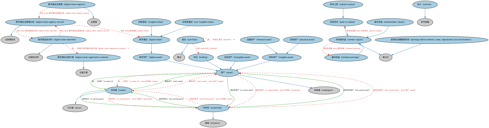

# 所有权本体（Ownership Ontology）结构与公理说明

本文档对应 `Ownership.rdf` / `Ownership.ttl`，说明该本体的类、继承关系、属性和公理约定。结构图见 `Ownership-structure.png`（`Ownership-structure.svg` 为可缩放版本）。

## 1. 本体概述

定义「拥有」（ownership）关系本身：所有者、被拥有资产、所有权份额与取得方式。

**在体系中的位置**：FND 所有权与控制模块的三件套之一。

**上下游关系**：上游依赖关系与参与方本体；下游被 BE 公司所有权、不动产、证券化资产归属引用。

**与相近概念的差别**：所有权≠占有——占有是实际控制着东西，所有权是法律上的归属（寄存物品时保管人占有但不拥有）；与受益权的差别——信托中受托人拥有名义所有权，受益人享有受益权。

本本体中类与类的核心关系如下（完整细节见各类小节）：

- **资产（asset）** 继承 **承受者（undergoer）**
- **资本公积（capital surplus）** 继承 **实收资本（paid-in capital）**
- **数字资产（digital asset）** 继承 **资产（asset）**
- **数字通证（digital token）** 继承 **数字资产（digital asset）**
- **数字通证标识符（digital token identifier）** 继承 **注册标识符（RegisteredIdentifier）**
- **数字通证注册方案（digital token registration scheme）** 继承 **注册方案（RegistrationScheme）**
- **数字通证注册簿（digital token registry）** 继承 **注册簿（Registry）**
- **数字通证注册簿记录（digital token registry record）** 继承 **注册簿条目（RegistryEntry）**
- **息税折旧摊销前利润（earnings before interest, taxes, depreciation and amortization）** 继承 **表达式（Expression）**
- **金融资产（financial asset）** 继承 **有形资产（tangible asset）**
- **同质通证（fungible token）** 继承 **数字通证（digital token）**
- **持仓（holding）** 继承 **资产（asset）**
- 其余 18 条关系从略。

## 2. 类（Class）

| 类（Class） | 定义（Definition） |
|---|---|
| 资产（asset） | 具有货币价值、为某参与方所拥有或为其带来利益的事物。 something of monetary value that is owned or provides benefit to some party |
| 资本公积（capital surplus） | 超出所发行所有者权益面值（设定价值）的出资部分。 capital contributed in excess of the par value (stated value) of the ownership interest issued |
| 数字资产（digital asset） | 仅以数字形式存在、或作为另一资产之数字表示的资产。 asset that exists only in digital form or that is the digital representation of another asset |
| 数字通证（digital token） | 在发行、存储、交换、所有权记录或交易验证中使用分布式账本技术的数字资产。 digital asset which uses distributed ledger technology for its issuance, storage, exchange, record of ownership or transaction validation and is not a currency |
| 数字通证标识符（digital token identifier） | 符合 ISO 24165 的数字通证注册用全球唯一标识符。 globally unique identifier conformant with ISO 24165 for the registration of digital tokens |
| 数字通证注册方案（digital token registration scheme） | 符合 ISO 24165 的数字通证标识符注册方案。 registration scheme conformant with ISO 24165 for the registration of digital token identifiers |
| 数字通证注册簿（digital token registry） | 数字通证的权威记录集合。 authoritative collection of records for digital tokens |
| 数字通证注册簿记录（digital token registry record） | 包含 ISO 24165-2:2025 为适用数字通证标识符（DTI）类型规定之数据元素的数字通证记录。 record for a digital token containing the data elements specified in ISO 24165-2:2025 for the applicable digital token identifier (DTI) type |
| 息税折旧摊销前利润（earnings before interest, taxes, depreciation and amortization） | 剔除资本结构、税项和非现金费用影响的潜在现金流度量。 measure of potential cash flow that excludes the effects of capital structure, taxes and non-cash expenses |
| 金融资产（financial asset） | 非实物形态的有形资产，其价值源自合同性请求权，如银行存款、债券、股票、权利、证书和银行余额。 non-physical, tangible asset whose value is derived from a contractual claim, such as bank deposits, bonds, stocks, rights, certificates, and bank balances |
| 同质通证（fungible token） | 各数字资产单位之间可相互替代的数字通证。 digital token capable of mutual substitution between the individual units of digital assets |
| 持仓（holding） | 由对某资产或证券的法定或受益所有权构成、为其所有者赋予经济权利的自有金融权益。 owned financial interest consisting of legal or beneficial ownership of an asset or security that confers economic rights on its owner |
| 收入（income） | 在某段时期内收到的收益。 revenue received during a period of time |
| 无形资产（intangible asset） | 可识别的、无实物形态的非货币性资产。 identifiable, non-monetary asset that lacks physical substance |
| 非同质通证（non-fungible token） | 代表对一个或多个有形和/或无形资产所有权证明的唯一数字通证，具有唯一元数据和/或标识。 unique digital token that represents proof of ownership of one or more tangible and/or intangible assets with unique metadata and/or identification such that no two are identical or fungible |
| 所有者（owner） | 在法律上被承认对某事物拥有占有权、使用特权以及转让任何相关权利或特权之能力的参与方。 party that is legally recognized as having the right to possess, the privilege to use, and ability to transfer any rights or privileges associated with something, as permitted by law |
| 所有者权益（owners' equity） | 所有者在企业中的份额加上经营利润。 owners' share in a business plus operating profit |
| 所有权（ownership） | 某参与方（明示或默示）持有某事物法定所有权、并有权转让该所有权和/或占有权的情形。 situation in which some party holds the legal title to something (explicitly or implicitly) and has the right to transfer that title and/or possession |
| 实收资本（paid-in capital） | 从投资者处收到的、以所有者权益为交换的资产。 assets received from investors in exchange for an ownership interest |
| 实物资产（physical asset） | 具有物质形态的有形资产，如不动产、设备和存货。 tangible asset that has a material form, such as property, equipment, and inventory |
| 组合（portfolio） | 为实现战略目标而作为整体汇集和维护、用于管理目的的持仓集合。 collection of holdings assembled and maintained as a unit for management purposes to achieve strategic objectives |
| 留存收益（retained earnings） | 支付股息后留存在企业中累积的净利润。 net profits kept to accumulate in a business after dividends are paid |
| 股东权益（shareholders' equity） | 以实体、基金或结构化产品中的股份形式体现的权益。 equity that is manifested in the form of shares in an entity, fund or structured product |
| 有形资产（tangible asset） | 作为物理可测资源（即具有物理形态）的资产。 asset that is a physical, measurable resource, i.e., one that takes a physical form |

以下按类逐个展开：每个类给出继承关系、相关属性与公理约定；子类在父类之下降一级编号。

### 2.1 资产（asset）

定义：具有货币价值、为某参与方所拥有或为其带来利益的事物。

- 父类：**承受者（undergoer）**
- 直接子类：**数字资产（digital asset）**、**持仓（holding）**、**无形资产（intangible asset）**、**有形资产（tangible asset）**

属性：

| 属性 | 定义 | 说明 |
|---|---|---|
| **具有取得日期（hasAcquisitionDate）** | — | — |
| **具有取得价格（has acquisition price）** | 具有取得日以货币、其他金融资产或货物表示的价值。 has a value as of the date of acquisition, expressed as an amount of money, other financial assets, or goods | 值域：价格；子属性：具有价格 |
| **是……的资产（is asset of）** | 标识资产的所有者。 identifies the owner of an asset | 值域：所有者（owner）；子属性：受…影响（is affected by） |
| **是自有资产（is owned asset）** | 标识某事物作为资产的所有权情境。 indicates the context of ownership in which something is an asset | 值域：所有权（ownership）；子属性：承受（undergoes） |

公理：

- **具有取得价格（has acquisition price）**至多有 1 个**价格（Price）**。
- **具有取得日期（hasAcquisitionDate）**存在取值约束。
- **是……的资产（is asset of）**至少有一个取值，类型是**所有者（owner）**。
- **是自有资产（is owned asset）**至少有一个取值，类型是**所有权（ownership）**。

#### 2.1.1 数字资产（digital asset）

定义：仅以数字形式存在、或作为另一资产之数字表示的资产。

- 父类：**资产（asset）**
- 直接子类：**数字通证（digital token）**

##### 2.1.1.1 数字通证（digital token）

定义：在发行、存储、交换、所有权记录或交易验证中使用分布式账本技术的数字资产。

- 父类：**数字资产（digital asset）**
- 直接子类：**同质通证（fungible token）**、**非同质通证（non-fungible token）**

###### 2.1.1.1.1 同质通证（fungible token）

定义：各数字资产单位之间可相互替代的数字通证。

- 父类：**数字通证（digital token）**

公理：

- 与**非同质通证（non-fungible token）**互斥：同一个体不能同时属于两者。

###### 2.1.1.1.2 非同质通证（non-fungible token）

定义：代表对一个或多个有形和/或无形资产所有权证明的唯一数字通证，具有唯一元数据和/或标识。

- 父类：**数字通证（digital token）**

#### 2.1.2 持仓（holding）

定义：由对某资产或证券的法定或受益所有权构成、为其所有者赋予经济权利的自有金融权益。

- 父类：**资产（asset）**

属性：

| 属性 | 定义 | 说明 |
|---|---|---|
| **具有份额权益（hasFractionalInterest）** | — | — |

公理：

- **具有份额权益（hasFractionalInterest）**存在取值约束。

#### 2.1.3 无形资产（intangible asset）

定义：可识别的、无实物形态的非货币性资产。

- 父类：**资产（asset）**

公理：

- 与**有形资产（tangible asset）**互斥：同一个体不能同时属于两者。

#### 2.1.4 有形资产（tangible asset）

定义：作为物理可测资源（即具有物理形态）的资产。

- 父类：**资产（asset）**
- 直接子类：**金融资产（financial asset）**、**实物资产（physical asset）**

##### 2.1.4.1 金融资产（financial asset）

定义：非实物形态的有形资产，其价值源自合同性请求权，如银行存款、债券、股票、权利、证书和银行余额。

- 父类：**有形资产（tangible asset）**

属性：

| 属性 | 定义 | 说明 |
|---|---|---|
| **具有取得价格（has acquisition price）** | 具有取得日以货币、其他金融资产或货物表示的价值。 has a value as of the date of acquisition, expressed as an amount of money, other financial assets, or goods | 值域：价格；子属性：具有价格 |

公理：

- **具有取得价格（has acquisition price）**的所有取值只能是**货币价格（MonetaryPrice）**。

##### 2.1.4.2 实物资产（physical asset）

定义：具有物质形态的有形资产，如不动产、设备和存货。

- 父类：**有形资产（tangible asset）**

公理：

- 与**金融资产（financial asset）**互斥：同一个体不能同时属于两者。

### 2.2 数字通证标识符（digital token identifier）

定义：符合 ISO 24165 的数字通证注册用全球唯一标识符。

- 父类：**注册标识符（RegisteredIdentifier）**

属性：

| 属性 | 定义 | 说明 |
|---|---|---|
| **是……的成员（isMemberOf）** | — | — |
| **标识（identifies）** | — | — |

公理：

- **是……的成员（isMemberOf）**恰好有 1 个**数字通证注册方案（digital token registration scheme）**。
- **标识（identifies）**至少有一个取值，类型是**数字通证注册簿记录（digital token registry record）**。

### 2.3 数字通证注册方案（digital token registration scheme）

定义：符合 ISO 24165 的数字通证标识符注册方案。

- 父类：**注册方案（RegistrationScheme）**

### 2.4 数字通证注册簿（digital token registry）

定义：数字通证的权威记录集合。

- 父类：**注册簿（Registry）**

属性：

| 属性 | 定义 | 说明 |
|---|---|---|
| **包含（comprises）** | — | — |

公理：

- **包含（comprises）**至少有一个取值，类型是**数字通证注册簿记录（digital token registry record）**。

### 2.5 数字通证注册簿记录（digital token registry record）

定义：包含 ISO 24165-2:2025 为适用数字通证标识符（DTI）类型规定之数据元素的数字通证记录。

- 父类：**注册簿条目（RegistryEntry）**

属性：

| 属性 | 定义 | 说明 |
|---|---|---|
| **包含（comprises）** | — | — |
| **登记（registers）** | — | — |

公理：

- **包含（comprises）**至少有一个取值，类型是**数字通证标识符（digital token identifier）**。
- **登记（registers）**至少有一个取值，类型是**数字通证（digital token）**。

### 2.6 息税折旧摊销前利润（earnings before interest, taxes, depreciation and amortization）

定义：剔除资本结构、税项和非现金费用影响的潜在现金流度量。

- 父类：**表达式（Expression）**

属性：

| 属性 | 定义 | 说明 |
|---|---|---|
| **适用于（appliesTo）** | — | — |

公理：

- **适用于（appliesTo）**可以有 0 个或多个**正式组织（FormalOrganization）**。

### 2.7 收入（income）

定义：在某段时期内收到的收益。

- 父类：**货币数量（MonetaryAmount）**

属性：

| 属性 | 定义 | 说明 |
|---|---|---|
| **具有日期区间（hasDatePeriod）** | — | — |

公理：

- **具有日期区间（hasDatePeriod）**恰好有 1 个**日期区间（DatePeriod）**。

### 2.8 所有者（owner）

定义：在法律上被承认对某事物拥有占有权、使用特权以及转让任何相关权利或特权之能力的参与方。

- 父类：**行为者（actor）**

属性：

| 属性 | 定义 | 说明 |
|---|---|---|
| **是所有方（is owning party）** | 标识参与方扮演所有者角色的所有权情境。 indicates the context of ownership in which the party plays the role of owner | 值域：所有权（ownership）；子属性：在…中行动（acts in） |
| **拥有资产（owns asset）** | 标识所有者所拥有的资产。 identifies an asset that an owner owns | 值域：资产（asset）；逆属性：是……的资产（is asset of）；子属性：对…采取行动（acts on） |

公理：

- **拥有资产（owns asset）**至少有一个取值，类型是**资产（asset）**。
- **是所有方（is owning party）**至少有一个取值，类型是**所有权（ownership）**。

### 2.9 所有者权益（owners' equity）

定义：所有者在企业中的份额加上经营利润。

- 父类：**表达式（Expression）**
- 直接子类：**实收资本（paid-in capital）**、**留存收益（retained earnings）**、**股东权益（shareholders' equity）**

属性：

| 属性 | 定义 | 说明 |
|---|---|---|
| **适用于（appliesTo）** | — | — |
| **具有自变量（hasArgument）** | — | — |

公理：

- **具有自变量（hasArgument）**至少有一个取值，类型是**实收资本（paid-in capital）**。
- **具有自变量（hasArgument）**至少有一个取值，类型是**留存收益（retained earnings）**。
- **适用于（appliesTo）**可以有 0 个或多个**正式组织（FormalOrganization）**。

#### 2.9.1 实收资本（paid-in capital）

定义：从投资者处收到的、以所有者权益为交换的资产。

- 父类：**所有者权益（owners' equity）**
- 直接子类：**资本公积（capital surplus）**

##### 2.9.1.1 资本公积（capital surplus）

定义：超出所发行所有者权益面值（设定价值）的出资部分。

- 父类：**实收资本（paid-in capital）**

#### 2.9.2 留存收益（retained earnings）

定义：支付股息后留存在企业中累积的净利润。

- 父类：**所有者权益（owners' equity）**

#### 2.9.3 股东权益（shareholders' equity）

定义：以实体、基金或结构化产品中的股份形式体现的权益。

- 父类：**所有者权益（owners' equity）**

### 2.10 所有权（ownership）

定义：某参与方（明示或默示）持有某事物法定所有权、并有权转让该所有权和/或占有权的情形。

- 父类：**情境（situation）**

属性：

| 属性 | 定义 | 说明 |
|---|---|---|
| **具有自有资产（has owned asset）** | 标识所有权情形中的资产。 indicates the asset in an ownership situation | 值域：资产（asset）；逆属性：是自有资产（is owned asset）；子属性：具有承受者（has undergoer） |
| **具有所有方（has owning party）** | 标识所有权情形中持有资产所有权的行为体。 identifies the actor that holds title to the asset in an ownership situation | 值域：所有者（owner）；逆属性：是所有方（is owning party）；子属性：具有行为者（has actor） |

公理：

- **具有所有方（has owning party）**至少有一个取值，类型是**所有者（owner）**。
- **具有自有资产（has owned asset）**至少有一个取值，类型是**资产（asset）**。

### 2.11 组合（portfolio）

定义：为实现战略目标而作为整体汇集和维护、用于管理目的的持仓集合。

- 父类：**集合（Collection）**

属性：

| 属性 | 定义 | 说明 |
|---|---|---|
| **包含（comprises）** | — | — |
| **是……的成员（isMemberOf）** | — | — |

公理：

- **包含（comprises）**至少有一个取值，类型是**持仓（holding）**。
- **是……的成员（isMemberOf）**至多有 1 个**组合（portfolio）**。

## 3. 其他属性

以下属性未绑定到本体的具体类（定义域在外部本体或未声明）：

对象属性（Object Property）：

| 属性 | 定义 | 说明 |
|---|---|---|
| **由……拥有（is owned by）** | 标识某人所拥有的事物。 indicates something that someone owns | 值域：参与方（party）；子属性：直接经历（experiences directly） |
| **拥有（owns）** | 标识参与方持有所有权并可占有的事物。 indicates something that a party holds title to and may possess | 子属性：扮演直接影响…的主动角色（plays active role that directly affects） |

## 4. 依赖（owl:imports，13 个）

本本体通过 `owl:imports` 引入以下本体，各项的中文名称与简介如下：

| 导入本体 | 中文名称 | 简介 |
|---|---|---|
| `FND/Accounting/CurrencyAmount.rdf` | 货币金额本体（Currency Amount Ontology） | 定义「金额＋币种」的货币金额（currency amount）表示，是 FIBO 中表达价格、债务金额、付款额等一切带币种数值的基础构件。 |
| `FND/DatesAndTimes/FinancialDates.rdf` | 金融日期本体（Financial Dates Ontology） | 定义金融语境下的日期与期间概念：结算日、付息日、到期日、日计数基准等。 |
| `FND/Law/LegalCapacity.rdf` | 法律能力本体（Legal Capacity Ontology） | 定义法律能力、缔约能力、签章权等概念，刻画主体从事法律行为的资格。 |
| `FND/Utilities/AnnotationVocabulary.rdf` | FIBO 标注词汇表（FIBO Annotation Vocabulary） | 定义 FIBO 专用的标注属性（如释义来源、成熟度等级），用于本体自身的元数据标注。 |
| `https://www.omg.org/spec/Commons/AnnotationVocabulary/` | OMG 通用标注词汇表（OMG Commons Annotation Vocabulary） | OMG 通用本体库（Commons）中的标注词汇表，提供概念映射等标注属性，FIBO 用它标注术语与外部标准的对应关系。 |
| `https://www.omg.org/spec/Commons/Collections/` | OMG 通用集合本体（OMG Commons Collections） | Commons 库中的集合本体，定义集合、成员等通用概念。 |
| `https://www.omg.org/spec/Commons/ContextualDesignators/` | OMG 通用语境指称本体（OMG Commons Contextual Designators） | Commons 库中的语境指称本体，定义「在某个语境下指代某物的名称/符号」，是地址、账户号码等语境相关标识的基础。 |
| `https://www.omg.org/spec/Commons/DatesAndTimes/` | OMG 通用日期与时间本体（OMG Commons Dates and Times） | Commons 库中的日期时间本体，定义日期、期间、时间点等通用时间概念。 |
| `https://www.omg.org/spec/Commons/Identifiers/` | OMG 通用标识符本体（OMG Commons Identifiers） | Commons 库中的标识符本体，定义标识符及其编码方案的通用概念。 |
| `https://www.omg.org/spec/Commons/Organizations/` | OMG 通用组织本体（OMG Commons Organizations） | Commons 库中的组织本体，定义组织、组织成员与组织结构的通用概念。 |
| `https://www.omg.org/spec/Commons/PartiesAndSituations/` | OMG 通用参与方与情境本体（OMG Commons Parties and Situations） | Commons 库中的参与方本体，定义独立主体、参与方及其角色扮演的通用概念，是 FIBO 参与方模型的上游。 |
| `https://www.omg.org/spec/Commons/QuantitiesAndUnits/` | OMG 通用量与单位本体（OMG Commons Quantities and Units） | Commons 库中的量与单位本体，定义数量、度量单位、量纲的通用概念，支撑金额、比率等数值表达。 |
| `https://www.omg.org/spec/Commons/RegistrationAuthorities/` | OMG 通用登记主管机构本体（OMG Commons Registration Authorities） | Commons 库中的登记主管机构本体，定义负责登记注册的主管机构及其登记行为的通用概念。 |

## 5. 文件

- 官方 RDF/XML：`Ownership.rdf`
- 中文 Turtle：`Ownership.ttl`
- 结构图：`Ownership-structure.png` / `Ownership-structure.svg`