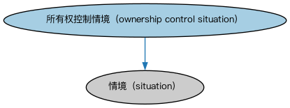

# 所有权与控制本体（Ownership and Control Ontology）结构与公理说明

本文档对应 `OwnershipAndControl.rdf` / `OwnershipAndControl.ttl`，说明该本体的类、继承关系、属性和公理约定。结构图见 `OwnershipAndControl-structure.png`（`OwnershipAndControl-structure.svg` 为可缩放版本）。

## 1. 本体概述

本本体将所有权（ownership）和控制（control）概念结合在一起，适用于两者语义同时成立的情形，例如全资子公司。

## 2. 类（Class）

| 类（Class） | 定义（Definition） |
|---|---|
| 所有权控制情境（ownership control situation） | 某参与方拥有并控制某物的情境。 |

### 2.1 继承关系（Inheritance）

- 所有权控制情境（ownership control situation） ⊑ 情境（situation）

## 3. 对象属性（Object Property）

| 属性（Property） | 中文（English） | 定义（Definition） | 说明 |
|---|---|---|---|
| fibo-fnd-oac-oac:isOwnedAndControlledBy | 由…拥有并控制（is owned and controlled by） | 将某物关联到拥有、影响、管理并指挥它的参与方。 | 值域（range）：参与方（party）；子属性（subPropertyOf）：由……拥有 |
| fibo-fnd-oac-oac:ownsAndControls | 拥有并控制（owns and controls） | 对某物进行指挥并施加权威性或支配性影响，且该物同时为其所有。 | 定义域（domain）：参与方（party）；逆属性（inverseOf）：由…拥有并控制（is owned and controlled by）；子属性（subPropertyOf）：拥有 |

## 6. 依赖（owl:imports，6 个）

本本体通过 `owl:imports` 引入以下本体，各项的中文名称与简介如下：

| 导入本体 | 中文名称 | 简介 |
|---|---|---|
| `FND/OwnershipAndControl/Control.rdf` | 控制本体（Control Ontology） | 定义「控制」关系：控制方、被控制方与控制程度，用于公司治理与合并报表判断。 |
| `FND/OwnershipAndControl/Ownership.rdf` | 所有权本体（Ownership Ontology） | 定义「拥有」关系：所有者、被拥有资产及所有权份额。 |
| `FND/Relations/Relations.rdf` | 关系本体（Relations Ontology） | FIBO 最底层的基础本体，定义参考（reference）、分类（classify）等通用关系与抽象概念，全库普遍依赖。 |
| `FND/Utilities/AnnotationVocabulary.rdf` | FIBO 标注词汇表（FIBO Annotation Vocabulary） | 定义 FIBO 专用的标注属性（如释义来源、成熟度等级），用于本体自身的元数据标注。 |
| `https://www.omg.org/spec/Commons/AnnotationVocabulary/` | OMG 通用标注词汇表（OMG Commons Annotation Vocabulary） | OMG 通用本体库（Commons）中的标注词汇表，提供概念映射等标注属性，FIBO 用它标注术语与外部标准的对应关系。 |
| `https://www.omg.org/spec/Commons/PartiesAndSituations/` | OMG 通用参与方与情境本体（OMG Commons Parties and Situations） | Commons 库中的参与方本体，定义独立主体、参与方及其角色扮演的通用概念，是 FIBO 参与方模型的上游。 |

## 7. 文件

- 官方 RDF/XML：`OwnershipAndControl.rdf`
- 中文 Turtle：`OwnershipAndControl.ttl`
- 结构图：`OwnershipAndControl-structure.png` / `OwnershipAndControl-structure.svg`