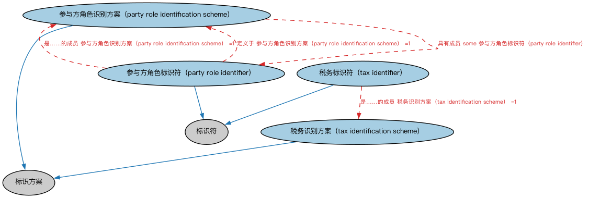

# 参与方本体（Parties Ontology）结构与公理说明

本文档对应 `Parties.rdf` / `Parties.ttl`，说明该本体的类、继承关系、属性和公理约定。结构图见 `Parties-structure.png`（`Parties-structure.svg` 为可缩放版本）。

## 1. 本体概述

本本体扩展 Commons 参与方与情境本体，增加参与方角色的标识符和通用的税务标识符。

本本体中类与类的核心关系如下（完整细节见各类小节）：

- **参与方角色识别方案（party role identification scheme）** 继承 **标识方案（IdentificationScheme）**
- **参与方角色标识符（party role identifier）** 继承 **标识符（Identifier）**
- **税务识别方案（tax identification scheme）** 继承 **标识方案（IdentificationScheme）**
- **税务标识符（tax identifier）** 继承 **标识符（Identifier）**

## 2. 类（Class）

| 类（Class） | 定义（Definition） |
|---|---|
| 参与方角色识别方案（party role identification scheme） | 为参与方所扮演角色分配标识符的系统。 system for allocating identifiers to roles that parties play |
| 参与方角色标识符（party role identifier） | 基于参与方在某种情境中所扮演的特定角色，能够唯一标识该参与方的字符序列。 sequence of characters, capable of uniquely identifying a party based on a specific role that they play in some context |
| 税务识别方案（tax identification scheme） | 在某司法辖区用于识别纳税人的识别方案。 identification scheme used to identify taxpayers in some jurisdiction |
| 税务标识符（tax identifier） | 分配给纳税人的标识符，使政府组织能够向其征收强制性财政收费和其他税费，以资助政府支出和各项公共开支。 identifier assigned to a taxpayer that enables compulsory financial charges and other levies to be imposed on the taxpayer by a governmental organization in order to fund government spending and various public expenditures |

以下按类逐个展开：每个类给出继承关系、相关属性与公理约定；子类在父类之下降一级编号。

### 2.1 参与方角色识别方案（party role identification scheme）

定义：为参与方所扮演角色分配标识符的系统。

- 父类：**标识方案（IdentificationScheme）**

属性：

| 属性 | 定义 | 说明 |
|---|---|---|
| **具有成员（hasMember）** | — | — |

公理：

- **具有成员（hasMember）**至少有一个取值，类型是**参与方角色标识符（party role identifier）**。

### 2.2 参与方角色标识符（party role identifier）

定义：基于参与方在某种情境中所扮演的特定角色，能够唯一标识该参与方的字符序列。

- 父类：**标识符（Identifier）**

属性：

| 属性 | 定义 | 说明 |
|---|---|---|
| **是……的成员（isMemberOf）** | — | — |
| **定义于（isDefinedIn）** | — | — |
| **标识（identifies）** | — | — |

公理：

- **定义于（isDefinedIn）**恰好有 1 个**参与方角色识别方案（party role identification scheme）**。
- **是……的成员（isMemberOf）**恰好有 1 个**参与方角色识别方案（party role identification scheme）**。
- **标识（identifies）**恰好有 1 个**参与方角色（party role）**。

### 2.3 税务识别方案（tax identification scheme）

定义：在某司法辖区用于识别纳税人的识别方案。

- 父类：**标识方案（IdentificationScheme）**

属性：

| 属性 | 定义 | 说明 |
|---|---|---|
| **适用于情境（isApplicableIn）** | — | — |

公理：

- **适用于情境（isApplicableIn）**至少有一个取值，类型是**管辖权（Jurisdiction）**。

### 2.4 税务标识符（tax identifier）

定义：分配给纳税人的标识符，使政府组织能够向其征收强制性财政收费和其他税费，以资助政府支出和各项公共开支。

- 父类：**标识符（Identifier）**

属性：

| 属性 | 定义 | 说明 |
|---|---|---|
| **是……的成员（isMemberOf）** | — | — |
| **适用于情境（isApplicableIn）** | — | — |
| **标识（identifies）** | — | — |

公理：

- **是……的成员（isMemberOf）**恰好有 1 个**税务识别方案（tax identification scheme）**。
- **标识（identifies）**恰好有 1 个**参与方（party）**。
- **适用于情境（isApplicableIn）**至少有一个取值，类型是**管辖权（Jurisdiction）**。

## 3. 其他属性

以下属性未绑定到本体的具体类（定义域在外部本体或未声明）：

对象属性（Object Property）：

| 属性 | 定义 | 说明 |
|---|---|---|
| **具有邮寄地址（has mailing address）** | 标识独立参与方可以接收信件和包裹等通信的实体地址。 identifies a physical address where an independent party can receive communications, including letters and packages | 值域：物理地址；子属性：具有地址 |

## 4. 依赖（owl:imports，12 个）

本本体通过 `owl:imports` 引入以下本体，各项的中文名称与简介如下：

| 导入本体 | 中文名称 | 简介 |
|---|---|---|
| `FND/Places/Addresses.rdf` | 地址本体（Addresses Ontology） | 定义邮政地址及其组成部分，为机构注册地、通讯地址建模。 |
| `FND/Relations/Relations.rdf` | 关系本体（Relations Ontology） | FIBO 最底层的基础本体，定义参考（reference）、分类（classify）等通用关系与抽象概念，全库普遍依赖。 |
| `FND/Utilities/AnnotationVocabulary.rdf` | FIBO 标注词汇表（FIBO Annotation Vocabulary） | 定义 FIBO 专用的标注属性（如释义来源、成熟度等级），用于本体自身的元数据标注。 |
| `https://www.omg.org/spec/Commons/AnnotationVocabulary/` | OMG 通用标注词汇表（OMG Commons Annotation Vocabulary） | OMG 通用本体库（Commons）中的标注词汇表，提供概念映射等标注属性，FIBO 用它标注术语与外部标准的对应关系。 |
| `https://www.omg.org/spec/Commons/Collections/` | OMG 通用集合本体（OMG Commons Collections） | Commons 库中的集合本体，定义集合、成员等通用概念。 |
| `https://www.omg.org/spec/Commons/ContextualDesignators/` | OMG 通用语境指称本体（OMG Commons Contextual Designators） | Commons 库中的语境指称本体，定义「在某个语境下指代某物的名称/符号」，是地址、账户号码等语境相关标识的基础。 |
| `https://www.omg.org/spec/Commons/DatesAndTimes/` | OMG 通用日期与时间本体（OMG Commons Dates and Times） | Commons 库中的日期时间本体，定义日期、期间、时间点等通用时间概念。 |
| `https://www.omg.org/spec/Commons/Designators/` | OMG 通用指称符本体（OMG Commons Designators） | Commons 库中的指称符本体，定义名称、标识符等「指代某物的符号」的通用概念。 |
| `https://www.omg.org/spec/Commons/Identifiers/` | OMG 通用标识符本体（OMG Commons Identifiers） | Commons 库中的标识符本体，定义标识符及其编码方案的通用概念。 |
| `https://www.omg.org/spec/Commons/PartiesAndSituations/` | OMG 通用参与方与情境本体（OMG Commons Parties and Situations） | Commons 库中的参与方本体，定义独立主体、参与方及其角色扮演的通用概念，是 FIBO 参与方模型的上游。 |
| `https://www.omg.org/spec/Commons/RegulatoryAgencies/` | OMG 通用监管机构本体（OMG Commons Regulatory Agencies） | Commons 库中的监管机构本体，定义监管机构及其监管职权的通用概念。 |
| `https://www.omg.org/spec/Commons/RolesAndCompositions/` | OMG 通用角色与构成本体（OMG Commons Roles and Compositions） | Commons 库中的角色本体，定义角色及整体—部分构成关系的通用概念。 |

## 5. 文件

- 官方 RDF/XML：`Parties.rdf`
- 中文 Turtle：`Parties.ttl`
- 结构图：`Parties-structure.png` / `Parties-structure.svg`