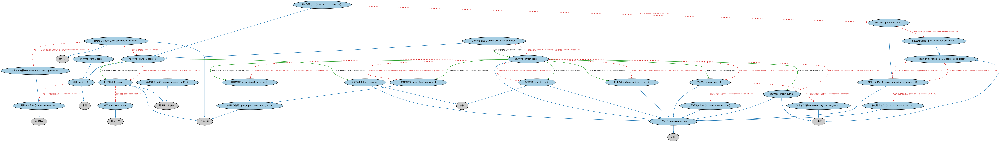

# 地址本体（Addresses Ontology）结构与公理说明

本文档对应 `Addresses.rdf` / `Addresses.ttl`，说明该本体的类、继承关系、属性和公理约定。结构图见 `Addresses-structure.png`（`Addresses-structure.svg` 为可缩放版本）。

## 1. 本体概述

定义邮政地址（postal address）及其组成部分：街道、城市、邮编、国家。

**在体系中的位置**：FND 地点模块的基础本体，机构注册地、通讯地址的标准模型。

**上下游关系**：上游依赖地点与指称相关概念；下游被美国邮政地址本体特化，被 BE、FBC、LOAN 引用（注册地、抵押物地址）。

**与相近概念的差别**：地址≠地点——地点是空间位置本身，地址是指代地点的文字结构；与虚拟地点的差别——一个物理、一个电子。

本本体中类与类的核心关系如下（完整细节见各类小节）：

- **地址（address）** 继承 **索引（Index）**
- **地址成分（address component）** 继承 **方面（Aspect）**
- **地址编制方案（addressing scheme）** 继承 **索引方案（IndexingScheme）**
- **常规街道地址（conventional street address）** 继承 **物理地址（physical address）**
- **地理方位符号（geographic directional symbol）** 继承 **代码元素（CodeElement）**
- **物理地址（physical address）** 继承 **地址（address）**
- **物理地址标识符（physical address identifier）** 继承 **代码元素（CodeElement）**
- **物理地址标识符（physical address identifier）** 继承 **标识符（Identifier）**
- **物理地址编制方案（physical addressing scheme）** 继承 **地址编制方案（addressing scheme）**
- **邮区（post code area）** 继承 **地理区域（GeographicRegion）**
- **邮政信箱（post office box）** 继承 **补充地址成分（supplemental address component）**
- **邮政信箱地址（post office box address）** 继承 **物理地址（physical address）**
- 其余 30 条关系从略。

## 2. 类（Class）

| 类（Class） | 定义（Definition） |
|---|---|
| 地址（address） | 通信可送达之位置的索引。 index to a location to which communications may be delivered |
| 地址成分（address component） | 地址的某个方面。 aspect of an address |
| 地址编制方案（addressing scheme） | 为对象分配地址的体系。 system for allocating addresses to objects |
| 常规街道地址（conventional street address） | 标识通信可送达之街道位置的物理地址。 physical address that identifies a location on a street to which communications may be delivered |
| 地理方位符号（geographic directional symbol） | 为邮政投递提供方位信息的代码元素。 code element that gives directional information for postal delivery |
| 物理地址（physical address） | 可为任何组织或个人送达通信、送达文书或找到代表的物理地址。 physical address where communications can be addressed, papers served or representatives located for any kind of organization or person |
| 物理地址标识符（physical address identifier） | 物理地址的唯一标识符。 unique identifier for a physical address |
| 物理地址编制方案（physical addressing scheme） | 按国家特定标准指明物理地址的方案。 scheme for specifying physical addresses according to a country specific standard |
| 邮区（post code area） | 由某邮政编码唯一标识的物理区域。 physical area uniquely identified by some postal code |
| 邮政信箱（post office box） | 与某地址关联的邮政信箱。 post office box associated with an address |
| 邮政信箱地址（post office box address） | 用于将通信投递到当地邮局（或该管辖区等同机构）指定信箱的物理地址。 physical address used to deliver communications to a designated container at a local post office or the local equivalent for the jurisdiction, where mail is held until the recipient collects it, rather than to a given house, building, or other location |
| 邮政信箱指称符（post office box designator） | 与标识符一起用于邮政信箱的指称符。 designator used, together with an identifier, for a post office box |
| 邮政编码（postcode） | 用于辅助邮件分拣的字符序列。 sequence of characters used to assist in the sorting of mail |
| 后置方位符号（postdirectional symbol） | 街道地址中位于街道名称和街道后缀之后的地理方位符号。 geographic directional symbol that follows the street name and street suffix in a street address |
| 前置方位符号（predirectional symbol） | 街道地址中位于主门牌号之后、街道名称之前的地理方位符号。 geographic directional symbol that occurs after the primary street number but before the street name in a street address |
| 主门牌号（primary address number） | 相对于给定街道标识位置的地址成分。 address component that identifies a location with respect to a given street |
| 区域专用标识符（region-specific identifier） | 由国家或其他区域内部使用的地理区域或行政区划标识符。 geographic region or subdivision identifier used internally by a country or other region |
| 次级单元（secondary unit） | 标识给定街道地址处较大结构内的独立单元（如公寓、办公室、机库、泊位、邮箱等）的地址成分。 address component that identifies an individual unit within a larger structure, such as an apartment, office, hangar, slip, mailbox, and so forth, at a given street address |
| 次级单元指称符（secondary unit designator） | 较大设施内较小结构或组成部分（如公寓、办公室、邮件站等类似指称）的分类符。 classifier for a smaller structure or component within a larger facility, such as an apartment, office, mail stop, or other similar designation |
| 次级单元指示符（secondary unit indicator） | 指向特定街道地址处次级单元（如楼栋或公寓）内具体单元的索引。 index to the specific unit within a secondary unit, such as a building or apartment, at a particular street address |
| 街道地址（street address） | 由主门牌号、前置方位、街道名称、后缀、后置方位和可选次级单元组成的位置索引。 index to a location that consists of a primary address number, predirectional, street name, suffix, postdirectional, and an optional secondary unit |
| 街道名称（street name） | 某情境（如城市、市政区、地理区域）中街道的标识符。 identifier for a street in some context (e.g., city, municipality, geographic region) |
| 街道后缀（street suffix） | 街道或其他投递位置（如沿水道住所）的分类符。 classifier for a street or other delivery location, such as a dwelling located along a waterway |
| 建筑名称（structure name） | 楼宇、住宅、办公综合楼、购物中心或其他建筑或建筑群的名称。 name for a building, house, office complex, shopping center, or other structure or group of structures |
| 补充地址成分（supplemental address component） | 提供对确保通信正确投递重要的附加信息的地址成分。 address component that provides additional information that is important to ensuring proper delivery of communications |
| 补充地址指称符（supplemental address designator） | 补充地址信息（如公路合同路线、乡村路线、建筑综合体、购物中心、公寓综合体）的分类符。 classifier for supplemental address information, such as a highway contract route, rural route, building complex, shopping center, condominium complex, mail box, or other similar designation |
| 补充地址单元（supplemental address unit） | 包含与特定地址关联的特定路线、信箱、公寓或其他指示符或单元的地址成分。 address component that includes a specific route, box, apartment, condominium or other indicator or unit associated with a specific address |
| 虚拟地址（virtual address） | 标识虚拟（即非物理）位置的地址。 address identifying a virtual, i.e. non-physical, location |

以下按类逐个展开：每个类给出继承关系、相关属性与公理约定；子类在父类之下降一级编号。

### 2.1 地址（address）

定义：通信可送达之位置的索引。

- 父类：**索引（Index）**
- 直接子类：**物理地址（physical address）**、**虚拟地址（virtual address）**

属性：

| 属性 | 定义 | 说明 |
|---|---|---|
| **是…的索引（isIndexTo）** | — | — |
| **定义于（isDefinedIn）** | — | — |

公理：

- **定义于（isDefinedIn）**可以有 0 个或多个**地址编制方案（addressing scheme）**。
- **是…的索引（isIndexTo）**恰好有 1 个**位置（Location）**。

#### 2.1.1 物理地址（physical address）

定义：可为任何组织或个人送达通信、送达文书或找到代表的物理地址。

- 父类：**地址（address）**
- 直接子类：**常规街道地址（conventional street address）**、**邮政信箱地址（post office box address）**

属性：

| 属性 | 定义 | 说明 |
|---|---|---|
| **是…的索引（isIndexTo）** | — | — |
| **具有地址行 1（has address line 1）** | 街道地址的第一行。 the first line of the street address | 子属性：具有文本值 |
| **具有地址行 2（has address line 2）** | 街道地址的第二行。 the second line of the street address | 子属性：具有文本值 |
| **具有地址行 3（has address line 3）** | 街道地址的第三行。 the third line of the street address | 子属性：具有文本值 |
| **具有收件人行（has attention line）** | 可选的自由文本地址行，标明预期收件人。 an optional, free text address line denoting the intended recipient | 子属性：具有文本值 |
| **具有具体邮政编码（has individual postcode）** | 标识当地邮政部门规定的投递地址的本地或国际邮政编码元素。 indicates the local or international postcode element of a delivery address as specified by the local postal service | 值域：邮政编码（postcode）；子属性：包含 |
| **具有邮件路由（has mail routing）** | 可选的自由文本地址行，含明确的路由信息（该元素的存在表明此地址为路由/「转交」地址）。 an optional, free text address line containing explicit routing information (this elements's presence indicates that this address is a routing / 'care of' address) | 子属性：具有文本值 |
| **具有邮政编码（has postal code）** | 当地邮政部门规定的此地址的邮政编码。 the postal code of this address as specified by the local postal service | 子属性：具有文本值 |
| **具有建筑名称（has structure name）** | 指明楼宇、住宅、办公综合楼、购物中心或其他建筑或建筑群的标识符。 specifies an identifier for a building, house, office complex, shopping center, or other structure or group of structures | 值域：建筑名称（structure name）；子属性：包含 |
| **具有城市名称（hasCityName）** | — | — |
| **具有国家（hasCountry）** | — | — |
| **具有市政区（hasMunicipality）** | — | — |
| **具有行政区划（hasSubdivision）** | — | — |

公理：

- **具有具体邮政编码（has individual postcode）**至多有 1 个**邮政编码（postcode）**。
- **具有国家（hasCountry）**至多有 1 个**国家（Country）**。
- **具有城市名称（hasCityName）**存在取值约束。
- **具有市政区（hasMunicipality）**至多有 1 个**市政区（Municipality）**。
- **具有行政区划（hasSubdivision）**至少有一个取值，类型是**国家行政区划（CountrySubdivision）**。
- **具有邮政编码（has postal code）**存在取值约束。
- **是…的索引（isIndexTo）**可以有 0 个或多个**物理位置（PhysicalLocation）**。

##### 2.1.1.1 常规街道地址（conventional street address）

定义：标识通信可送达之街道位置的物理地址。

- 父类：**物理地址（physical address）**

属性：

| 属性 | 定义 | 说明 |
|---|---|---|
| **具有地址行 1（has address line 1）** | 街道地址的第一行。 the first line of the street address | 子属性：具有文本值 |
| **具有地址行 2（has address line 2）** | 街道地址的第二行。 the second line of the street address | 子属性：具有文本值 |
| **具有地址行 3（has address line 3）** | 街道地址的第三行。 the third line of the street address | 子属性：具有文本值 |
| **具有街道地址（has street address）** | 标识由主门牌号、前置方位、街道名称、后缀、后置方位和可选次级单元组成的完整地址成分。 indicates a fully-specified address component that consists of a primary address number, predirectional, street name, suffix, postdirectional, and an optional secondary unit | 值域：街道地址（street address）；子属性：包含 |

公理：

- **具有地址行 1（has address line 1）**存在取值约束。
- **具有地址行 2（has address line 2）**存在取值约束。
- **具有地址行 3（has address line 3）**存在取值约束。
- **具有街道地址（has street address）**至多有 1 个**街道地址（street address）**。

##### 2.1.1.2 邮政信箱地址（post office box address）

定义：用于将通信投递到当地邮局（或该管辖区等同机构）指定信箱的物理地址。

- 父类：**物理地址（physical address）**

属性：

| 属性 | 定义 | 说明 |
|---|---|---|
| **包含（comprises）** | — | — |

公理：

- **包含（comprises）**恰好有 1 个**邮政信箱（post office box）**。

#### 2.1.2 虚拟地址（virtual address）

定义：标识虚拟（即非物理）位置的地址。

- 父类：**地址（address）**

属性：

| 属性 | 定义 | 说明 |
|---|---|---|
| **具有标签（hasTag）** | — | — |

公理：

- **具有标签（hasTag）**存在取值约束。
- 与**物理地址（physical address）**互斥：同一个体不能同时属于两者。

### 2.2 地址成分（address component）

定义：地址的某个方面。

- 父类：**方面（Aspect）**
- 直接子类：**主门牌号（primary address number）**、**次级单元（secondary unit）**、**次级单元指示符（secondary unit indicator）**、**街道地址（street address）**、**街道名称（street name）**、**街道后缀（street suffix）**、**建筑名称（structure name）**、**补充地址成分（supplemental address component）**、**补充地址单元（supplemental address unit）**

#### 2.2.1 主门牌号（primary address number）

定义：相对于给定街道标识位置的地址成分。

- 父类：**地址成分（address component）**

属性：

| 属性 | 定义 | 说明 |
|---|---|---|
| **具有标签（hasTag）** | — | — |

公理：

- **具有标签（hasTag）**存在取值约束。

#### 2.2.2 次级单元（secondary unit）

定义：标识给定街道地址处较大结构内的独立单元（如公寓、办公室、机库、泊位、邮箱等）的地址成分。

- 父类：**地址成分（address component）**

属性：

| 属性 | 定义 | 说明 |
|---|---|---|
| **包含（comprises）** | — | — |

公理：

- **包含（comprises）**可以有 0 个或多个**次级单元指示符（secondary unit indicator）**。
- **包含（comprises）**恰好有 1 个**次级单元指称符（secondary unit designator）**。

#### 2.2.3 次级单元指示符（secondary unit indicator）

定义：指向特定街道地址处次级单元（如楼栋或公寓）内具体单元的索引。

- 父类：**地址成分（address component）**

属性：

| 属性 | 定义 | 说明 |
|---|---|---|
| **具有标签（hasTag）** | — | — |

公理：

- **具有标签（hasTag）**存在取值约束。

#### 2.2.4 街道地址（street address）

定义：由主门牌号、前置方位、街道名称、后缀、后置方位和可选次级单元组成的位置索引。

- 父类：**地址成分（address component）**

属性：

| 属性 | 定义 | 说明 |
|---|---|---|
| **具有后置方位符号（has postdirectional symbol）** | 指明街道地址中位于街道名称和街道后缀之后的地理方位符号。 specifies a geographic directional symbol that follows the street name and street suffix in a street address | 值域：后置方位符号（postdirectional symbol）；子属性：包含 |
| **具有前置方位符号（has predirectional symbol）** | 指明街道地址中位于主门牌号之后、街道名称之前的地理方位符号。 specifies a geographic directional symbol that occurs after the primary street number but before the street name in a street address | 值域：前置方位符号（predirectional symbol）；子属性：包含 |
| **具有主门牌号（has primary address number）** | 指明相对于给定街道的位置。 specifies a a location with respect to a given street | 值域：主门牌号（primary address number）；子属性：包含 |
| **具有次级单元（has secondary unit）** | 指明给定街道地址处较大结构内的独立单元，如公寓、办公室、机库、泊位、邮箱等。 specifies an individual unit within a larger structure, such as an apartment, office, hangar, slip, mailbox, and so forth, at a given street address | 值域：次级单元（secondary unit）；子属性：包含 |
| **具有街道名称（has street name）** | 指明某情境中街道的标识符（如 Baker、First、Main）。 specifies an identifier for a street in some context (e.g., 'Baker', 'First', 'Main') | 值域：街道名称（street name）；子属性：包含 |
| **具有街道后缀（has street suffix）** | 指明街道或其他投递位置的附加限定符。 specifies an additional qualifier for a street or other delivery location, such as a dwelling located along a waterway | 值域：街道后缀（street suffix）；子属性：包含 |

公理：

- **具有主门牌号（has primary address number）**至多有 1 个**主门牌号（primary address number）**。
- **具有前置方位符号（has predirectional symbol）**可以有 0 个或多个**前置方位符号（predirectional symbol）**。
- **具有后置方位符号（has postdirectional symbol）**可以有 0 个或多个**后置方位符号（postdirectional symbol）**。
- **具有次级单元（has secondary unit）**可以有 0 个或多个**次级单元（secondary unit）**。
- **具有街道名称（has street name）**至少有一个取值，类型是**街道名称（street name）**。
- **具有街道后缀（has street suffix）**可以有 0 个或多个**街道后缀（street suffix）**。

#### 2.2.5 街道名称（street name）

定义：某情境（如城市、市政区、地理区域）中街道的标识符。

- 父类：**地址成分（address component）**、**名称（Name）**

属性：

| 属性 | 定义 | 说明 |
|---|---|---|
| **具有标签（hasTag）** | — | — |

公理：

- **具有标签（hasTag）**存在取值约束。

#### 2.2.6 街道后缀（street suffix）

定义：街道或其他投递位置（如沿水道住所）的分类符。

- 父类：**地址成分（address component）**、**分类符（Classifier）**

#### 2.2.7 建筑名称（structure name）

定义：楼宇、住宅、办公综合楼、购物中心或其他建筑或建筑群的名称。

- 父类：**地址成分（address component）**、**名称（Name）**

属性：

| 属性 | 定义 | 说明 |
|---|---|---|
| **具有标签（hasTag）** | — | — |

公理：

- **具有标签（hasTag）**存在取值约束。

#### 2.2.8 补充地址成分（supplemental address component）

定义：提供对确保通信正确投递重要的附加信息的地址成分。

- 父类：**地址成分（address component）**
- 直接子类：**邮政信箱（post office box）**

属性：

| 属性 | 定义 | 说明 |
|---|---|---|
| **包含（comprises）** | — | — |
| **具有标签（hasTag）** | — | — |

公理：

- **具有标签（hasTag）**存在取值约束。
- **包含（comprises）**可以有 0 个或多个**补充地址单元（supplemental address unit）**。
- **包含（comprises）**恰好有 1 个**补充地址指称符（supplemental address designator）**。

##### 2.2.8.1 邮政信箱（post office box）

定义：与某地址关联的邮政信箱。

- 父类：**补充地址成分（supplemental address component）**

属性：

| 属性 | 定义 | 说明 |
|---|---|---|
| **包含（comprises）** | — | — |

公理：

- **包含（comprises）**恰好有 1 个**邮政信箱指称符（post office box designator）**。

#### 2.2.9 补充地址单元（supplemental address unit）

定义：包含与特定地址关联的特定路线、信箱、公寓或其他指示符或单元的地址成分。

- 父类：**地址成分（address component）**

属性：

| 属性 | 定义 | 说明 |
|---|---|---|
| **具有标签（hasTag）** | — | — |

公理：

- **具有标签（hasTag）**存在取值约束。

### 2.3 地址编制方案（addressing scheme）

定义：为对象分配地址的体系。

- 父类：**索引方案（IndexingScheme）**
- 直接子类：**物理地址编制方案（physical addressing scheme）**

属性：

| 属性 | 定义 | 说明 |
|---|---|---|
| **定义（defines）** | — | — |

公理：

- **定义（defines）**的所有取值只能是**地址（address）**。

#### 2.3.1 物理地址编制方案（physical addressing scheme）

定义：按国家特定标准指明物理地址的方案。

- 父类：**地址编制方案（addressing scheme）**

公理：

- 该属性存在取值约束。

### 2.4 地理方位符号（geographic directional symbol）

定义：为邮政投递提供方位信息的代码元素。

- 父类：**代码元素（CodeElement）**
- 直接子类：**后置方位符号（postdirectional symbol）**、**前置方位符号（predirectional symbol）**

属性：

| 属性 | 定义 | 说明 |
|---|---|---|
| **具有标签（hasTag）** | — | — |

公理：

- **具有标签（hasTag）**至少有一个取值，类型是**xsd:string（string）**。

#### 2.4.1 后置方位符号（postdirectional symbol）

定义：街道地址中位于街道名称和街道后缀之后的地理方位符号。

- 父类：**地理方位符号（geographic directional symbol）**

#### 2.4.2 前置方位符号（predirectional symbol）

定义：街道地址中位于主门牌号之后、街道名称之前的地理方位符号。

- 父类：**地理方位符号（geographic directional symbol）**

### 2.5 物理地址标识符（physical address identifier）

定义：物理地址的唯一标识符。

- 父类：**代码元素（CodeElement）**、**标识符（Identifier）**

属性：

| 属性 | 定义 | 说明 |
|---|---|---|
| **是……的成员（isMemberOf）** | — | — |
| **标识（identifies）** | — | — |

公理：

- **是……的成员（isMemberOf）**恰好有 1 个**物理地址编制方案（physical addressing scheme）**。
- **标识（identifies）**恰好有 1 个**物理地址（physical address）**。

### 2.6 邮区（post code area）

定义：由某邮政编码唯一标识的物理区域。

- 父类：**地理区域（GeographicRegion）**

### 2.7 邮政编码（postcode）

定义：用于辅助邮件分拣的字符序列。

- 父类：**代码元素（CodeElement）**、**地理区域标识符（GeographicRegionIdentifier）**

属性：

| 属性 | 定义 | 说明 |
|---|---|---|
| **标识（identifies）** | — | — |

公理：

- **标识（identifies）**恰好有 1 个**邮区（post code area）**。

### 2.8 区域专用标识符（region-specific identifier）

定义：由国家或其他区域内部使用的地理区域或行政区划标识符。

- 父类：**地理区域标识符（GeographicRegionIdentifier）**

属性：

| 属性 | 定义 | 说明 |
|---|---|---|
| **被……使用（isUsedBy）** | — | — |

公理：

- **被……使用（isUsedBy）**至少有一个取值，类型是**地缘政治实体（GeopoliticalEntity）**。

### 2.9 次级单元指称符（secondary unit designator）

定义：较大设施内较小结构或组成部分（如公寓、办公室、邮件站等类似指称）的分类符。

- 父类：**分类符（Classifier）**

属性：

| 属性 | 定义 | 说明 |
|---|---|---|
| **需要次级单元范围（requires secondary unit range）** | 若为真，表明需要附加限定符（如公寓号）才能完整描述投递点。 if true, indicates that an additional qualifier is needed to complete the delivery point description, such as an apartment number | 值域：xsd:boolean；子属性：具有文本值 |

公理：

- **需要次级单元范围（requires secondary unit range）**存在取值约束。

### 2.10 补充地址指称符（supplemental address designator）

定义：补充地址信息（如公路合同路线、乡村路线、建筑综合体、购物中心、公寓综合体）的分类符。

- 父类：**分类符（Classifier）**
- 直接子类：**邮政信箱指称符（post office box designator）**

属性：

| 属性 | 定义 | 说明 |
|---|---|---|
| **分类（classifies）** | — | — |

公理：

- **分类（classifies）**至少有一个取值，类型是**补充地址成分（supplemental address component）**。

#### 2.10.1 邮政信箱指称符（post office box designator）

定义：与标识符一起用于邮政信箱的指称符。

- 父类：**补充地址指称符（supplemental address designator）**

## 3. 其他属性

以下属性未绑定到本体的具体类（定义域在外部本体或未声明）：

对象属性（Object Property）：

| 属性 | 定义 | 说明 |
|---|---|---|
| **具有地址（has address）** | 标识可据以定位或联系某事物（如网络地址情形）或某实体、或可接收函件的方式。 indicates a means by which something (in the case of a network address) or some entity may be located or contacted or may receive correspondence | 值域：地址（address）；子属性：以……为特征 |
| **具有转写地址（has transliterated address）** | 标识注册实体的转写（即拉丁化或罗马化 ASCII）地址。 identifies a transliterated (i.e., in Latin or Romanized ASCII) address for the registered entity | 值域：地址（address）；子属性：具有地址（has address） |

## 4. 依赖（owl:imports，13 个）

本本体通过 `owl:imports` 引入以下本体，各项的中文名称与简介如下：

| 导入本体 | 中文名称 | 简介 |
|---|---|---|
| `FND/Arrangements/IdentifiersAndIndices.rdf` | 标识符与索引本体（Identifiers and Indices Ontology） | 定义标识符（identifier）、标识方案与索引（index）的基本结构，是 ISIN、LEI、CUSIP 等编码体系建模的基础。 |
| `FND/Utilities/Analytics.rdf` | 分析本体（Analytics Ontology） | 定义分析工具、度量与比率的通用概念，支撑指标与模型的表达。 |
| `FND/Utilities/AnnotationVocabulary.rdf` | FIBO 标注词汇表（FIBO Annotation Vocabulary） | 定义 FIBO 专用的标注属性（如释义来源、成熟度等级），用于本体自身的元数据标注。 |
| `https://www.omg.org/spec/Commons/AnnotationVocabulary/` | OMG 通用标注词汇表（OMG Commons Annotation Vocabulary） | OMG 通用本体库（Commons）中的标注词汇表，提供概念映射等标注属性，FIBO 用它标注术语与外部标准的对应关系。 |
| `https://www.omg.org/spec/Commons/Classifiers/` | OMG 通用分类器本体（OMG Commons Classifiers） | OMG 通用本体库（Commons）中的分类器本体，定义分类方案、类别与归类关系的通用概念，FIBO 的分类建模建立在其上。 |
| `https://www.omg.org/spec/Commons/CodesAndCodeSets/` | OMG 通用代码与代码集本体（OMG Commons Codes and Code Sets） | Commons 库中的代码本体，定义代码、代码集及其维护方的通用概念，是 ISO 4217、ISO 3166 等编码体系建模的基础。 |
| `https://www.omg.org/spec/Commons/Collections/` | OMG 通用集合本体（OMG Commons Collections） | Commons 库中的集合本体，定义集合、成员等通用概念。 |
| `https://www.omg.org/spec/Commons/ContextualDesignators/` | OMG 通用语境指称本体（OMG Commons Contextual Designators） | Commons 库中的语境指称本体，定义「在某个语境下指代某物的名称/符号」，是地址、账户号码等语境相关标识的基础。 |
| `https://www.omg.org/spec/Commons/Designators/` | OMG 通用指称符本体（OMG Commons Designators） | Commons 库中的指称符本体，定义名称、标识符等「指代某物的符号」的通用概念。 |
| `https://www.omg.org/spec/Commons/Identifiers/` | OMG 通用标识符本体（OMG Commons Identifiers） | Commons 库中的标识符本体，定义标识符及其编码方案的通用概念。 |
| `https://www.omg.org/spec/Commons/Locations/` | OMG 通用位置本体（OMG Commons Locations） | Commons 库中的位置本体，定义地理位置、地点的通用概念。 |
| `https://www.omg.org/spec/Commons/SitesAndFacilities/` | OMG 通用场所与设施本体（OMG Commons Sites and Facilities） | Commons 库中的场所与设施本体，定义物理场所、设施及其位置的通用概念。 |
| `https://www.omg.org/spec/Commons/TextDatatype/` | OMG 通用文本数据类型（OMG Commons Text Datatype） | Commons 库中的文本数据类型定义，提供带语言标记的文本等基础数据类型。 |

## 5. 文件

- 官方 RDF/XML：`Addresses.rdf`
- 中文 Turtle：`Addresses.ttl`
- 结构图：`Addresses-structure.png` / `Addresses-structure.svg`