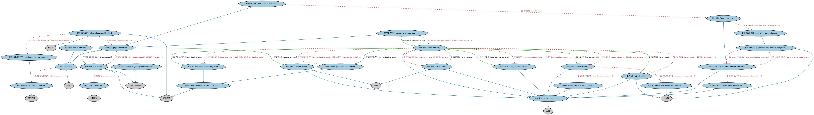

# 地址本体（Addresses Ontology）结构与公理说明

本文档对应 `Addresses.rdf` / `Addresses.ttl`，说明该本体的类、继承关系、属性和公理约定。结构图见 `Addresses-structure.png`（`Addresses-structure.svg` 为可缩放版本）。

## 1. 本体概述

定义邮政地址（postal address）及其组成部分：街道、城市、邮编、国家。

**在体系中的位置**：FND 地点模块的基础本体，机构注册地、通讯地址的标准模型。

**上下游关系**：上游依赖地点与指称相关概念；下游被美国邮政地址本体特化，被 BE、FBC、LOAN 引用（注册地、抵押物地址）。

**与相近概念的差别**：地址≠地点——地点是空间位置本身，地址是指代地点的文字结构；与虚拟地点的差别——一个物理、一个电子。

## 2. 类（Class）

| 类（Class） | 定义（Definition） |
|---|---|
| 地址（address） | 通信可送达之位置的索引。 |
| 地址成分（address component） | 地址的某个方面。 |
| 地址编制方案（addressing scheme） | 为对象分配地址的体系。 |
| 常规街道地址（conventional street address） | 标识通信可送达之街道位置的物理地址。 |
| 地理方位符号（geographic directional symbol） | 为邮政投递提供方位信息的代码元素。 |
| 物理地址（physical address） | 可为任何组织或个人送达通信、送达文书或找到代表的物理地址。 |
| 物理地址标识符（physical address identifier） | 物理地址的唯一标识符。 |
| 物理地址编制方案（physical addressing scheme） | 按国家特定标准指明物理地址的方案。 |
| 邮区（post code area） | 由某邮政编码唯一标识的物理区域。 |
| 邮政信箱（post office box） | 与某地址关联的邮政信箱。 |
| 邮政信箱地址（post office box address） | 用于将通信投递到当地邮局（或该管辖区等同机构）指定信箱的物理地址。 |
| 邮政信箱指称符（post office box designator） | 与标识符一起用于邮政信箱的指称符。 |
| 邮政编码（postcode） | 用于辅助邮件分拣的字符序列。 |
| 后置方位符号（postdirectional symbol） | 街道地址中位于街道名称和街道后缀之后的地理方位符号。 |
| 前置方位符号（predirectional symbol） | 街道地址中位于主门牌号之后、街道名称之前的地理方位符号。 |
| 主门牌号（primary address number） | 相对于给定街道标识位置的地址成分。 |
| 区域专用标识符（region-specific identifier） | 由国家或其他区域内部使用的地理区域或行政区划标识符。 |
| 次级单元（secondary unit） | 标识给定街道地址处较大结构内的独立单元（如公寓、办公室、机库、泊位、邮箱等）的地址成分。 |
| 次级单元指称符（secondary unit designator） | 较大设施内较小结构或组成部分（如公寓、办公室、邮件站等类似指称）的分类符。 |
| 次级单元指示符（secondary unit indicator） | 指向特定街道地址处次级单元（如楼栋或公寓）内具体单元的索引。 |
| 街道地址（street address） | 由主门牌号、前置方位、街道名称、后缀、后置方位和可选次级单元组成的位置索引。 |
| 街道名称（street name） | 某情境（如城市、市政区、地理区域）中街道的标识符。 |
| 街道后缀（street suffix） | 街道或其他投递位置（如沿水道住所）的分类符。 |
| 建筑名称（structure name） | 楼宇、住宅、办公综合楼、购物中心或其他建筑或建筑群的名称。 |
| 补充地址成分（supplemental address component） | 提供对确保通信正确投递重要的附加信息的地址成分。 |
| 补充地址指称符（supplemental address designator） | 补充地址信息（如公路合同路线、乡村路线、建筑综合体、购物中心、公寓综合体）的分类符。 |
| 补充地址单元（supplemental address unit） | 包含与特定地址关联的特定路线、信箱、公寓或其他指示符或单元的地址成分。 |
| 虚拟地址（virtual address） | 标识虚拟（即非物理）位置的地址。 |

### 2.1 继承关系（Inheritance）

- 地址（address） ⊑ 索引
- 地址成分（address component） ⊑ 方面
- 地址编制方案（addressing scheme） ⊑ 索引方案
- 常规街道地址（conventional street address） ⊑ 物理地址（physical address）
- 地理方位符号（geographic directional symbol） ⊑ 代码元素
- 物理地址（physical address） ⊑ 地址（address）
- 物理地址标识符（physical address identifier） ⊑ 代码元素
- 物理地址标识符（physical address identifier） ⊑ 标识符
- 物理地址编制方案（physical addressing scheme） ⊑ 地址编制方案（addressing scheme）
- 邮区（post code area） ⊑ 地理区域
- 邮政信箱（post office box） ⊑ 补充地址成分（supplemental address component）
- 邮政信箱地址（post office box address） ⊑ 物理地址（physical address）
- 邮政信箱指称符（post office box designator） ⊑ 补充地址指称符（supplemental address designator）
- 邮政编码（postcode） ⊑ 代码元素
- 邮政编码（postcode） ⊑ 地理区域标识符
- 后置方位符号（postdirectional symbol） ⊑ 地理方位符号（geographic directional symbol）
- 前置方位符号（predirectional symbol） ⊑ 地理方位符号（geographic directional symbol）
- 主门牌号（primary address number） ⊑ 地址成分（address component）
- 区域专用标识符（region-specific identifier） ⊑ 地理区域标识符
- 次级单元（secondary unit） ⊑ 地址成分（address component）
- 次级单元指称符（secondary unit designator） ⊑ 分类符
- 次级单元指示符（secondary unit indicator） ⊑ 地址成分（address component）
- 街道地址（street address） ⊑ 地址成分（address component）
- 街道名称（street name） ⊑ 地址成分（address component）
- 街道名称（street name） ⊑ 名称
- 街道后缀（street suffix） ⊑ 地址成分（address component）
- 街道后缀（street suffix） ⊑ 分类符
- 建筑名称（structure name） ⊑ 地址成分（address component）
- 建筑名称（structure name） ⊑ 名称
- 补充地址成分（supplemental address component） ⊑ 地址成分（address component）
- 补充地址指称符（supplemental address designator） ⊑ 分类符
- 补充地址单元（supplemental address unit） ⊑ 地址成分（address component）
- 虚拟地址（virtual address） ⊑ 地址（address）

## 3. 对象属性（Object Property）

| 属性（Property） | 中文（English） | 定义（Definition） | 说明 |
|---|---|---|---|
| fibo-fnd-plc-adr:hasAddress | 具有地址（has address） | 标识可据以定位或联系某事物（如网络地址情形）或某实体、或可接收函件的方式。 | 值域（range）：地址（address）；子属性（subPropertyOf）：以……为特征 |
| fibo-fnd-plc-adr:hasIndividualPostcode | 具有具体邮政编码（has individual postcode） | 标识当地邮政部门规定的投递地址的本地或国际邮政编码元素。 | 定义域（domain）：物理地址（physical address）；值域（range）：邮政编码（postcode）；子属性（subPropertyOf）：包含 |
| fibo-fnd-plc-adr:hasPostdirectionalSymbol | 具有后置方位符号（has postdirectional symbol） | 指明街道地址中位于街道名称和街道后缀之后的地理方位符号。 | 定义域（domain）：街道地址（street address）；值域（range）：后置方位符号（postdirectional symbol）；子属性（subPropertyOf）：包含 |
| fibo-fnd-plc-adr:hasPredirectionalSymbol | 具有前置方位符号（has predirectional symbol） | 指明街道地址中位于主门牌号之后、街道名称之前的地理方位符号。 | 定义域（domain）：街道地址（street address）；值域（range）：前置方位符号（predirectional symbol）；子属性（subPropertyOf）：包含 |
| fibo-fnd-plc-adr:hasPrimaryAddressNumber | 具有主门牌号（has primary address number） | 指明相对于给定街道的位置。 | 定义域（domain）：街道地址（street address）；值域（range）：主门牌号（primary address number）；子属性（subPropertyOf）：包含 |
| fibo-fnd-plc-adr:hasSecondaryUnit | 具有次级单元（has secondary unit） | 指明给定街道地址处较大结构内的独立单元，如公寓、办公室、机库、泊位、邮箱等。 | 定义域（domain）：街道地址（street address）；值域（range）：次级单元（secondary unit）；子属性（subPropertyOf）：包含 |
| fibo-fnd-plc-adr:hasStreetAddress | 具有街道地址（has street address） | 标识由主门牌号、前置方位、街道名称、后缀、后置方位和可选次级单元组成的完整地址成分。 | 定义域（domain）：常规街道地址（conventional street address）；值域（range）：街道地址（street address）；子属性（subPropertyOf）：包含 |
| fibo-fnd-plc-adr:hasStreetName | 具有街道名称（has street name） | 指明某情境中街道的标识符（如 Baker、First、Main）。 | 定义域（domain）：街道地址（street address）；值域（range）：街道名称（street name）；子属性（subPropertyOf）：包含 |
| fibo-fnd-plc-adr:hasStreetSuffix | 具有街道后缀（has street suffix） | 指明街道或其他投递位置的附加限定符。 | 定义域（domain）：街道地址（street address）；值域（range）：街道后缀（street suffix）；子属性（subPropertyOf）：包含 |
| fibo-fnd-plc-adr:hasStructureName | 具有建筑名称（has structure name） | 指明楼宇、住宅、办公综合楼、购物中心或其他建筑或建筑群的标识符。 | 定义域（domain）：物理地址（physical address）；值域（range）：建筑名称（structure name）；子属性（subPropertyOf）：包含 |
| fibo-fnd-plc-adr:hasTransliteratedAddress | 具有转写地址（has transliterated address） | 标识注册实体的转写（即拉丁化或罗马化 ASCII）地址。 | 值域（range）：地址（address）；子属性（subPropertyOf）：具有地址（has address） |

## 4. 数据属性（Datatype Property）

| 属性（Property） | 中文（English） | 定义（Definition） |
|---|---|---|
| fibo-fnd-plc-adr:hasAddressLine1 | 具有地址行 1（has address line 1） | 街道地址的第一行。 |
| fibo-fnd-plc-adr:hasAddressLine2 | 具有地址行 2（has address line 2） | 街道地址的第二行。 |
| fibo-fnd-plc-adr:hasAddressLine3 | 具有地址行 3（has address line 3） | 街道地址的第三行。 |
| fibo-fnd-plc-adr:hasAttentionLine | 具有收件人行（has attention line） | 可选的自由文本地址行，标明预期收件人。 |
| fibo-fnd-plc-adr:hasMailRouting | 具有邮件路由（has mail routing） | 可选的自由文本地址行，含明确的路由信息（该元素的存在表明此地址为路由/「转交」地址）。 |
| fibo-fnd-plc-adr:hasPostalCode | 具有邮政编码（has postal code） | 当地邮政部门规定的此地址的邮政编码。 |
| fibo-fnd-plc-adr:requiresSecondaryUnitRange | 需要次级单元范围（requires secondary unit range） | 若为真，表明需要附加限定符（如公寓号）才能完整描述投递点。 |

## 5. 公理约定（Axioms）

- 地址（address）：定义于 地址编制方案（addressing scheme） ≥0
- 地址（address）：是…的索引 位置 =1
- 地址编制方案（addressing scheme）：定义 only 地址（address）
- 常规街道地址（conventional street address）：具有街道地址（has street address） 街道地址（street address） ≤1
- 常规街道地址（conventional street address）：restriction
- 常规街道地址（conventional street address）：restriction
- 常规街道地址（conventional street address）：restriction
- 地理方位符号（geographic directional symbol）：具有标签 some xsd:string
- 物理地址（physical address）：具有具体邮政编码（has individual postcode） 邮政编码（postcode） ≤1
- 物理地址（physical address）：具有国家 国家 ≤1
- 物理地址（physical address）：具有市政区 市政区 ≤1
- 物理地址（physical address）：restriction
- 物理地址（physical address）：restriction
- 物理地址（physical address）：是…的索引 物理位置 ≥0
- 物理地址（physical address）：具有行政区划 some 国家行政区划
- 物理地址标识符（physical address identifier）：标识 物理地址（physical address） =1
- 物理地址标识符（physical address identifier）：是……的成员 物理地址编制方案（physical addressing scheme） =1
- 物理地址编制方案（physical addressing scheme）：restriction
- 邮政信箱（post office box）：包含 邮政信箱指称符（post office box designator） =1
- 邮政信箱地址（post office box address）：包含 邮政信箱（post office box） =1
- 邮政编码（postcode）：标识 邮区（post code area） =1
- 主门牌号（primary address number）：restriction
- 区域专用标识符（region-specific identifier）：被……使用 some 地缘政治实体
- 次级单元（secondary unit）：包含 次级单元指示符（secondary unit indicator） ≥0
- 次级单元（secondary unit）：包含 次级单元指称符（secondary unit designator） =1
- 次级单元指称符（secondary unit designator）：restriction
- 次级单元指示符（secondary unit indicator）：restriction
- 街道地址（street address）：具有主门牌号（has primary address number） 主门牌号（primary address number） ≤1
- 街道地址（street address）：具有后置方位符号（has postdirectional symbol） 后置方位符号（postdirectional symbol） ≥0
- 街道地址（street address）：具有前置方位符号（has predirectional symbol） 前置方位符号（predirectional symbol） ≥0
- 街道地址（street address）：具有次级单元（has secondary unit） 次级单元（secondary unit） ≥0
- 街道地址（street address）：具有街道后缀（has street suffix） 街道后缀（street suffix） ≥0
- 街道地址（street address）：具有街道名称（has street name） some 街道名称（street name）
- 街道名称（street name）：restriction
- 建筑名称（structure name）：restriction
- 补充地址成分（supplemental address component）：包含 补充地址单元（supplemental address unit） ≥0
- 补充地址成分（supplemental address component）：restriction
- 补充地址成分（supplemental address component）：包含 补充地址指称符（supplemental address designator） =1
- 补充地址指称符（supplemental address designator）：分类 some 补充地址成分（supplemental address component）
- 补充地址单元（supplemental address unit）：restriction
- 虚拟地址（virtual address）：restriction
- 虚拟地址（virtual address） 与 物理地址（physical address） 互斥（disjointWith）

## 6. 依赖（owl:imports，13 个）

本本体通过 `owl:imports` 引入以下本体，各项的中文名称与简介如下：

| 导入本体 | 中文名称 | 简介 |
|---|---|---|
| `FND/Arrangements/IdentifiersAndIndices.rdf` | 标识符与索引本体（Identifiers and Indices Ontology） | 定义标识符（identifier）、标识方案与索引（index）的基本结构，是 ISIN、LEI、CUSIP 等编码体系建模的基础。 |
| `FND/Utilities/Analytics.rdf` | 分析本体（Analytics Ontology） | 定义分析工具、度量与比率的通用概念，支撑指标与模型的表达。 |
| `FND/Utilities/AnnotationVocabulary.rdf` | FIBO 标注词汇表（FIBO Annotation Vocabulary） | 定义 FIBO 专用的标注属性（如释义来源、成熟度等级），用于本体自身的元数据标注。 |
| `https://www.omg.org/spec/Commons/AnnotationVocabulary/` | OMG 通用标注词汇表（OMG Commons Annotation Vocabulary） | OMG 通用本体库（Commons）中的标注词汇表，提供概念映射等标注属性，FIBO 用它标注术语与外部标准的对应关系。 |
| `https://www.omg.org/spec/Commons/Classifiers/` | OMG 通用分类器本体（OMG Commons Classifiers） | OMG 通用本体库（Commons）中的分类器本体，定义分类方案、类别与归类关系的通用概念，FIBO 的分类建模建立在其上。 |
| `https://www.omg.org/spec/Commons/CodesAndCodeSets/` | OMG 通用代码与代码集本体（OMG Commons Codes and Code Sets） | Commons 库中的代码本体，定义代码、代码集及其维护方的通用概念，是 ISO 4217、ISO 3166 等编码体系建模的基础。 |
| `https://www.omg.org/spec/Commons/Collections/` | OMG 通用集合本体（OMG Commons Collections） | Commons 库中的集合本体，定义集合、成员等通用概念。 |
| `https://www.omg.org/spec/Commons/ContextualDesignators/` | OMG 通用语境指称本体（OMG Commons Contextual Designators） | Commons 库中的语境指称本体，定义「在某个语境下指代某物的名称/符号」，是地址、账户号码等语境相关标识的基础。 |
| `https://www.omg.org/spec/Commons/Designators/` | OMG 通用指称符本体（OMG Commons Designators） | Commons 库中的指称符本体，定义名称、标识符等「指代某物的符号」的通用概念。 |
| `https://www.omg.org/spec/Commons/Identifiers/` | OMG 通用标识符本体（OMG Commons Identifiers） | Commons 库中的标识符本体，定义标识符及其编码方案的通用概念。 |
| `https://www.omg.org/spec/Commons/Locations/` | OMG 通用位置本体（OMG Commons Locations） | Commons 库中的位置本体，定义地理位置、地点的通用概念。 |
| `https://www.omg.org/spec/Commons/SitesAndFacilities/` | OMG 通用场所与设施本体（OMG Commons Sites and Facilities） | Commons 库中的场所与设施本体，定义物理场所、设施及其位置的通用概念。 |
| `https://www.omg.org/spec/Commons/TextDatatype/` | OMG 通用文本数据类型（OMG Commons Text Datatype） | Commons 库中的文本数据类型定义，提供带语言标记的文本等基础数据类型。 |

## 7. 文件

- 官方 RDF/XML：`Addresses.rdf`
- 中文 Turtle：`Addresses.ttl`
- 结构图：`Addresses-structure.png` / `Addresses-structure.svg`