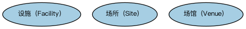

# 设施本体（Facilities Ontology）结构与公理说明

本文档对应 `Facilities.rdf` / `Facilities.ttl`，说明该本体的类、继承关系、属性和公理约定。结构图见 `Facilities-structure.png`（`Facilities-structure.svg` 为可缩放版本）。

## 1. 本体概述

本本体为描述设施相关概念提供脚手架，包括虚拟设施和实体设施，以及提供各种设施的实体场所。

## 2. 类（Class）

| 类（Class） | 定义（Definition） |
|---|---|
| 设施（Facility） | 可供使用的建筑、设备或服务。 |
| 场所（Site） | 具有特定位置的实体场地。 |
| 场馆（Venue） | 举办活动或交易的具体场所。 |

### 2.1 继承关系（Inheritance）

## 3. 对象属性（Object Property）

| 属性（Property） | 中文（English） | 定义（Definition） | 说明 |
|---|---|---|---|
| fibo-fnd-plc-fac:isSituatedAt | 位于（isSituatedAt） | 指示某事物所处的位置。 | — |
| fibo-fnd-plc-fac:situates | 安置（situates） | 标识某事物所处的地点、环境或情境。 | — |

## 6. 依赖（owl:imports，8 个）

本本体通过 `owl:imports` 引入以下本体，各项的中文名称与简介如下：

| 导入本体 | 中文名称 | 简介 |
|---|---|---|
| `FND/Places/Addresses.rdf` | 地址本体（Addresses Ontology） | 定义邮政地址及其组成部分，为机构注册地、通讯地址建模。 |
| `FND/Relations/Relations.rdf` | 关系本体（Relations Ontology） | FIBO 最底层的基础本体，定义参考（reference）、分类（classify）等通用关系与抽象概念，全库普遍依赖。 |
| `FND/Utilities/AnnotationVocabulary.rdf` | FIBO 标注词汇表（FIBO Annotation Vocabulary） | 定义 FIBO 专用的标注属性（如释义来源、成熟度等级），用于本体自身的元数据标注。 |
| `https://www.omg.org/spec/Commons/AnnotationVocabulary/` | OMG 通用标注词汇表（OMG Commons Annotation Vocabulary） | OMG 通用本体库（Commons）中的标注词汇表，提供概念映射等标注属性，FIBO 用它标注术语与外部标准的对应关系。 |
| `https://www.omg.org/spec/Commons/ContextualDesignators/` | OMG 通用语境指称本体（OMG Commons Contextual Designators） | Commons 库中的语境指称本体，定义「在某个语境下指代某物的名称/符号」，是地址、账户号码等语境相关标识的基础。 |
| `https://www.omg.org/spec/Commons/Organizations/` | OMG 通用组织本体（OMG Commons Organizations） | Commons 库中的组织本体，定义组织、组织成员与组织结构的通用概念。 |
| `https://www.omg.org/spec/Commons/RolesAndCompositions/` | OMG 通用角色与构成本体（OMG Commons Roles and Compositions） | Commons 库中的角色本体，定义角色及整体—部分构成关系的通用概念。 |
| `https://www.omg.org/spec/Commons/SitesAndFacilities/` | OMG 通用场所与设施本体（OMG Commons Sites and Facilities） | Commons 库中的场所与设施本体，定义物理场所、设施及其位置的通用概念。 |

## 7. 文件

- 官方 RDF/XML：`Facilities.rdf`
- 中文 Turtle：`Facilities.ttl`
- 结构图：`Facilities-structure.png` / `Facilities-structure.svg`