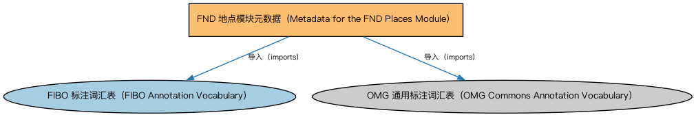

# FND 地点模块元数据（Metadata for the FND Places Module）说明

本文档对应 `MetadataFNDPlaces.rdf` / `MetadataFNDPlaces.ttl`。

## 1. 本文件是什么

声明地点（Places）模块的构成：地址、虚拟地点、不动产及美国邮政地址（含个体）等本体。

从机制上说，这是一个元数据清单（metadata manifest）文件：它本身不定义任何类或属性，而是通过 `dct:hasPart` 声明一个域或模块由哪些本体构成，并携带版本 IRI、版权、许可与成熟度等发布管理信息。它回答的问题是「这个域/模块包含什么、当前是什么版本」，供发布工具和文档系统按模块组织内容；它的 `owl:imports` 只引入标注词汇表，不是用来加载业务本体的入口（加载入口是 `All*` 与 `About*` 聚合文件）。

## 2. 声明的构成（dct:hasPart，5 个）

| 构成项 | 中文名称 | 简介 |
|---|---|---|
| `FND/Places/Addresses.rdf` | 地址本体（Addresses Ontology） | 定义邮政地址及其组成部分，为机构注册地、通讯地址建模。 |
| `FND/Places/NorthAmerica/USPostalServiceAddresses.rdf` | 美国邮政地址本体（U.S. Postal Service Addresses Ontology） | 定义符合美国邮政服务（USPS）规范的地址结构：街道、城市、州与邮编。 |
| `FND/Places/NorthAmerica/USPostalServiceAddressesIndividuals.rdf` | 美国邮政地址个体本体（U.S. Postal Service Addresses Individuals Ontology） | 收录美国州、地区等地址参考数据个体，供美国地址建模时引用。 |
| `FND/Places/RealProperty.rdf` | 不动产本体（Real Property Ontology） | 定义不动产（real property）及其与地点、所有权的关系，支撑抵押贷款与房地产金融。 |
| `FND/Places/VirtualPlaces.rdf` | 虚拟地点本体（Virtual Places Ontology） | 定义网站、电子邮箱等虚拟地点概念，补充物理地点之外的「场所」表达。 |

## 3. 标注依赖（owl:imports，2 个）

以下导入仅用于支撑元数据标注本身（如成熟度等级、概念映射），不属于业务内容：

| 导入本体 | 中文名称 | 简介 |
|---|---|---|
| `FND/Utilities/AnnotationVocabulary.rdf` | FIBO 标注词汇表（FIBO Annotation Vocabulary） | 定义 FIBO 专用的标注属性（如释义来源、成熟度等级），用于本体自身的元数据标注。 |
| `https://www.omg.org/spec/Commons/AnnotationVocabulary/` | OMG 通用标注词汇表（OMG Commons Annotation Vocabulary） | OMG 通用本体库（Commons）中的标注词汇表，提供概念映射等标注属性，FIBO 用它标注术语与外部标准的对应关系。 |

## 4. 文件

- 官方 RDF/XML：`MetadataFNDPlaces.rdf`
- 中文 Turtle：`MetadataFNDPlaces.ttl`
- 结构图：`MetadataFNDPlaces-structure.png` / `MetadataFNDPlaces-structure.svg`