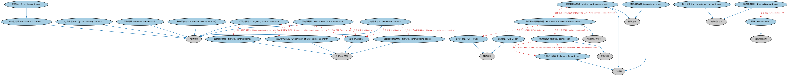

# 美国邮政地址本体（U.S. Postal Service Addresses Ontology）结构与公理说明

本文档对应 `USPostalServiceAddresses.rdf` / `USPostalServiceAddresses.ttl`，说明该本体的类、继承关系、属性和公理约定。结构图见 `USPostalServiceAddresses-structure.png`（`USPostalServiceAddresses-structure.svg` 为可缩放版本）。

## 1. 本体概述

定义符合美国邮政服务（USPS）规范的地址结构：街道、城市、州缩写、ZIP 邮编。

**在体系中的位置**：FND 地点模块的北美特化本体。

**上下游关系**：上游继承地址本体；下游配套的地址个体本体提供美国州等参考数据。

**与相近概念的差别**：与通用地址本体的差别——固化了美国特有的结构（州、ZIP 码格式），便于与美国数据对接。

## 2. 类（Class）

| 类（Class） | 定义（Definition） |
|---|---|
| 国务院地址（Department of State address） | 投递地址行以「UNIT」加单元标识符、再加「BOX」加信箱号代替街道地址的投递地址。 |
| 国务院单元成分（Department of State unit component） | 国务院地址中包含「UNIT」加单元标识符的成分。 |
| 波多黎各地址（Puerto Rico address） | 波多黎各投递点的投递地址，可含以缩写「URB」加城区名的补充地址行。 |
| 美国邮政地址标识符（U.S. Postal Service address identifier） | 与 ZIP+4 编码组合后，投递点编码为 USPS 服务的每个可投递地址提供唯一标识符。 |
| ZIP+4 编码（ZIP+4 Code） | 由五位数字、连字符和四位数字组成的九位号码，USPS 以其商标 ZIP+4 称之。 |
| 邮区编码（Zip Code） | 分配给投递地址、指明州和邮局或邮区的五位编码。 |
| 完整地址（complete address） | 具备全部必要地址元素、可与美国邮政 ZIP+4 及城市州文件精确匹配以获得投递点编码的投递地址。 |
| 投递地址代码集（delivery address code set） | 按美国邮政署 28 号出版物、替代特定投递点细节的数字代码体系。 |
| 投递点编码（delivery point code） | 分配给投递点的 00 至 99 之间的特定数字组。 |
| 投递点代码集（delivery point code set） | 按美国邮政署 28 号出版物、替代特定投递点细节的数字代码体系。 |
| 存局候领地址（general delivery address） | 以「GENERAL DELIVERY」字样（最好大写、完整拼写不缩写）代替街道地址的投递地址。 |
| 公路合同地址（highway contract address） | 投递地址行以缩写「HC」加路线标识符、再加「BOX」加信箱号代替街道地址的投递地址。 |
| 公路合同路线（highway contract route） | 与某地址关联的公路合同路线。 |
| 公路合同路线地址（highway contract route address） | 乡村地区城市或镇区界限之外、与某地址关联的邮路。 |
| 国际地址（international address） | 明确包含国家的物理地址。 |
| 信箱（mailbox） | 与某地址关联的、非美国邮政局信箱的信箱。 |
| 海外军事地址（overseas military address） | 投递地址行使用部队或指挥单位缩写（如 CMR、PSC、UNIT 或 HC）加单元编号的投递地址。 |
| 私人信箱地址（private mail box address） | 由商业邮件接收公司提供的投递地址，含以缩写「PMB」开头的补充地址行。 |
| 乡村路线地址（rural route address） | 投递地址行以缩写「RR」加路线标识符、再加「BOX」加信箱号代替街道地址的投递地址。 |
| 标准化地址（standardized address） | 按邮政标准缩写完整拼写的投递地址。 |
| 城区（urbanization） | 较大地理区域中的片区、分区或开发区。 |
| 邮区编码方案（zip code scheme） | 美国用于便利邮件投递的体系，由直接印在地址后的五位或九位区域改进计划（ZIP）编码构成。 |

### 2.1 继承关系（Inheritance）

- 国务院地址（Department of State address） ⊑ 物理地址
- 国务院单元成分（Department of State unit component） ⊑ 补充地址成分
- 波多黎各地址（Puerto Rico address） ⊑ 常规街道地址
- 美国邮政地址标识符（U.S. Postal Service address identifier） ⊑ 物理地址标识符
- ZIP+4 编码（ZIP+4 Code） ⊑ 邮政编码
- 邮区编码（Zip Code） ⊑ 邮政编码
- 完整地址（complete address） ⊑ 标准化地址（standardized address）
- 投递地址代码集（delivery address code set） ⊑ 代码集
- 投递地址代码集（delivery address code set） ⊑ 标识方案
- 投递点编码（delivery point code） ⊑ 代码元素
- 投递点代码集（delivery point code set） ⊑ 代码集
- 存局候领地址（general delivery address） ⊑ 物理地址
- 公路合同地址（highway contract address） ⊑ 物理地址
- 公路合同路线（highway contract route） ⊑ 补充地址成分
- 公路合同路线地址（highway contract route address） ⊑ 补充地址成分
- 国际地址（international address） ⊑ 物理地址
- 信箱（mailbox） ⊑ 补充地址成分
- 海外军事地址（overseas military address） ⊑ 物理地址
- 私人信箱地址（private mail box address） ⊑ 常规街道地址
- 乡村路线地址（rural route address） ⊑ 物理地址
- 标准化地址（standardized address） ⊑ 物理地址
- 城区（urbanization） ⊑ 国家行政区划
- 邮区编码方案（zip code scheme） ⊑ 代码集
- 邮区编码方案（zip code scheme） ⊑ 标识方案

## 3. 对象属性（Object Property）

| 属性（Property） | 中文（English） | 定义（Definition） | 说明 |
|---|---|---|---|
| fibo-fnd-plc-uspsa:hasUrbanization | 具有城区（has urbanization） | 标识与投递地址相关的地理区域内的片区、分区或开发区。 | 值域（range）：城区（urbanization）；子属性（subPropertyOf）：包含 |

## 5. 公理约定（Axioms）

- 国务院地址（Department of State address）：restriction
- 国务院地址（Department of State address）：包含 国务院单元成分（Department of State unit component） =1
- 国务院地址（Department of State address）：包含 信箱（mailbox） =1
- 国务院地址（Department of State address） 与 常规街道地址 互斥（disjointWith）
- 国务院单元成分（Department of State unit component）：restriction
- 波多黎各地址（Puerto Rico address）：包含 城区（urbanization） ≥0
- 美国邮政地址标识符（U.S. Postal Service address identifier）：包含 投递点编码（delivery point code） =1
- 美国邮政地址标识符（U.S. Postal Service address identifier）：包含 ZIP+4 编码（ZIP+4 Code） =1
- 投递地址代码集（delivery address code set）：具有成员 some 美国邮政地址标识符（U.S. Postal Service address identifier）
- 投递点编码（delivery point code）：是……的成员 投递点代码集（delivery point code set） =1
- 投递点编码（delivery point code）：restriction
- 投递点代码集（delivery point code set）：具有成员 some 投递点编码（delivery point code）
- 存局候领地址（general delivery address）：restriction
- 存局候领地址（general delivery address） 与 常规街道地址 互斥（disjointWith）
- 公路合同地址（highway contract address）：包含 公路合同路线（highway contract route） =1
- 公路合同地址（highway contract address）：包含 信箱（mailbox） =1
- 公路合同地址（highway contract address） 与 常规街道地址 互斥（disjointWith）
- 公路合同路线（highway contract route）：restriction
- 公路合同路线地址（highway contract route address）：restriction
- 信箱（mailbox）：restriction
- 海外军事地址（overseas military address）：具有地址行 1 some rdfs:Literal
- 海外军事地址（overseas military address）：具有城市名称 some（restriction）
- 海外军事地址（overseas military address） 与 常规街道地址 互斥（disjointWith）
- 乡村路线地址（rural route address）：包含 信箱（mailbox） =1
- 乡村路线地址（rural route address）：包含 公路合同路线地址（highway contract route address） =1
- 乡村路线地址（rural route address） 与 常规街道地址 互斥（disjointWith）
- 邮区编码方案（zip code scheme）：具有成员 some（restriction）

## 6. 依赖（owl:imports，8 个）

本本体通过 `owl:imports` 引入以下本体，各项的中文名称与简介如下：

| 导入本体 | 中文名称 | 简介 |
|---|---|---|
| `FND/Places/Addresses.rdf` | 地址本体（Addresses Ontology） | 定义邮政地址及其组成部分，为机构注册地、通讯地址建模。 |
| `FND/Utilities/AnnotationVocabulary.rdf` | FIBO 标注词汇表（FIBO Annotation Vocabulary） | 定义 FIBO 专用的标注属性（如释义来源、成熟度等级），用于本体自身的元数据标注。 |
| `https://www.omg.org/spec/Commons/AnnotationVocabulary/` | OMG 通用标注词汇表（OMG Commons Annotation Vocabulary） | OMG 通用本体库（Commons）中的标注词汇表，提供概念映射等标注属性，FIBO 用它标注术语与外部标准的对应关系。 |
| `https://www.omg.org/spec/Commons/CodesAndCodeSets/` | OMG 通用代码与代码集本体（OMG Commons Codes and Code Sets） | Commons 库中的代码本体，定义代码、代码集及其维护方的通用概念，是 ISO 4217、ISO 3166 等编码体系建模的基础。 |
| `https://www.omg.org/spec/Commons/Collections/` | OMG 通用集合本体（OMG Commons Collections） | Commons 库中的集合本体，定义集合、成员等通用概念。 |
| `https://www.omg.org/spec/Commons/Designators/` | OMG 通用指称符本体（OMG Commons Designators） | Commons 库中的指称符本体，定义名称、标识符等「指代某物的符号」的通用概念。 |
| `https://www.omg.org/spec/Commons/Identifiers/` | OMG 通用标识符本体（OMG Commons Identifiers） | Commons 库中的标识符本体，定义标识符及其编码方案的通用概念。 |
| `https://www.omg.org/spec/Commons/Locations/` | OMG 通用位置本体（OMG Commons Locations） | Commons 库中的位置本体，定义地理位置、地点的通用概念。 |

## 7. 文件

- 官方 RDF/XML：`USPostalServiceAddresses.rdf`
- 中文 Turtle：`USPostalServiceAddresses.ttl`
- 结构图：`USPostalServiceAddresses-structure.png` / `USPostalServiceAddresses-structure.svg`