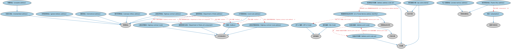

# 美国邮政地址本体（U.S. Postal Service Addresses Ontology）结构与公理说明

本文档对应 `USPostalServiceAddresses.rdf` / `USPostalServiceAddresses.ttl`，说明该本体的类、继承关系、属性和公理约定。结构图见 `USPostalServiceAddresses-structure.png`（`USPostalServiceAddresses-structure.svg` 为可缩放版本）。

## 1. 本体概述

定义符合美国邮政服务（USPS）规范的地址结构：街道、城市、州缩写、ZIP 邮编。

**在体系中的位置**：FND 地点模块的北美特化本体。

**上下游关系**：上游继承地址本体；下游配套的地址个体本体提供美国州等参考数据。

**与相近概念的差别**：与通用地址本体的差别——固化了美国特有的结构（州、ZIP 码格式），便于与美国数据对接。

本本体中类与类的核心关系如下（完整细节见各类小节）：

- **国务院地址（Department of State address）** 继承 **物理地址（PhysicalAddress）**
- **国务院单元成分（Department of State unit component）** 继承 **补充地址成分（SupplementalAddressComponent）**
- **波多黎各地址（Puerto Rico address）** 继承 **常规街道地址（ConventionalStreetAddress）**
- **美国邮政地址标识符（U.S. Postal Service address identifier）** 继承 **物理地址标识符（PhysicalAddressIdentifier）**
- **ZIP+4 编码（ZIP+4 Code）** 继承 **邮政编码（Postcode）**
- **邮区编码（Zip Code）** 继承 **邮政编码（Postcode）**
- **完整地址（complete address）** 继承 **标准化地址（standardized address）**
- **投递地址代码集（delivery address code set）** 继承 **代码集（CodeSet）**
- **投递地址代码集（delivery address code set）** 继承 **标识方案（IdentificationScheme）**
- **投递点编码（delivery point code）** 继承 **代码元素（CodeElement）**
- **投递点代码集（delivery point code set）** 继承 **代码集（CodeSet）**
- **存局候领地址（general delivery address）** 继承 **物理地址（PhysicalAddress）**
- 其余 12 条关系从略。

## 2. 类（Class）

| 类（Class） | 定义（Definition） |
|---|---|
| 国务院地址（Department of State address） | 投递地址行以「UNIT」加单元标识符、再加「BOX」加信箱号代替街道地址的投递地址。 delivery address whose delivery address line uses 'UNIT' followed by the unit identifier, followed by 'BOX' followed by box number, in place of a street address, 'DPO' as the literal value for the city, and the appropriate armed forces subdivision code in place of a subdivision (state) code |
| 国务院单元成分（Department of State unit component） | 国务院地址中包含「UNIT」加单元标识符的成分。 component of a Department of State address that includes 'UNIT' followed by the unit identifier |
| 波多黎各地址（Puerto Rico address） | 波多黎各投递点的投递地址，可含以缩写「URB」加城区名的补充地址行。 delivery address for a delivery point in Puerto Rico that may include a supplementary address line containing the abbreviation 'URB' followed by the name of the urbanization area that is appropriate for that address |
| 美国邮政地址标识符（U.S. Postal Service address identifier） | 与 ZIP+4 编码组合后，投递点编码为 USPS 服务的每个可投递地址提供唯一标识符。 combined with the ZIP + 4 code, the delivery point code provides a unique identifier for every deliverable address served by the USPS |
| ZIP+4 编码（ZIP+4 Code） | 由五位数字、连字符和四位数字组成的九位号码，USPS 以其商标 ZIP+4 称之。 nine-digit number consisting of five digits, a hyphen, and four digits, which the USPS describes by its trademark ZIP+4 |
| 邮区编码（Zip Code） | 分配给投递地址、指明州和邮局或邮区的五位编码。 five-digit code code assigned to a delivery address indicating the state and post office or postal zone |
| 完整地址（complete address） | 具备全部必要地址元素、可与美国邮政 ZIP+4 及城市州文件精确匹配以获得投递点编码的投递地址。 delivery address that has all the address elements necessary to allow an exact match with the current Postal Service ZIP+4 and City State files to obtain the finest level of ZIP+4 and delivery point codes for the delivery address |
| 投递地址代码集（delivery address code set） | 按美国邮政署 28 号出版物、替代特定投递点细节的数字代码体系。 system of numeric codes that substitute for specified delivery point details according to the U.S. Postal Service Publication 28 |
| 投递点编码（delivery point code） | 分配给投递点的 00 至 99 之间的特定数字组。 specific set of digits between 00 and 99 assigned to a delivery point |
| 投递点代码集（delivery point code set） | 按美国邮政署 28 号出版物、替代特定投递点细节的数字代码体系。 system of numeric codes that substitute for specified delivery point details according to the U.S. Postal Service Publication 28 |
| 存局候领地址（general delivery address） | 以「GENERAL DELIVERY」字样（最好大写、完整拼写不缩写）代替街道地址的投递地址。 delivery address that uses the words 'GENERAL DELIVERY', uppercase preferred, spelled out (no abbreviation), in place of a street address |
| 公路合同地址（highway contract address） | 投递地址行以缩写「HC」加路线标识符、再加「BOX」加信箱号代替街道地址的投递地址。 delivery address whose delivery address line uses the abbreviation 'HC', followed by the route identifier, followed by 'BOX' followed by box number, in place of a street address |
| 公路合同路线（highway contract route） | 与某地址关联的公路合同路线。 highway contract route associated with an address |
| 公路合同路线地址（highway contract route address） | 乡村地区城市或镇区界限之外、与某地址关联的邮路。 mail route outside the city or township limits in a rural area associated with an address |
| 国际地址（international address） | 明确包含国家的物理地址。 physical address that explicitly includes a country |
| 信箱（mailbox） | 与某地址关联的、非美国邮政局信箱的信箱。 mailbox, other than a U.S. Post Office box, associated with an address |
| 海外军事地址（overseas military address） | 投递地址行使用部队或指挥单位缩写（如 CMR、PSC、UNIT 或 HC）加单元编号的投递地址。 delivery address whose delivery address line uses an abbreviation for the unit or command such as 'CMR', 'PSC', or 'UNIT', or 'HC', followed by the unit identifier, followed by 'BOX' followed by box number, in place of a street address, either 'APO' or 'FPO' as the literal value for the city and the appropriate armed forces subdivision code in place of a subdivision (state) code |
| 私人信箱地址（private mail box address） | 由商业邮件接收公司提供的投递地址，含以缩写「PMB」开头的补充地址行。 delivery address provided by a commercial mail receiving company that includes a supplementary address line containing the abbreviation 'PMB' or the pound "#" symbol followed by the mailbox number; alternatively, 'PMB' or '#" and the mailbox number can be appended to the street address |
| 乡村路线地址（rural route address） | 投递地址行以缩写「RR」加路线标识符、再加「BOX」加信箱号代替街道地址的投递地址。 delivery address whose delivery address line uses the abbreviation 'RR', followed by the route identifier, followed by 'BOX' followed by box number, in place of a street address |
| 标准化地址（standardized address） | 按邮政标准缩写完整拼写的投递地址。 delivery address that is fully spelled out, abbreviated by using the Postal Service standard abbreviations or as given in the current Postal Service ZIP+4 file |
| 城区（urbanization） | 较大地理区域中的片区、分区或开发区。 an area, sector, or development within a larger geographic area |
| 邮区编码方案（zip code scheme） | 美国用于便利邮件投递的体系，由直接印在地址后的五位或九位区域改进计划（ZIP）编码构成。 system used in the U.S. to facilitate the delivery of mail, consisting of a five- or nine-digit code Zone Improvement Plan (ZIP) printed directly after the address, the first five digits (initial code) indicating the state and post office or postal zone, the last four (expanded code) the box section or number, portion of a rural route, building, or other specific delivery location |

以下按类逐个展开：每个类给出继承关系、相关属性与公理约定；子类在父类之下降一级编号。

### 2.1 国务院地址（Department of State address）

定义：投递地址行以「UNIT」加单元标识符、再加「BOX」加信箱号代替街道地址的投递地址。

- 父类：**物理地址（PhysicalAddress）**

属性：

| 属性 | 定义 | 说明 |
|---|---|---|
| **包含（comprises）** | — | — |
| **具有城市名称（hasCityName）** | — | — |

公理：

- **具有城市名称（hasCityName）**的取值固定为 DPO。
- **包含（comprises）**恰好有 1 个**信箱（mailbox）**。
- **包含（comprises）**恰好有 1 个**国务院单元成分（Department of State unit component）**。
- 与**常规街道地址（ConventionalStreetAddress）**互斥：同一个体不能同时属于两者。

### 2.2 国务院单元成分（Department of State unit component）

定义：国务院地址中包含「UNIT」加单元标识符的成分。

- 父类：**补充地址成分（SupplementalAddressComponent）**

属性：

| 属性 | 定义 | 说明 |
|---|---|---|
| **包含（comprises）** | — | — |

公理：

- **包含（comprises）**的取值固定为 Unit。

### 2.3 波多黎各地址（Puerto Rico address）

定义：波多黎各投递点的投递地址，可含以缩写「URB」加城区名的补充地址行。

- 父类：**常规街道地址（ConventionalStreetAddress）**

属性：

| 属性 | 定义 | 说明 |
|---|---|---|
| **包含（comprises）** | — | — |

公理：

- **包含（comprises）**可以有 0 个或多个**城区（urbanization）**。

### 2.4 美国邮政地址标识符（U.S. Postal Service address identifier）

定义：与 ZIP+4 编码组合后，投递点编码为 USPS 服务的每个可投递地址提供唯一标识符。

- 父类：**物理地址标识符（PhysicalAddressIdentifier）**

属性：

| 属性 | 定义 | 说明 |
|---|---|---|
| **包含（comprises）** | — | — |

公理：

- **包含（comprises）**恰好有 1 个**ZIP+4 编码（ZIP+4 Code）**。
- **包含（comprises）**恰好有 1 个**投递点编码（delivery point code）**。

### 2.5 ZIP+4 编码（ZIP+4 Code）

定义：由五位数字、连字符和四位数字组成的九位号码，USPS 以其商标 ZIP+4 称之。

- 父类：**邮政编码（Postcode）**

### 2.6 邮区编码（Zip Code）

定义：分配给投递地址、指明州和邮局或邮区的五位编码。

- 父类：**邮政编码（Postcode）**

### 2.7 投递地址代码集（delivery address code set）

定义：按美国邮政署 28 号出版物、替代特定投递点细节的数字代码体系。

- 父类：**代码集（CodeSet）**、**标识方案（IdentificationScheme）**

属性：

| 属性 | 定义 | 说明 |
|---|---|---|
| **具有成员（hasMember）** | — | — |

公理：

- **具有成员（hasMember）**至少有一个取值，类型是**美国邮政地址标识符（U.S. Postal Service address identifier）**。

### 2.8 投递点编码（delivery point code）

定义：分配给投递点的 00 至 99 之间的特定数字组。

- 父类：**代码元素（CodeElement）**

属性：

| 属性 | 定义 | 说明 |
|---|---|---|
| **是……的成员（isMemberOf）** | — | — |
| **具有标签（hasTag）** | — | — |

公理：

- **具有标签（hasTag）**存在取值约束。
- **是……的成员（isMemberOf）**恰好有 1 个**投递点代码集（delivery point code set）**。

### 2.9 投递点代码集（delivery point code set）

定义：按美国邮政署 28 号出版物、替代特定投递点细节的数字代码体系。

- 父类：**代码集（CodeSet）**

属性：

| 属性 | 定义 | 说明 |
|---|---|---|
| **具有成员（hasMember）** | — | — |

公理：

- **具有成员（hasMember）**至少有一个取值，类型是**投递点编码（delivery point code）**。

### 2.10 存局候领地址（general delivery address）

定义：以「GENERAL DELIVERY」字样（最好大写、完整拼写不缩写）代替街道地址的投递地址。

- 父类：**物理地址（PhysicalAddress）**

属性：

| 属性 | 定义 | 说明 |
|---|---|---|
| **具有地址行 1（hasAddressLine1）** | — | — |

公理：

- **具有地址行 1（hasAddressLine1）**的取值固定为 GENERAL DELIVERY。
- 与**常规街道地址（ConventionalStreetAddress）**互斥：同一个体不能同时属于两者。

### 2.11 公路合同地址（highway contract address）

定义：投递地址行以缩写「HC」加路线标识符、再加「BOX」加信箱号代替街道地址的投递地址。

- 父类：**物理地址（PhysicalAddress）**

属性：

| 属性 | 定义 | 说明 |
|---|---|---|
| **包含（comprises）** | — | — |

公理：

- **包含（comprises）**恰好有 1 个**信箱（mailbox）**。
- **包含（comprises）**恰好有 1 个**公路合同路线（highway contract route）**。
- 与**常规街道地址（ConventionalStreetAddress）**互斥：同一个体不能同时属于两者。

### 2.12 公路合同路线（highway contract route）

定义：与某地址关联的公路合同路线。

- 父类：**补充地址成分（SupplementalAddressComponent）**

属性：

| 属性 | 定义 | 说明 |
|---|---|---|
| **包含（comprises）** | — | — |

公理：

- **包含（comprises）**的取值固定为 HighwayContractRouteDesignator。

### 2.13 公路合同路线地址（highway contract route address）

定义：乡村地区城市或镇区界限之外、与某地址关联的邮路。

- 父类：**补充地址成分（SupplementalAddressComponent）**

属性：

| 属性 | 定义 | 说明 |
|---|---|---|
| **包含（comprises）** | — | — |

公理：

- **包含（comprises）**的取值固定为 RuralRouteDesignator。

### 2.14 国际地址（international address）

定义：明确包含国家的物理地址。

- 父类：**物理地址（PhysicalAddress）**

### 2.15 信箱（mailbox）

定义：与某地址关联的、非美国邮政局信箱的信箱。

- 父类：**补充地址成分（SupplementalAddressComponent）**

属性：

| 属性 | 定义 | 说明 |
|---|---|---|
| **包含（comprises）** | — | — |

公理：

- **包含（comprises）**的取值固定为 MailboxDesignator。

### 2.16 海外军事地址（overseas military address）

定义：投递地址行使用部队或指挥单位缩写（如 CMR、PSC、UNIT 或 HC）加单元编号的投递地址。

- 父类：**物理地址（PhysicalAddress）**

属性：

| 属性 | 定义 | 说明 |
|---|---|---|
| **具有地址行 1（hasAddressLine1）** | — | — |
| **具有城市名称（hasCityName）** | — | — |

公理：

- **具有地址行 1（hasAddressLine1）**至少有一个取值，类型是**rdfs:Literal（Literal）**。
- **具有城市名称（hasCityName）**至少有一个取值，该取值满足：该属性存在取值约束。
- 与**常规街道地址（ConventionalStreetAddress）**互斥：同一个体不能同时属于两者。

### 2.17 私人信箱地址（private mail box address）

定义：由商业邮件接收公司提供的投递地址，含以缩写「PMB」开头的补充地址行。

- 父类：**常规街道地址（ConventionalStreetAddress）**

### 2.18 乡村路线地址（rural route address）

定义：投递地址行以缩写「RR」加路线标识符、再加「BOX」加信箱号代替街道地址的投递地址。

- 父类：**物理地址（PhysicalAddress）**

属性：

| 属性 | 定义 | 说明 |
|---|---|---|
| **包含（comprises）** | — | — |

公理：

- **包含（comprises）**恰好有 1 个**信箱（mailbox）**。
- **包含（comprises）**恰好有 1 个**公路合同路线地址（highway contract route address）**。
- 与**常规街道地址（ConventionalStreetAddress）**互斥：同一个体不能同时属于两者。

### 2.19 标准化地址（standardized address）

定义：按邮政标准缩写完整拼写的投递地址。

- 父类：**物理地址（PhysicalAddress）**
- 直接子类：**完整地址（complete address）**

#### 2.19.1 完整地址（complete address）

定义：具备全部必要地址元素、可与美国邮政 ZIP+4 及城市州文件精确匹配以获得投递点编码的投递地址。

- 父类：**标准化地址（standardized address）**

### 2.20 城区（urbanization）

定义：较大地理区域中的片区、分区或开发区。

- 父类：**国家行政区划（CountrySubdivision）**

### 2.21 邮区编码方案（zip code scheme）

定义：美国用于便利邮件投递的体系，由直接印在地址后的五位或九位区域改进计划（ZIP）编码构成。

- 父类：**代码集（CodeSet）**、**标识方案（IdentificationScheme）**

属性：

| 属性 | 定义 | 说明 |
|---|---|---|
| **具有成员（hasMember）** | — | — |

公理：

- **具有成员（hasMember）**至少有一个取值，该取值满足：该属性存在取值约束。

## 3. 其他属性

以下属性未绑定到本体的具体类（定义域在外部本体或未声明）：

对象属性（Object Property）：

| 属性 | 定义 | 说明 |
|---|---|---|
| **具有城区（has urbanization）** | 标识与投递地址相关的地理区域内的片区、分区或开发区。 indicates area, sector, or development within a geographic area relevant to a delivery address | 值域：城区（urbanization）；子属性：包含 |

## 4. 依赖（owl:imports，8 个）

本本体通过 `owl:imports` 引入以下本体，各项的中文名称与简介如下：

| 导入本体 | 中文名称 | 简介 |
|---|---|---|
| `FND/Places/Addresses.rdf` | 地址本体（Addresses Ontology） | 定义邮政地址及其组成部分，为机构注册地、通讯地址建模。 |
| `FND/Utilities/AnnotationVocabulary.rdf` | FIBO 标注词汇表（FIBO Annotation Vocabulary） | 定义 FIBO 专用的标注属性（如释义来源、成熟度等级），用于本体自身的元数据标注。 |
| `https://www.omg.org/spec/Commons/AnnotationVocabulary/` | OMG 通用标注词汇表（OMG Commons Annotation Vocabulary） | OMG 通用本体库（Commons）中的标注词汇表，提供概念映射等标注属性，FIBO 用它标注术语与外部标准的对应关系。 |
| `https://www.omg.org/spec/Commons/CodesAndCodeSets/` | OMG 通用代码与代码集本体（OMG Commons Codes and Code Sets） | Commons 库中的代码本体，定义代码、代码集及其维护方的通用概念，是 ISO 4217、ISO 3166 等编码体系建模的基础。 |
| `https://www.omg.org/spec/Commons/Collections/` | OMG 通用集合本体（OMG Commons Collections） | Commons 库中的集合本体，定义集合、成员等通用概念。 |
| `https://www.omg.org/spec/Commons/Designators/` | OMG 通用指称符本体（OMG Commons Designators） | Commons 库中的指称符本体，定义名称、标识符等「指代某物的符号」的通用概念。 |
| `https://www.omg.org/spec/Commons/Identifiers/` | OMG 通用标识符本体（OMG Commons Identifiers） | Commons 库中的标识符本体，定义标识符及其编码方案的通用概念。 |
| `https://www.omg.org/spec/Commons/Locations/` | OMG 通用位置本体（OMG Commons Locations） | Commons 库中的位置本体，定义地理位置、地点的通用概念。 |

## 5. 文件

- 官方 RDF/XML：`USPostalServiceAddresses.rdf`
- 中文 Turtle：`USPostalServiceAddresses.ttl`
- 结构图：`USPostalServiceAddresses-structure.png` / `USPostalServiceAddresses-structure.svg`