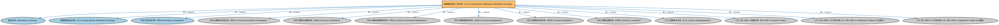

# 美国邮政地址个体本体（U.S. Postal Service Addresses Individuals Ontology）说明

本文档对应 `USPostalServiceAddressesIndividuals.rdf` / `USPostalServiceAddressesIndividuals.ttl`。

## 1. 本文件是什么

收录美国州、地区等地址参考数据个体，供美国地址建模时引用。

从机制上说，这是一个个体（individuals）文件：它本身不定义任何新的类或属性，装的全是命名个体（owl:NamedIndividual）——也就是一条条真实存在的实例数据（如具体的货币、市场、监管机构、法域）。它的 `owl:imports` 引入的是这些个体所属的类定义所在的本体。应用需要实例级参考数据时加载这类文件。

## 2. 个体构成（共 285 个）

按个体所属类型统计（类型名为中文（English）对照）：

| 类型（Class） | 个体数量 |
|---|---|
| 街道后缀（StreetSuffix） | 206 |
| 区域专用标识符（RegionSpecificIdentifier） | 73 |
| 国家行政区划（CountrySubdivision） | 3 |
| 地理区域标识符（GeographicRegionIdentifier） | 3 |

个体数量较多，仅举前 10 个示例，完整清单见同名 `.ttl` 文件：

| 个体（示例） | 类型 |
|---|---|
| AA | 区域专用标识符（RegionSpecificIdentifier） |
| AB | 区域专用标识符（RegionSpecificIdentifier） |
| AE | 区域专用标识符（RegionSpecificIdentifier） |
| AK | 区域专用标识符（RegionSpecificIdentifier） |
| AL | 区域专用标识符（RegionSpecificIdentifier） |
| AP | 区域专用标识符（RegionSpecificIdentifier） |
| AR | 区域专用标识符（RegionSpecificIdentifier） |
| AS | 区域专用标识符（RegionSpecificIdentifier） |
| AZ | 区域专用标识符（RegionSpecificIdentifier） |
| Armed Forces Americas | 国家行政区划（CountrySubdivision） |

## 3. 依赖的本体（owl:imports，13 个）

以下导入提供个体所属的类定义与相关参考数据：

| 导入本体 | 中文名称 | 简介 |
|---|---|---|
| `FND/Places/Addresses.rdf` | 地址本体（Addresses Ontology） | 定义邮政地址及其组成部分，为机构注册地、通讯地址建模。 |
| `FND/Places/NorthAmerica/USPostalServiceAddresses.rdf` | 美国邮政地址本体（U.S. Postal Service Addresses Ontology） | 定义符合美国邮政服务（USPS）规范的地址结构：街道、城市、州与邮编。 |
| `FND/Utilities/AnnotationVocabulary.rdf` | FIBO 标注词汇表（FIBO Annotation Vocabulary） | 定义 FIBO 专用的标注属性（如释义来源、成熟度等级），用于本体自身的元数据标注。 |
| `https://www.omg.org/spec/Commons/AnnotationVocabulary/` | OMG 通用标注词汇表（OMG Commons Annotation Vocabulary） | OMG 通用本体库（Commons）中的标注词汇表，提供概念映射等标注属性，FIBO 用它标注术语与外部标准的对应关系。 |
| `https://www.omg.org/spec/Commons/Classifiers/` | OMG 通用分类器本体（OMG Commons Classifiers） | OMG 通用本体库（Commons）中的分类器本体，定义分类方案、类别与归类关系的通用概念，FIBO 的分类建模建立在其上。 |
| `https://www.omg.org/spec/Commons/ContextualDesignators/` | OMG 通用语境指称本体（OMG Commons Contextual Designators） | Commons 库中的语境指称本体，定义「在某个语境下指代某物的名称/符号」，是地址、账户号码等语境相关标识的基础。 |
| `https://www.omg.org/spec/Commons/Designators/` | OMG 通用指称符本体（OMG Commons Designators） | Commons 库中的指称符本体，定义名称、标识符等「指代某物的符号」的通用概念。 |
| `https://www.omg.org/spec/Commons/Identifiers/` | OMG 通用标识符本体（OMG Commons Identifiers） | Commons 库中的标识符本体，定义标识符及其编码方案的通用概念。 |
| `https://www.omg.org/spec/Commons/Locations/` | OMG 通用位置本体（OMG Commons Locations） | Commons 库中的位置本体，定义地理位置、地点的通用概念。 |
| `https://www.omg.org/spec/LCC/Countries/CountryRepresentation/` | LCC 国家表示本体（LCC Country Representation） | OMG 国家语言代码库（LCC）中的国家表示本体，定义国家、国家标识等概念，是 ISO 3166 各国代码个体的类定义来源。 |
| `https://www.omg.org/spec/LCC/Countries/ISO3166-1-CountryCodes/` | LCC ISO 3166-1 国家代码（ISO 3166-1 Country Codes） | LCC 中 ISO 3166-1 标准的国家/地区代码个体集（如 CN、US、MX），供法域与地址建模引用。 |
| `https://www.omg.org/spec/LCC/Countries/Regions/ISO3166-2-SubdivisionCodes-CA/` | LCC ISO 3166-2 子分区代码·CA（ISO 3166-2 Subdivision Codes for 加拿大） | LCC 中 ISO 3166-2 标准下加拿大的省/州级行政区代码个体集。 |
| `https://www.omg.org/spec/LCC/Countries/Regions/ISO3166-2-SubdivisionCodes-US/` | LCC ISO 3166-2 子分区代码·US（ISO 3166-2 Subdivision Codes for 美国） | LCC 中 ISO 3166-2 标准下美国的省/州级行政区代码个体集。 |

## 4. 文件

- 官方 RDF/XML：`USPostalServiceAddressesIndividuals.rdf`
- 中文 Turtle：`USPostalServiceAddressesIndividuals.ttl`
- 结构图：`USPostalServiceAddressesIndividuals-structure.png` / `USPostalServiceAddressesIndividuals-structure.svg`