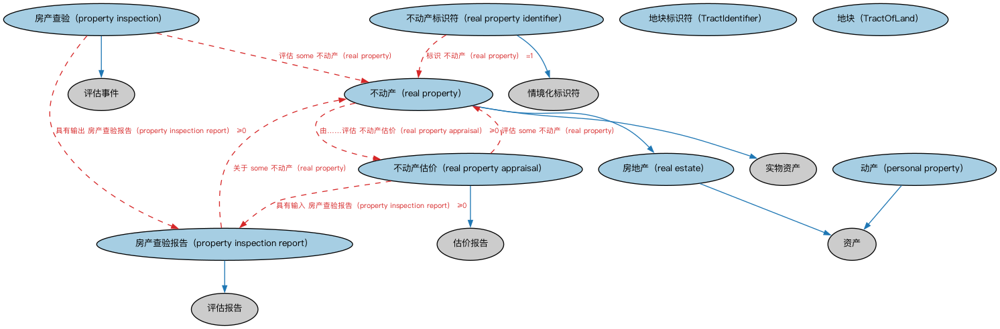

# 不动产本体（Real Property Ontology）结构与公理说明

本文档对应 `RealProperty.rdf` / `RealProperty.ttl`，说明该本体的类、继承关系、属性和公理约定。结构图见 `RealProperty-structure.png`（`RealProperty-structure.svg` 为可缩放版本）。

## 1. 本体概述

定义不动产（real property）：土地及附着其上的建筑物，及其与地点、所有权的关系。

**在体系中的位置**：FND 地点模块中与金融最相关的本体，支撑抵押贷款、房地产金融。

**上下游关系**：上游依赖地点、地址与所有权本体；下游被 LOAN 抵押贷款（抵押物）、房地产贷款各本体引用。

**与相近概念的差别**：不动产≠房产本身——不动产强调「土地＋附着物＋权利束」的法律概念；与动产的差别——能否移动、登记制度不同。

## 2. 类（Class）

| 类（Class） | 定义（Definition） |
|---|---|
| 地块标识符（TractIdentifier） | 在某管辖区签发使用的地块唯一标识符。 |
| 地块（TractOfLand） | 地球表面较大区域内一块连续的土地，通常按契约、勘测或法律文件所述边界界定。 |
| 动产（personal property） | 不附着于土地的可移动物品或财物类资产。 |
| 房产查验（property inspection） | 涉及分析不动产一个或多个方面的事件。 |
| 房产查验报告（property inspection report） | 涵盖房产查验结果的报告。 |
| 房地产（real estate） | 不动产、不动产抵押权益（包括土地租赁权及其上建筑物的抵押权益）以及相关股份。 |
| 不动产（real property） | 定义为土地连同永久附着于该土地的任何构筑物（如房屋、树木、围栏和改良物）的实物资产。 |
| 不动产估价（real property appraisal） | 估计某不动产价值金额的价值评估。 |
| 不动产标识符（real property identifier） | 在某管辖区用于标识特定不动产的唯一标识符。 |

### 2.1 继承关系（Inheritance）

- 动产（personal property） ⊑ 资产
- 房产查验（property inspection） ⊑ 评估事件
- 房产查验报告（property inspection report） ⊑ 评估报告
- 房地产（real estate） ⊑ 资产
- 不动产（real property） ⊑ 实物资产
- 不动产（real property） ⊑ 房地产（real estate）
- 不动产估价（real property appraisal） ⊑ 估价报告
- 不动产标识符（real property identifier） ⊑ 情境化标识符

## 5. 公理约定（Axioms）

- 动产（personal property）：由……评估 估价报告 ≥0
- 动产（personal property） 与 不动产（real property） 互斥（disjointWith）
- 房产查验（property inspection）：具有输出 房产查验报告（property inspection report） ≥0
- 房产查验（property inspection）：评估 some 不动产（real property）
- 房产查验报告（property inspection report）：关于 some 不动产（real property）
- 不动产（real property）：由……评估 不动产估价（real property appraisal） ≥0
- 不动产估价（real property appraisal）：具有输入 房产查验报告（property inspection report） ≥0
- 不动产估价（real property appraisal）：评估 some 不动产（real property）
- 不动产估价（real property appraisal）：由……提供 some 估价师
- 不动产标识符（real property identifier）：适用于情境 管辖权 ≥0
- 不动产标识符（real property identifier）：标识 不动产（real property） =1

## 6. 依赖（owl:imports，17 个）

本本体通过 `owl:imports` 引入以下本体，各项的中文名称与简介如下：

| 导入本体 | 中文名称 | 简介 |
|---|---|---|
| `FND/Arrangements/Assessments.rdf` | 评估本体（Assessments Ontology） | 定义评估活动、评估结果与评估方的通用结构，为信用评级、风险打分等判断性活动提供基础模型。 |
| `FND/DatesAndTimes/Occurrences.rdf` | 事件与发生本体（Occurrences Ontology） | 定义「发生」（occurrence）、事件与触发条件，用于表达企业行动、信用事件等「发生了什么」。 |
| `FND/OwnershipAndControl/Ownership.rdf` | 所有权本体（Ownership Ontology） | 定义「拥有」关系：所有者、被拥有资产及所有权份额。 |
| `FND/Places/Addresses.rdf` | 地址本体（Addresses Ontology） | 定义邮政地址及其组成部分，为机构注册地、通讯地址建模。 |
| `FND/Relations/Relations.rdf` | 关系本体（Relations Ontology） | FIBO 最底层的基础本体，定义参考（reference）、分类（classify）等通用关系与抽象概念，全库普遍依赖。 |
| `FND/Utilities/AnnotationVocabulary.rdf` | FIBO 标注词汇表（FIBO Annotation Vocabulary） | 定义 FIBO 专用的标注属性（如释义来源、成熟度等级），用于本体自身的元数据标注。 |
| `https://www.omg.org/spec/Commons/AnnotationVocabulary/` | OMG 通用标注词汇表（OMG Commons Annotation Vocabulary） | OMG 通用本体库（Commons）中的标注词汇表，提供概念映射等标注属性，FIBO 用它标注术语与外部标准的对应关系。 |
| `https://www.omg.org/spec/Commons/Collections/` | OMG 通用集合本体（OMG Commons Collections） | Commons 库中的集合本体，定义集合、成员等通用概念。 |
| `https://www.omg.org/spec/Commons/ContextualDesignators/` | OMG 通用语境指称本体（OMG Commons Contextual Designators） | Commons 库中的语境指称本体，定义「在某个语境下指代某物的名称/符号」，是地址、账户号码等语境相关标识的基础。 |
| `https://www.omg.org/spec/Commons/ContextualIdentifiers/` | OMG 通用语境标识符本体（OMG Commons Contextual Identifiers） | Commons 库中的语境标识符本体，定义在特定语境下唯一标识事物的标识符结构，是地址、账户类标识的基础。 |
| `https://www.omg.org/spec/Commons/Documents/` | OMG 通用文档本体（OMG Commons Documents） | Commons 库中的文档本体，定义文档及其组成部分的通用概念。 |
| `https://www.omg.org/spec/Commons/Identifiers/` | OMG 通用标识符本体（OMG Commons Identifiers） | Commons 库中的标识符本体，定义标识符及其编码方案的通用概念。 |
| `https://www.omg.org/spec/Commons/Locations/` | OMG 通用位置本体（OMG Commons Locations） | Commons 库中的位置本体，定义地理位置、地点的通用概念。 |
| `https://www.omg.org/spec/Commons/Organizations/` | OMG 通用组织本体（OMG Commons Organizations） | Commons 库中的组织本体，定义组织、组织成员与组织结构的通用概念。 |
| `https://www.omg.org/spec/Commons/PartiesAndSituations/` | OMG 通用参与方与情境本体（OMG Commons Parties and Situations） | Commons 库中的参与方本体，定义独立主体、参与方及其角色扮演的通用概念，是 FIBO 参与方模型的上游。 |
| `https://www.omg.org/spec/Commons/RegulatoryAgencies/` | OMG 通用监管机构本体（OMG Commons Regulatory Agencies） | Commons 库中的监管机构本体，定义监管机构及其监管职权的通用概念。 |
| `https://www.omg.org/spec/Commons/SitesAndFacilities/` | OMG 通用场所与设施本体（OMG Commons Sites and Facilities） | Commons 库中的场所与设施本体，定义物理场所、设施及其位置的通用概念。 |

## 7. 文件

- 官方 RDF/XML：`RealProperty.rdf`
- 中文 Turtle：`RealProperty.ttl`
- 结构图：`RealProperty-structure.png` / `RealProperty-structure.svg`