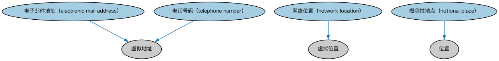

# 虚拟地点本体（Virtual Places Ontology）结构与公理说明

本文档对应 `VirtualPlaces.rdf` / `VirtualPlaces.ttl`，说明该本体的类、继承关系、属性和公理约定。结构图见 `VirtualPlaces-structure.png`（`VirtualPlaces-structure.svg` 为可缩放版本）。

## 1. 本体概述

本本体为描述虚拟位置概念提供脚手架。

本本体中类与类的核心关系如下（完整细节见各类小节）：

- **电子邮件地址（electronic mail address）** 继承 **虚拟地址（VirtualAddress）**
- **网络位置（network location）** 继承 **虚拟位置（VirtualLocation）**
- **概念性地点（notional place）** 继承 **位置（Location）**
- **电话号码（telephone number）** 继承 **虚拟地址（VirtualAddress）**

## 2. 类（Class）

| 类（Class） | 定义（Definition） |
|---|---|
| 电子邮件地址（electronic mail address） | 定义电子邮件消息可投递到的电子消息端点的虚拟地址，通常通过基于简单邮件传输协议（SMTP）的通信系统投递。 virtual address that defines an electronic messaging endpoint to which email messages can be delivered, typically via an Simple Mail Transfer Protocol (SMTP) based communications system |
| 网络位置（network location） | 可由网络地址（节点或接口的标识符）标识的虚拟位置。 a virtual location that may be identified by a network address (an identifier for a node or interface) |
| 概念性地点（notional place） | 一种抽象地点，是“国内”“欧元区”等众多常见概念之一。 an abstract place; one of many commonly understood concepts such as domestic, Eurozone etc. |
| 电话号码（telephone number） | 可分配给固定电话用户台、无线电子电话设备或其他通过公共交换电话网传输数据的设备的虚拟地址。 virtual address that may be assigned to a fixed-line telephone subscriber station connected to a telephone line or to a wireless electronic telephony device, such as a radio telephone or a mobile telephone, or to other devices or services for data transmission via the public switched telephone network (PSTN) or other public and private networks |

以下按类逐个展开：每个类给出继承关系、相关属性与公理约定；子类在父类之下降一级编号。

### 2.1 电子邮件地址（electronic mail address）

定义：定义电子邮件消息可投递到的电子消息端点的虚拟地址，通常通过基于简单邮件传输协议（SMTP）的通信系统投递。

- 父类：**虚拟地址（VirtualAddress）**

### 2.2 网络位置（network location）

定义：可由网络地址（节点或接口的标识符）标识的虚拟位置。

- 父类：**虚拟位置（VirtualLocation）**

属性：

| 属性 | 定义 | 说明 |
|---|---|---|
| **由……标识（isIdentifiedBy）** | — | — |

公理：

- **由……标识（isIdentifiedBy）**恰好有 1 个**地址（Address）**。

### 2.3 概念性地点（notional place）

定义：一种抽象地点，是“国内”“欧元区”等众多常见概念之一。

- 父类：**位置（Location）**

### 2.4 电话号码（telephone number）

定义：可分配给固定电话用户台、无线电子电话设备或其他通过公共交换电话网传输数据的设备的虚拟地址。

- 父类：**虚拟地址（VirtualAddress）**

## 3. 其他属性

以下属性未绑定到本体的具体类（定义域在外部本体或未声明）：

对象属性（Object Property）：

| 属性 | 定义 | 说明 |
|---|---|---|
| **具有电子邮件地址（has electronic mail address）** | 指定某实体可被定位、联系或接收信件的电子消息端点。 specifies an electronic messaging endpoint at which some entity may be located or contacted or may receive correspondence | 值域：电子邮件地址（electronic mail address）；子属性：具有地址 |
| **具有电话号码（has telephone number）** | 指示由数字和符号序列组成的虚拟地址，可分配给固定电话用户台或无线电子电话设备等。 indicates a virtual address composed of a sequence of digits and symbols that may be assigned to a fixed-line telephone subscriber station, a wireless electronic telephony device, such as a radio telephone or a mobile telephone, or other similar device or service | 值域：电话号码（telephone number）；子属性：具有地址 |

## 4. 依赖（owl:imports，6 个）

本本体通过 `owl:imports` 引入以下本体，各项的中文名称与简介如下：

| 导入本体 | 中文名称 | 简介 |
|---|---|---|
| `FND/Places/Addresses.rdf` | 地址本体（Addresses Ontology） | 定义邮政地址及其组成部分，为机构注册地、通讯地址建模。 |
| `FND/Utilities/AnnotationVocabulary.rdf` | FIBO 标注词汇表（FIBO Annotation Vocabulary） | 定义 FIBO 专用的标注属性（如释义来源、成熟度等级），用于本体自身的元数据标注。 |
| `https://www.omg.org/spec/Commons/AnnotationVocabulary/` | OMG 通用标注词汇表（OMG Commons Annotation Vocabulary） | OMG 通用本体库（Commons）中的标注词汇表，提供概念映射等标注属性，FIBO 用它标注术语与外部标准的对应关系。 |
| `https://www.omg.org/spec/Commons/Identifiers/` | OMG 通用标识符本体（OMG Commons Identifiers） | Commons 库中的标识符本体，定义标识符及其编码方案的通用概念。 |
| `https://www.omg.org/spec/Commons/Locations/` | OMG 通用位置本体（OMG Commons Locations） | Commons 库中的位置本体，定义地理位置、地点的通用概念。 |
| `https://www.omg.org/spec/Commons/Organizations/` | OMG 通用组织本体（OMG Commons Organizations） | Commons 库中的组织本体，定义组织、组织成员与组织结构的通用概念。 |

## 5. 文件

- 官方 RDF/XML：`VirtualPlaces.rdf`
- 中文 Turtle：`VirtualPlaces.ttl`
- 结构图：`VirtualPlaces-structure.png` / `VirtualPlaces-structure.svg`