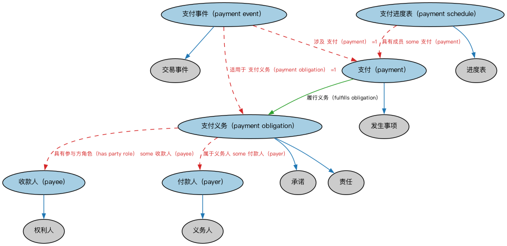

# 付款与计划表本体（Payments and Schedules Ontology）结构与公理说明

本文档对应 `PaymentsAndSchedules.rdf` / `PaymentsAndSchedules.ttl`，说明该本体的类、继承关系、属性和公理约定。结构图见 `PaymentsAndSchedules-structure.png`（`PaymentsAndSchedules-structure.svg` 为可缩放版本）。

## 1. 本体概述

定义付款（payment）与付款计划表（payment schedule）：一系列按日期与金额安排的付款义务。

**在体系中的位置**：FND 产品与服务模块的两个核心之一，是贷款还款表、债券付息表、租金计划的基础。

**上下游关系**：上游依赖货币金额与金融日期本体；下游被 LOAN、SEC 债务、衍生品现金流引用。

**与相近概念的差别**：计划表≠实际付款——计划表是约定的付款安排（应付），付款是实际发生的资金转移（实付）；逾期分析就是两者对照。

## 2. 类（Class）

| 类（Class） | 定义（Definition） |
|---|---|
| 收款人（payee） | 债务应支付给的一方，或汇票、本票、支票的指定受款人，或收到或将收到付款的一方。 |
| 付款人（payer） | 支付账单或费用、或为部分或全部履行义务而向收款人付款的一方。 |
| 支付（payment） | 为履行义务（如清偿请求权或债务）而交付货币。 |
| 支付事件（payment event） | 涉及为履行义务而交付货币的事件。 |
| 支付义务（payment obligation） | 按合同所载条款支付一定金额的可法律强制执行的责任。 |
| 支付进度表（payment schedule） | 为履行义务而交付货币的进度表。 |

### 2.1 继承关系（Inheritance）

- 收款人（payee） ⊑ 权利人
- 付款人（payer） ⊑ 义务人
- 支付（payment） ⊑ 发生事项
- 支付事件（payment event） ⊑ 交易事件
- 支付义务（payment obligation） ⊑ 承诺
- 支付义务（payment obligation） ⊑ 责任
- 支付进度表（payment schedule） ⊑ 进度表

## 3. 对象属性（Object Property）

| 属性（Property） | 中文（English） | 定义（Definition） | 说明 |
|---|---|---|---|
| fibo-fnd-pas-psch:fulfillsObligation | 履行义务（fulfills obligation） | 满足某项请求权、债务或其他义务的支付要求。 | 定义域（domain）：支付（payment）；值域（range）：支付义务（payment obligation） |
| fibo-fnd-pas-psch:hasPaymentAmount | 具有支付金额（has payment amount） | 指明支付所涉及的货币金额。 | 定义域（domain）：支付（payment）；值域（range）：货币数量；子属性（subPropertyOf）：具有货币数量 |
| fibo-fnd-pas-psch:hasPaymentSchedule | 具有支付进度表（has payment schedule） | 指明履行义务的进度表。 | 值域（range）：支付进度表（payment schedule）；子属性（subPropertyOf）：具有进度表 |

## 5. 公理约定（Axioms）

- 收款人（payee）：由…扮演（is played by） some（是…的参与方（is a party to） some 支付义务（payment obligation））
- 付款人（payer）：具有义务 only 支付义务（payment obligation）
- 支付（payment）：具有支付金额（has payment amount） some 货币数量
- 支付事件（payment event）：涉及 支付（payment） =1
- 支付事件（payment event）：适用于 支付义务（payment obligation） =1
- 支付义务（payment obligation）：由……授予 only 合同
- 支付义务（payment obligation）：属于义务人 some 付款人（payer）
- 支付义务（payment obligation）：具有参与方角色（has party role） some 收款人（payee）
- 支付进度表（payment schedule）：具有成员 some 支付（payment）

## 6. 依赖（owl:imports，14 个）

本本体通过 `owl:imports` 引入以下本体，各项的中文名称与简介如下：

| 导入本体 | 中文名称 | 简介 |
|---|---|---|
| `FND/Accounting/CurrencyAmount.rdf` | 货币金额本体（Currency Amount Ontology） | 定义「金额＋币种」的货币金额（currency amount）表示，是 FIBO 中表达价格、债务金额、付款额等一切带币种数值的基础构件。 |
| `FND/Agreements/Agreements.rdf` | 协议本体（Agreements Ontology） | 定义两个或以上参与方之间协议（agreement）的通用概念：协议的当事方、条款、生效与终止，是合同等一切契约性安排的上位模型。 |
| `FND/Agreements/Contracts.rdf` | 合同本体（Contracts Ontology） | 在协议之上定义具有法律约束力的合同（contract）：合同当事方、合同条款、义务与权利，是金融工具与交易合同建模的基石。 |
| `FND/DatesAndTimes/FinancialDates.rdf` | 金融日期本体（Financial Dates Ontology） | 定义金融语境下的日期与期间概念：结算日、付息日、到期日、日计数基准等。 |
| `FND/DatesAndTimes/Occurrences.rdf` | 事件与发生本体（Occurrences Ontology） | 定义「发生」（occurrence）、事件与触发条件，用于表达企业行动、信用事件等「发生了什么」。 |
| `FND/Law/LegalCapacity.rdf` | 法律能力本体（Legal Capacity Ontology） | 定义法律能力、缔约能力、签章权等概念，刻画主体从事法律行为的资格。 |
| `FND/ProductsAndServices/ProductsAndServices.rdf` | 产品与服务本体（Products and Services Ontology） | 定义产品、服务及其提供者与客户的通用关系。 |
| `FND/Relations/Relations.rdf` | 关系本体（Relations Ontology） | FIBO 最底层的基础本体，定义参考（reference）、分类（classify）等通用关系与抽象概念，全库普遍依赖。 |
| `FND/Utilities/AnnotationVocabulary.rdf` | FIBO 标注词汇表（FIBO Annotation Vocabulary） | 定义 FIBO 专用的标注属性（如释义来源、成熟度等级），用于本体自身的元数据标注。 |
| `https://www.omg.org/spec/Commons/AnnotationVocabulary/` | OMG 通用标注词汇表（OMG Commons Annotation Vocabulary） | OMG 通用本体库（Commons）中的标注词汇表，提供概念映射等标注属性，FIBO 用它标注术语与外部标准的对应关系。 |
| `https://www.omg.org/spec/Commons/Collections/` | OMG 通用集合本体（OMG Commons Collections） | Commons 库中的集合本体，定义集合、成员等通用概念。 |
| `https://www.omg.org/spec/Commons/ContextualDesignators/` | OMG 通用语境指称本体（OMG Commons Contextual Designators） | Commons 库中的语境指称本体，定义「在某个语境下指代某物的名称/符号」，是地址、账户号码等语境相关标识的基础。 |
| `https://www.omg.org/spec/Commons/PartiesAndSituations/` | OMG 通用参与方与情境本体（OMG Commons Parties and Situations） | Commons 库中的参与方本体，定义独立主体、参与方及其角色扮演的通用概念，是 FIBO 参与方模型的上游。 |
| `https://www.omg.org/spec/Commons/RolesAndCompositions/` | OMG 通用角色与构成本体（OMG Commons Roles and Compositions） | Commons 库中的角色本体，定义角色及整体—部分构成关系的通用概念。 |

## 7. 文件

- 官方 RDF/XML：`PaymentsAndSchedules.rdf`
- 中文 Turtle：`PaymentsAndSchedules.ttl`
- 结构图：`PaymentsAndSchedules-structure.png` / `PaymentsAndSchedules-structure.svg`